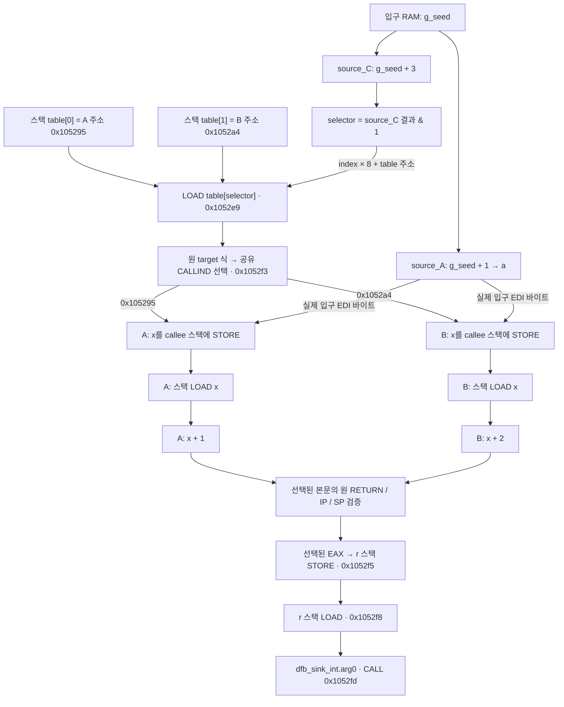

# 함수 간 설계: 요약 기반 (2026-10-07, Fable 검토 반영)

**현재 상태 (2026-10-25): 연산식 계층의 1차 개발은 완료다.** 지원 계약·제한·완료 근거와 선택적 확장은
[§25.58](#2558-연산식-1차-개발-완료와-지원-계약-2026-10-25)에 모았다. 확인된 1차 필수 잔여 항목은 없으며,
범위 밖 기능을 자동으로 다음 필수 작업에 추가하지 않는다. 이 선언은 프로젝트 전체의 모든 분석 문제를 해결했다는 뜻이 아니다.
이 문서는 누적 설계 기록이다. 각 절의 "현재/다음/미구현"은 해당 절 작성 당시를 뜻하며, 특히 §25.36·§25.54의
연산식 개발 계획은 역사적 기록이다. 현재 연산식 범위 판정에는 §25.58과 그 절이 연결하는 구현 결과를 우선한다.

배경: `docs/interprocedural_investigation.md` — 기존 계층은 루트마다 재전개(요약·memo 없음), 평가 시점 없는
PointerPath(무한 루프), 재귀 미지원. 새 설계는 **완성된 intra 그래프에서 함수 요약을 bottom-up으로 만들고
호출 지점에서 물리 바이트로 인스턴스화**한다(Sharir–Pnueli functional approach: 데이터 의존에 대해 완전 문맥 민감).

원칙(유지): 놓치지 않는다(모르면 부채/불완전), 호출 규약 비가정, 선언(가정)과 증명을 결과에서 구분.

현재 안전 경계: §25.63은 과거 절의 fresh/nonstack **포인터 출처만으로 객체 전체를 분리하던 설명과 완전성 기대를
대체**한다. 과거 회귀 통과 기록은 당시 동결본의 기록이지 이후 발견된 범위 밖 접근 결함이 없었다는 증명이 아니다.

## 1. 함수 요약 (`FunctionSummary`)

끝 상태(`observed_terminal_states`)의 **모든 바이트 run**을 넷 중 하나로 분류한다(exit별, 그 뒤 합침).

| 분류 | 의미 | 비고 |
|---|---|---|
| `IDENTITY(src)` | 끝 값 = 입구 바이트 src의 값 그대로 | ENTRY 정의뿐 아니라 push/pop 복원 포함. 판정기 = `configured_call_clobber_discharge._callee_preserves` 승격. src가 같은 위치면 preserved. swap은 교차 IDENTITY |
| `AFFINE(src, c)` | SP 전용: 끝 SP = SP_entry + c | `relative_memory` 주소식으로 c 계산. stdcall `ret imm16` 지원 필수(`may_alias._return_shape` 는 미지원) |
| `COMPUTED(deps, origins, debts, control_deps)` | 끝 정의 → ENTRY 역추적 입구 바이트 집합 + 내부 source 라벨 + 도달 부채 종류 + 제어 의존 입력(별도) | 기본 데이터 전용 결과 불변 |
| `UNKNOWN(reason)` | unresolved write, 대상 미상 CALLIND/CALLOTHER/외부 호출 이후 | 현재 call_clobber 부채와 같은 의미 |

유도: must-write(모든 exit에서 IDENTITY 아님) / may-write / preserved(모든 exit에서 같은 위치 IDENTITY).

추가 처리:
- callee 프레임 쓰기(SP_entry 아래): caller 스택 (token + 음수 오프셋)으로 may-write. 프레임 바닥 아래는
  하나의 추상 원소 `below_frame` 으로 접음(재귀 종료성).
- 복귀 주소 읽기(`call next; pop ebx`): `*(SP_entry)` = caller의 transient push 상수(`ObservedCallStateProjection.transient_coordinate`).
- 메모리로 전달된 포인터(32비트 스택 인자 등): 앵커 `ENTRY(*(SP_entry+4))` 를 호출 지점에서 caller 도달 정의로 **한 번** 평가.
- 꼬리 호출 exit: 1단계는 UNKNOWN exit(부채). 이후 "지점 상태 ∘ 대상 요약" 합성.
- 비반환 callee: 호출 뒤 상태 bottom, kill 없음, `no_return`.
- CALLIND·외부 import: UNKNOWN. 외부 선언 모델은 **가정 라벨**(TEST-ONLY 모드와 같은 등급). varargs 특별 처리 없음.

## 2. 호출 지점 결합 (`bind_call_site`)

- caller 레지스터 바이트(호출 시점) = callee 입구 레지스터 바이트.
- callee 입구 SP = caller의 반환주소 push 후 SP(`observed_call_state` 토큰).
- callee 상대 객체(입구 원자 앵커) → 호출 지점에서 그 원자의 caller 값을 `relative_memory` 주소식 평가기로 한 번
  평가(caller 상대 객체 / 스택 슬롯 / 전역 / 미상→부채). 앵커 깊이 상한 k(예: 4) 초과 → 부채. **while 재대입 없음**.
- 같은 caller 객체가 두 인자로 넘어오면(경계 별칭) 해당 IDENTITY run을 may-write + 양쪽 의존으로 내림.

## 3. caller 그래프 통합 (CFL 질의 계층 대신 물질화)

- 호출 c의 쓰기 run마다 노드 `call_def:{c}:{run}`(NodeKind `CALL_EFFECT`).
  간선: 의존 입구 바이트의 caller 도달 정의 → call_def(`summary_transfer`), callee source 라벨 → call_def
  (`summary_origin`, 라벨 `source:X@callee`), UNKNOWN → 이유별 부채 노드.
- 메모리 SSA: 호출을 writer로. must-write = DATA_WRITE(strong kill), may-write = DATA_WRITE + 호출 전 정의에서
  call_def로 간선 하나 더(약한 갱신을 출처 관점에서 등가 표현).
- call_clobber: `_State.called(key, preserved)` 에 preserved ∪ 쓰기 집합 → UNKNOWN 바이트만 부채.
- 진입점: `normalize(assumed_call_effects=…)` 훅을 `EvidencedCallEffect`(provenance: declared | proven)로 일반화.
- 골든: intra 모드 v2 유지, 함수 간 모드 골든 v3 별도(모드 플래그).

## 4. 재귀

- SCC 단위. must-facts(GFP: 요약 가정 → 본문 재확인; 반환하는 실행의 호출 깊이 귀납으로 건전) 먼저,
  그 결과를 kill로 써서 may-facts(LFP).
- 활성화 프레임은 SP_entry 상대 + token으로 자연 분리.
- 종료성 widening 2개: callee 프레임 may-write → `below_frame`; 앵커 경로 깊이 k 초과 → 미상 포인터 객체 부채.
- 함수 포인터 재귀: CALLIND 미상 → UNKNOWN(건전).
- 판본: v1 SCC 내부 간선을 UNKNOWN 호출로(모두 종료, 출처 정확·불완전) → v2 LFP + widening → v3 GFP must.

## 5. 검증

- 인터프리터 확장: Bundle 안 callee로 실제 call/return(공유 메모리), 외부·미상만 havoc. 교차 호출 동적 의존이
  caller 그래프의 역경로인지 확인.
- S0용: 활성화 provenance(활성화 안에서 바이트별 전이 의존) → "동적 요약 ⊆ 정적 요약".
- 지표: 기존 + "SP 미상 호출 수", 부채 이유별 히스토그램. 함수 간 검증은 **내부 helper 호출**에서
  (source/sink는 외부라 기본 모드 확실은 선언 모델 없이는 불가 — 지표는 가정 모드 + 함수 간 모드로 읽음).

## 6. 단계 계획

| 단계 | 내용 | 완료 기준 |
|---|---|---|
| S0 요약 추출 | `FunctionSummary`, intra 그래프에서만, caller 불변, 덤프 도구 | 동적 요약 ⊆ 정적 요약, corpus/09/10/zlib 위반 0 |
| S1 잎 callee 직접 호출 | call_def 물질화, EvidencedCallEffect, call_clobber 보존 구간, may-write; 인터프리터 1단계 실제 호출 | DFB050/052/054/056~059/066/151/152/021~023 출처 정확, 누락 0, 가정 모드 확실 |
| S2 중첩·SP | bottom-up, DFB051/053/055, SP AFFINE(stdcall), 32비트 스택 인자, 내부 외부호출 부채 전파 | win32·ELF x86 Bundle 종료, 누락 0, SP 미상 호출 0(09) |
| S3 문맥 민감 부채 해소 | 사상 객체로 callee may_alias 해소, 메모리 내 포인터 앵커, 깊이 상한 | 09 비재귀 케이스 효과적 정확+확실 |
| S4 규모 | UE DLL·zlib·코퍼스, 예산(요약 시간 ≤ intra 정규화), CALLIND·import UNKNOWN 집계 | 전 Bundle 시간 상한 내 종료, 누락 0, 부채 히스토그램 |
| S5 재귀 | v1 → v2 → v3 | DFB060~065 종료·출처 정확, v2에서 확실 |
| S6 설명·골든 | proof 체인, 골든 v3 | 골든 compare 0 |

## 7. 재사용 / 재작성

- 재사용: `observed_call_state`(토큰·transient), `PhysicalMemoryTransition`, `_callee_preserves`(→ IDENTITY 판정),
  `DischargeKind` 4종(요약 분류로 흡수), `_function_relative_object_id`, relative_memory 주소식 평가기(공개화),
  `recursive_frame_inventory` 의 call token, Bundle/session/`_cyclic_nodes`.
- 재작성: `configured_write_event_engine`, `configured_origin_projection`, `configured_function_memory`(PointerPath),
  `configured_boundary_mapping`(→ `bind_call_site`), `configured_interprocedural_slice` 완성 경로.
- 보류: finite-context·recursive_* z3 모듈(엔진 미연결, 테스트 0), path_explanation은 S6에서 proof 체인 기반으로 축소.

## 8. S0 결과 (2026-10-07): 함수 요약 추출

- 구현: `src/tdo_v2/function_summary.py` (`summarize_function(normalized, observation)`), caller 불변.
  - 끝 상태 run마다 IDENTITY / COMPUTED / UNKNOWN (AFFINE은 S2). 건드리지 않은 바이트는 요약에 없음 = 보존.
  - 출처·entry 메모리 읽기 연산·부채: 그래프 조상 폐포를 한 번에 계산(`_AncestorClosure`, SCC 묶음 DP) —
    정의별 역추적과 결과 동일(무작위 500 함수), inflate 46초 → 0.3초.
  - 끝에서 지나간 호출·별칭 쓰기·주소 미상 쓰기: 끝 블록에서 거꾸로 걸으며 kill에서 멈추는 탐색
    (`_live_gens_at_exit`) — 고정점 solver와 결과 동일(무작위 600 함수).
  - 주소가 불확실한 쓰기(주소 피연산자가 부채 있는 읽기에 의존)는 어디든 쓸 수 있음 → `unknown_writers`,
    그 쓰기가 정의한 run은 UNKNOWN(이전 값이 남을 수 있음).
  - 꼬리 점프 출구(조건부 포함)는 `tail_exits`(S0에서는 호출자가 UNKNOWN으로 취급).
- 검증: 인터프리터에 바이트별 provenance(입구 레지스터 / 입구 메모리를 읽은 연산 / 호출) 추가,
  `tests/intra/summary_oracle.py` 가 "동적 ⊆ 정적" 검사(호출의 반환주소 push는 죽은 스택이라 제외).
  - 무작위 1,000 함수(실행 4,891회, 바이트 31만) 위반 0. 틀린 요약 4종(출처 삭제·거짓 IDENTITY·호출 숨김·
    쓰기 누락) 모두 검출. 테스트 `tests/intra/test_function_summary.py`.
  - 실제 Bundle 전체(코퍼스 7, 09 3, UE 6, zlib; 도구 `tools/graph_fidelity/measure_summary.py`) 위반 0.
    요약 시간: inflate 1.2초, zlib 전체 2.9초.
- S0에서 고친 검사 함정: JOIN을 거쳐 entry 메모리를 읽는 연산도 entry 읽기로 집계.
- 남은 것(S1~): push/pop 복원의 IDENTITY 판정, SP AFFINE, callee 프레임 쓰기(`below_frame`), 꼬리 호출 합성.

## 9. S1a 결과 (2026-10-07): 레지스터 효과 연결

- `src/tdo_v2/call_summary_effects.py`: 피호출자 요약 → 호출 지점의 `ProvenCallEffect`(레지스터만).
  쓰기 run 묶음별 (쓰는 바이트, 의존 바이트); 어떤 exit에서 그대로면 자기 자신도 의존(약한 갱신);
  UNKNOWN·부채·피호출자 입구 메모리 의존 → 증명 안 함(부채 유지). 꼬리 출구·정상 출구 없음 → 전체 미증명.
  피호출자가 직접 건드리지 않은 레지스터도 **내부 호출이 보존을 보장하지 않으면** 미증명
  (`FunctionSummary.inner_calls`).
- `normalize(proven_call_effects=…)`: 호출 직전에 2단계 효과 — 각 run의 입력을 호출 지역 임시값으로 모은 뒤
  (`~in<i>`) 출력 쓰기(`~<i>`). 한 단계로 하면 뒤 run이 앞 run의 쓰기를 읽는 오류(실제로 발견). call_clobber는
  증명된 보존 범위(쓰기 포함)를 그 호출의 보존으로 사용.
- `src/tdo_v2/interprocedural.py` `analyze_units`: 호출 그래프 SCC를 피호출자 먼저 처리, 같은 SCC 안의 호출
  (재귀)은 불투명 유지(S5).
- 검증기: 인터프리터 program 모드(Bundle 안 함수 실제 호출/반환, call 명령 시작부터 활성화로 취급, 활성화 안
  쓰기는 바깥 호출에 귀속하고 호출자 입력 출처를 기록, 반환 후 SP가 호출 전 값이면 정의 복원),
  `tests/intra/program_oracle.py`(호출을 거친 값의 호출자 입력까지 역추적 도달 확인).
  - 무작위 3단(호출자→중간→말단) 프로그램 160개: 호출 372개 모두 증명, 호출 경유 의존 3,837건, 누락 0.
  - 실제 Bundle(누락 0 전부): 09 debug 내부 호출 202/203 증명·경유 8,192건, release 111/113, win32 152/156
    (0.9초), UE DLL 108/116(3.7초)·206/218(8.8초), zlib 45/83. 이전 계층에서 끝나지 않던 win32·UE가 수 초에 끝남.
  - 골든 v2(함수 내부) 0 차이, 테스트 Win 179 / WSL 180.
- 가정(명시): 호출 모양은 피호출자가 SP를 복원한다고 가정(기존 엔진과 동일). 무작위 피호출자는 스택 균형으로
  생성 — SP 요약 검사는 S2.
- 남은 것: S1b 포인터·출력 인자 메모리 결합, S1c 엔진 연결과 09 케이스 지표(origin 라벨 전달).

## 10. S1b 결과 (2026-10-07): 포인터·출력 인자 메모리 결합

- 앵커: 피호출자의 FUNCTION_RELATIVE 객체 중 "입구 레지스터 값 하나 + 변위"인 것을 후보 레지스터(포인터 크기,
  메모리 공간별)의 객체 ID와 맞춰 찾음(`interprocedural._relative_anchors`). SP 앵커는 피호출자 프레임.
  전역(ADDRESS_SPACE)은 그대로. 앵커 없는 객체(메모리에서 읽은 포인터 등)에 쓰면 메모리 전체 부채.
- `call_summary_effects`: `ProvenMemoryRun`(앵커 쓰기 + 입력 레지스터·앵커 읽기), `loads`(피호출자 입구 메모리
  읽기), `preserves_memory`. 피호출자 자신이 내보내는 메모리 쓰기와의 별칭 때문에만 UNKNOWN인 run은 호출자의
  may-alias가 다루므로 계산값으로 취급. 내부 불투명 호출·주소 미상 쓰기·부채가 있으면 메모리 보존 아님.
- 정규화: `~ld<j>`(앵커 메모리 읽기) → `~in<i>`(입력 모음) → `~<i>`(출력). 앵커 주소는 relative_memory
  `project_anchored` 가 입력 모음 시점의 레지스터 값으로 **한 번** 평가(SP는 호출 모양의 push 크기만큼 보정).
  한 호출의 메모리 쓰기 둘이 호출자에서 같은 바이트에 겹치면(같은 객체를 두 인자로 넘김) 둘 다 미해결(부채).
- call_clobber: 메모리를 보존하는 증명된 호출은 메모리 바이트를 clobber하지 않음(dense: 메모리용 기본값 분리,
  sparse: 서명에 반영) — 두 엔진 동치 테스트 통과.
- 결과: 무작위 3단 프로그램 160개 메모리 run 160개, 메모리 보존 증명 241/372, 호출 경유 의존 4,607건, 누락 0.
  출력 인자(`*(rdi+8)=rsi`)·swap(x는 y의 옛 값만, 확실)·전역·스택 쓰는 피호출자·메모리에서 읽은 포인터(부채)·
  같은 객체 두 번(부채) 테스트. 실제 Bundle 누락 0, 호출 경유 의존: 09 debug 8,192→10,032, release 144→1,472,
  win32 352→1,704, UE Dev 112→688, DebugGame 84→796. 함수 내부 골든 v2 0 차이. 테스트 Win 184 / WSL 185.
- 한계(기록): 검증기의 메모리 경유 판정은 "그 호출의 메모리 run 중 하나에 도달"(동적 주소를 정적 객체로 사상하지
  않음) + 호출자 입력 도달 검사. 32비트 스택 인자(메모리 앵커)는 S2.

## 11. S1c 결과 (2026-10-07): 요약 엔진 경로와 케이스 지표

- `src/tdo_v2/summary_engine.py` `analyze_frozen_bundle_with_summaries`: 엔진의 루트별 함수 간 보완 대신
  하향식 요약 계층(`analyze_units`)으로 Bundle 전체를 정규화. `run_dfbench.py --summaries`
  (또는 `TDO_V2_INTERPROCEDURAL=summaries`).
  - origin: TEST-ONLY 선언 source 호출의 쓰기, Bundle 안 source 함수 호출의 run 출력(선택자 범위),
    피호출자 안에서 source에 닿은 run의 출력(요약이 `origins`로 전달).
  - sink: 엔진과 같은 방식(호출 지점·꼬리 호출). sink 래퍼·콜백 안의 sink는 그 함수의 루트(호출자로 요구 투영은 S2/S3).
- 요약 보강: 복사 사슬 IDENTITY(`_CopyTracer`, push/pop 보존 레지스터), `ProvenCallEffect.observes_registers`
  (받은 레지스터를 주소로 쓰지 않는 피호출자 → 그 호출에서 스택 포인터 복사가 탈출하지 않음).
- **스택 탈출을 위치별로**(`may_alias._Escape`): 함수 안 어디서든 탈출하면 함수 전체가 비공개가 아니던 규칙을
  "읽기: 입구→그 지점 경로에 탈출이 없으면 비공개, 쓰기: 그 지점→이후 경로에 탈출이 없으면 비공개"로.
  탈출 연산 자체와 그 호출의 요약 효과(`call~…`)는 탈출 쪽으로 취급. 옛 규칙 대비 행·작성자 **제거만**
  (전체 Bundle 비교, 추가 0). 함수 내부만으로는 거의 차이 없음(호출이 불투명하면 첫 호출에서 탈출) —
  효과는 요약 호출이 있을 때.
- **이름 붙은 가정 `globals-disjoint-from-stack`**(요약 엔진에서 **기본 켜짐** — 2026-10-07 사용자 결정;
  하위 API `normalize`/`analyze_units`는 기본 꺼짐): 상수 주소(전역)는 스택 객체(입구 SP 기준, 자기 프레임 +
  호출자 프레임)와 겹치지 않음. 포인터 기반 객체와 스택은 여전히 겹칠 수 있음.
  `stack_switches`: SP에 스택에서 유도되지 않은 값을 넣는 연산(`mov rsp,[x]` 등 — 파이버·코루틴 전환)이
  프로그램의 어느 함수에라도 있으면 가정을 프로그램 전체에서 철회(Bundle 안 함수만 보므로 Bundle 밖 전환
  코드는 못 봄). 적용 여부는 `NormalizedFunction.assumes_globals_disjoint_from_stack`, `EngineRun.assumptions`에
  기록, `run_dfbench` 출력에 "assumptions applied" 표시. 끄기: `run_dfbench --no-assume-globals-not-stack`
  또는 `TDO_V2_ASSUME_GLOBALS_NOT_STACK=0`(펌웨어·정적 버퍼 스택 등). 지표의 "확실"은 이 가정 아래에서 확실.
  검증(골든·동적 검증기)은 가정 없이도 계속 돌림.
- 케이스 지표(요약 엔진, 정확 / 정확+확실, 누락+확실은 모든 실행에서 0):

  | Bundle | 모드 | S1c 1부 | + 위치별 탈출 | + 전역·스택 가정 |
  |---|---|---|---|---|
  | 09 debug (61) | 기본 | 40 / 4 | 42 / 4 | **50 / 42** |
  | 09 debug | TEST-ONLY 가정 | 50 / 43 | 50 / 43 | 50 / 43 |
  | 09 release (51) | 기본 | — | 48 / 40 | 48 / 41 |
  | UE DLL Dev (22) | 기본 | — | 13 / 12 | 13 / 12 |
  | UE DLL DebugGame (22) | 기본 | — | 5 / 2 | 6 / 2 |

  09 debug 기본 모드가 가정을 켜면 TEST-ONLY 경계 가정과 거의 같아짐: 경계 함수가 Bundle 안에 있어 요약으로
  증명되고, 남던 원인이 "sink 안 전역 쓰기 ↔ 호출자 home space 재읽기" 별칭이었기 때문.
  (옛 엔진: 기본 39 / 28, 가정 53 / 41.)
- 남은 것(당시 기록 → 12절에서 처리): cpp_like source 라벨, 32비트 지표, sink 래퍼·콜백, 요약 `crossed`의 가정.
- 테스트: 위치별 탈출(탈출 전 읽기 비공개, 탈출 전 쓰기는 다른 기반에서 보임, 루프 뒤 탈출이 루프 머리에 영향),
  가정 켬/끔, 포인터는 여전히 별칭, 스택 전환 시 철회, 무작위 탈출 함수 400개 동적 검증기. 두 규칙을 일부러
  틀리게 바꾸면 손 테스트가 잡음(무작위 검증기는 못 잡음: 함수 안에서 실제 별칭은 주소 미상 접근으로만
  생기고 그건 항상 부채라서 — 위치별 규칙은 출처 추론의 안전장치).


## 12. S1c 3부 · S2 (2026-10-07): 나머지 정리 — Fable 검토 순서(A → C1 → B, C2/C3)

1. **불투명 source 호출 라벨**(`summary_engine.extra_origins`): source 호출이 증명되지 않았거나 상태 바이트를
   쓰는 run이 없으면, 그 호출을 이름에 담은 call-clobber 부채 노드(상태 레지스터 바이트를 읽는 것)에 라벨.
   부채라 루트는 "불확실"로 남음. cpp_like x64 기본 0/11 → P0 5/11, P1 7/11(source 함수가 Bundle 밖).
2. **요약 `crossed`에도 전역·스택 가정**(`function_summary._exit_crossings`, `may_alias.stack_object_of`):
   09 debug 기본 50/42 → 50/43(TEST-ONLY와 같음).
3. **sink 요구 투영(A)**: `FunctionSummary.sink_demands`(루트별 입구 바이트·부채·출처·완전성; 함수 안
   주소 미상 쓰기가 있으면 불완전) → `ProvenSinkDemand`(레지스터 + 앵커 메모리 `loads`; 앵커 없는 입구
   메모리는 불완전) → 정규화 `~sink<k>` 행(입력 모음, 출력 쓰기 전) → 호출자의 루트(`AnalyzedFunction.
   projected_sinks`, 피호출자 부분이 불완전하면 루트도 불완전). 같은 하향식 한 번에 중첩 래퍼까지 합성.
   정상 출구가 없는 래퍼도 sink 요구는 전달(`ProvenCallEffect` 상태 없이). 자기 sink의 상태가 그래프에 없으면
   호출 연산에 묶어 "묶이지 않은 루트"로 보고(조용히 사라지던 경로 제거). 앵커 후보에 요약 호출의 앵커
   레지스터 포함(포인터를 그대로 넘기는 함수). DFB055: 없음 → 정확(불확실: 디버그 home space 재읽기와
   포인터 쓰기의 별칭 — S3 문맥 해소 대상).
   검증: 인터프리터가 활성화 안 sink 호출 인자의 호출자 입력을 기록(`Run.sink_reads`), `program_oracle.
   check_sink_demands` — 투영 루트가 있어야 하고 그 입력에 도달해야 함. 무작위 래퍼 160개 누락 0, 메모리
   입력을 버리는 변형을 잡음.
4. **32비트 지표**(`run_dfbench`): PE32/ELF32 → `x86-32`(언어 x86:LE:32, source = EAX, sink = 호출 시점
   `[ESP+0]` 메모리 선택자; TEST-ONLY 가정은 메모리 상태를 모델링하지 않아 32비트 sink는 일반 호출).
   **앵커 변위 버그 수정**: 상대 객체 바이어스를 2^64로 고정 → 포인터 폭(2^32/2^64). 32비트 앵커 메모리가
   전부 부채로 남던 원인. win32 33/1 → 35/25.
5. **SP AFFINE(C1, 건전성)**: `FunctionSummary.register_deltas`(포인터 크기 레지스터의 끝 값 = 입구 + c,
   모든 exit 같은 c; 주소식 평가기 `relative_memory.register_value_deltas`), `ProvenCallEffect.restores_stack`
   (c == −push 변위일 때만). 아니면 그 호출의 SP 면제를 call_clobber·요약 crossing에서 제거 → 호출 뒤 SP
   읽기가 부채(조용한 오프셋 오류 방지). 요약 안 된 호출은 기존 호출 모양 규칙 그대로이며
   `EngineRun.assumptions`에 `opaque-callees-restore-stack-pointer`로 표시. 우리 Bundle에는 stdcall
   (`ret imm`)이 없어 지표 변화 없음. 무작위 비균형 피호출자 160개 누락 0, 복원을 항상 참으로 두는 변형을 잡음.
6. **꼬리 점프 합성(C3)**: 프로그램 함수로의 무조건 꼬리 `BRANCH`를 호출처럼 요약 효과로(`_direct_calls`),
   SP는 런에서 빼고 exit 델타에 대상의 c를 더함(`tail_stack`, `tail_stack_delta`), 합성된 꼬리는
   `tail_exits`가 아님. 레지스터를 하나도 쓰지 않는 썽크는 프로그램 레지스터 파일·레지스터 공간으로 대체.
   검증: 꼬리 테스트 + 무작위 160개(대상 비균형 포함) 누락 0, 대상 c를 무시하는 변형은 손 테스트가 잡음
   (무작위 검증기는 기록자 노드 도달만 보므로 SP 값 오차에 약함 — 기록).
7. **상수 대상 간접 호출(B, DFB073형)**: `COPY t ← r; CALLIND t`에서 r의 값이 주소식 평가로 상수이고 그
   값이 Bundle 함수 입구이며 그 COPY의 역방향 슬라이스에 부채가 없으면 직접 호출로. 분석 → 해소 →
   재분석을 해소 집합이 안정될 때까지(매 라운드 재확인; 안정 안 되면 해소 없이). 불투명 호출 뒤 재적재는
   해소 안 함(부채). DFB071(다른 함수가 전역에 등록한 콜백)은 보류.

케이스 지표(요약 엔진 기본 모드, 정확 / 정확+확실, 누락+확실 모든 실행 0):

| Bundle | 11절 끝 | 12절 끝 |
|---|---|---|
| 09 debug | 50 / 42 (61건) | **52 / 45** (63건; DFB055·DFB073 새로 잡힘) |
| 09 release | 48 / 41 (51건) | 49 / 42 (52건) |
| win32 release | 지표 없음 | **35 / 27** (46건) |
| cpp P0 / P1 x64 | 0 / 0, 0 / 0 | 5 / 0, 7 / 0 |
| cpp P0 / P1 x86 | 지표 없음 | 7 / 0, 6 / 0 |
| UE DLL Dev / DebugGame | 13 / 12, 6 / 2 | 13 / 12, 6 / 2 |

함수 내부 골든: v2 대비 차이는 (a) 위치별 탈출로 may-alias 행·작성자 제거(제거만, 전 Bundle 확인),
(b) 32비트 TEST-ONLY 규칙이 이제 적용됨(win32·cpp x86 가정 모드) — 둘 다 의도된 변화. 골든 **v3** 로 갱신.

남은 것: S3(문맥 민감 부채 해소: DFB055 home space 별칭 등), DFB071(전역 콜백), stdcall SP 보정 행(현재는
부채), 조건부 꼬리 점프, S5 재귀, UE DebugGame의 extra-only(14건) 원인 분석.

## 13. S3 (2026-10-07 밤): 호출 지점에서 별칭 조건 판정 (Fable 검토 반영)

- 문제: 디버그 빌드는 인자를 home space(호출자 프레임, 입구 SP 위)에 저장했다 다시 읽는다. 피호출자 안에서는
  포인터 쓰기(`v->x`)가 그 슬롯과 겹칠 수 있어 재읽기에 may-alias 부채 → 요약 run·sink 요구가 불확실/UNKNOWN.
  호출자는 두 주소를 다 안다(`&s`와 자기 SP 기준 슬롯).
- **조건부 부채**(`function_summary._alias_conditions`): 읽기 주소가 정확하고 모든 후보 작성자가 정확한 범위를
  쓰는 may-alias 부채는 라벨 대신 (읽기 범위, 쓰기 범위) 쌍 = "서로 안 겹치면 부채 없음". `_AncestorClosure`가
  5번째 성분으로 모음. 주소가 그 부채에 기대는 저장(`_uncertain_address_writers`)도 같은 조건으로.
- 전달: `SinkDemand.conditions`, `SummaryRun.conditions` → `ProvenSinkDemand/ProvenRunEffect/ProvenMemoryRun.
  conditions`(앵커 쌍; 한쪽이라도 앵커 없으면 불완전/unknown) → 정규화 `~ck<k>`(sink 요구)·`~cr<i>`(run) 행이
  앵커 레지스터를 읽음 → `interprocedural._decide_conditions`가 호출 시점 값으로 양쪽 위치를 한 번 계산:
  같은 객체면 겹침 여부, 다른 객체면 두 주소 공간 / 전역·스택(이름 붙은 가정)만 안 겹침, 그 밖(두 포인터)은
  sink 요구에선 호출자 객체의 조건으로 위로 전달, run에선 실패 처리.
- run 조건 실패 → 그 바이트 unknown(`failed_conditions`)으로 효과를 다시 만들고 함수를 다시 정규화(실패 집합은
  커지기만 함, 유한). 겹치는 배치에서는 한 호출의 두 메모리 쓰기가 같은 호출자 바이트에 떨어져 기존 "둘 다
  미해결" 장치도 함께 막음.
- 검증: 합성 DFB055/DFB057(조건 해소), 겹치는 배치(불완전 유지), 배치 전수(변위 7 × 필드 4 등) 동적 검증기
  누락 0, "항상 해소" 변형은 sink 쪽 손·무작위 테스트가 잡음. 실제 Bundle 동적 검증: 09 debug 전체(125함수,
  의존 18.9만, 호출 경유 2,128), release, win32, UE Dev, UE DebugGame(52만), cpp 모두 누락 0.
- 검증기 수정: 인터프리터가 호출 활성화 안의 읽기도 기록하던 것을 최상위만 기록(재귀에서 호출자와 같은 연산
  키라 오탐 21,780건이 났음).
- 새 Bundle `v2-win-debug-full`(09 debug 75케이스 전부, 재귀 포함): 요약 엔진 9.5초, 옛 계층은 재귀에서 실패.
- 지표(기본 모드, 정확/확실): 09 debug 전체 74건 56/45 → **57/47**(DFB055·DFB057), 부분 Bundle 52/45 → 53/47.
- 남은 원인(09 debug 전체 불확실 27건): 외부 import(malloc·strcpy·memcpy·setjmp·DLL) 11 — 외부 모델 필요(가정
  등급); 재귀 6 — S5; MinGW `.refptr`(읽기 전용 `.rdata`의 전역 주소 슬롯을 읽어 전역에 접근 →
  "메모리에서 읽은 포인터"라 스택과 별칭) — 읽기 전용 이미지 데이터의 상수 접기 필요(섹션 권한 증거가 Bundle
  블록에 없음, 원본 PE 헤더로 가능); 비트 단위 3(보류).

## 14. 메모리 속 포인터 앵커 · S5 재귀 · 프레임 아래 접기 (2026-10-07 밤)

1. **메모리 속 포인터 앵커**(설계 1절의 `ENTRY(*(SP_entry+4))` 앵커): 피호출자가 입구 메모리에서 읽은 포인터
   크기 값으로 주소를 만든 객체를 `AnchoredSpan.pointer`(그 포인터가 놓인 위치 — 레지스터 앵커·전역·또 다른
   포인터, 깊이 2)로 표현. 호출자는 그 슬롯을 `~ld` 행으로 읽고, 반복 투영(normalize의 고정점 루프)에서 그
   행의 메모리 읽기 정의로 포인터 값을 평가(`relative_memory.project_anchored`의 `("mem", key)`). 32비트
   스택 인자 포인터, `**pp`, `this->member` 류. win32 35/27 → **43/34**, release 49/42 → 50/43.
   검증: `**pp` 손 테스트, 메모리로 넘긴 포인터 무작위 60개(변위를 8 틀리게 한 변형을 잡음).
2. **S5 재귀**(Fable 설계): SCC 안 호출은 낙관적 가설("아무것도 안 쓰고 SP 복원")에서 시작, 가설로 구성원을
   다시 분석해 유도한 효과가 가설과 같아질 때까지 반복(`interprocedural.solve`, 최대 8라운드). **검증된
   고정점만** 채택(돌아오는 활성화의 깊이에 대한 귀납으로 건전), 아니면 SCC 안 호출 불투명(기존, 부채)으로
   두고 `AnalyzedFunction.recursion_unresolved`. 가설에선 조건부 값은 실패로, sink 요구는 라벨별 병합(매 라운드
   자기 투영으로 늘지 않게). 09 debug 전체 SCC 모두 수렴. 검증: 무작위 자기/상호 재귀 160개(깊이 카운터)
   누락 0, "1라운드 결과를 검증 없이 채택" 변형을 잡음.
3. **프레임 아래 접기**(`ProvenCallEffect.clobbers_below`): 피호출자 입구 SP 아래(자기 프레임·그 아래 호출들의
   프레임)에 대한 쓰기는 바이트별로 내보내지 않고 "호출 시점 SP 아래 스택은 바뀔 수 있음"으로. 호출자는 `~sp`
   행으로 호출 시점 SP를 자기 스택 객체 오프셋으로 계산(`normalize._call_below_bounds`)하고, 메모리를 보존하는
   호출이면 그 경계 아래를 뺀 모든 추적 메모리 범위를 보존 범위로 call_clobber에 넘김(엔진 변경 없음). 요약
   crossing도 같은 경계. 재귀에서 프레임 쓰기가 라운드마다 더 깊이 투영되던 문제(수렴 불가)를 없앰.
   검증: 호출 뒤 SP 아래 읽기는 불확실, 위는 정확(경계를 16 틀리게 한 변형을 잡음).
   **도중 발견·수정한 건전성 버그 2건**: (a) 메모리를 보존하지 않는 호출에도 경계 보존 범위를 줌 → 09 debug
   "누락+확실" 2건(DFB023/066)으로 바로 드러남, 보존 호출만으로 제한. (b) SP 델타(C1)가 부채를 지나는 정의를
   증명으로 받아들임(복원 안 하는 호출 뒤 SP) → 비균형 무작위 테스트가 잡음, 부채·조건 있는 run은 델타 증명 안 함.
4. 지표(기본 모드, 정확/확실, 누락+확실 0): 09 debug 전체 57/47 → **58/51**(DFB062 상호 재귀 등).

## 15. 외부 함수 모델 · exporter 묶음 · 읽기 전용 데이터 (2026-10-08, Fable 설계)

1. **exporter 묶음 수정**(`GhidraV2BundleExport.imageInfo`): 봉인된 새 멤버 `image-info.json`
   (스키마 tdo-v2-image-info-1) — 블록별 권한·이름(read/write/execute/volatile), import 심볼과 Ghidra가 그
   주소를 묶은 메모리 칸(IAT, MinGW `.refptr`)·thunk, export 진입점, 재배치 주소. manifest에 선택 키
   `image_info_member`(블록 멤버 다음 정규 순서), admission이 다른 멤버처럼 digest 검증. 기존 v2 Bundle은
   그대로 읽힘(키 없음 → None). 블록 행·scope 다이제스트는 바꾸지 않음. 엔진 쪽 `tdo_v2.image_info`가 봉인을
   다시 확인하고 읽음. 전 Bundle 재export: `/root/tdo_bundles3`.
2. **외부 함수 모델**(`tdo_v2.summary_store`, `models/external/*.json`): 함수 요약 형식의 선언 모델을
   언어+ABI별 파일로 관리(물리 레지스터 조각으로 기술 → 엔진은 호출 규약 모름). 항목: 레지스터 쓰기와 그 입력,
   메모리 쓰기(입구 레지스터 기준 + 변위, 크기 = 바이트 또는 레지스터)와 입력·읽기, 나머지 메모리 보존 여부.
   **명시한 보존 레지스터 외에는 모두 unknown**(빠뜨리면 보수적). 자기 프레임 아래는 항상 바뀜, 받은 포인터는
   관찰 가능(탈출). 크기가 레지스터면 호출자가 그 값을 상수로 증명할 때만(`~ext` 행 → 재정규화) 정확한 쓰기,
   아니면 메모리 보존 안 함. 연결: `CALL` thunk 주소 또는 `COPY t ← [import 칸]; CALLIND t`
   (`interprocedural._external_sites`, image-info의 import 표). 쓰인 모델마다 `external-model:<파일>/<항목>
   @v<버전>`이 `EngineRun.assumptions`에. 기본 켜짐, `run_dfbench --no-external-models`로 끔.
   - 1차 모델: crt-win64 / crt-sysv64 — memcpy·memmove·memset(크기 증명 시 정확), strcpy 계열(메모리 보존
     안 함), strlen·strcmp 계열(결과 unknown, 메모리 보존), malloc·calloc(새 주소, 입력 없음), free(사용 후
     해제 없음 가정), realloc(메모리 보존 안 함). x86-32(스택 인자)는 메모리 속 포인터 베이스가 필요해 보류.
   - 검증: 인터프리터가 외부 함수를 실제 C 의미로 실행(`Interpreter(externals=…)`), 프로그램 검증기로 모델과
     대조 — 손 테스트 + 무작위 150개 누락 0, memcpy 모델에서 원본 읽기를 뺀 변형을 잡음.
   - 보류(Fable): 새 객체(malloc 결과가 아무것과도 안 겹침, 루프 안전성 필요), 결과 레지스터 기준 쓰기(realloc),
     setjmp/longjmp, DLL 요약 내보내기/가져오기(export 표는 이제 Bundle에 있음), TEST-ONLY 경계 가정의 모델
     통합(옛 엔진 경로와 assumed 골든이 아직 그 경로를 씀 — 요약 엔진을 기본으로 바꿀 때 함께).
3. **읽기 전용 데이터 상수**(이름 붙은 가정 `readonly-image-data-is-constant`, `image_info.ReadOnlyImage`,
   **기본 켜짐** — 2026-10-08 사용자 결정, 끄기: `--no-assume-readonly-image` / `TDO_V2_ASSUME_READONLY_IMAGE=0`;
   권한은 바이너리 섹션 헤더(Ghidra 블록), 가정은 "실행 중 권한을 바꿔 덮어쓰지 않음"뿐): 로드·초기화·쓰기 불가·volatile 아님 블록의 입구 내용은 이미지 값
   (봉인된 블록 바이트). 주소식 평가에서만 사용(출처 추적은 그대로). MinGW `.refptr` 경유 전역 접근이 전역
   쓰기로 해소. 테스트: 가정 켬/끔, 이미지가 실제로 그 포인터를 가질 때
   동적 검증 누락 0.
4. 지표(09 debug 전체, 새 Bundle, 기본 모드 정확/확실, 누락+확실 0): 58/51 → 모델 **58/52**(DFB123) →
   + 읽기 전용 가정 **60/54**.

## 16. 요약 엔진을 기본으로 (2026-10-08, 사용자 결정)

- `run_dfbench.py`는 이제 기본으로 요약 엔진(`tdo_v2.summary_engine`)을 쓴다. 옛 엔진(`engine.
  analyze_frozen_bundle`, 루트별 함수 간 보완)은 `--legacy-engine` 또는 `TDO_V2_INTERPROCEDURAL=legacy`.
  `--summaries`는 호환용으로 남김(무동작). 출력에 적용된 가정 목록이 항상 찍힌다.
- 같은 부분 Bundle(09 debug)에서: 요약 엔진 정확 53 / 확실 48, 옛 엔진 39 / 28 (재귀 케이스는 옛 엔진에서 실패).
- 남은 정리(다음): TEST-ONLY 경계 가정(`assumed_call_effects`)을 모델 파일 방식으로 통합. 옛 엔진과 함수 내부
  골든의 "-assumed" 세트가 아직 그 경로를 쓰므로, 옛 엔진을 실제로 걷어낼 때 함께.
- **TEST-ONLY 통합(완료)**: 요약 엔진에서 TEST-ONLY 선언 경계는 더 이상 `assumed_call_effects`(정규화의 원시
  호출 쓰기 + call_clobber·may_alias 예외) 경로를 타지 않는다. 같은 선언(`AssumedCallEffect`)을 "선언한
  레지스터만 선언한 입력으로 쓰고 나머지는 모두 보존, SP 복원" 요약으로 바꿔 요약·모델과 같은
  `ProvenCallEffect` 경로로 연결(`analyze_units(declared_boundaries=…)`). 결과의 가정 목록에
  `test-only-boundary:<label>`. 요약 엔진의 TEST-ONLY 결과는 이전과 루트 단위로 동일(8개 Bundle, 차이 0).
  옛 경로는 legacy 엔진과 함수 내부 골든 "-assumed" 세트(정규화 단위)용으로만 남음.

## 17. UE DebugGame 분석과 rep 문자열 명령 (2026-10-08, Fable 설계)

- **보고 방식 변경**: 지표를 "N개 케이스 중 정확 a(%) / 정확+확실 b(%) / 과다 / 누락(확실) / Bundle에 없음"으로
  출력(`dfbench_metric.sh` SUMMARY 줄). UE 테스트베드는 UE 플러그인 DLL의 손으로 쓴 22개 케이스(엔진 전체 아님).
- **DebugGame 주원인**: MSVC 비최적화 빌드는 구조체 복사·채우기를 `rep movsb`/`rep stosb`로 만든다(DebugGame
  33개/20함수, Development 0개). Ghidra는 명령 하나 안의 루프로 들어 올려 주소가 반복마다 바뀌므로 주소 미상
  읽기/쓰기 → 모든 메모리 별칭 부채 → 과다 출처. 22개 중 13개 케이스 함수에 rep.
- **해결**(`tdo_v2/rep_strings.py`, `normalize`): Ghidra 12 lifting(ia.sinc) 그대로의 `rep movs*`/`rep stos*`만
  피연산자 동일성까지 확인해 인식(다르면 기존 루프 처리). 인식한 명령은 직선 블록 하나
  (`build_pcode_block_graph(straight=…)`). 평가기에는 연산 대체(`operation_overrides`): 횟수 레지스터는 끝에 0,
  포인터 레지스터와 0번째 접근은 횟수·방향 증명 전엔 미상. 횟수(명령 시작의 RCX)·방향(DF)이 증명되면
  요소 행 `~e<i>`(movs: 읽기·값 복사·쓰기, stos: 쓰기)을 반복 순서대로 끼워 넣고 다시 정규화(겹치는 원본/대상도
  정확), 포인터는 끝에 방향·n·크기만큼 이동. 요소 행은 횟수 분기에 제어 의존. 4096바이트 상한.
  방향: 함수 안 CLD/STD면 증명, 함수 입구 값이면 이름 붙은 가정 `direction-flag-clear`(두 x86-64 ABI가 보장,
  쓰일 때만 표시, 기본 켜짐, `--no-assume-direction-flag-clear`).
- **검증**: 인터프리터가 실제 루프를 돌리며 i≥1회 요소 연산을 `~e<i>`로 기록, 블록이 요약하는 반복 간 내부
  레지스터 흐름은 제외. 횟수 0/1/2/5/16 × movs/stos × 겹침 4배치 × 방향 2 = 80 조합 + 미증명 횟수 + 가정
  사용 — 데이터·제어 의존 누락 0. 변위 부호/요소 하나 빠뜨린 변형을 잡음(42·51건 실패).
- **결과**: DebugGame 22개 중 정확 6(27%) → **10(45%)**, 확실 2 → 3, 과다 14 → 10.
- **남은 원인**(DebugGame 불확실 18): 증명된 호출인데 메모리 보존 실패 15 — UE 컨테이너 도우미(TArray/
  FString류)가 메모리에서 읽은 포인터·heap으로 쓰는 "주소 미상 쓰기"를 가짐 → 다음 단계 "새 객체(heap)·포인터
  체인" 과제와 직결.

## 18. 새 객체·포인터 체인 1단계 (2026-10-08, Fable 검토 반영)

진단(케이스별 부채 원인): 09 debug 힙 케이스(DFB030~033)는 malloc 결과 포인터에 주소식이 없어 주소 미상 접근,
UE DebugGame은 "메모리 보존 실패" 도우미(생성자·컨테이너)가 대부분. Fable 권고 순서: 정의 atom(좁게) → Q4 →
fresh → 함수 간.

1. **정의 atom**(`relative_memory._definition_atom`): 주소식이 없는 값이라도 **활성화당 한 번만 실행되는** 정의
   (호출의 효과 행 `~<i>`, 실제 LOAD; 레지스터/임시, 정의 폭 그대로)는 그 정의로 키를 삼은 atom이 된다(입력으로
   키 삼지 않음 — 같은 인자의 malloc 두 번은 다른 값). "한 번" = `single_execution_keys`: SSA와 같은 p-code 블록
   그래프에서 순환에 없는 블록, rep 직선 블록 제외, 그래프 미지원·대상 미상 BRANCHIND가 있으면 함수 전체 끔.
   기존 고정점에 도달한 **뒤에만** 켬(먼저 켜면 입구 atom으로 풀릴 접근이 다른 객체로 굳음 — 정밀도 문제).
   서로 다른 atom은 기존처럼 may-alias. 
2. **wild 객체**(`may_alias`): 호출 결과·읽은 포인터는 비공개 프레임을 가리킬 수 있다(피호출자가 자기 SP로
   호출자 프레임 주소를 돌려줌). 그런 객체로의 쓰기는 비공개 프레임 읽기에도 보이고(필터 `unknown_writers`에
   포함), 비공개 프레임 쓰기는 wild 객체에 닿는다(dense·sparse 둘 다). 변형 "wild 처리 없음"을 테스트가 잡음.
3. **fresh**(모델 `"fresh": true`, malloc/calloc): 새 블록 주소 — 스택 포함 기존 메모리가 아님 → wild 아님.
   **observes**(모델, malloc/free: `[]`): 함수가 주소로 쓰거나 보관할 수 있는 레지스터. 디버그 빌드는 RBP에
   프레임 주소를 들고 있어, 기본값(모든 레지스터)이면 첫 malloc에서 프레임 전체가 탈출 처리됐다. 둘 다 그
   모델의 가정 라벨 아래(crt-win64/sysv64 v2).
4. **조건부 주소 불확실 작성자**(`function_summary`, `call_summary_effects`): home space에 this를 저장했다
   다시 읽어 쓰는 쓰기(UE 생성자)는 S3 조건(읽은 슬롯 ∩ 쓴 범위 = ∅)으로 줄어들어도 `unknown_writers`에 남아
   호출을 "메모리 보존 안 함"으로 만들었다. 이제 조건부 작성자는 정적 객체에 쓰는 일반 쓰기로 보고, 조건은
   `FunctionSummary.writer_conditions` + IDENTITY/UNKNOWN 아닌 모든 run의 조건으로 전달 → 호출 지점이 판정.
   호출 지점이 위치를 못 잡거나 실패를 찾으면 그 호출 전체(레지스터·메모리·SP 복원)를 unknown으로
   (`_all_unknown`; 보존 주장도 조건에 기대므로). SP 델타는 조건 붙이기 전 run으로 계산(같은 조건 아래).
   검증: 배치 전수(home slot 겹침 포함) 누락 0; 변형 "조건 없이 신뢰"를 `*rdi = rcx; *(*rsi) = rbx` 배치가
   잡음(48건). 요약 검증기는 실행의 실제 입구 주소로 조건을 계산해 실패한 실행만 건너뜀(`conditional_skips`).
5. **검증기 보강**(`pcode_interpreter`): COPY 출처를 바이트 단위로, 호출 활성화가 쓴 바이트의 출처가 정확히
   자기 호출 전 값이면 원래 작성자 유지(값이 같다는 이유로는 아님). 기존엔 다른 부채에 가려져 있던 검증기
   오탐(`mov edx, edx`류)이 정의 atom으로 부채가 사라지며 드러났음.
6. **결과**(기본 모드, 누락+확실 0): 09 debug 75건 정확 60(80%) → **63(84%)**, 정확+확실 54(72%) →
   **59(79%)**; UE DebugGame 22건 확실 3 → **9**(정확 10); release·win32·UE Dev 변화 없음. 동적 검증
   (measure_program --models) 5개 Bundle 누락 0. 테스트 452개.
7. 보류: Q4(함수 어디든 미해결 쓰기 → 불확실) — 미해결 쓰기에 "출력 저장소 미상" 연산이 섞여 있어(레지스터를
   덮을 수 있음) 그대로는 못 뺌, 종류 구분 후 좁히기(측정상 win32 1건). fresh 객체의 다른 기준과의 불겹침(탈출
   분석), 함수 간 fresh 반환(A3), realloc 내용 보존, x86-32 모델.

## 19. 새 객체·포인터 체인 2단계: UE Core 모델 · realloc · fresh 불겹침 (2026-10-08, Fable 검토 반영)

Fable 권고 순서 (a) 엔진 DLL 모델 → (b) realloc = 같은 객체 → (c1) fresh 불겹침 → (c2) 탈출 분석 → (d) 함수 간
fresh. 이번 단계는 (a)(b)(c1)과, 측정 중 드러난 UE helper 원인들.

1. **엔진 DLL 모델 매칭**(`summary_store`): 파일에 `libraries`, 항목에 `original_names`(mangled). 라이브러리 + mangled
   이름으로만 매칭(C 런타임 파일은 짧은 이름, 단 `?` mangled import는 제외), 두 파일이 한 import에 맞으면 오류.
   새 파일 `models/external/ue_core_win64.json`: FMemory Malloc(fresh)/Free/QuantizeSize(순수)/Realloc,
   FDebug::CheckVerifyFailedImpl·UE4Array_Private::OnInvalidArrayNum(메모리 보존 — 가정
   "ue-core-diagnostics-no-reentrant-callback", noreturn은 verify()에서 틀리므로 쓰지 않음).
2. **realloc = 같은 객체**(모델 `same_object_as`, crt v3·ue-core): 결과 주소식 = 호출 시점 인자의 주소식(가정
   no-use-of-old-pointer-after-realloc, free의 no-use-after-free와 같은 꼴), 인자가 상수(realloc(NULL))면 fresh,
   other_memory 보존. 검증기 realloc은 항상 블록을 옮기고 각 바이트가 원래 작성자를 유지(이동), 옛 블록은 havoc.
   DFB031 정확·확실.
3. **fresh 불겹침(c1)**(`may_alias._Policy`): fresh 객체(fresh atom 하나 기준)는 상수 주소·스택·다른 fresh와
   안 겹침. **입구 레지스터 기준 객체는 제외** — 불투명 호출 뒤의 레지스터 읽기는 SSA상 입구 값이지만 실제로는
   그 호출이 돌려준 값(새 블록 주소일 수 있음)이라서(같은 원리의 기존 구멍 후보는 별도 작업으로 기록).
   테스트: 엔진이 따라갈 수 없는 경로(실행 시 G를 가리키는 rbx)로 돌아온 포인터는 겹침 유지, 변형 "fresh는
   무엇과도 안 겹침"을 검증기가 잡음.
4. **CALLOTHER 표시 연산**(`models/pcodeops/x86.json`, `pcodeop_models`): Bundle에는 userop 번호만 있으므로
   언어 버전별 번호→이름 표(`ghidra/GhidraV2ListUserOps.java`로 확인: x86 64/32 4.6에서 17=LOCK, 18=UNLOCK)로
   LOCK/UNLOCK(출력 없고 번호 피연산자뿐)을 읽기·쓰기 없는 선언 효과로(라벨 `pcodeop-model:x86-markers/...`).
   검증기도 같은 의미로 실행(`no_effect_userops`).
5. **`jmp [__imp_X]` 꼬리 호출**: 모델을 BRANCHIND 꼬리(마지막 연산, fallthrough 없음 — Ghidra는 terminal로
   표시하지 않음)에도 적용, BRANCH 꼬리와 같은 합성. 검증기는 외부 함수 실행 후 그 ret으로 호출자에 복귀.
   스택 모양이 없는 thunk가 스택 기준 객체를 전혀 건드리지 않으면 꼬리 지점의 프레임 아래 경계 0
   (`_stackless_tail_bounds`).
6. **요약의 비공개 프레임 규칙**: 엔진 may_alias는 비공개 프레임 쓰기가 다른 객체에 닿지 않는다고 보는데 요약의
   crossing은 그렇지 않아, 가변 인자 호출 전 스택 인자 쓰기만으로 입구 포인터 객체가 UNKNOWN이 됐다. 정규화가
   `private_frame_writes`·`wild_objects`를 남기고 요약이 같은 규칙을 씀.
7. **호출 효과의 레지스터 범위**: thunk처럼 레지스터 몇 개만 쓰는 함수의 호출 효과가 그 함수의 최대 레지스터까지만
   보존을 계산해 RBX·RDI 같은 보존 레지스터가 빠졌다 → 프로그램 전체 범위 이상으로.
8. **결과**(기본 모드, 누락+확실 0): 09 debug 75건 정확 63 → **64(85%)**, 확실 59 → **60(80%)**; release 51/46 →
   **52/47**; win32·UE 케이스 지표 변화 없음. UE Dev 호출 경유 의존 1,276 → 2,428, DebugGame 796 → 1,684, 모델
   적용 호출 5 → 70. 동적 검증 누락 0(zlib 256건은 기존과 동일, 별도 작업). 테스트 461개.
9. **UE 다음 원인**(R001/R011): TArray helper가 Realloc 결과를 `this->Data`에 쓰고 호출자가 그 포인터를 다시
   읽어 원소를 씀 → 그 포인터가 "새 블록(스택 아님)"이라는 사실이 함수 경계를 못 넘음 = (d) 함수 간 fresh.
   그 밖: 가상 호출(레지스터 CALLIND), FString 내부, 루프 안 쓰기.

## 20. (d) 함수 간 포인터 값 (2026-10-08, Fable + Astra 교차 검토)

설계 과정: 같은 설계 문서(`docs/design_brief_d_interprocedural_fresh.md`)를 Fable과 Astra(gpt-6-astra, Codex CLI,
읽기 전용)에 각각 주고, 서로의 답을 보여 준 2라운드에서 합의. 핵심 합의: (1) 첫 단계는 "정체성"이 아니라 "스택이
아님" 분리 사실 + 정확한 값 대입(복사, realloc 지연 전달) — 새 블록끼리 서로 안 겹친다는 정체성은 미룸(같은 블록이
두 출력으로 나갈 때의 위험); (2) 증거는 표현식 같음이 아니라 정의를 거슬러 올라가는 출처 추적(같은 식이어도
"realloc 결과"와 "옛 포인터 복사"는 NULL일 때 다름); (3) 긍정 테스트는 `is_complete`까지 확인(검증기는 부채가 있으면
놓침을 봐 줌), 주소 재사용(free 후 malloc) 시나리오. 내 판정: Fable의 "wild가 아니면 충분" 주장은 틀림 — 프레임이
이미 탈출한 경우(&Arr 전달) 별칭 부채는 정책의 "스택과 안 겹침"(Astra 안)으로만 없어짐.

1. **callee 요약**(`function_summary._pointer_values`, `_CopyTracer.origin`): 포인터 폭 run(COMPUTED, 또는 부채 없이
   alias crossing만 있는 UNKNOWN — 호출 효과가 내보낸 쓰기와의 겹침으로 풀 수 있는 것)의 모든 종단 정의를 정확한
   복사(COPY·STORE·LOAD 전달, 단일 도달 정의, 무조건 부채 없음 — S3 조건부 부채는 run 조건으로 호출 지점이 판정)로
   거슬러 올라가 출처를 구함: 입구 범위 → `("same", 범위, False)`; fresh 호출 결과·이미 nonstack인 하위 호출 run →
   `("nonstack",)`; same_object 결과(realloc) → 인자의 출처 위에 `("same", 범위, True)`(NULL이면 새 블록). 합류(JOIN 정의,
   또는 run의 여러 종단 정의): 같으면 유지, "입구 값 유지 ∪ 그 값의 realloc"은 `("same", 범위, True)`(객체면 같은 객체,
   NULL이면 NULL 또는 새 블록 — 둘 다 스택 아님), 그 밖은 없음.
2. **호출 효과**(`call_summary_effects`): 값을 바이트별 판정의 sources에 `("pointer", 값)` 표시로 실어(값 없음도 표시)
   출구 병합에서 다르면 버림, keeps_old면 버림, 한 run이 정확히 포인터 폭일 때만 `ProvenRunEffect/ProvenMemoryRun.value`
   (`nonstack` / `same_reg`(레지스터) / `same_mem`(앵커 메모리)) — 대입할 입력이 그 run의 입력 행에 있을 때만.
3. **caller**(`normalize._proven_call_rows` → `relative_memory._pointer_row`): `nonstack` → 한 번만 실행되는 호출의 행에
   nonstack atom(스택과만 안 겹침, `may_alias._Policy.nonstack_objects`); `same_*` → 호출 시점 값의 주소식 대입(입력 행
   `~in`/`~ld`), 상수 0 + NULL이면 새 블록 → nonstack atom, 그 밖 상수는 그 주소. 정규화 결과에 `fresh_rows`·
   `same_object_rows` 보존(요약이 사용).
4. **고친 버그**(Astra 지적): realloc 인자가 0이 아닌 상수여도 새 블록으로 보던 것 → 0만 새 블록, 그 밖 상수는 그 주소.
5. **검증기**: free된 주소를 다음 malloc이 재사용(가정 no-use-after-free를 실제로 시험).
6. **테스트**: TV2R001 모양(Data=0 → 원소 쓰기 뒤 프레임 필드 정확·확실), Data가 이미 블록일 때 realloc 너머 원소 출처
   유지, helper가 `this->Data = &this->Num`이면 값 없음, 변형 "모든 포인터 run을 nonstack으로"를 검증기가 잡음, free 후
   주소 재사용. 테스트 466개.
7. **결과**(누락+확실 0): UE Development 정확 13 → **14**(64%), 누락 2 → 1(R001이 확실이 됨, 남은 과다 출처 B는 8바이트
   구조체 복사의 바이트 정밀도 — 보류 항목); win32 확실 36 → **37**; 09 debug·release·UE DebugGame 변화 없음; 동적
   검증 누락 0(zlib 256 기존).
8. **다음**: DebugGame은 같은 패턴이 home space 경유로 더 깊음; 새 블록 정체성(그룹)·루프·재귀의 값; 가상 호출; 바이트
   정밀도(R001 B).

## 21. DebugGame: 조건부 별칭 너머의 값 · xor 0 · 반환 주소 슬롯 (2026-10-08)

원인(측정): DebugGame의 TArray helper(ResizeGrow)는 this를 home 슬롯에서 매번 다시 읽어 쓴다. (1) `this->Data =
Realloc(...)`의 주소가 "조건부 별칭 의심"(S3)을 지나 그 의심의 *작성자가 쓴 값*까지 거슬러 올라가, 그 값의 clobber 부채
때문에 조건 없는 불확실 쓰기가 됐다; (2) 그 clobber는 내부 helper의 `xor edx, edx`(입력과 무관한 0)가 앞선 import
호출이 덮은 edx를 "읽는" 것으로 처리돼 생긴 가짜 부채였다.

1. `function_summary._address_slice` / `_AncestorClosure`: 조건부 may-alias 부채는 닿되 지나가지 않음(조건 성립 시 그
   작성자는 읽은 바이트를 쓰지 않았으므로 그 값은 흐르지 않음, 실패 시 호출 전체가 unknown).
2. `normalize._scoped_effect`·검증기: 같은 레지스터끼리의 XOR/SUB/BOOL_XOR = 입력 없는 0. 주소식 평가기도 0, 상수의
   INT_SEXT·INT_MULT 접기.
3. writer 조건 쌍이 배제한 (작성자 → 바이트) 별칭은 요약 crossing에서 뺌(`_exit_crossings`의 excused).
4. 호출 모양이 push한 반환 주소 슬롯 run은 메모리 보존 판정에서 뺌(엔진이 원래 그 push를 transient로 지우고, 복귀 후
   호출자 SP 아래의 죽은 바이트로 보는 것과 일관).
5. 테스트: DebugGame 모양(this spill/reload, 모르는 값을 쓴 뒤 알려진 값으로 덮기) — 메모리 보존·확실, 배치 전수
   (home 슬롯 겹침 포함) 누락 0, 변형 "옛 주소 slice"는 다시 조건 없는 불확실 작성자가 됨; xor 0. 테스트 493개.
6. 결과: DebugGame 호출 경유 의존 1,684 → 2,466(helper가 메모리 보존으로 증명됨), 케이스 지표는 변화 없음; 다른
   Bundle 변화 없음, 동적 검증 누락 0. R001 DebugGame의 다음 원인: 호출자에서 다시 읽은 Data가 "스택 아님"으로
   인정되지 않는 경로(Add 안의 check() 실패 경로 등) — 조사 중.

## 22. 가정 레지스트리 · census 클래스 A 수정 (2026-10-12, Fable + Astra census)

배경: UE DebugGame/Development의 남은 케이스를 Fable과 Astra가 각자 전수 조사(census)하고 교차 검토해 근본 원인을
A(이번 트랙)/B(별도 주제)/C(정상)로 나눴다. 수정 중 필요한 가정이 늘어 **모든 가정을 한곳**에서 관리한다.

1. 가정 레지스트리 `src/tdo_v2/assumptions.py` (`REGISTRY`): 이름·종류(switch/reported/model/test-only)·기본값·
   주장·깨지는 경우·적용 위치. `docs/assumptions.md`는 `render_markdown()`으로 생성(테스트가 일치 확인).
   `run_dfbench`의 `--no-…` 플래그와 환경 변수도 레지스트리에서 만든다.
2. 새 가정 두 개, 기본 켜짐(사용자 결정 2026-10-12):
   - `win64-home-space-callee-private`: Win64에서 진입 SP 위 반환 주소 슬롯 + 32바이트 home space는 그 함수의
     private frame(`may_alias._Policy.private_above = 0x28`). 함수가 스택 포인터를 내보내면 기존 탈출 분석이 취소.
   - `debug-break-traps-do-not-return`: int 3 / int 0x29(`models/pcodeops/x86.json`의 `traps`) 뒤는 죽은 경로.
     `function_summary._dead_region`이 trap과 noreturn 호출에서 경로를 잘라 죽은 exit·호출·crossing을 뺀다; 모든
     경로가 trap으로 끝나는 함수는 `ProvenCallEffect.noreturn`(예: `__report_gsfailure`, 그 꼬리를 가진
     `__security_check_cookie`).
3. 클래스 A 수정(증명, 가정 아님):
   - A2 오래된 포인터 행 치환: 아직 주소 없는 쓰기가 남아 있으면 ENTRY에 닿는 메모리 포인터 행을 미룸.
   - A3 JOIN(NULL / 스택 아닌 블록): 한 번만 실행되는 블록의 JOIN은 활성화마다 고정된 "스택 아님" 값. 원자는
     블록이 아니라 **JOIN 소스 집합**으로 키(같은 소스의 JOIN 두 개는 같은 경로 → 같은 값).
   - A6 callee 안의 realloc(NULL): 호출의 유일한 포인터 값이면 fresh(값이 둘이면 같은 블록일 수 있어 nonstack).
   - A9 상수: 넓은 상수 쓰기의 일부 바이트, INT_AND/OR/XOR·SUBPIECE 상수 접기.
   - A8 죽은 쓰기: 어떤 run에도 없는(나중 쓰기가 모든 경로에서 덮은) 쓰기라도 대상 객체가 anchor 가능하면
     exported. 그 쓰기가 다른 바이트에 닿았다면 덮은 쓰기도 같은 주소에 닿고, 그건 exported라 호출자의 may-alias가 덮음.
   - BUG-1 IAT 슬롯은 읽기 전용 상수가 아님(85b7c27).
4. 테스트: `test_named_assumptions.py`(가정 끔/켬/위반을 oracle이 잡음), `test_dead_exported_writes.py`(같은 객체면
   덮은 값이 보임), `test_definition_atoms.py`(병합 할당). 503개 통과.
5. 결과(sure-missing 0 유지, 동적 검증 누락 0):
   - UE DebugGame exact/exact+sure 10/9 → **15/12** (과잉 보고 10 → 5): R011·U008·U009 exact+sure, R007·R008은 잘못된 B가 빠져 exact
     (아직 unsure), R001은 sure(B 과잉은 남음). 동적 검증의 부채로 덮인 차이 450 → 422.
   - UE Development 14/12 → **14/13**(U004 sure, A8).
   - 09 debug 64/60, release 52/47, win32 44/37 변화 없음. zlib 109730의 누락 256은 이전과 같음(기존 이슈, 별도 작업).
6. 남은 것: 클래스 B(바이트 정밀도, FName/FString 모델, CoreUObject 핸들, 해시/루프), memcpy 크기 증명.
7. 검수(census round 2, Fable + Astra 2라운드 + 설계 상담) 결과:
   - **오래된 투영(stale projection)**: 주소가 나중에 풀리는 쓰기 때문에 메모리에서 읽은 값의 도달 정의가 바뀌어도,
     이미 만든 투영은 다시 보지 않았다(HEAD에도 있던 문제, 호출 없이도 재현). 수정: `settle_pending`(주소 없는 쓰기가
     닿을 수 있는 읽기 값은 기다림, 마지막 단계에서만 사용하고 그 단계가 쓰기의 주소를 풀면 되돌림) + 최종 검증
     `relative_memory.stale_reads`(쓰인 값은 최종 SSA 값과 같아야 함, rep 개수는 부채도 없어야 함; 실패한 읽기는 막고 다시
     정규화). 테스트 `test_stale_pointer_rows.py`, `test_stale_projection_alias.py`(rep).
   - BUG-6(JOIN 원자 키를 SSA id 대신 안정 키로), BUG-7(trap 가정 보고 누락), BUG-11(pcodeop 모델 항상 전달),
     죽은 경로 쓰기의 조건 제거.
   - **남은 건전성 문제(설계 합의, 미구현)**: 주소가 부채 있는 읽기에 기대는 "불확실 주소 쓰기"가, 그 쓰기가 닿을 수
     있는 읽기에 부채를 만들지 않는다 — 루트 slice(와 Astra 재현으로는 요약의 레지스터 run, 호출 안 메모리 쓰기 `~k`)가
     놓칠 수 있음. 합의된 설계: may_alias에 "불확실 쓰기" 종류(어디든 쓸 수 있으나 kill하지 않음) + 그 쓰기의 조건을
     실은 부채 노드(`conditions_of`) + `_uncertain_address_writers`와 고정점(`~k`/`~e` 행 포함) + rep 개수/방향 증명의
     레지스터 clobber 검증; 재귀 대신 명시적 루프. xfail 테스트가 이 문제를 표시.
8. **불확실 주소 쓰기의 부채(구현, 2026-10-12, Fable + Astra 설계 합의)**: 주소가 부채 있는 읽기에 기대는 쓰기 W는
   "정적 위치에 쓴다(조건부: W의 조건 하에) 또는 어디든 쓴다(무조건)".
   - `function_summary.uncertain_writers_of`: STORE + 호출 메모리 행 `~k`·rep 원소 `~e`(anchor로 주소 slice), 호출
     clobber 부채는 그 행의 span이 주소 레지스터와 겹칠 때 셈. → `normalize`가 고정점까지 반복(재귀 대신 명시적 루프,
     막힌 읽기 `_blocked_reads`·막힌 rep 사이트와 함께).
   - `may_alias(uncertain_writers=…)`: W는 평소 효과에 더해 "?W"를 모든 객체의 모든 바이트(private 포함)에 gen;
     이후 정확한 쓰기만 kill. 행에 `MayAliasRead.uncertain`/`plain`.
   - 부채 노드: 무조건 W는 보통 `may_alias_read`(작성자 간선 포함, 후보 출처); 조건부 W는 별도
     `uncertain_write_read`(간선 없음, 조건=`NormalizedFunction.uncertain_nodes`). 루트 slice에선 부채(조건을 판단할
     호출자가 없음), 함수 요약에선 투명(그 조건은 이미 `writer_conditions`로 모든 주장에 붙음), 연쇄 판정엔 조건과 함께 셈.
   - rep: 개수의 최종 그래프 slice가 어떤 부채에도 닿으면 그 사이트는 펼치지 않음(레지스터 clobber 포함). 방향은 상수
     또는 `direction-flag-clear`(진입과 호출 복귀 시 DF=0, 레지스트리 문구 갱신).
   - 테스트 `test_stale_projection_alias.py` 5개(wild 포인터, callee 안 쓰기, clobber된 레지스터로 STORE, rep 개수 둘).
   - 결과(e9): 09 debug 64/60·release 52/47·win32 44/37, UE Development 14/13 변화 없음; UE DebugGame 15/12 → 13/12
     (R007·R008: 이미 unsure였고, 호출 뒤 다시 읽은 포인터로 쓴 무조건 불확실 쓰기의 값 B가 가능한 출처로 추가 — 과잉,
     누락 아님). sure-missing 0, 동적 검증 누락 0(zlib 109730 기존 이슈 제외). zlib 분석 시간 55 → 90초(고정점 반복).
9. **구현 검수(Fable + Astra 2라운드) 후 수정** — 모두 반례 테스트가 있고, 각 수정을 되돌리면 그 테스트가 실패함:
   - `_alias_conditions`: 무조건 불확실 작성자가 보통 별칭으로도 닿아도 부채는 무조건(조건 쌍으로 바뀌지 않음).
   - writer 조건을 호출 지점에서 **판정**(`ProvenCallEffect.writer_conditions`, `~cw` 행): 전엔 위치만 확인해 보존·
     IDENTITY 주장이 판정 없이 쓰일 수 있었음. 재귀 가설도 writer 조건을 실패로 둠.
   - 조건 판정·모델 extent·rep 개수/방향·호출의 below-stack 경계: 근거 값이 부채에 닿으면 쓰지 않음
     (`normalize._reaches_debt`/`_debt_nodes`/`_row_reaches_debt`, 호출 clobber는 그 행의 span이 겹칠 때만).
     extent 상수는 상태마다 다시 확인하고 틀리면 영구 철회. 검증은 may-alias 부채를 그래프에 만든 **뒤**에 함.
   - DF: `direction-flag-clear`로 받아들이는 건 "부채가 모두 DF 자신을 바꿀 수 있는 호출뿐이고 방향이 정방향(0)"일
     때만(호출 전 DF=1, 호출 뒤 다른 레지스터에서 DF 복사 → 거부).
   - 무조건 불확실 쓰기는 kill하지 않음(dense·sparse).
   남은 것(정밀도·성능): 중간 호출자에서 열린 조건 쌍을 위로 넘기기(BUG-5, `~cw` 포함), 불확실 집합만 바뀔 때
   재정규화 전체 대신 may-alias·부채만 다시 만들기(zlib 55 → ~100초).
10. **남은 작업(2026-10-12, Fable + Astra 설계 상담·2라운드 검수)**:
   - 속도: 불확실 쓰기 고정점을 한 번의 정규화 안에서 반복(그래프 `copy()` + may-alias·부채만 다시 만듦). zlib 104 → 약 60초.
   - 열린 조건 쌍(BUG-5, run 조건 `cr`만): 중간 함수에서 판단할 수 없는 쌍은 실패 대신 그 함수의 조건으로 남김 —
     run 행 `~{i}`에 "open_condition" 부채(조건부: 요약은 쌍을 위로 넘기고, 루트는 unsure). 한번 열린 쌍은 계속
     열림(나중에 실패하거나 다른 위치로 잡히면 실패). 조건에만 나오는 객체도 anchor 후보(`_relative_anchors`).
     writer 조건(`cw`)은 계속 실패로 둠(측정 결과 0건; 레지스터·SP 보존까지 지키려면 별도 장치 필요).
   - 실행 검증기: 호출 안에서 push/pop으로 메모리를 거쳐 되돌린 레지스터도 정확한 복사 출처(`_copy_source`)로
     호출 전 작성자를 되찾음 — 보존 주장을 믿지 않고도 거짓 누락이 없음(검수 중 넣었던 완화는 Astra가 실제 누락을
     숨길 수 있음을 보여 제거).
   - 테스트: `test_open_conditions.py` 6개, `test_program_oracle_copy_back.py` 2개. 526개 통과.

## 23. DLL 함수를 한 번 분석해 모델로 재사용 (2026-10-13, 사용자 결정 · Fable + Astra 설계)

배경: 외부 DLL(UE Core 등) 함수는 실제 코드를 같은 엔진으로 **한 번** 분석해 모델로 저장하고, 이후엔 DLL 없이 모델을
쓴다. 사람이 쓰는 모델은 분석이 막히는 곳(가상 할당기 등)에만. 다른 곳에서 만든 모델을 넣는 입구도 마련한다.
실험(UnrealEditor-Core.dll 5.1): 대상 5개 함수의 호출 폐포 3,493개 — `AppendChar`/`FName` 생성자는 2,830개(서로
부르는 2,046개 덩어리, 간접 호출 3,396개)로 끝나지 않음. 이미 모델이 있는 함수 6개에서 자르면 `AppendChar` 8개 함수,
`~FString` 2개(FName은 이름 풀 자체가 덩어리라 그대로 → 손 모델).

계획: (1) 출처와 외부 모델 입구 (2) DLL 분석 중 모델 있는 함수에서 자르기(주소로 일치; 손 모델의 "이 모듈 메모리"
문구가 DLL 안에선 뜻이 바뀌는 점 재확인) (3) 분석 결과를 호출자와 무관한 템플릿(요약 + anchor)으로 저장·로드
(레지스터 객체 재지정, DLL 전역은 모듈 구분 · 처음엔 보존 주장 포기, 가정은 전이적으로 수집) (4) FName 손 모델.

1단계(구현): 모델 파일 `source`(hand 기본 | derived: library + sha256 필수 | external: tool …), `assumptions`(등록된
가정 이름이나 `<namespace>:<name>`). 라벨: `external-model:`(hand, 기존 그대로) / `derived-model:…#<sha 12자리>` /
`supplied-model:`. 사용 시 모델 라벨과 그 모델이 기대는 가정을 함께 보고. 이번 실행에서 꺼진 가정에 기대는 모델은
적용하지 않음(호출은 불투명). 같은 import에 모델이 여럿이면 오류 — `overrides`(`<file id>/<entry>`)로만 명시 교체;
없는 대상·자기 파일·순환·중복 file id는 로드 시 오류, 교체 후 후보가 없으면 오류. 추가 모델 폴더: `run_dfbench
--model-dir`(반복), `TDO_V2_MODEL_DIRS`(OS 경로 구분자 `;`/`:`), 같은 폴더는 한 번만. 성능(결과 불변):
`interprocedural.site()` 함수별 캐시, `_preserved_stack_pointers` 레지스터 공간 1회 계산 — 재귀 덩어리 분석의 반복
계산 제거. exporter `--entry`도 호출 폐포 포함. 테스트 `test_model_sources.py` 12개, 538개 통과, 측정 불변.

2단계(구현): 라이브러리 자체를 분석할 때 모델 있는 함수에서 자르기. 모델 항목 `"internal": true`(그 라이브러리 안의
호출자에게도 모델이 맞음 — UE Core 6개 항목, v2). `analyze_units(own_library=...)`: export 이름이 internal 항목과
맞는 함수는 분석하지 않고, 직접 호출·꼬리 점프·상수 대상 간접 호출이 모델을 씀(라벨 + 새 가정
`library-internal-model-cuts`: 모델이 어디서 쓰이든 그 함수의 **완전한 계약** — 빠진 내부 상태는 아무도 관찰하지
않음). 프로그램 전체 사실(스택 포인터, 레지스터, 스택 전환에 따른 가정 철회)은 잘린 함수 포함 전체로 먼저 계산한
뒤 모델 적용 여부를 정함. 메모리를 안 건드리는 thunk(`jmp 모델`)의 꼬리 경계 0: 프로그램의 적재 메모리 공간이고
**스택 포인터를 쓰지 않을 때만**(`add rsp; jmp`는 제외 — Astra 반례). 실험: FString 대상 3개의 분석 범위 2,830 → 6개
함수(+6 잘림, 명령 154개), 1초 미만; `FString()`·`~FString` 메모리 보존, `AppendChar`는 `Data[Num] = c`(인덱스 주소)
쓰기 2개가 주소 모르는 쓰기로 남음 → 3단계 전에 "객체 안 어딘가" 표현 필요. 테스트 `test_library_cuts.py` 5개.

4단계(구현, 3단계보다 먼저 — 사용자 결정 A→B): **"정확한 위치, 모르는 값" 쓰기**와 FName 손 모델. 모델 메모리 행
`{"write": ..., "value": "unknown"}`: 그 바이트만 값을 말하지 않고 쓴다(나머지 메모리는 `other_memory` 대로).
일반화: 요약에서도 값이 UNKNOWN(빚·풀 수 없는 원천·실패한 조건)이지만 **위치가 anchor로 정확한** 메모리 run은 더 이상
"메모리 전부 보존 안 함"이 아니라 `ProvenCallEffect.unknown_memory`가 된다(위치를 못 찾는 쓰기, 주소 모르는 쓰기, 불투명
내부 호출은 그대로 보존 포기). 호출자: `~iu<j>`(다른 입력과 함께, 출력보다 먼저 주소를 계산 — Astra 반례: 래퍼가 호출 뒤
rcx를 바꾸면 위치가 틀렸음) → `~u<j>`(그 위치 쓰기 + 무조건 빚 "opaque_call_write"; query·설명 그래프·주소 불확실
목록에 포함 — 그 값으로 만든 주소의 쓰기는 주소 불확실 쓰기). 같은 호출의 anchor 쓰기가 그 호출이 직접 쓰는 전역과
겹치면 anchor 쓰기를 미해결로 둠(행 순서는 실제 순서를 말하지 않음 — HEAD에도 있던 구멍, 테스트로 확인). 모델 항목별
`assumptions` 허용(파일 `source.assumptions`와 같은 검사). FName 생성자 2개(WIDECHAR/ANSICHAR, `ue-core-win64` v3):
`[rcx, rcx+12)` 값 모름, `rax = rcx`, observes rcx·rdx, 나머지 보존 — 새 가정 `ue-core-name-pool-private`(이름 풀·락·
TLS·할당은 Core 내부, 모듈로 들어오는 콜백 없음, UE 5.1 에디터 빌드 FName 12바이트). 진단 항목 2개는
`ue-core-diagnostics-no-reentrant-callback`를 사용마다 보고. 오라클: 읽기가 그 호출의 `~u` 행만 읽고 슬라이스가
불완전할 때만 빚으로 설명(넓은 읽기가 다른 바이트를 같이 읽으면 원래 검사 — Fable·Astra 2차). 결과(e21): UE DebugGame
13/12 → 13/13, Development 14/13 → 14/14(R006 확실), 09 64/60·52/47·44/37 불변, 동적 누락 0(zlib 256 기존),
설명 안 된 의존 09·Dev 0, DebugGame 1270 → 1226. 테스트 `test_opaque_call_writes.py` 14개, 556개 통과.

3단계(구현, Fable + Astra 설계 2차까지): **분석 결과를 템플릿으로 저장·로드**. `summary_templates`: 내보낼 함수의 요약 +
anchor를 호출자와 무관한 형태로 저장(모델 파일 `"kind": "summary"`). 객체 표: 레지스터 파일(가져오는 프로그램의 것으로
재지정), entry 레지스터나 그 객체 안의 포인터 슬롯에서 주소가 정해지는 객체(`anchor`, 스택 프레임 포함), 나머지 —
DLL 전역, anchor 없는 객체, 원천으로 나오는 임시 저장소 — 는 **아무 호출자도 위치를 못 찾는 객체**(`local`: 그 쓰기는
메모리 보존 포기, 그 값은 모름, 그 조건은 결정 불가; 가져오는 쪽 전역 주소로는 절대 안 바꿈). 동작 키는 `dll:` 접두.
가져올 때는 Bundle 안 함수와 **같은 경로**(`site_effect`, 실패한 별칭 조건 되먹임 포함 — Astra: 기존 외부 모델 경로는
실패 조건을 버림; 객체 id 고정). 기준: 위치를 찾을 수 있는 부분은 Bundle 안 결과와 같고, 나머지는 약해질 뿐 강해지지
않음(테스트로 확인). **적재 주소 의존**(Astra 반례 `[rcx + &G]`, `&G`의 한 바이트를 오프셋으로): 파생 실행에서
`relative_memory.ImageBaseTracking` — 이미지 범위 상수가 들어간 주소식의 "이미지 기준 계수"를 따라가, 그 수가 entry 값
기준 위치·크기·스택 변화량 같은 **사실**이 되면 그 함수(와 그것을 부르는 함수)는 내보내지 않음; 읽기 전용 이미지 접기는
끔(재배치된 주소일 수 있음). 출처: Bundle의 executable sha256, 이미지 기준 주소, 언어 버전, 엔진 버전(요약·템플릿·
의미 — 다르면 적용 안 함), 파라미터(`private_frame_above` 값 — 다르면 적용 안 함), 파생 때 읽은 모델 파일 전부의 파일
sha256(파일 단위 — 파일 기본값 변경도 잡음; 바뀌었거나 없거나 다른 파일이 그것을 overrides하면 적용 안 함), p-code op
모델 digest(트랩 표 포함), 그 실행의 모든 가정(전이성: 실행 전체 합집합) + 새 가정 `derived-model-runtime-matches`.
내보내기 거부: 요약 없음, 검증 안 된 재귀, 꼬리 출구, TEST-ONLY 입력, 원천 라벨·sink 요구, 위치 못 찾는 쪽의 writer
조건, 다른 파생 모델 위의 파생, 적재 주소 의존. 적용 안 된 템플릿은 `AnalyzedFunction.refused_models`(이유).
`analyze_units(keep_uncut=...)`: 내보낼 함수는 자르지 않음. 도구 `tools/derive_models/derive_models.py`(폐포만 분석,
프로그램 전체 사실은 라이브러리 전체에서). 실험: UnrealEditor-Core `FString()`·`~FString`·`AppendChar` 템플릿
(`models/derived/ue_core_win64_fstring.json`, 폐포 6 + 잘림 6): 3개 모두 내보냄, UE DebugGame/Development에서 각
2회씩 적용·거부 0; 지표 불변(13/13, 14/14) — 해당 사례는 `AppendChar`의 `Data[Num] = c`(인덱스 주소, 주소 모르는 쓰기
2개)가 메모리 보존을 막음 → 다음 주제 배열/인덱스. 동적 오라클(`measure_program`)은 DLL 코드를 실행할 수 없어 템플릿
호출이 있는 실행은 건너뜀(검증 아님). 구현 리뷰 2차까지(Fable·Astra) 반영 — **적재 주소 의존의 근거는 명령어
인코딩**(리뷰 7차까지): 이미지 범위 안의 수는 그 자체로 주소라는 증거가 아님(같은 비트의 고정 상수는 옮겨지지
않음). 명령어를 디코딩(접두사·REX·VEX/EVEX·0F 맵·ModRM)해서 — 이해 못 함(모르는 opcode, 67 주소 크기, XOP, 상대 분기
call/jmp/jcc/xbegin, 32비트 `lea r32,[rip]`)이면 "모름"; 재배치 항목도 RIP 상대 피연산자도 없으면 "고정 수"; 그 외에는
8바이트 재배치 항목이 정확히 그 값을 담거나 RIP 상대 대상(`주소 + 길이 + disp32`)이 그 값이고 **명령어의 다른 어떤
필드도 같은 값을 담지 않을 때만** "이미지 주소", 나머지 상수는 모두 "모름"(길이를 모르면 증명 없음;
`summary_templates.image_provenance`). 범위보다 출처를 먼저 봄: 증명된 주소는 범위 밖이어도(`&end + 8`) 1, 고정 수는
범위 밖일 때만 0. 증명 안 된 이미지 범위(끝 포함) 수는 "모름". 계수는 {0, 1, 모름}만: 주소 + 수 = 1,
주소 + 주소·주소 − 주소(`&end − &start` 포함)·상쇄·마스크·부분 읽기 = 모름. 사실로 쓰일 때 검사: entry 값 기준 위치,
절대 위치(계수 1만 허용), 상수 값(크기·호출 대상), 스택 변화량·`~sp`, rep 개수·포인터·방향, null 검사(0만 허용). 직접
메모리 피연산자(ADDRESS varnode)도 증명이 없으면 그 함수는 내보내지 않음. 이미지 범위 = 이미지 공간의 모든 블록. 언어
major/minor가 다르면 적용 안 함; TEST-ONLY 입력·추적 없이 분석된 결과는 내보내기 거부; 기록된 모델 파일과 같은 이름을
모델하는 다른 파일(템플릿 포함)이 있으면 적용 안 함; 메모리 공간이 둘 이상이면 거부; 생성 정보(엔진 리비전, Bundle)
기록(비교 안 함). 검증: 무작위 왕복(위치를 찾는 템플릿은 Bundle 안과 효과가 필드 단위로 같고, 나머지는 약해질 뿐),
**재배치 동적 검사**(클라이언트는 템플릿으로, 인터프리터는 실제 라이브러리 본문을 0x10000 옮겨 실행 → 조용한 누락 0;
검사를 끄고 내보낸 "masked restore"는 이 오라클이 잡음), 리뷰 반례 거부 테스트 9종(고정 상수, 빼고 더하기, 주소 두 개,
이미지 끝, 마스크 복원, 페이지 마스크, 부분 읽기, 상쇄, entry 기준 오프셋). Core 실험: 상수 51개 — 이미지 주소 2개 증명, 고정 49개, 모름 0; 템플릿 3개
그대로 내보냄. 테스트 `test_summary_templates.py` 25개, `test_summary_template_roundtrip.py` 8개, 589개 통과.

## 24. 진짜 DLL 연결 — 필요할 때 분석 + 저장 (2026-10-13 설계, 사용자 결정 · Fable + Astra 2차까지; v1 구현은 24.2)

사용자 의도: 분석할 때 진짜 DLL을 연결해 플러그인이 부르는 Core 함수의 실제 코드로 따라 들어가고, 한 번 분석한
함수는 저장해 두었다가 다음부터 저장본으로 대체(23절처럼 내보낼 함수를 미리 사람이 고르지 않음).

구조(B — 둘 다 동의): 플러그인 분석은 지금처럼 한 프로그램. 연결된 라이브러리의 import 중 유효한 저장본이 없는 것은
그 라이브러리 Bundle에서 바로 파생(23절 템플릿)해 같은 실행에 적용하고 저장. 두 Bundle을 한 분석으로 합치는 A는
(함수 키 충돌 0x180000000, 프로그램 범위 사실, 이미지 간 별칭) 비용이 커서 보류 — B의 손실은 정확도뿐: DLL 전역 쓰기는
메모리 보존 포기, 템플릿은 원천/sink 경계를 담지 않음, 콜백·가상 호출은 둘 다 불투명.

사용자 결정: (a) **손 모델 먼저** — 손 모델이 있는 import는 파생하지 않음(꺼진 손 모델이어도; 그때는 불투명). (b) v1은
**내보낸 함수만 저장** — 내부 함수는 배치마다 다시 분석; 함수 단위 저장(의존 digest)은 다음 단계.

v1 설계(Fable·Astra 2차 합의):
1. `--link LIB=<DLL 경로>` 반복. 공급자 확인: 파일 sha256 = 저장된 라이브러리 Bundle의 executable_sha256 = 템플릿에
   기록된 sha256 (선택한 DLL 바이트 → Bundle → 파생 기록 → 템플릿 → import 이름까지 사슬로). **이름 커버리지**: 플러그인이
   그 라이브러리에서 가져오는 모든 이름(손 모델·데이터 포함)이 DLL export 표에 있어야 함, 하나라도 없으면 그 연결 거부(잘못된
   DLL). **파생 자격**은 따로: 이름 있는, forward 아닌, 몸체가 있는 함수 export만(데이터·forwarder·서수 전용은 손/불투명).
   이름이 같아도 다른 빌드일 수 있음 → `derived-model-runtime-matches` 유지, 버전 리소스·해시 보고.
2. 필요한 export: 기존 import 호출 인식 패턴(모델 유무와 무관하게) − 손 모델 있는 이름.
3. 환경을 먼저 고정: 플러그인 실행의 유효 설정 → 파생 설정(읽기 전용 이미지 접기는 항상 끔; `globals-disjoint-from-stack`은
   **아래 "스택 전환 증거"로만** — 일부 폐포의 스캔은 DLL 전체의 증거가 아니고, 연결된 코드가 플러그인 정적 버퍼에서
   실행될 수도 있음. 정정: 이 가정은 요약 엔진에서 **기본 켜짐**(summary_engine `assume_globals_disjoint_from_stack=True`)이라
   통째로 끄면 기본 결과가 약해짐) → 파생 프로필 = 실제로 쓴 설정(엔진 버전들, private_frame_above, 스위치 상태, p-code op
   digest, 손 모델 파일 (id, sha256) 집합, 언어, Ghidra·SLEIGH·exporter·naming 식별자). 순서: 손 모델 확정 → 유효 가정
   → **적용 가능한 잘림만** 계산 → 그 잘림으로 내보내기·파생 → 적용 시 `refusal()` + 상속 가정 꺼짐 검사 둘 다.
   가정이 꺼져 적용할 수 없는 잘림은 몸체를 내보내거나 명시적 불투명 경계로(몸체 없는 빈 함수로 두지 않음).
4. 저장소: `<cache>/<LIB>/<dll sha256>/<프로필 digest>/` — 불변 템플릿 파일 + 시도 기록. 거부 분류: 의미(같은 입력이면
   재시도 안 함) / 예산(더 큰 예산·작은 배치로 재시도) / 인프라(복구 후 재시도). 배치 실패를 export의 영구 성질로 만들지
   않음. v1은 export 하나씩 파생(배치 1개). import마다 후보 하나만 골라 적용(저장된 배치 파일을 통째로 싣지 않음).
5. 파생은 손 모델 파일만 싣고, 어떤 라이브러리의 저장본도 싣지 않음(파생 위의 파생 거부가 저장되는 것 방지).
6. 내보내기 비용: DLL·번역 설정마다 Ghidra 프로젝트 유지(직렬 접근, 결과 Bundle은 불변·식별). 잘림 함수를 몸체 없이
   내보내는 최적화는 잘림이 주소로 걸리도록 고친 뒤(Fable P1-A: 지금 `derive_models`는 몸체 없는 잘림을 못 찾아 불투명이
   됨) 전체 폐포 파생과 같은 결과인지 테스트로 확인한 다음에만.
7. 보고(import마다): 저장본 사용 / 새로 파생 / 맞지 않는 저장본(이유) / 의미 거부 / 예산 / 손 모델 적용 / 손 모델 있으나 꺼짐 /
   불투명 경계; 템플릿 파일 식별자; 파생 안의 경계(다른 DLL import, 간접 호출).
8. 보류: 중첩 연결(Core → 다른 UE DLL), 데이터 객체 연결(GMalloc/GLog), 내부 함수 저장, 동적 오라클에서 DLL 코드 실행
   (명령어 주소·데이터 안 포인터·import·TLS까지 옮기는 로더 어댑터가 필요 — ImageBaseTracking의 증명은 재배치 명세가
   아님; 그때까지 그런 호출은 "검증 안 됨"으로 보고), 플러그인 자체의 적재 주소 의존(열린 항목).
구현 전 필수 테스트: 잘림 뒤에 숨은 스택 전환, 가정 철회로 꺼진 잘림, 데이터/forward export와 없는 이름 구분, 다른 DLL의
저장본, 겹치는 저장 배치, 예산 그대로 재시도해 성공하는 인프라 실패.

**Ghidra 실험(2026-10-13, Ghidra 12.0.4 headless, 엔진 코드 변경 없음)** — 플러그인 `UnrealEditor-TraceUnrealPlayground.dll`
(Development), 유지되는 프로젝트 하나:
- `-import <플러그인> -loader-loadLibraries true -loader-libraryLoadDepth 1 -librarySearchPaths <폴더>
  -loader-libraryDestinationFolder /libs -loader-linkExistingProjectLibraries true`: 검색 폴더에 둔 Core·CoreUObject를
  `/libs`에 불러와 플러그인의 External Program으로 연결(Core·CoreUObject 서로도 연결). 158초. **분석은 주 프로그램
  (플러그인)만** — 불러온 라이브러리는 분석되지 않음(별도 `-process`로 분석).
- 연결 확인 스크립트(모든 외부 심볼, C++ 클래스 namespace 포함; original imported name으로 연결된 프로그램에서 찾기):
  Core import 24개 모두 있음(분석 후 함수 19, 데이터 5 — 데이터 export도 구분됨), CoreUObject 141개 모두 있음, 없는 이름 0.
  → 설계 1번의 이름 커버리지·함수/데이터 구분을 Ghidra 연결 정보로 할 수 있음(Engine은 검색 폴더에 안 둠 → 연결 없음).
- Core를 프로젝트에서 한 번 분석·저장(`-process UNREALEDITOR-CORE.DLL`): 557초.
- 분석된 Core에서 FString 3개 폐포 내보내기(`-process ... -noanalysis`): **138초**(전에는 매번 새로 분석해 632초).
  Bundle 크기는 같음(10,495 파일, 510 MB — 내보내기가 손 모델 잘림을 모름, 설계 6번의 잘림 반영 내보내기 필요).
- 이 Bundle에서 파생한 템플릿은 기존 `models/derived/ue_core_win64_fstring.json`과 **완전히 같음**(생성 정보 제외).
설계 반영: 6번 — DLL마다 Ghidra 프로젝트 유지가 실제로 동작(라이브러리 분석은 한 번, 내보내기만 반복); 1번 — import→export
연결과 함수/데이터 구분은 Ghidra의 External Program 연결을 쓰고, 우리는 sha256·커버리지를 확인. 라이브러리 분석은 import 때
자동이 아님 → 연결 모드는 "필요한 라이브러리만 `-process`로 분석"을 명시적으로 수행.

**사용자 결정(2026-10-13): Ghidra 프로젝트는 사용자가 준비** — 연결할 DLL을 프로젝트에 올리고(라이브러리 불러오기·연결)
분석까지 끝내 두는 것은 사용자 몫, 도구는 스스로 import·분석하지 않고 준비 상태를 확인만 함(설명서
`tools/bundle_export/README.md`에 순서 명시). 구현(`export_bundle.py --ghidra-project X.gpr --project-program
/libs/LIB`): 프로젝트의 프로그램을 그대로 처리(`-process -noanalysis -readOnly`), 분석 안 된 프로그램 거부(exporter
`--require-analyzed`), 기록된 실행 파일 SHA-256이 주어진 DLL과 다르면 거부(기존 검사). **잘림 반영 내보내기**
(`--stop-at-internal-models LIB` / `--stop-at-name`): 내부 손 모델 함수는 내보내되 그 호출은 따라가지 않음(몸체가 있어
`derive_models`가 이름으로 찾아 자름 — Fable P1-A 해결). Core FString 3개: 49 파일·43 MB·98초(전: 10,495 파일·510 MB),
템플릿은 전체 폐포 파생과 **완전히 같음**; 잘린 함수 6개 모두 찾음; 분석 안 된 CoreUObject는 거부됨; import 방식
내보내기도 그대로 동작(회귀 확인).

### 24.1 결정 사항 정리 (2026-10-13 기준)

| # | 결정 | 누가 | 이유 |
|---|---|---|---|
| 1 | DLL 연결은 B 방식: 플러그인 분석은 한 프로그램, 저장본이 없는 DLL 함수는 그 DLL 코드에서 바로 파생해 쓰고 저장 | Fable·Astra 합의, 사용자 승인 | 두 프로그램을 한 분석으로 합치는 A는 비용이 크고, B의 손실은 정확도뿐(건전성 아님) |
| 2 | 손 모델 먼저: 손 모델이 있는 import는 파생하지 않음(꺼져 있어도) | 사용자 | 손 모델이 있다 = 분석이 막히는 곳; Malloc의 "새 블록" 같은 사실 유지 |
| 3 | v1 저장 범위는 내보낸(export) 함수만; 내부 함수 저장은 다음 단계 | 사용자 | 함수 간 의존 기록 없이 시작 |
| 4 | Ghidra 프로젝트는 사용자가 준비(DLL 불러오기·연결·분석); 도구는 import·분석하지 않고 준비 상태만 확인, 설명서에 순서 명시 | 사용자 | 분석 시간·옵션은 사용자 책임, 동작 예측 가능 |
| 5 | 내보내기는 내부 손 모델 함수에서 멈춤(`--stop-at-internal-models`), 그 함수 몸체는 포함 | 구현·리뷰 | 510 MB → 43 MB, 결과 동일 |
| 6 | `globals-disjoint-from-stack`은 **스택 전환 증거**로 판단: 연결할 DLL(과 분석 대상 프로그램)의 **전체** 함수를 Ghidra 프로젝트에서 한 번 검사해 증거 파일로 저장; 증거가 있고(같은 DLL, 전체 검사, 전환 0) 플러그인 실행도 가정을 켰을 때만 그 가정으로 파생; 전환이 나오면 실행 전체에서 가정을 끔; 증거가 없으면 가정 없이 파생(약하지만 안전) | 사용자 | 잘린 Bundle은 DLL 전체의 증거가 아님; 같은 프로세스라 DLL의 전환은 플러그인에도 영향 |
| 7 | 스택 전환 판정은 "모든 경로에서 스택에서 유래한 값"(must)으로: 그렇지 않은 값으로 스택 포인터를 쓰면 전환 | 구현(이번 검토에서 발견) | 기존 판정은 한 경로라도 스택 유래면 통과시켜 일부 경로의 전환을 놓칠 수 있었음; 스택 포인터를 지역에서 못 정한 함수(호출·복귀 모양 없음)는 프로그램 전체의 스택 포인터로 검사 |
| 8 | 전체 검사도 증명은 아님(Ghidra가 못 찾은 코드, 연결 안 한 DLL): 가정 이름 유지, 보고에 검사 범위(DLL, 함수 수, 함수 밖 명령어 수) 기록 | 합의 | 정직한 보고 |
| 9 | 보류: 중첩 연결, 데이터 객체 연결, 내부 함수 저장, 동적 오라클의 DLL 코드 실행(로더 어댑터 필요), 플러그인 자체의 적재 주소 의존 | 합의 | v1 범위 |

**24.1의 6·7 구현(2026-10-13, 리뷰 3차까지 — 규칙 `stack-switch-coefficient-v3`)**: 스택 전환 판정 = **스택 계수** MUST
분석(`may_alias.stack_switches`와 Java `GhidraV2StackSwitchScan`이 같은 규칙): 레지스터·임시값의 위치(공간·오프셋·크기)마다
"스택 포인터 + 수"(1) / 스택 포인터 없음(0) / 그 외(모름), 합류에서 같지 않으면 모름. 전달: COPY 유지; 덧셈·뺄셈은 계수끼리
(rsp − rsp = 0, 0·1만 남음); AND는 정렬 마스크 −2^k(k ≤ 12)일 때만 1 유지, 다른 마스크는 모름; LOAD는 0; 나머지 연산은
입력이 모두 0이면 0 아니면 모름; 부분 쓰기는 덮이지 않은 기존 위치를 모름으로; CALL·CALLIND 뒤에는 스택 포인터와 공통
보존 레지스터(x86-64 rbx·rbp·r12–r15, x86-32 ebx·ebp·esi·edi)만 유지; CALLOTHER는 자기 출력만 정의. 스택 포인터를 계수 1이
아닌 값으로 쓰면 전환(그 뒤 스택 포인터는 다시 1 — 연쇄 보고 없음). 닿지 않는 코드·함수 밖 명령어도 "스택 포인터 = 1"에서
검사; 지역 호출 대상도 따라감; 처리할 수 없는 분기는 UNCHECKED(전환 취급). **의도된 예외 3개는 이름 붙은 보고 가정
`stack-switch-check-exceptions`**: 메모리에서 읽은 값이나 호출이 남긴 레지스터 값으로 스택 포인터를 조정하는 것(alloca·
__chkstk)은 스택 포인터가 없는 값으로 봄, 사용자 연산은 자기 출력만 바꿈, 호출은 공통 보존 레지스터를 지킴 —
`globals-disjoint-from-stack`이 쓰일 때 함께 보고, 증거 파일에 `exceptions`·`call_preserved`로 기록(정확히 일치해야 로드).
이 예외를 없애면(읽은 값·호출 결과를 모름으로) 거의 모든 Windows 바이너리에서 가정이 꺼짐. 리뷰 반례(Fable·Astra 3차까지):
호출 너머 남은 rax, 한 바이트·부분 쓰기, rsp − rsp + 정적 주소, 부호 비트·하위 마스크, `rsp = CALLOTHER(rsp)`, 출력 없는
사용자 연산 너머의 rax, 복귀 모양만 있는 프로그램, 닿지 않는 에필로그 — 테스트로 고정(전환이어야 할 것은 이전 규칙에서
실패). 중간 오류 기록: v2 초안은 SSE CALLOTHER를 호출로 보아 Core에서 `mov rsp, r11` 26건 거짓 양성, x86-32 보존
레지스터를 비워 win32 Bundle의 확실 37 → 27 → v3에서 둘 다 해결. 결과: 기존 Bundle 전부 전환 0, 전체 측정(e34) 기준선과
같음(09 64/60·52/47·44/37, UE 13/13·14/14, 동적 누락 0, zlib 256 기존); Ghidra 전체 검사 Core 52,211 함수·2.88 M 명령어
(함수 밖 15,196 포함) 전환 0, 플러그인 981 함수 0, **ntdll.dll 양성 대조 `MOV RSP,[RCX+0x10]` — Java와 엔진 검사(같은 함수의
Bundle 1,540 함수)가 같은 연산을 찾음**. 증거 파일(`tdo_v2.stack_evidence`): 엄격한 형식 검사, 빈 검사는 깨끗하지 않음,
현재 규칙만 허용(이전 규칙의 깨끗함은 현재 규칙을 함의하지 않음), Java DETECTOR와 같은지 테스트; `assumption_allowed`: 증거
중 하나라도 전환이면 가정 철회(같은 프로세스), 라이브러리 파생은 그 라이브러리 자신의 깨끗한 증거가 있을 때만. 연결:
`run_dfbench --stack-evidence`(범위 출력; 증거가 없으면 "Bundle 함수만 검사"), `derive_models --stack-evidence`, `tools/
bundle_export/scan_stack_switches.py`. Core FString 템플릿을 v3 증거로 다시 파생(요약 동일, 가정에 보고 가정 포함).
사용자 결정(2026-10-13): 플러그인 자신의 증거가 없을 때도 가정은 **유지**(Bundle 함수 검사로 철회만 하고, "Bundle 함수만
검사"라고 범위를 출력).

### 24.2 DLL 연결 v1 구현 (2026-10-13, Fable·Astra 리뷰 2차까지)

**사용법**: `run_dfbench --link UNREALEDITOR-CORE.DLL=<DLL 경로> --ghidra-project <준비된 .gpr>` (`--link-cache`,
`--link-refresh`, `--link-dry-run`, `--link-folder`). 설명서: `tools/bundle_export/README.md`의 "Linking a run with the
libraries".

**구조**: `tdo_v2.linking.Linker`를 요약 엔진이 분석 직전에 한 번 부름(`analyze_frozen_bundle_with_summaries(linker=)`).
Ghidra 쪽은 `tools/bundle_export/link_provider.py`(준비된 프로젝트에서 내보내기·스택 검사만, import·분석 없음), 파생은
`derive_models.derive_library`.

**순서** (DLL마다):
1. 확인 — 모든 DLL을 먼저 확인한 뒤에 검사·파생 시작: DLL 파일의 PE machine이 실행 언어와 맞는지, 플러그인이 그
   DLL에서 가져오는 모든 이름(또는 `Ordinal_N`)이 DLL의 export 표에 있는지(`tdo_v2.pe_exports`). 아니면 오류로 멈춤.
2. 스택 전환 증거 — 연결되는 DLL은 항상 검사(DLL 빌드마다 한 번, 저장; 키 = DLL sha256 + Ghidra 버전·검사기 소스).
   증거 파일의 실행 파일 sha256이 DLL과 다르면 증거 아님. 어느 DLL이든 전환이 있으면 **파생 전에** 가정을 끔(그 실행에서
   철회될 가정에 기대는 템플릿을 만들지 않음). `--link-dry-run`은 이미 있는 검사만 씀.
3. 필요한 함수 = 플러그인이 실제로 부르는 import 중 그 DLL 것. 이미 모델이 있으면 그 모델(손 모델 먼저). data export·
   forwarder·서수 전용 export는 보고만(v1).
4. 저장본 찾기 — `<cache>/<LIB>/<DLL sha256>/<profile>/templates|refusals/`. profile = 엔진 버전, 언어·ABI, **실행 설정
   (home space, traps, globals-disjoint 실효값, direction-flag)**, p-code 모델, 손 모델 파일(id·digest), Ghidra 버전과
   내보내기·검사기 소스, 그 DLL 증거 파일의 digest(없으면 없음 — 나중에 깨끗한 검사가 생기면 다시 파생).
5. 없으면 파생 — Ghidra 내보내기는 **한 번에**(Ghidra 한 번 실행, 내부 손 모델에서 멈춤), 분석·템플릿은 **함수 하나씩**
   (`derive_library(per_export=True)`: 그 함수의 closure와 거기서 닿는 잘린 함수만). 그래서 템플릿이 같이 파생된 다른
   함수에 따라 달라지지 않음(Astra 반례: 다른 export가 섞이면 "tail exits not composed"가 풀리는 경우). 손 모델만 써서
   파생(파생에서 파생 금지), 실행의 p-code 모델·설정 그대로.
6. 거부 종류 — 파생이 그 함수에 대해 내린 판정은 종류와 함께 저장(같은 Bundle·profile이면 같은 결과): 의미(분석이 표현
   못 함), 예산(재귀 고정점 라운드 초과 — 라운드 수는 profile에 포함), 기반("not analyzed", Bundle에 없음). 종류는 문구가
   아니라 거부를 만든 곳에서 붙임(`TemplateRefused(kind)` → `summary_templates.Refusal`). 저장 안 함: 파생 실행 자체의 실패
   (Ghidra/내보내기 실패, Bundle sha 불일치, 한 함수 파생 중 예외) — 다음 실행에서 다시 시도. 새 결과는 이전 저장본을 대체
   (거부가 템플릿을, 템플릿이 거부를 지움). 저장한 템플릿 옆에 sha256 파일 — 손상·수정된 파일은 없는 것으로.
   `--link-refresh`는 그 DLL 빌드의 **모든 profile**의 저장본과 증거를 지우고 다시(다시 분석한 결과는 어느 설정의 저장본도
   바꿀 수 있음).
7. 적용 전 검사 — 최종 모델 묶음에 대해 엔진이 호출 지점에서 쓸 `summary_templates.refusal`과 꺼진 가정을 미리 확인,
   못 쓰는 템플릿은 `unusable`로 보고하고 빼냄(연결됐다고 말하지 않음). 실행 후 `[link] templates applied in this run:
   N of M`(실행 가정 목록의 `derived-model:link-...` 기준).
8. DLL 증거는 실행의 증거에 합류(같은 프로세스): 전환이면 실행 전체에서 가정 철회.

**엔진 수정**: `summary_templates.refusal`의 이름 겹침 검사를 lookup과 같게 — 라이브러리를 적은 파일끼리는 (라이브러리,
원래 이름)이 같을 때만 겹침(Astra: ONE.DLL!F 손 모델과 TWO.DLL!F 템플릿이 공존 가능). 라이브러리를 안 적은 파일은 이름의
앞 밑줄을 떼고 비교(lookup이 그렇게 찾음: X.DLL!_foo와 일반 모델 foo는 겹침).

**리뷰 1차 반영 (Fable P1 1·P2 9, Astra P1 3·P2 4)**: 실행 설정을 무시한 파생(가정을 끈 실행에서 템플릿이 전부 버려짐) →
실효 설정으로 파생·profile에 포함; refresh가 증거를 다시 검사하지 않음; 거부가 이전 템플릿을 지우지 않음; 거부만 있거나
손 모델만 있을 때 증거 누락; 묶음 파생의 결과 의존 → 함수별 분석; 예산·입장 실패가 의미 거부로 저장; 적용 전 확인 없음;
PE machine 미확인; 깨진 저장 파일에서 실행 중단 → 없는 것으로; 증거 키에 Ghidra 버전 없음; 다른 DLL 전환이 먼저 파생된
템플릿을 무효로 만듦 → 모든 DLL 증거를 먼저 봄. 남은 한계(설명서에 명시): 사용자 Ghidra 분석 자체는 키에 없음 — 다른
옵션으로 다시 분석했으면 `--link-refresh`.

**리뷰 2차 반영 (Fable P2 7, Astra P1 2·P2 4)**: refresh가 다른 profile의 옛 템플릿을 남김 → 빌드 전체 삭제; 밑줄 뗀
이름 겹침; 예산·기반 판정을 매 실행 다시 내보냄(78초) → 종류와 함께 저장, 재귀 라운드 수는 profile에; 문구로 종류 판단 →
kind; 서수 import가 이름 있는 export를 가리키면 파생되지만 적용 안 됨 → v1은 `ordinal`로 보고; dry-run이 증거 없이 다른
profile을 봄 → 저장본을 보지 않고 `pending`; dry-run이 증거 파일을 지움 → 안 지움; 입장 못 한 export 하나가 같은 묶음의
다른 함수를 실패시킴 → 함수별로 처리(그 함수만 `not analyzed`); p-code 모델 없음(None)을 기본값으로 바꿈 → 그대로;
구조가 깨진 저장 템플릿 → sha256 확인. 남은 P2(보고 요약 개선)는 다음에.

**검증**: 합성 테스트 `tests/intra/test_linking.py`(가짜 Ghidra; 확인·손 모델 우선·저장·거부 종류·profile 변화·refresh·
증거·적용 전 검사·엔진을 통한 끝-끝 적용 — 템플릿 결과가 같은 함수 몸체를 Bundle에 넣은 결과와 같음). UE Development
실제 실행: Core 호출 import 9개 중 손 모델 6, 파생 3(FString(), ~FString, AppendChar — 예전에 손으로 고른 셋과 같음);
첫 실행 241초(Core 스택 검사 146초 + 내보내기 78초, 49 파일), 다음 실행 10초(전부 저장본), 두 실행 모두 "적용 3/3".
함수별 파생의 요약은 예전 손으로 만든 파일과 **같고**, 가정 목록만 함수별로 줄어듦(3·5·10개, 묶음일 때 11개). 연결 실행의
결과(모든 root의 출처·완전성)는 예전 템플릿 파일을 쓴 실행과 **완전히 같음**, 지표도 같음(22건 중 exact+sure 14) — 템플릿이
없는 실행과도 같음(AppendChar의 index 쓰기 때문, 배열 단계에서 다룸).

## 25. 배열 · index 주소 (2026-10-13 설계, Fable + Astra 2차까지; A단계 25.4, B단계 25.5)

### 25.1 진단 (UE Development, 실패 8건; `.census6/why_origin.py`로 root에서 금지 출처까지의 경로 추적)

| 케이스 | 원인 | 배열 문제? |
|---|---|---|
| R001 TArray 원소, R011 큰 원소 | 원소는 `Data+0`에 쓰고 `Data+0`에서 같은 레지스터로 읽음 — 배열은 정확. B는 **제어 의존**으로 들어옴: `check(Index < Num)` 실패 경로의 `mov rax,[__imp_?GIgnoreDebugger@@3_NA]; cmp byte [rax],0`. import 칸에서 읽은 포인터를 "어디든 가리킬 수 있음"(wild)으로 봐서 그 1바이트 읽기가 B를 담은 스택 칸과 겹칠 수 있다고 판단. 그 칸은 Core의 **데이터 export**(bool 변수) | 아님 |
| R002 TArray 잘못된 index | 위와 같은 제어 경로 + 두 번째 `Add`의 `Data + Num*8` 쓰기 | 일부 |
| R005 FString 버퍼 | AppendChar(Core, 연결 템플릿) 안의 `Data[Num] = c`가 index 쓰기 → 주소 없음 → 호출 전체가 "메모리 보존 안 함", A가 사라짐 | 예 |
| R009 TMap, R010 중첩 TArray | index 쓰기가 많은 컨테이너 코드 | 예(완성은 목표 아님) |
| R007, R008 포인터 사슬 | source 호출 뒤 포인터를 다시 읽음 | 아님(별도) |

현재 엔진(조사 결과): 주소 = 원자(atom)들의 선형식(계수·상수). INT_MULT·INT_LEFT·INT_SEXT·INT_ZEXT·SUBPIECE는 **상수끼리만** 접음 →
`base + idx*8`은 주소가 없음 → "어디든 쓸 수 있는 쓰기"(아무것도 덮어쓰지 못함, 뒤의 모든 읽기에 부채, 요약에서는
`preserves_memory=False`). index 값이 정확히 알려져 있어도 마찬가지. 구간·보폭·합동 분석은 없음.

### 25.2 결정된 설계 (순서 A → B → C → D → E → F)

**A. 검증기(oracle) 먼저.** 지금 요약 검증기(`summary_oracle.py:158`)와 프로그램 검증기(`program_oracle.py:92`)는 호출의
아무 메모리 run이나 "덮음"으로 받아들임 → 새 정확성 주장을 검사 못 함. 주장된 run의 실제 목적지 바이트·폭·시점을
실행 값으로 계산해 그 바이트가 그 안에 있는지 확인; 완전하다고 주장한 범위 밖의 쓰기 = 실패; "겹치지 않음" 주장 =
실제 겹침이 없어야 함. 엔진의 별칭 판정 코드를 검증기에 재사용하지 않음. 새 무작위 프로그램: 폭·확장·자르기·shift·
wrap(작은 폭은 전수 검사), 구조체 배열(보폭 8/12/16/24, 필드 일부), 같은 index 재사용 / 다시 읽기 / index 칸 덮어쓰기,
같아지는 인자, 한 그룹 안 여러 index 접근, 조건부·부분 쓰기, 요약(index를 먼저 바꿈, 목적지가 index 칸과 겹침, 다른
스냅샷의 두 호출), import(칸 변경 + 가정 끔), 모듈 경계 밖으로 나가는 상수 offset, Astra의 반례(상수 + 접근 폭이 2^64
근처에서 wrap). 결과 집계는 완료 / 지원 안 됨 / 조건부 건너뜀 / 가정 위반을 따로 셈.

**B. import 칸에서 읽은 포인터 (단계 0).**
- 새 등록 가정 `import-slots-hold-their-exports`(기본 켬, 끌 수 있음, 보고): 알아본 import 칸(`image_info.imports[*].slots`)을
  통째로 정확히 읽으면 그 import가 가리키는 주소가 들어 있고, 분석하는 실행 동안 칸은 바뀌지 않으며, 그 주소의 모듈은
  계속 적재돼 있음. 틀리는 경우: IAT hooking·Detours·패치, 해석 전의 delay-load 칸, 언로드, 실행 중 재해석.
  `readonly-image-data-is-constant`(import 칸을 제외함)와는 별개.
- 효과: `p = *칸`은 "어떤 적재된 모듈 이미지 안의 정적 저장소를 가리키는 주소"라는 새 주소 값. **새 주소 공간이 아님**,
  export끼리·모듈끼리 겹치지 않는다는 주장 없음(같은 주소의 export, forwarder). 모든 전역과 겹칠 수 있음. 스택과는
  `globals-disjoint-from-stack`(문장을 "다른 모듈 이미지의 정적 저장소"까지 넓히고 assumptions.md 재생성)으로만 분리,
  모델로 만든 새 블록과는 그 모델의 가정 아래 분리.
- 적용 범위: 접근하는 **모든 바이트가 이미지 안**임이 보일 때만. DLL 파일이 있으면(연결) export RVA가 든 section의 경계로
  확인; 없으면 export 주소의 1바이트 접근만. `*p`(내용)와 `p + index`는 이 성질이 없음. 코드 export도 같음(함수 바이트도
  이미지 안).
- 기대: R001·R011의 가짜 스택 별칭 제거(제어 의존 자체는 남고, 출처는 실제 전역).

**C. 보폭 있는 주소(단계 1, 안정된 값만, 새 가정 없음).**
1. 폭별 선형식: 식은 그 폭의 고리(mod 2^w)에서의 선형식. 더하기·빼기·상수 곱·상수 shift(p-code 규칙, 너무 큰 shift = 0)는
   식 안에 남음. 폭이 바뀌는 곳(SEXT, ZEXT, SUBPIECE, 출력 폭이 다른 곱·shift)에서 식이 끝나고 **경계 원자**가 됨: 키 =
   (정의 연산, 입력 정의, 입출력 폭, 종류). 범위는 실제 연산이 보장하는 것만: SEXT w비트 → [-2^(w-1), 2^(w-1)-1], ZEXT →
   [0, 2^w-1], SUBPIECE는 추출(offset 포함) 규칙, 그 밖은 불투명(범위 없음). 상수가 아닌 배율 → 주소 없음(지금처럼).
2. 원자 규율: 경계 원자는 정의 원자와 같은 규칙 — 활성화당 한 번 실행되는 정의만(순환 안의 값 = 루프 변수는 이번
   단계에서 **주소 없음 그대로**), 입력 읽기가 미정·막힘이면 거부, 첫 고정점 뒤에만 켬. 메모리 읽기에서 온 사실(두 index
   값이 같음, 원자의 정체)로 별칭을 배제하거나 효과를 인정했으면 그 사실도 오래된 읽기 검사로 다시 확인하고, 틀리면
   그 판정에 기댄 결과를 다시 만듦. 종료: 무효가 된 의존은 그 분석 동안 영구히 막고, 반복 한도를 넘으면 보수적으로.
3. 접근 설명 + 관계(새 "객체"를 만들지 않음): 해결된 접근 = (주소 공간, 64비트 주소 전체의 선형식, 바이트 크기, 원자들의
   값 정체). 계수 1인 비경계 원자 = **비교용 그룹**일 뿐(소유 관계의 증거 아님). 두 접근의 관계:
   - `exact(d)`: 차이가 상수 d(같은 원자·같은 계수·같은 값 정체), d는 mod 2^64로 해석; wrap하는 바이트 범위는 나누거나
     보수적으로.
   - `disjoint`(겹치지 않음) 증명 두 가지:
     (i) 합동: g = gcd(2^64, 상쇄되지 않은 모든 계수). 겹침 창 W = [-(s1-1), s2-1] 안에 (c1-c2)와 mod g로 같은 값이
     없으면 겹치지 않음.
     (ii) 구간(Astra 공식): 차이 전체(상수 포함)의 정수 구간 [A, B]를 큰 정수로 계산(각 항: 계수 × 범위 양 끝의 최소·최대)
     하고, ⌈(A − W_max)/M⌉ > ⌊(B − W_min)/M⌋ (M = 2^64)이면 모든 wrap 위치에서 겹치지 않음. 크기 제한 조건 필요 없음.
     (Fable의 "|k|·범위 < 2^63" 조건은 빠른 판정용으로만.) 둘 다 아니면 `may`(겹칠 수 있음).
   - x86-32는 M = 2^32로 매개변수화(또는 이번 단계는 64비트 바이트 주소 공간만).
4. 메모리 의미: **index 쓰기는 덮어쓰기(kill) 없이 "겹칠 수 있는 곳에 추가"만**(strong update는 이번 단계에서 뺌 — 두
   리뷰 합의; 실패 케이스에 필요 없음). `relative_memory.py:338`에서 확정 SSA 쓰기를 만들지 않음. 정확한 쓰기 ↔ index
   읽기도 `disjoint`가 아니면 전달(Fable P1-4). 같은 그룹이라는 이유만으로 기존 "같은 객체 = 바이트 정확" 지름길
   (`may_alias.py:187`, 객체 2개 미만 조기 반환, `call_summary_effects.py:243`의 객체 소속 인정)을 쓰지 않음 — 모두 관계로.
   어디든 쓰는 쓰기·불확실 쓰기는 그대로.
5. 스택 기반 index(`rsp + 8*i`)는 이번 단계에서 **주소 없음 그대로**(프레임 안에 있다는 증명이 없음; 스택 유래 추적은 계속).
   같은 할당의 두 view는 서로 "다른 새 블록"으로 보지 않음.

**D. 요약·템플릿의 index(단계 3, 입구 값으로 표현되는 것만).**
- callee의 index 쓰기를 run으로 만드는 조건: base와 index 모두 **입구 값**(입구 레지스터, 입구 메모리 칸 — 다른 효과보다
  먼저 읽는 입구 스냅샷으로)의 식으로 callee 자신의 데이터 흐름이 증명. 예: `++self->Num; self->Data[self->Num] = A`는
  index = sext32(Num_입구 + 1)이지 Num_입구가 아님. 아니면 지금처럼 어디든 쓰는 쓰기.
- 저장 형식: `index: [{coefficient, extend: {kind, from_width}, form: {입구 칸들의 선형식, 상수}}]`, 확장 한 단계만;
  form은 mod 2^from_width로 계산 → 확장 → 주소 고리에서 계수 적용. 템플릿은 ImageBaseTracking 검사(index 식에 적재
  주소에 따라 바뀌는 상수 금지). 템플릿·캐시 profile 버전 올림, 왕복·재배치 테스트.
- 호출 지점: index 식을 그 호출 활성화의 호출 전 값에 묶음(두 호출이 같은 템플릿 칸을 써도 정체 공유 안 함), 묶은 뒤
  목적지 겹침·작성자 조건 다시 확인, 행 순서가 실행 순서를 만들지 않음.
- `preserves_memory` 계약(Astra 문안): 요약된 출구로 돌아오는 모든 실행에서, 호출자가 볼 수 있는 모든 메모리 효과가
  run(정확·index)·위치가 정해진 미상 값 효과·스택 효과로 덮이고, 각 효과는 가능한 값·출처를 보수적으로 담음. 그 밖의
  메모리 변경은 없음. → 호출자의 바이트는 모든 효과와 겹치지 않음이 증명될 때만 보존; 겹칠 수 있는 index run은 출처를
  더하고 옛 값도 남김. 범위가 넓어도(모든 객체와 겹칠 수 있어도) 완전하면 됨. 그래서 **D는 E 없이 가능**(Fable도 동의).
  R005: A가 `S[0]`의 가능한 출처로 돌아옴(확실은 아님). AppendChar의 성장·Data 교체·내부 호출이 모두 덮여야 완전.

**E. 소유 객체 안에 머무름(단계 2, 선택 가정, 기본 끔).** `indexed-access-stays-in-object`: 소유자가 **명시적으로 확인된**
(지금은 할당 모델의 새 블록만) base의 index 접근은 모든 바이트가 그 살아 있는 할당 안. 소유자는 모델에서만, 계수에서
추론하지 않음. 켬/끔 측정 후 확대. Fable 주의: base가 메모리에서 읽은 포인터(wild)면 효과가 작음 — 측정 먼저.

**F. 나중.** index 쓰기의 strong update(별도의 "확정 쓰기" 능력: 실행당 한 주소, 검증된 base·index, 정확한 바이트 덮음,
실행 확정, 조건·불확실성 없음, 별칭 전파·롤백), 루프 index(유한 may-footprint), index 값 분석(R002용 작은 상수 대입은
먼저 가능), realloc 내용 보존, TMap 등 컨테이너(완성은 목표 아님). R007·R008은 배열과 별개.

### 25.3 리뷰 기록
1차: Fable(P0 없음, P1 6 — 칸 무결성, 새 객체 종류, 원자 규율, 양방향 전달, 2 먼저, wild base 효과 작음), Astra(P0 9 —
mod 2^64 wrap, 폭 경계, 그룹 ≠ 소유, (O,T) 객체 대신 접근 관계, 같은 할당 view의 fresh 분리 오류, strong update 조건과
`relative_memory.py:338`, 오래된 읽기 규율, 입구 스냅샷 vs 나중 읽기, 검증기 빈틈). 2차(서로의 답을 읽고): Fable은 Astra
15개 모두 동의(모듈별 분리 주장 철회, D가 E보다 먼저 가능 인정), strong update 제외; Astra는 구간 조건 반례(상수 + 접근 폭,
2^63 근처)를 내고 [A,B] 번역 창 공식으로 대체(작은 폭 161,280건 검사, 거짓 분리 0), `p + 상수`의 이미지 포함 유지 반대,
스택 index 보류, 기존 지름길 3곳. 기록: `.census6/design_array_{prompt,prompt2,fable,astra,2_fable,2_astra}.md`.

### 25.4 A단계(검증기 보강) 구현 (2026-10-13, Fable 3차 · Astra 4차 승인)

**왜**: 요약 검증기는 "그 명령이 쓴다고 적힌 run이 있는가"만, 프로그램 검증기는 "그 호출의 아무 메모리 run에 닿는가"만 봐서,
run의 **위치**가 틀린 요약도 통과할 수 있었음(위치를 8바이트 옮긴 요약을 옛 검증기는 둘 다 통과시킴 — 테스트로 확인).

**바뀐 점** (`tests/intra/pcode_interpreter.py`, `program_oracle.py`, `summary_oracle.py`, `tools/graph_fidelity/measure_program.py`):
- 실행기: 바깥쪽 호출마다 **callee 입구 시점**(반환 주소 push 뒤)의 값 스냅샷, 각 바이트를 쓴 활성화 번호, 읽기마다 쓴 호출별
  활성화 집합, 다른 호출의 입력 꼬리표에도 활성화 번호, 주소는 공간의 **선언 폭**으로 wrap(Bundle 증거; 기본 64비트), 활성화별
  최저 스택 포인터, 쓴 바이트 목록(footprint), realloc으로 옮겨진 바이트의 원래 자리, 값을 되돌려 쓴 바이트의 이전 상태 복원.
- 프로그램 검증기: 호출이 쓴 바이트는 그 활성화 시점으로 계산한 run 위치 안에 있어야 함(앞선 호출의 입력, `~u` 행도); 위치가 안
  맞으면 **그 호출**을 이름 붙인 clobber 부채·주소 미상·그 호출의 open_condition만 인정(호출 노드에 닿는 것만으론 안 됨);
  `preserves_memory` 호출은 쓴 모든 바이트가 run/`unknown_memory` 위치 안이어야 함(자기 프레임·반환 주소·home space·할당
  모델이 옮기거나 해제한 바이트 제외).
- 요약 검증기: 메모리 바이트는 그 writer run의 위치(입구 값으로 계산; 레지스터 기준, 포인터 2단계, 변위는 상수 + 실제로 읽은
  입구 칸에서)가 담아야 함; UNKNOWN 대체도 위치 확인; writer 조건 겹침도 wrap.
- 집계: place_checked / covered / unlocated_only / failed / failed_debt / no_activation, footprint_checked / unlocated.

**결과**: 테스트 668개(새 위치 테스트 20개: ±1·±8·16 이동, 스택 포인터 기준, 앞선 호출 입력, footprint, wrap, 되돌려 쓰기,
home space 경계, 합성 변위, wrap 걸친 포인터, realloc 이동, 선언 폭). 실제 Bundle: 누락 0(zlib 기존 256 제외), 설명 안 됨
0/0/0/DebugGame 1227/0 — **DebugGame은 옛 검증기와 같은 집합(차이 0)**, 위치 확인 09 debug 320/320 · release 224/224 ·
win32 160/160 · UE Dev 568(400 담음, 168 부채) · DebugGame 1063(614 담음), 위치 미상만인 경우 0, footprint 위반 0.
→ **지금까지의 "동작함" 판정은 더 강한 기준에서도 그대로**. 리뷰 중 검증기 자체의 오류 3개(스냅샷 시점 −8, 외부 호출 push
슬롯, 피연산자 폭)를 찾아 고침(그 사이 거짓 경보가 테스트·Bundle에서 드러남).

**남긴 것**: C 시작 때 — 모듈러 exact/disjoint 기준 검사기, 작은 폭 전수 산술; B 동안 — import 칸 테스트; 스냅샷 비용(차분 저장),
요약 위치 미상 72바이트 목록(C 전에 0으로), `_Locator`의 8바이트 포인터 가정(32비트 요약 전).

### 25.5 B단계(import 칸 포인터) 구현 (2026-10-13, Fable 2차 · Astra 3차 승인)

- 새 등록 가정 `import-slots-hold-their-exports`(기본 켬, `--no-assume-import-slots`): import 칸(IAT)을 포인터 폭으로
  통째로 읽은 값(그 칸에 대해 함수 안에서 쓰기가 없는 ENTRY 값)은 그 import가 가리키는 주소. import마다 원자 하나(라이브러리
  + 이름으로 키 — 적재 주소와 무관, 같은 import의 두 칸은 같은 원자). 그 주소 **바로 그 1바이트**(변위 0, 적재 주소와 무관한
  변위)는 이미지 안 정적 데이터 → `globals-disjoint-from-stack`가 켜진 실행에서 스택과 겹치지 않음(nonstack 객체), private
  frame에도 닿지 않음. 더 넓은 접근·다른 변위·새 블록·다른 import와의 분리는 주장하지 않음(export 크기 근거 없음, forwarder).
- `relative_memory.IMPORT_SLOTS`(분석 1회 동안의 ContextVar), `import_object_ids`(import 원자 위 두 객체: 그 바이트 / 그 밖),
  `interprocedural._relative_anchors`가 두 객체를 칸에 anchor(포인터 폭 읽기만) — callee가 import 포인터로 쓴 run을 호출자가
  계속 찾음. 보고: `NormalizedFunction.assumes_import_slots_hold_exports`, 실행 가정 목록. 연결 profile·파생에도 실효값.
- 리뷰 반영: anchor 퇴행(Fable P1), 적재 주소 추적 우회(Astra P1 — 적재 주소에 따라 바뀌는 변위는 제외), 폭 제한(1바이트),
  폭이 다른 두 읽기 중 좁은 것이 anchor 되는 문제(Astra P1), 모델 없을 때 image_info 미전달(P2), 새 블록 분리 주장 삭제.
- 결과: 테스트 681개(새 13개), 지표 기준선과 같음(09 64/60·52/47·44/37, UE DebugGame 13/13, Dev 14/14), 동적 누락 0(zlib 기존 256).
- **정정**: root 출처는 데이터 의존만으로 계산함(`observed_slice` → `BackwardSliceQuery`, 제어 의존 제외). 진단 스크립트가 제어
  간선까지 따라가서 R001의 B가 GIgnoreDebugger 경로로 들어온다고 봤으나, 지표의 B는 **byte lane** 경로: 원소 `It`(A·B 8바이트)를
  64비트 레지스터 하나로 복사 → 그 4바이트만 읽어도 레지스터 값 노드 전체(B 포함)에 닿음. B단계는 올바른 별칭 정리지만 R001
  지표는 바꾸지 않음. 다음: **B2 byte lane 단계**(C 전에, 두 리뷰 권고).

### 25.6 B2a단계(byte lane을 따르는 root 출처) 구현 (2026-10-14, Fable · Astra 리뷰)

- 문제(25.5 정정): 8바이트 레지스터 하나에 A·B를 함께 담고 그중 4바이트(A)만 sink에 넘겨도, 기존 슬라이스는 값 노드 단위라
  B까지 출처로 잡음. B2a는 **root 출처 라벨만** 바이트 단위로 좁힘. 완전성 판정·노드 슬라이스·요약은 그대로(B2a′/B2b에서).
- `src/tdo_v2/lane_slice.py`: 기존 의존 그래프 위를 거꾸로 따라가며 노드마다 "필요한 바이트"를 들고 감. 정의 노드는 저장소의
  절대 바이트, 연산 노드는 결과 바이트 번호, `FULL`(전부)은 흡수. 정확한 바이트 대응은 리틀 엔디언(`language_id`의 `:LE:`)이고
  모양(입력 개수·폭)이 맞을 때만: COPY/INT_NEGATE, LOAD(+주소 전부), STORE(+주소 전부), 상수 SUBPIECE, PIECE, ZEXT,
  SEXT(맨 위 바이트는 전부), AND/OR/XOR 바이트별. 그 밖의 연산·호출·빚(debt)·알 수 없는 간선은 전부 FULL(보수적).
  JOIN: 필요한 바이트를 덮지 못하는 바이트가 있거나 다른 객체의 소스가 있으면 모든 소스 FULL.
  seed: sink 행의 선택자 span이 정의와 같은 객체이고 겹칠 때만 그 바이트, 아니면 FULL(x86-32에서 스택 칸 선택자 vs 임시
  정의 → 빈 요구로 출처를 다 잃던 문제 수정, 회귀 테스트).
- `summary_engine._raw_root_groups`: root를 raw sink 행 (label, occurrence)마다 그 occurrence의 **모든** 노드로 만듦. 정규화
  (`(kind, label, node)`마다 한 행)는 다른 occurrence가 이미 묶은 노드의 행을 지움 — 그룹 전체든 일부든(Astra 2차 P1: occ0이 A,
  occ1이 A+B면 occ1은 B만 남아 A의 출처를 잃던 문제, B2a 이전부터 있던 것). 빠진 노드는 다른 root의 같은 노드 슬라이스를 재사용,
  없으면 노드 질의(라벨은 닿은 SOURCE 행). 노드가 보충된 그룹 수 = `LANE_DIAGNOSTICS["restored"]`. 회귀 테스트. lane 결과는 노드 결과의 부분집합이어야 하며 아니면 노드 결과로 되돌림
  (`not_subset`, 현재 0). SOURCE 행의 span은 그 노드 자신의 정의와 같은 객체일 때만 바이트로, 아니면 span 없음(닿으면 셈).
  끄기: `TDO_V2_LANE_ORIGINS=0`.
- 검증기(`tests/intra/lane_oracle.py`): 바이트마다 출처 집합을 들고 실제 실행. 함수 자신의 연산 결과·STORE 대상 바이트를 seed로
  `lane_slice` 결과와 비교. 진입 레지스터 바이트·전역 바이트는 정확히, 진입 레지스터 기준 상대 객체는 그 레지스터의 실행 값으로
  주소를 맞춰 정확히. 함수 자신의 호출이 쓴 레지스터 바이트는 그 호출 행이 쓴 정의에서 그 바이트가 요구되어야 함.
  분류 불가(통과로 치지 않음): 빚에 닿음, 위치를 못 맞춘 상대 객체, 호출이 쓴 메모리, 실행 중 할당된 블록의 안 쓴 바이트
  (할당 호출의 내용). callee 안에서 중첩 호출이 쓴 바이트는 활성 동안 `nested`로 표시하고, 바깥 호출이 반환할 때 그 활성이
  남긴 바이트마다 **현재 위치**의 `("call", 바깥 호출, 위치)`로 다시 붙임(callee가 rax→rbx로 옮겼으면 rbx) → 정확한 레지스터
  바이트 검사가 그대로 적용(Fable·Astra 2차 P1: "바깥 호출의 정의 중 하나에 닿으면 통과"는 틀린 바이트 대응을 숨겼음 — 회귀
  테스트가 caller COPY 1바이트 이동을 잡음). 다시 붙지 못한 `nested`(모델이 옮긴 바이트)는 분류 불가.
  callee가 push/pop으로 되돌린 레지스터(인터프리터가 출처로 "호출 전 값 그대로"라고 복원하는 바이트 — 프로그램 검증기와 같은
  규칙)는 호출 전 lane으로 복원(push/pop의 스택 주소는 값의 출처가 아님; UE Dev 2,656건 오탐 수정, 회귀 테스트).
  rep 문자열 지점·callee 활성 안 연산은 실행마다 비교 안 함.
  변이 검사(무작위 함수 60개): 변이 없음 0 / LOAD 메모리 1바이트 회전 34,538 / STORE 값 이동 2,658 / SUBPIECE-1 3,013 /
  COPY 이동 54,720 / LOAD 주소 빠짐 283,070 / ZEXT 빠짐 2,035 — 모두 잡힘.
  Bundle lane 검증기(`.census6/run19.sh`): 09 debug·release·win32·UE DebugGame·UE Dev·zlib 모두 lane_missing 0, nested 0,
  not_subset 0.
- root 수준 검증(`.census6/root_lane_oracle.py`): 모든 Bundle 함수를 실제로 실행, source 호출이 반환할 때 rax에 라벨을 붙이고,
  함수 자신의 sink 호출 시점에 선택자 바이트 출처의 라벨이 엔진 출처 안에 있어야 함. 09 debug sink 실행 295·라벨 64·위반 1
  (DFB064 간접 재귀, root가 unsure로 보고되는 기존 한계 — lane 끈 상태와 같음), release 28/4/0, UE DebugGame 76/17/0,
  UE Dev 24/1/0. lane 켬/끔 결과 같음.
- 사례별(raw occurrence 단위, `.census6/run20.sh`): 기대 출처를 잃은 것 0, 넓어진 것 0, root 누락 0. 사라진 것은 금지 출처 B뿐
  (09 debug DFB046 occ2, UE DebugGame TV2R004 occ2 · TV2R001 occ7, UE Dev TV2R001 · TV2R011 occ5).
  지표: 09 debug 65/61(전 64/60), UE DebugGame 15/15(13/13), UE Dev 16/16(14/14), release·win32 그대로.
- B2a′(lane 단위 완전성)는 구현 전에 효과를 측정: 불완전한 root 중 "닿는 미해결 읽기 때문에만" 불완전하고 lane 슬라이스는
  그 읽기를 하나도 안 지나는 것 = 모든 Bundle에서 0(09 debug 12개 중 0, release 8개 중 0, UE DebugGame 5개 중 0, Dev 3개 중 0;
  `.census6/diag_lane_completeness.py`) → 보류.
- 알려진 한계: 완전성 판정은 노드 단위, 요약 경계를 넘는 lane은 FULL(B2b), 빅 엔디언은 전부 FULL, 검증기의 호출 메모리·할당
  블록 내용·다시 붙지 못한 중첩 호출 바이트는 분류 불가로만 셈, root 수준 검증기는 occurrence를 합쳐서 비교.
- 리뷰: Fable 1·2·3차, Astra 1·2·3차(`.census6/lanes_impl*_{fable,astra}.md`).

### 25.7 스택 주소에 다른 값을 섞은 주소 (2026-10-14, 기존 결함 수정, Fable 2차 · Astra 2차 승인)

- 발견: C단계 준비로 주소 원자 사용처를 조사하다 찾음(B2a 이전부터 있던 결함). `rsp + rdi`, `rdi + rsp`, `rsp - rdi`, `2*rsp`,
  `rbp = rsp; rbp + rdi`처럼 진입 스택 포인터 원자에 다른 원자가 섞인 주소는 원자 묶음의 해시로 보통 FUNCTION_RELATIVE 객체가
  됨(계수·원자 수 검사 없음). may-alias의 private frame 규칙("스택 값이 새기 전에는 **다른 기준**으로 이 함수의 새 프레임에 닿을
  수 없음")이 이 객체를 다른 기준으로 봐서, `[rsp+0x10]=rsi; [rsp+rdi]=rdx; rax=[rsp+0x10]`에서 rax ← {rsi}만, **완전**으로
  보고(rdi = 0x10이면 rdx). 읽기 방향도 같음. 무작위 레지스터 값으로는 충돌이 거의 안 나서 동적 검증기가 못 잡았음.
- 수정(`relative_memory`): 투영기가 may-alias 정책과 같은 스택 포인터(`may_alias._stack_pointer`)를 알고, 스택에서 온 원자 =
  스택 포인터와 겹치는 레지스터 범위의 진입 원자(폭 무관 — 원자를 만들 때 겹침으로 분류, 미리 나열한 목록도 함께), 그리고 그런
  입력으로 만든 opaque 원자(전이적). 원자 묶음이 정확히 `((스택 원자, 1),)`(스택 객체 자신)가 아니면서 스택에서 온 원자를 가진
  객체는 **wild**(기준이 어디든 가리킬 수 있음 — private frame 포함; 메모리에서 읽은 포인터·호출 결과와 같은 분류).
  wild가 맞는 이유: `rsp + rdi`는 rdi가 무엇이든 될 수 있어 프레임·호출자 프레임·전역·힙 어디든 닿음 — 더 좁은 분류는 index
  범위 근거(E단계)가 필요.
- 요약: 호출된 함수의 `rsp + rdi` 객체는 원래도 anchor가 안 돼 `preserves_memory`가 거짓이었음(변화 없음, 테스트로 고정).
- 결과: 테스트 13개(수정 없이 10개 실패, 대조 3개는 양쪽 통과; 방향 지정 실행 rdi = 0x10 포함), Bundle 동적 검증기 그대로,
  지표 그대로(정밀도 손실 없음).
- C단계에 주는 제약: 스택에서 온 주소는 세 종류 — 스택 객체(정확), wild(섞인 주소·opaque), 주소 없음(어디든 쓰기).
  `rsp + 8*i` 같은 스택 index는 E단계 전까지 wild(또는 주소 없음)로 둠(25.2 C.5와 같음).

### 25.8 C1단계: index 주소 (2026-10-14, 설계 검토 Fable·Astra 2차, 구현 리뷰 Fable·Astra 2차)

25.2 C의 가장 작은 쓸모 있는 부분. 기록: `.census6/step_c1_{prompt,prompt2,fable,astra,2_fable,2_astra}.md`, `wt_c1/.census6/c1_impl*`.

- **배율**: 원자가 있는 식에 상수를 곱하거나(INT_MULT) 상수만큼 왼쪽 shift(INT_LEFT; 폭 이상 shift = 0, p-code 규칙)하면 모든
  계수와 변위를 그 폭의 고리(mod 2^(8·폭))에서 곱함. 계수가 0이 되면 그 원자는 빠짐. 계수는 부호 있는 대표값으로 정규화.
- **경계 원자**: 원자가 있는 식의 INT_SEXT / INT_ZEXT → 새 원자. 키 = (종류, 입력 폭, 출력 폭, 입력 식의 원자 묶음(계수 포함),
  입력 변위; 연산 key는 넣지 않음 — 넣으면 같은 식의 정확한 관계를 잃음). 입력 식의 결정적 함수라 입력 원자가 한 값이면 한 값; 같은 식을 두 번 확장해도 같은 원자(a[i]와 a[i]가 정확히
  같은 곳). 범위(SEXT: [-2^(w-1), 2^(w-1)-1], ZEXT: [0, 2^w-1])는 C2용으로 저장만. 입력이 적재 주소에 따라 움직일 수 있으면
  (image ≠ 0) 거부. 원자는 식과 함께 매번 다시 계산되고 따로 저장되지 않음 → 입력 읽기가 오래된 읽기 검사로 막히면 식이
  없어지고 쓰기는 다시 "주소 없음", 다시 만든 SSA에서 앞의 덮어쓰기도 사라짐(입력 원자는 기존 규율: 진입·import 원자, 한 번만
  실행되는 정의의 정의 원자(첫 고정점 뒤, 미정·막힘 아님), 그런 입력의 opaque 원자).
- **객체 = 원자 묶음**(기존 구조 그대로, 25.2 C.3/C.4에서 바뀐 점 — 두 검토 확인): 원자 묶음(계수 포함)이 같은 두 접근은 매 실행
  상수만큼 차이 = `Exact(d)` → 바이트 정확, 덮어쓰기(strong update) 유효(모든 원자가 활성화당 한 값이므로). 묶음이 다르면
  겹칠 수 있음(덮어쓰기 없음) — "index 쓰기는 덮어쓰지 않음"(C.4)은 증명된 같은 주소를 뺀 모든 경우에 그대로. `DISJOINT`
  증명(다른 index의 필드 분리 등)은 C2(`index_relation`).
- **wild**: 경계 원자가 있거나 계수가 1이 아닌 원자가 있는 객체(index 객체; 전에는 보통 객체였던 `rdi - rsi`, `2*rdi`도 —
  더 보수적)는 wild — private frame에 닿을 수
  있음. 이유(Astra 반례): 진입 rdi = 진입 sp + 8(호출자 프레임 포인터), esi = -7이면 `rdi + 8*sext(esi)`가 이 함수의 새 프레임
  칸. 스택 index(`rsp + 8*i`)도 wild(C.5의 "주소 없음" 대신 — 별칭에서는 적어도 같은 만큼 보수적). opaque 연산은 입력의
  분류를 이어받음: 입력에 wild·경계·배율 원자가 있으면 opaque 원자도 wild(Astra 구현 1차 P1 — `(zext(edi) & mask) - 16`이
  wild를 잃던 문제), 스택에서 온 입력이면 스택에서 온 원자.
- **wrap 경계(기존 결함 수정, 모든 상대 객체)**: 상대 접근의 최종 변위 d(주소 폭 b비트의 부호 있는 값)가 |d| ≥ 2^(b-2)이면
  주소 없음. 그러면 같은 묶음의 두 접근은 변위 차이가 고리의 절반보다 작아 직선 span 비교 = mod 2^b 비교(Astra 반례: 변위
  2^63-1의 2바이트 쓰기와 -2^63의 1바이트 읽기는 mod 2^64로 겹치는데 span으로는 떨어져 있었음). `project_access`·
  `project_anchored`(덧붙는 변위 포함) 둘 다.
- 캐시: `ENGINE_SEMANTICS_VERSION` 1 → 2(25.7 + C1 — 전에 만든 템플릿은 다시 만들어야 함), 연결 profile·`derive_models`
  producer에 `index_addresses` 기록. `models/derived/ue_core_win64_fstring.json`을 이 엔진으로 다시 만듦(같은 Core Bundle·스택
  증거; 요약 3개는 바이트 단위로 같고 버전 정보만 바뀜, 모델 버전 2).
- 진단: `[run] index addresses (docs 25.8): on, index objects N, seam refusals M`(실행마다 초기화).
- 결과: 테스트 753개(새 18개: 같은 원소 덮어쓰기, 한 원소의 두 필드 분리, 다른 index는 겹칠 수 있음, 원소 쓰기가 포인터 칸에
  닿을 수 있음, 두 반례(방향 지정 실행 포함), 32/64비트 경계, 루프 index는 주소 없음, 배율 소거·wrap, 폭 이상 shift, 스위치
  끔, opaque wild, 오래된 index 재읽기, 무작위 index 함수 180개 × 6실행 graph 검증기 누락 0, "묶음 합치기" 변이 잡힘).
  Bundle: 지표 켬/끔 동일(09 debug 65/61, release 52/47, win32 44/37, UE DebugGame 15/15, UE Dev 16/16); index 객체 09 0개·
  release 0·win32 1·UE 5·5, wrap 경계 거부 0; 프로그램 검증기·lane 검증기 그대로(누락 0). → 건전하지만 지금 Bundle에는 거의
  영향 없음: 의미 있는 index 쓰기는 루프 변수이거나 호출된 함수 안(D단계)에 있음.
- 끄기: `TDO_V2_INDEX_ADDRESSES=0`(배율·경계 원자만 끔; wrap 경계와 wild 규칙은 항상 — "끔" = 고친 기준선). 가정 아님
  (정확한 산술 + 기존 원자 규율).
- 남은 일: 호출된 함수의 index 쓰기는 여전히 anchor 안 됨 → `preserves_memory` 거짓(D단계), DISJOINT(C2), SUBPIECE 경계 원자 없음.
- 별도 단계(검토 2명 동의, 사용자 확인 필요): 지금의 private frame 규칙은 **등록 안 된 가정** — "진입 값(진입 레지스터·진입 메모리·
  상수만으로 계산한 값)으로 만든 접근의 바이트는, 스택 값이 새기 전에는 이 함수의 새 프레임과 겹치지 않음". `rdi - 16`(rdi가
  호출자 프레임 바로 위를 가리킬 때)도 같은 반례. `entry-values-do-not-address-the-new-frame`(스위치, 기본 켬, 끄면 스택이 아닌
  모든 상대 객체가 private frame에 대해 wild)로 등록·보고 예정.

### 25.9 private frame 규칙을 가정으로 등록 (2026-10-14, 설계 검토 Fable·Astra)

- 왜: C1 검토에서 Astra의 반례 — 진입 rdi = 진입 sp + 8(호출자 프레임 안 포인터)이면 `rdi - 0x38`이 이 함수의 새 프레임 칸.
  지금까지 private frame 규칙(`may_alias._Policy.is_private`: 진입 sp 아래 바이트는 스택 값이 새기 전에는 다른 기준으로 닿지
  않음)은 증명으로 취급됐지만 실제로는 **가정**이었음(등록된 것은 win64 home space 확장뿐).
- 등록: `entry-values-do-not-address-the-new-frame`(스위치, 기본 켬; `--no-assume-entry-values-not-frame`,
  `TDO_V2_ASSUME_ENTRY_VALUES_NOT_FRAME=0`). 내용: 스택이 아닌 진입 레지스터 값·진입 메모리 값·상수만으로 계산한 주소(어떤
  산술·변위·폭 변화든)의 접근 바이트는, 스택 값이 새기 전에는 이 함수의 새 프레임과 겹치지 않음. 프레임에서 빠지는 기준 네
  종류 중 이 가정이 맡는 것은 진입 값 산술뿐(상수·import → globals-disjoint / import-slots, 새 블록 → 할당 모델, nonstack →
  callee 요약). wild 기준(읽은 포인터·호출 결과·index·스택 섞인 주소)은 언제나 프레임에 닿음. 틀리는 경우: 호출자가 준
  포인터를 호출자 프레임 바닥 아래로 옮기거나 index(버퍼 underflow, alloca 옆 산술), 인자·TLS로 프레임 주소를 계산하는 손 코드,
  context record로 callee 프레임을 쓰는 unwind handler.
- 끄면: private 바이트 없음(`escape = None`) — 다른 제외(globals-disjoint, 새 블록, nonstack)는 그대로. win64 home space는 이
  가정의 확장이라 이것이 꺼지면 효과도 보고도 없음.
- **사용할 때만 보고**(Fable P2-1): `is_private`가 어떤 바이트를 private로 판정한 함수만 `assumes_entry_values_not_frame` →
  실행 가정 목록. 그래서 이 규칙을 한 번도 쓰지 않은 템플릿은 이 가정을 끈 실행에서도 적용됨. `win64-home-space-callee-private`도
  이제 이것과 함께 사용할 때만 보고(전에는 "켜져 있으면 항상"). 예전 엔진 경로(`--legacy-engine`)는 스위치를 넘기지 않아 늘 켬.
- 템플릿 호환(Astra 구현 1·2차): 이 가정을 끄면 home space 확장도 모든 곳에서 0(요약 엔진·연결 profile·`derive_library`·
  linker 사전 검사). 템플릿의 `private_frame_above`는 그 템플릿이 `win64-home-space-callee-private`에 기댈 때(표시가 있을 때)만
  이 실행과 같아야 함 — 기대지 않은 템플릿은 어떤 home space에서도 적용. 꺼진 가정에 기댄 모델은 거부 이유를 기록
  (`refused_models`: "rests on ..., switched off in this run").
- 연결: `may_alias.ENTRY_VALUES_NOT_FRAME`(ContextVar, 기본 켬 — 직접 호출하는 도구·테스트는 지금과 같음),
  `interprocedural.analyze_units(assume_entry_values_not_frame=...)`가 실행마다 설정하고 끝나면 되돌림; 꺼진 가정 목록
  (`disabled`)에 들어가 그 가정에 기댄 모델은 쓰지 않음; 요약 엔진·`run_dfbench`(레지스트리에서 자동)·연결 profile·
  `derive_models`. `ENGINE_SEMANTICS_VERSION` 2 → 3(Astra P1: 예전 템플릿은 이 가정에 기대면서 표시가 없음 → 모두 다시 만들어야
  함). `models/derived/ue_core_win64_fstring.json` 다시 만듦(요약 3개 그대로, 출처 가정 목록에 이 이름 추가).
- 테스트(`test_frame_assumption.py`): 켬 — 반례에서 프레임 다시 읽기는 완전·쓰기 값 없음, 가정 보고, 방향 지정 실행은 실제로
  놓침(가정이 틀리는 경우를 고정); 끔 — 쓰기 값이 출처·불완전, 보고 없음(home space도), 방향 지정 실행 누락 0; 실행 뒤 스위치
  복구; 프레임을 안 쓰는 함수는 보고 안 함; 끈 상태에서도 callee 자기 프레임 쓰기는 호출자 메모리 보존(구조적 규칙).
- 결과: 테스트 758개. 켬(기본) = 지표 그대로, 모든 Bundle에서 이 가정이 실제로 쓰여 보고됨. 끔(가정의 무게): 09 debug
  65/61 → 65/58, release 그대로, win32 44/37 → 41/30, UE DebugGame 15/15 → 13/13, UE Dev 그대로; 모든 경우 "확실한데 놓침" 0.

### 25.10 D단계 전 진단: R005(FString::AppendChar)는 승인된 D로 안 풀림 (2026-10-14, Fable·Astra 의견 — 사용자 결정 필요)

진단(`.census6/diag_appendchar.py`, Core 라이브러리 Bundle의 AppendChar 폐포를 C1 켠 엔진으로 파생): 파생 템플릿에 주소 없는 쓰기
2개가 남음 — 1800f5078(`Data[i] = c`, 2바이트), 1800f50d6(`Data[i+1] = 0`). 주소 = RAX + 2*sext(EDI).
- 기준(RAX = 1800f5070의 `[rbx]` 다시 읽기, ResizeGrow 경로와 합류): 처음엔 wild로 봤으나 Fable 확인 결과 **진입 `*(this+0)` 원자**
  — realloc 모델의 같은 객체 행(`same_mem`, null_is_fresh)을 `_pointer_row`가 합성. 기준은 막히지 않음.
- index(EDI): `lea edi, [rdx-1]`(rdx = Num) 뒤 `cmovz edi, ebp`(ebp = 0) → index = (Num == 0) ? 0 : Num - 1. 식 사슬:
  INT_ADD(Num, -1) 됨 → SUBPIECE(경계 원자 없음) → cmov JOIN {없음, 0} → INT_ZEXT → 없음. **여기서 끊김.**
- 두 번째 끊김(Fable): 파생 템플릿의 `[this+0]` run 값이 None — `function_summary._pointer_values.value_of`가 안쪽 행의
  ("nonstack",)만 합성하고 ("same", span, flag)는 합성 안 함. 호출자의 `S[0]` 읽기가 알 수 없는 포인터를 거침.
- 그래서 승인된 D(진입 값만의 선형 index 식)는 지금 실패 사례 어느 것도 고치지 못함(R002/R009/R010 컨테이너·루프, R007/R008
  포인터 다시 읽기).

선택지(기록: `.census6/d_diagnosis_{prompt,astra,fable}.md`):
1. **두 의견 공통 첫걸음**: `_pointer_values`에서 안쪽 ("same", span, flag) 합성(가정 없음, 20절 (d)를 한 단계 더). R007/R008에도
   도움될 수 있음.
2. Fable "D-lite": SUBPIECE 경계 원자 + 한 번 실행되는 JOIN의 opaque 원자(일반 C1 규칙, 검증기로 확인) → 두 쓰기가 정확한 원자
   묶음 위치 하나를 얻음; 그다음 D를 줄여서(기준 = null_is_fresh 진입 칸 값, index = opaque 항, 범위만). 기대: R005에서 A가 가능한
   출처, B 없음. "확실"은 미검증, "정확"은 경로 조건(F단계)이 필요.
3. Astra: 배열 트랙은 여기서 멈추고(B/B2a/C1 완료) 포인터 다시 읽기(R007/R008)부터 — 1번은 그 일부.
4. 둘 다 거부: (b) 블록 단위 요약 + E(지금은 불필요, 비쌈), (a) 후보 쓰기(JOIN이 SUBPIECE/ZEXT 아래에 있어 비쌈, 정밀도만).
사용자 결정: R005의 목표(가능한 출처 A vs 정확+확실), 순서(D-lite vs 포인터 다시 읽기 먼저 — 1번은 어느 쪽이든 먼저),
D 완화(opaque index 항, realloc 모델의 기존 가정 위 같은 객체 기준, E 없음) 승인 여부, once-join 원자를 일반 규칙으로 할지.

### 25.11 중첩된 "같은 포인터" 값 합성 (25.10의 #1, 2026-10-14, 설계·구현 검토 Antigravity·Astra)

리뷰어 변경: Claude 사용량 한도 때문에 Fable 대신 Antigravity(`agy` CLI, Gemini 4 Argon High, 읽기 전용 계획 모드)를 씀.
기록: `.census6/nested_same_{prompt,agy,astra,impl_prompt,impl_agy,impl_astra}.md`.

- 문제: 함수 요약은 포인터 크기 출력에 값("이 출력은 진입 시 X와 같은 포인터")을 붙임. 호출된 함수의 값은 호출 지점에서
  `same_reg`/`same_mem`(호출 시점의 레지스터/메모리 값)으로 넘어오고 호출한 쪽 정규화가 `pointer_rows`로 받지만, 호출한 쪽이
  **자기 요약을 만들 때**(`function_summary._pointer_values`)는 이것을 합성하지 않아 한 단계만 지나도 값이 사라졌음.
- 수정: `NormalizedFunction.pointer_rows`를 내보내고, `_pointer_values`가 호출 행의 값을 "호출 시점에 넘긴 값의 출처"
  (staging 행이 읽은 레지스터 / 포인터 칸 load 행이 읽은 메모리 — 정확한 복사만 따라감)와 합성: ("same", 그 진입 span,
  안쪽 flag 또는 바깥 flag). 새 가정 없음(두 증명된 사실의 합성; flag는 realloc 모델의 기존 null-is-fresh).
- 안전장치: 행 자체나 그 호출의 **어느** `~ld` 행에든 hard debt가 있으면 거부(두 단계 load는 앞 load가 가리킨 곳을 읽음 —
  Antigravity P1); 같은 경로에서 이미 합성 중인 호출 행을 다시 만나면 값 없음(루프가 호출에 자기 결과를 넘기는 경우의 무한
  재귀 — Astra P1; 기존 realloc 경로에도 같은 재귀 가능성이 있었고 함께 막음).
- 함께 고친 것(`call_summary_effects._with_origins`): 호출 지점에서 값이 같은 두 포인터(rax, rcx 둘 다 rdi의 복사)가 16바이트
  레지스터 묶음 하나로 합쳐져 값을 잃었음 → 값이 있는 run의 표시에 위치(span)를 넣어 각자 포인터 크기 run으로 남김(여러 출구의
  같은 위치는 그대로 합쳐짐; 출구마다 값이 다르면 값 없음).
- `ENGINE_SEMANTICS_VERSION` 3 → 4, FString 템플릿 다시 만듦.
- 테스트 8개(수정 없이 3개 실패; 두 안전장치를 각각 빼면 해당 테스트 실패): 레지스터·메모리 합성, 복사가 아닌 인자는 값 없음,
  루프 종료, 호출자의 호출자(H → F → G가 rcx를 돌려줌)에서 `*(rax)`가 `*(rdi)`로 정확·완전, 그 프로그램의 실행 대조, 출구마다
  다른 포인터는 값 없음, 두 단계 load 부채 거부.
- 결과: 테스트 768개, 모든 Bundle 지표·검증기 그대로. **R005는 아직 그대로**: AppendChar 템플릿의 `[this+0]` run은 합성 문제가
  아니라 UNKNOWN 판정 때문 — (1) 주소 없는 index 쓰기 2개(25.10의 #2), (2) 이 함수 자신의 스택 쓰기(스택 값이 새 나간 뒤라 private
  frame이 아님 — 그러나 rcx 같은 진입 레지스터 객체는 `entry-values-do-not-address-the-new-frame` 아래서 새 프레임을 가리킬 수
  없으므로 정밀도 개선 여지), (3) ResizeGrow의 메모리 쓰기와 겹칠 수 있음.
- 남은 P2(두 리뷰): `~ld` 거부를 그 load의 주소 사슬로만 좁히기(지금은 호출 전체 — 보수적).

### 25.12 진입 레지스터 객체 vs 자기 새 프레임 — 효과 0으로 보류 (2026-10-14, 설계 검토 Antigravity·Astra 2차)

- 아이디어: `this`(진입 rcx + 변위)처럼 **진입 레지스터 값 하나 + 변위**인 객체는, 스택 값이 새 나간 뒤에도 이 함수의 새 프레임
  (진입 sp 아래 바이트)에 닿지 않는다고 보고, 프레임 쓰기 ↔ 그 객체 사이의 별칭을 없앰(AppendChar의 `[this+0]` run을 UNKNOWN으로
  만드는 원인 중 하나).
- 검토에서 나온 필수 조건(나중에 다시 할 때): 등록 가정의 **강화**로 명시(지금 문장은 "새기 전에는"만 말함 — Astra); 호출이
  바꿨을 수 있는 레지스터는 내부 표현이 여전히 진입 원자라서(`.census6/diag_clobber_entry.py`: 결과는 call_clobber 부채로 불완전 —
  지금도 건전) call_clobber 부채에서 앞으로 닿는 접근의 객체는 제외(Antigravity P0); 메모리를 거쳐 온 포인터(`[rdi]=rax; [rsi]=rsp;
  rbx=[rdi]`)도 may-alias 부채가 있으면 제외(둘 다 P0); 제외 자격은 새 규칙 없이 수렴한 분석에서 정하고 고정(Astra — 순환 방지);
  쓰기 주체 조건(주소 모르는/불확실한 쓰기가 섞이면 제외), (연산, 객체) 쌍은 모든 범위가 진입 sp 아래일 때만, 출구 판정에서만 쓰인
  경우도 사용 보고. 기록: `.census6/entry_frame_{prompt,prompt2,agy,astra,2_agy,2_astra}.md`.
- **효과 상한 먼저 측정**(B2a′와 같은 방식): 안전장치 없이 가장 낙관적으로 적용한 진단 버전(`.census6/p_entry_frame_ub.py`,
  `run_entry_frame_ub.sh`, 커밋 안 함)으로 모든 Bundle을 돌림 → **바뀐 root 0개**(09 debug·release·win32·UE DebugGame·UE Dev).
  → 보류. R005에서는 index 쓰기(#2)가 남아 있는 한 이것만으로는 의미 없음; #2 뒤에 다시 측정.
- 같은 방식으로 25.10의 #2(SUBPIECE 경계 원자 + 한 번 실행되는 블록의 일반 합류 원자)도 상한 측정(`.census6/p_index_ub.py`,
  `run_index_ub.sh`, 커밋 안 함): 주소 모르는 쓰기 09 debug 3 → 2, release 2 → 1, win32 11 그대로, UE DebugGame 86 → 88, UE Dev
  31 → 28, zlib 628 → 616; **바뀐 root 0개**(모든 Bundle). → #2 단독으로는 보류. R005는 #2 + #3(D-lite, 요약의 index 쓰기를
  호출한 쪽에서 위치 결정) + 호출한 쪽 판단이 한 묶음이어야 움직임.

### 25.13 남은 불확실·실패의 원인 분류 (2026-10-14, 진단만)

도구: `.census6/why_unknown.py`(주소 모르는 접근이 어디서 끊기나), `.census6/why_unsure.py`(케이스 root가 어떤 부채로 불확실한가,
call_clobber 부채의 읽기와 사이에 있는 호출의 대상), `.census6/what_target.py`(호출 대상 이름·import).

- **09 Bundle의 불확실은 거의 전부 `call_clobber_read`**(호출이 레지스터·메모리를 바꿨을 수 있음): debug 10개 중 9개(6개는 이것
  하나만), release 8개 모두, win32 10개 중 8개. 사이에 있는 호출의 종류:
  - 다른 DLL의 import(DFB130 arg→ret, DFB131 outparam): **이미 있는 DLL 연결(24.2, `--link`)**을 지표 실행에서 안 켬.
  - 함수 포인터 테이블(DFB072): 간접 호출 대상이 읽기 전용 테이블에서 옴 — 테이블의 후보 대상을 모두 합치는 기능이 없음.
  - 모델 없는 CRT 함수: strcpy(DFB122), setjmp(DFB110, 예외적 흐름도 있음).
  - TLS 접근 함수(DFB091, function-000109가 요약되지 않음 — 원인 미조사).
  - 원래 풀 수 없게 설계된 것: DFB074(unresolved indirect), DFB075(요약 없는 외부 호출) — 불확실이 정답.
  - DFB064: 간접 재귀(알려진 한계).
- **주소 모르는 접근**은 09에서는 몇 개뿐이고 케이스 결과에 거의 영향 없음(DFB044, win32 DFB122·DFB201의 함수에만). UE에서는
  루프 안에서 읽은 포인터(DebugGame 61 읽기·16 쓰기), rep 문자열(16·33), 판정 거부(32·21), 호출된 함수의 쓰기(16), 합류(Dev 26·6)
  순.
- UE 케이스(R002/R005/R007/R008/R009/R010)는 may_alias·call_clobber·opaque_call_write·주소 모르는 쓰기가 섞여 있음 — 앞 절들의
  분석(컨테이너, 포인터 다시 읽기, D)과 같음.

### 25.14 09 testbed의 import DLL 연결(DFB130/131) (2026-10-14, 구현 검토 Antigravity·Astra 7차 승인)

25.13에서 DFB130/131의 불확실은 "DLL 연결(24.2)을 안 켬"이 원인이었음. 켜 보니 두 결함이 나와 고침.

- **C DLL의 template이 적용되지 않던 문제**(`summary_store.ExternalModels.lookup`): `libraries`를 적은 모델 파일은 import를
  (라이브러리, `original_name`)으로만 찾았는데, C export는 `original_name`이 None → 연결이 만든 template이 한 번도 적용 안 됨(UE
  Core는 mangled 이름이 있어서 됐음). 이제 (라이브러리, original이 있으면 original, 없으면 import 이름) — `linking`이 template을
  만들 때 쓰는 열쇠와 같음. `libraries` 없는 파일(CRT)은 그대로(짧은 이름, `?`-mangled 제외).
- **debug 빌드의 import 호출 모양**(`interprocedural._slot_loaded_register`): debug 빌드는 `mov rax, [__imp_X]; call rax`로 DLL을
  부름(`call [__imp_X]`가 아님) → "호출 0개". 이 모양을 import 호출로 인정하는 조건(엔진의 p-code block 그래프 위에서):
  - CALLIND가 있는 block B가 자기 명령어의 시작이고, 함수 시작 block이 아니며, 앞 block P가 정확히 하나(P ≠ B);
  - P는 **평범한 명령어 하나 전체**(`_plain_into`): fallthrough가 B의 명령어, flow target 없음, call/override 아님, CALL·CALLIND·
    CALLOTHER·BRANCH·CBRANCH·BRANCHIND·RETURN 연산 없음 → P의 연산이 모두 순서대로 실행된 뒤 B로 들어감(관찰된 흐름과 p-code 중
    무엇을 믿든);
  - P에서 R과 겹치는 마지막 쓰기가 import 칸 주소에서 R 전체로의 COPY;
  - B에서 CALLIND 앞에 호출 없음, 대상은 R 자신(그 앞에 R과 겹치는 쓰기 없음) 또는 R의 COPY인 임시값(`UNIQUE`만 — 메모리는
    STORE가 이름 없이 덮을 수 있음);
  - BRANCHIND가 있는 함수(대상 모름)·그래프가 unsupported인 함수는 인정 안 함.
  - 이 연결은 `call [slot]`과 같은 사실(import 칸에 그 export 주소가 있음)에 기댐. `import-slots-hold-their-exports` 가정 보고는
    두 모양 모두에 아직 없음 — 한 번에 따로 다룰 일(두 리뷰 동의).
- **p-code block 그래프 보강**(`pcode_blocks`, 검토 중 나온 기존 결함): 관찰된 흐름과 p-code가 어긋날 수 있는 모양을 추측하지
  않고 unsupported로 보고: 마지막이 아닌 RETURN; 지역 flow target(예외 착지점)이 있는 call은 한 덩어리이고 마지막 연산이 유일한
  CALL/CALLIND일 때만; 쪼개진 명령어가 착지점 있는 call이거나 override 표시가 있음; 쪼개진 명령어에서 관찰된 다음 명령어가
  실행되는 sub-block에서 닿지 않거나, flow target이 실행되는 branch의 목적지가 아님. `.census6/graph_census.py`로 모든 Bundle의
  모든 함수(09 debug 125·release 91·win32 81, UE DebugGame 119·Dev 71, zlib 25)에서 HEAD와 새 코드 모두 전부 supported → 지금
  결과에 영향 없음. 쪼개지지 않은 명령어는 엔진 전체가 Ghidra의 관찰된 흐름을 믿는 기존 전제 그대로.
- 테스트: `tests/intra/test_model_lookup_c_imports.py`(2), `tests/intra/test_import_call_shapes.py`(22, 반례마다 그 반례를 막는
  조건으로 거부되는지 확인; 각 검토 차수의 새 반례 테스트는 이전 코드에서 실패).
- **결과**(DLL 연결 켬, `.census6/run_link09.sh`): debug: template 4개 중 4개 적용, DFB130 missing·불확실 → exact·확실,
  DFB131 missing → exact·확실, DFB075 missing → exact·확실(바뀐 root 3개). release: 2개 중 2개 적용, DFB130 exact·불확실 →
  exact·확실, DFB131 missing → exact·확실(바뀐 root 2개). 연결 없는 기본 지표는 그대로(09 debug 65/61, release 52/47, win32 44/37,
  UE DebugGame 15/15, Dev 16/16), oracle도 그대로(missing 0 — zlib 256은 기존, DebugGame unexplained 1227 기존; calls_modeled
  debug 19·release 13으로 HEAD와 같음). 테스트 792개 통과.
- 실행 방법: DLL을 Ghidra 프로젝트에 먼저 import·분석(`analyzeHeadless /root/ghidra_link_proj link/libs09<cfg> -import <사본
  LIBDFBENCH_IMPORTLIB.DLL>`), 그다음 `run_dfbench --link LIBDFBENCH_IMPORTLIB.DLL=<dll> --ghidra-project
  /root/ghidra_link_proj/link.gpr --link-cache /root/tdo_link_cache --link-folder /libs09<cfg>`. 기본 지표 실행(`dfbench_metric.sh`)은
  연결 없이 그대로 둠(기준선 비교용) — 연결 결과는 이 절의 숫자로 따로 기록.
- DFB075(`dfb_external_no_summary`)는 "요약 없는 외부 호출"로 설계된 케이스지만 DLL 안의 함수가 `return x`라서 연결하면 정답대로
  확실해짐. manifest의 `unresolved_call_boundary` 경고는 연결이 없을 때의 기대임.
- 기록: `.census6/linkfix{,2..7}_{prompt,agy,astra}.md`.

### 25.15 strcpy 모델과 "모델이 적은 쓰기는 호출 뒤에도 남음" (DFB122, 2026-10-14, 설계·구현 검토 Antigravity·Astra)

- 원인(25.13): 두 64-bit 빌드 모두 CRT import `strcpy`를 부름. 예전 모델(crt v3)은 "메모리 결과 없음, 나머지 메모리 모름" →
  호출 뒤 `dst[0]` 읽기가 call_clobber 부채.
- **모델**(crt v4, win64·sysv64): `strcpy`를 따로 둠 — 반환값 = dst, 정확한 쓰기 하나 dst[0,1) = src[0,1), 나머지 메모리 모름.
  근거: 정의된 호출(src가 NUL로 끝남, dst가 충분히 큼, 겹치지 않음 — 아니면 미정의 동작)이면 strcpy는 적어도 끝의 NUL을 복사하고
  src[0]을 먼저 옮기므로 돌아왔을 때 dst[0] == 호출 때의 src[0]. `strcat`(별칭 strncpy, strncat)은 예전 항목 그대로(strncpy는
  n == 0이면 아무것도 안 씀, strcat은 dst 문자열 뒤에 씀). 모델은 지금처럼 선언된 가정으로 사용마다 보고
  (`external-model:crt-win64/strcpy@v4`).
- **엔진**: 모델만 바꾸면 DFB122는 exact가 되지만 여전히 불확실 — 모델의 쓰기는 CALL 바로 앞에 놓이는데, 메모리를 지키지 않는
  호출은 CALL에서 모든 메모리를 덮은 것으로 봐서 방금 쓴 바이트까지 덮음. 모델 형식의 뜻("적은 쓰기는 정확히 그 바이트,
  나머지는 other_memory대로")과 어긋남. 고침(범위 B — 외부 모델만):
  - `ProvenCallEffect.memory_runs_final`(외부 모델만 True). `normalize._kept_call_memory`: 그 효과의 메모리 run 행
    `<call>~<len(runs)+i>`마다, memory SSA의 쓰기 정의가 모두 DATA_WRITE이고 wild 아닌 한 객체 안의 이어진 범위로 run 크기와 같고,
    주소 모르는 쓰기가 아니고, 주소가 불확실한 쓰기(`_uncertain`)가 아니고, 조건·writer 조건·keeps_old가 없을 때만 그 바이트를
    호출이 지키는 것으로(`proven_preserved`에 추가). 안쪽 고정점에서 지킨 행이 불확실한 주소로 바뀌면 `_Retry(uncertain=...)`로
    다시 정규화(불확실 목록은 늘기만 하므로 끝남).
  - `NormalizedFunction.kept_call_memory` → `function_summary._exit_crossings`도 같은 바이트를 지킴(지역 그래프와 요약이 같은 말).
  - 범위 A(파생 요약까지)는 안 함: tail exit·언급 안 된 exit의 "self" 합치기·exported aliasing 복구 경우가 먼저 검증돼야 함
    (Antigravity P0-2, Astra P1).
  - `ENGINE_SEMANTICS_VERSION` 4 → 5, `models/derived/ue_core_win64_fstring.json` 다시 만듦(템플릿 내용 같음).
- 테스트 `tests/intra/test_model_memory_runs_kept.py`: DFB122 모양(dst[0] 완전, dst[1] 불완전, oracle 놓침 없음), src 바이트의
  부채 유지, 뒤의 opaque 호출이 다시 덮음, 불확실한 목적지(다시 정규화 경로), wrapper 요약은 dst[0]을 run으로 내보내지만 그
  호출자는 여전히 덮음(범위 B), dense/sparse 교차 확인, 8바이트 쓰기(여러 원자), 호출 시점 스택 아래 목적지. 변형 확인: 모델 표시
  끔 → 3개 실패, exit crossing 변경 되돌림 → wrapper 테스트 실패, 불확실 제외 제거 → 불확실 테스트 실패.
- 결과: DFB122 debug·release 모두 missing·불확실 → exact·확실. 기본 지표 09 debug 65/61 → 66/62, release 52/47 → 53/48,
  win32 44/37·UE DebugGame 15/15·Dev 16/16 그대로; oracle 그대로(missing 0 — zlib 256 기존, DebugGame unexplained 1227 기존,
  calls_modeled 19·13 같음). 테스트 798개 통과(그 뒤 리뷰 P2 테스트 2개 추가).
- 기록: `.census6/strcpy_{prompt,agy,astra}.md`, `.census6/strcpy_impl_{prompt,agy,astra}.md`.

### 25.16 돌아오지 않는 함수(abort)와 그 import thunk로의 점프 (DFB091 1단계, 2026-10-14, 설계 검토 1차, 구현 검토 4차 Antigravity·Astra)

- 원인: 09 testbed는 MinGW gcc로 빌드돼서 `__thread` 변수를 libgcc의 `__emutls_get_address`(정적 링크, debug 0x140004b00 ·
  release 0x140003c40)로 읽고 씀. 이 함수는 요약이 있지만 `je <abort import thunk>` 4곳이 tail exit로 남아
  `derive_proven_call_effect`가 효과를 만들지 않음 → 이 함수를 부르는 호출은 모두 opaque.
- **모델**(crt v5, win64·sysv64): 항목 필드 `noreturn`(엄격한 bool; register·memory 행이 없어야 하고 `observes`를 반드시 선언).
  `abort`: noreturn, observes [] (C11 7.22.4.1: 호출한 곳으로 돌아오지 않음). `model_effect`가 `noreturn`을 넘겨 직접 호출은
  기존 `_dead_region`이 경로를 자름.
- **점프**(`interprocedural._noreturn_jumps`): 명령어의 마지막 연산이고(명령어 안 흐름 없음) 목적지가 함수 밖의 import
  thunk이며 그 모델이 noreturn인 점프만:
  - BRANCH: fall-through 없음, 관찰된 flow target이 thunk 하나뿐, Bundle 함수로의 tail call(`calls`)이 아님 →
    `summarize_function`의 `dead_ops`(기존 자르기 → dead exit);
  - CBRANCH: fall-through가 함수 안이고 관찰된 flow target이 thunk 또는 함수 안 → 가져간 쪽 edge만 죽음:
    `noreturn_jumps`로 넘겨 `_tail_exits`가 그 블록을(지역 후속이 있을 때만) tail exit로 세지 않음. fall-through 경로는 그대로.
  - 꺼진 가정·`usable` 거부 검사는 `_external_sites`와 같음; 적용된 점프만 `declared`에 모델 라벨로 보고(+ 상속 가정).
- **돌아오지 않는 효과의 공통 검사**(`interprocedural._unplaced_noreturn`, 검토 중 나온 기존 경로까지): 함수의 효과를 만든 뒤,
  noreturn 효과인데 그 명령어에 관찰된 다른 후속(자기 목적지 — 직접 BRANCH·CALL의 주소 — 와 CALL의 fall-through 말고)이
  있으면, 함수 안이든 밖이든, 그 효과를 빼고 호출을 opaque로 둠(`_dead_region`이 그 edge까지 자르기 때문). `jmp [__imp_abort]`,
  Bundle 함수인 abort thunk로의 tail jump, 착지점 있는 call 모두 해당. (검증 단계가 EXTERNAL 공간 target을 `flow_targets`에서
  빼므로 실제 `jmp [slot]`은 target 없음 — UE Bundle의 모든 `jmp [slot]`이 EXTERNAL target 하나뿐.)
- `ENGINE_SEMANTICS_VERSION` 5 → 6, FString 템플릿 다시 만듦(내용 같음). oracle 인터프리터: abort로의 CALL·BRANCH·가져간
  CBRANCH에서 실행 멈춤.
- 테스트 `tests/intra/test_noreturn_models.py`(13): 모델 로드·검증 3종, `je abort` 도우미(tail exit 없음, 호출자가 효과를 받고
  rax→rbx 완전, 도우미를 실제로 실행하는 oracle 포함), 모델 없으면 tail exit 유지, 무조건 `jmp abort`(dead exit), 두 쪽 다
  함수 밖으로 나가는 `je abort`는 제외, 다른 지역 target도 있는 `jmp abort`는 제외, 다른 target이 있는 `jmp [__imp_abort]`·Bundle thunk로의 `jmp`(함수 안·밖)는
  noreturn 아님. 각 검사를 끄면 해당 테스트 실패.
- 결과: `__emutls_get_address` 호출이 opaque가 아니게 됨(debug·release). 기본 지표·oracle 그대로(테스트 813개; oracle
  calls_modeled debug 19 → 24, release 13 → 18). DFB091은 여전히 불확실 — 이 함수 안의 libwinpthread 호출 때문.
- **libwinpthread-1.dll 연결 측정**(2단계 조사, `.census6/run_linkpthread.sh`; DLL은 `C:\Strawberry\c\bin`, Ghidra 프로젝트
  `/libswinpthread`): 7개 import 중 `pthread_mutex_init`·`lock`·`unlock`은 템플릿이 만들어지고 적용됨; `pthread_getspecific`·
  `setspecific`·`once`·`key_create`는 거부("depends on the library's load address" — 공통으로 쓰는 내부 함수 0x2e36570d7이
  라이브러리 자신의 코드 주소를 값으로 씀). DFB091은 연결해도 불확실. 남은 원인과 진행 여부는 사용자 결정 대기.
- 기록: `.census6/noreturn_{prompt,agy,astra}.md`, `.census6/noreturn_impl_{prompt,agy,astra}.md`.

### 25.17 배열 묶음 2단계: SUBPIECE 경계 원자, once-join 원자, ZEXT 아래 바이트 (R005, 2026-10-15, 설계 검토 Antigravity·Astra)

R005(FString)의 막힘을 25.10의 D-lite 순서대로. 이 단계는 가정 없는 일반 C1 규칙(모든 함수, `TDO_V2_INDEX_ADDRESSES`로 끔).
- **2a SUBPIECE 경계 원자**: 원자가 있는 식의 SUBPIECE(e, k)(출력이 더 좁음, k + 출력 ≤ 입력, image 0) → 새 경계 원자. 키 =
  (subpiece, 입력 폭, 출력 폭, k, e의 원자 묶음, e의 변위 mod 2^입력). 범위 [0, 2^(8·출력)-1]. 성질은 입력에서 이어받음(스택 유래,
  wild). 경계 원자이므로 그 위의 객체는 wild.
- **2b once-join 원자**: 한 번만 실행되는 블록(`_once_blocks`, 첫 고정점 뒤)의 JOIN이고 요청 span이 JOIN span이며 모든 후보가
  식을 가지고(미정·막힌 읽기면 식이 없음) image가 0이고 폭이 같을 때 → 새 원자: 이번 실행의 값은 후보 중 하나. 키 = 합류한
  정의들의 안정 키 + span + **후보들의 식**(나중 단계에서 후보가 바뀌면 원자도 바뀌어 오래된 읽기로 잡힘 — Antigravity P0-1;
  안정 키도 유지 — Astra). 범위는 후보가 모두 상수일 때만(최소·최대). 기존 같은-후보 규칙·join-nonstack 규칙 뒤에 적용.
  경계(index) 원자이므로 그 위의 객체는 wild. `_note_opaque_atom`으로 성질 이어받음.
- **2c ZEXT 아래 바이트**: ZEXT(x)가 쓴 칸을 x의 폭으로 다시 읽으면 x의 식(원자가 있어도). 32비트 레지스터 쓰기의 zero
  extension을 32비트로 다시 읽는 경우(AppendChar의 cmov 앞 `zext edi`). 전에는 상수만.
- AppendChar(`.census6/diag_oncejoin.py`, `diag_appendchar.py`): index = sext(once-join{subpiece(Num-1), 0}) → 두 쓰기 모두 주소
  식(기준 진입 `*(this+0)` 원자 + 2 × index 원자)을 얻음 → wild index 객체. 그 결과 AppendChar 템플릿은 **거부됨**("writer
  conditions on objects no caller can locate") — 전에는 주소 모르는 쓰기 2개를 가진 템플릿이었음. 3단계(요약의 index 쓰기)가
  이것을 다룸.
- `ENGINE_SEMANTICS_VERSION` 6 → 7; `models/derived/ue_core_win64_fstring.json` 다시 만듦(생성자·소멸자 2개, AppendChar 거부).
- 테스트 `tests/intra/test_index_atoms_once.py`(9): 잘린 index는 정확한 한 곳(두 번째 쓰기가 첫 쓰기를 덮음), cmov로 고른
  index도 정확한 한 곳, C1 스위치 끄면 모름, 루프 안 join은 원자 없음(쓰기 주소 모름 — 블록 검사를 빼면 실패), 무작위 cmov·
  SUBPIECE index 함수 180개 × 6실행 graph 검증기 누락 0, ZEXT를 다른 폭(2바이트)으로 다시 읽으면 주소 없음·같은 폭이면 주소 있음.
  HEAD 코드에서 "정확한 한 곳"·"같은 폭" 테스트는 실패.
- 결과(AppendChar 거부 상태): 테스트 813개(+ 새 9개); 지표 전부 그대로(09 debug 66/62, release 53/48, win32 44/37, UE DebugGame 15/15,
  Dev 16/16 — R005는 이미 missing); oracle 그대로(missing 0, zlib 256 기존; DebugGame unexplained 1227 기존).
- 기록: `.census6/bundle_{prompt,agy,astra}.md`(설계 1차), `.census6/step2_impl{,2}_*`(구현 검토 2차, 둘 다 승인).

### 25.18 배열 묶음 3단계 설계: 근거를 바꿔 끼울 수 있는 "버퍼 안" 판정과 범위 쓰기 (설계만, 2026-10-15)

사용자 결정(2026-10-15): 3단계는 **설계까지만** 하고 구현은 정방향 분석기(메모리: 나중 계획)를 붙일 때 함께. 이유: 지금 구현해도
얻는 것은 R005 하나(가정 E 필요, "A만·불확실")이고, 이 장치의 가치는 정방향 사실(호출 지점 값 → index·버퍼 크기 → 안에 있음 증명)과
함께 쓸 때 나옴. 설계 검토 2차(`.census6/step3_{prompt,agy,astra}.md`)의 지적을 반영.

**0. 근거 없는 index 쓰기(지금 2단계 상태의 처리 방향).** 요약 표시만 바꾸면 안 됨(Astra P0): 쓰기 조건은 레지스터 결과·포인터
값·스택 delta 같은 모든 의존 주장을 지키고 있고, `_AncestorClosure`는 조건부 별칭 부채에서 멈춤. 그래서 **정규화 단계에서부터**
wild index 객체에 쓰는 쓰기를 조건 없는(unconditional) 불확실 쓰기로 다룸 — `_alias_conditions`가 wild 객체의 쓰기로 조건 쌍을
만들지 않고(Antigravity P0-1), 그 읽기 부채는 그대로 단단한 부채로 남아 의존 주장 전부가 그 부채를 안고 계산됨. 남은(위치를 못
정하는) 쓰기 조건이 있으면 템플릿 거부는 유지. 결과는 2단계 전과 같은 뜻(주소 모르는 쓰기가 있는 템플릿).

**1. 할당 식별자(allocation reference).** 할당 모델(malloc의 fresh, realloc의 same-object + null_is_fresh)이 만든 블록에 붙는 식별자.
같은 호출의 포인터 출력(예: `[this+0]` run의 ("same", ..., null_is_fresh))과 index 쓰기가 **같은 식별자**를 공유; 호출한 쪽에서
호출 전 칸이 NULL이면 그 식별자는 그 호출의 새 블록 원자에 묶임. 묶을 근거가 없으면 index 쓰기를 내보내지 않음(지금의
`unique` 문 — 포인터 출력이 여럿이면 fresh를 주지 않음 — 그대로). 비NULL 입력의 same_mem은 할당 근거가 아님(Astra P0-2:
`_pointer_row`는 그 경로의 기존 식을 그대로 씀).

**2. "버퍼 안" 판정과 근거 기록.** `contained(access, allocation_ref, context) -> Evidence | None`: 그 접근이 실행될 **때마다 모든 바이트**가
그 시점에 살아 있는 그 할당 안에 있다는 주장. Evidence 기록 = (주장, 접근 식별자, 할당 식별자·판, 적용 상황, 만든 쪽·판,
기대는 사실·가정 목록). 종류: `proven`(엔진이 확인 — 할당 크기와 offset 범위; 지금은 없음), `external:<분석기>`(건전하다고
설정된 분석기의 기록된 증거 — 이름만으로는 신뢰 정책이 아님), 가정(`indexed-access-stays-in-object` = E, 기본 끔, 사용마다 보고;
도구가 낸 비건전 사실도 이름 붙은 가정). 기대는 것은 **이어받음**: 할당 모델이나 E에 기대는 입력으로 증명한 범위도 그 가정을
안고 감. 여러 경로는 가능한 모든 경로를 덮어야 하고 서로 다른 경로의 범위를 교집합하지 않음. 낡거나 서로 어긋나는 사실은
보수적으로 버림.

**3. 버퍼 안 ≠ 서로 다름(Astra P0-2, Antigravity P0-3).** E는 접근이 그 할당 안에 머문다는 것뿐, `this` 객체가 그 할당 밖이라는
증명이 아님(`this`가 버퍼 안을 가리킬 수도 있음). AppendChar 안에서는 Data의 할당과 `this`가 서로 다른지 모름 → 요약은 **전제
조건**으로 내보냄: (`this` 객체의 칸 span, 할당 식별자 범위) 쌍이 겹치지 않을 때만 성립. 호출한 쪽이 결정(R005: S는 스택,
버퍼는 그 호출의 새 블록 → 겹치지 않음). 그러려면 할당 식별자가 조건 쌍 안에서 호출한 쪽이 위치를 정할 수 있는 형태여야 함
(지금의 "writer conditions on objects no caller can locate" 거부를 푸는 길). 포함 판정은 **피호출자 정규화 단계에서** 적용(요약
내보낼 때 표시만 붙이면 늦음 — 첫 쓰기 → Data 다시 읽기 → 두 번째 쓰기 의존이 그 전에 풀려야 함).

**4. 범위 쓰기(ranged may-write) 통로.** 기존 장치는 모두 계약이 다름: 일반 SSA 쓰기는 덮어씀(`memory_ssa._apply_writes`),
불확실 쓰기는 모든 객체로 퍼짐, `~u`는 위치가 정확하고 값만 모름. 새 기록 = (쓰기 key, 할당 식별자, mod 2^비트 구간들,
출처, 부채, 근거 참조, 원래 접근 폭·접근 식별자). 별칭 분석(may_alias)의 작성자·의존 장치 위에 얹음: 덮어쓰지 않음(겹치는 바이트는
옛 출처를 유지하고 이 쓰기의 출처를 더함), 나중의 정확한 쓰기는 자기가 덮는 바이트에서만 지움, 같은 객체 읽기도 처리(지금
may_alias는 같은 객체를 건너뜀), 같은 할당을 가리키는 다른 view에도 전달, 합성 출력끼리 행 순서만으로 서로 지우지 않음, 피호출자가
그 바이트를 읽지 않아도 출구 요약에 실림. **바이트 단위로 펼치지 않음**(2^33 바이트 — `may_alias`·`call_clobber`의 바이트 반복이
멈춤, Antigravity P0-4); memory SSA와 `call_clobber`의 바이트 쓰기 목록에 넣지 않음.

**5. 요약·템플릿의 index run.** IndexRun = (기준 = 할당 식별자, footprint = [L, U+s)를 무한 정수로 계산해 mod 2^비트 구간 합으로
— 근거가 있는데 범위가 전체면 None = 그 할당 전체(Antigravity P1-2), 근거가 없으면 0번처럼 주소 모르는 쓰기, 출처·부채, 근거
참조, 전제 조건). 템플릿 필드·판 올림, 왕복·재배치 테스트, ImageBaseTracking(적재 주소에 따라 바뀌는 기준·offset 거부). E는 접근
자체를 제한하지 범위 추정치 전체를 제한하는 것이 아님(추정치가 할당보다 넓어도 건전한 과대 추정).

**6. 바깥 사실 입구(정방향 연결, 구현은 나중).** `Fact(id, subject, context, claim, evidence, requires, fingerprints)`:
subject = 호출한 함수·호출 지점(필요하면 피호출자의 접근 식별자), context = 호출 입구 스냅샷이나 접근 시점 상태·호출 문맥·조건,
claim = 레지스터·칸의 값 집합(칸은 위치와 스냅샷까지), 할당 기준 offset 범위 + 접근 폭, (나중) 분기 결정, evidence = 확인된 증명 /
신뢰 설정된 분석기 결과 / 이름 붙은 가정 + 만든 쪽·판·자료 참조. 호출 지점 사실은 그 문맥이 나타내는 모든 실행(루프 반복 포함)을
덮어야 함. 들어오는 곳: `interprocedural`의 derive → normalize → validate 반복(`_prove_extents`의 철회 규율). **주의**(Astra P1):
`_prove_extents`는 모델 효과만 다시 만듦 — 범위만 담은 템플릿으로는 `Num = 0`에서 `J = 0`을 다시 계산할 수 없음. 정방향 사실을
쓰려면 호출 문맥별로 피호출자 본문을 다시 분석하는 경로(특수화)나 보존된 기호 변환식이 필요.

**7. 검증과 테스트.** 프로그램·요약 oracle이 주장된 footprint·포함·출처·부채·보존 범위를 실행으로 확인; E에 기댄 포함의 반례는
**가정 위반**, 증명이라고 주장한 것의 반례는 **증명·구현 실패**로 따로 셈(표본 실행 성공은 검증일 뿐 포함 증거가 아님). 테스트:
NULL에서 새 블록 묶기, S/T 두 할당, 겹치는 run, wrap, 중첩 wrapper, E 켬/끔, E를 끄면 E에 기댄 템플릿 거부, `this`/Data
자기 별칭, 낡은 Data 사실, 포인터 출력 여럿, realloc 있는/없는 경로, 같은 객체 읽기, 범위 쓰기 뒤 정확한 덮어쓰기, wrapper를 통한
E-끔 캐시 재사용. E 켬/끔 기준선은 따로 둠.

**8. 캐시·템플릿 정체.** 코드·모델·의미 판 지문, 특수화 문맥, 근거 요구 사항을 포함하고 불러올 때·쓸 때(중첩 wrapper 포함)
다시 확인. E를 끄면 index 필드뿐 아니라 그것에 기댄 **모든** 주장(포인터 출력, 보존 주장)이 무효.

**9. E가 틀리는 경우(가정 설명에 적을 것).** 버퍼 오버플로·언더플로; realloc의 이동·축소·실패(NULL)·크기 0(이동은 기존
`no-use-of-old-pointer-after-realloc` 계약 아래에서만 논리 객체 하나와 맞음 — E가 그 보장을 몰래 더하면 안 됨); 해제 뒤 사용·주소
재사용; 같은 할당의 두 view(같은 식별자를 공유해야 함); 내부 포인터(할당 기준 변위가 필요); 같은 할당 지점의 반복 할당; SSO처럼
Data가 `this` 안을 가리키는 경우(할당 모델 식별자가 없으면 1번 규칙으로 제외); arena처럼 한 블록을 나눠 쓰는 할당기(모델이 없으면
제외); 내부 포인터에서 음수 index로 머리로 가는 경우.

**설계 검토 3차에서 더한 것**(`.census6/step3b_{prompt,agy,astra}.md`, 둘 다 설계 승인, 막는 문제 없음):
- **조건의 새 피연산자**(3번): 기존 조건 쌍은 레지스터 기준 칸·직접 span만 위치를 정함(`_decide_conditions`) — 포인터 칸 뒤의
  할당을 가리킬 수 없고, 호출 전 값으로 정하면 R005에서는 NULL(0)이 됨. 그래서 `AllocationRange(할당 식별자, 판, 구간 | 전체)`를
  조건 쪽에 더함: 직렬화·재배치, 만든 호출·출력·조건·요구 사항 포함; 입구 칸 묶음은 호출 전 스냅샷에서 부채 검사와 함께; 포인터
  출력·조건·IndexRun이 같은 묶음을 공유; 할당기 계약과 유효한 입구 사실로 결정(분리에 기대는 출력을 읽어서 분리를 증명하면
  안 됨); 범위를 바이트로 펼치지 않고 할당 정체·수명·view 변위로 비교(전체 할당 vs 스택은 크기 없이도 분리 가능); 결정 실패는
  의존 주장 전체를 철회하고 다시 정규화. wrapper: 지금은 결정 못 한 writer 조건이 실패(건전, 정밀도 손실) — 열린 조건으로
  넘기려면 요약 전체 guard를 wrapper로 넘기는 확장이 필요(선택).
- **"묶음 없음 → 내보내지 않음"의 뜻**(1번): IndexRun만 빼고 보존·포인터 주장을 남기면 건전하지 않음 → 묶음 실패·근거 없음·
  전제 실패는 **조건 없는 주소 모르는 쓰기로 남기거나 요약 전체를 거부**. 0번도 같음: 포함 근거가 없는 index 객체의 run은
  내보내지 않고, 그 객체가 나중에 덮여 보여도 주소 모르는 쓰기 효과를 유지(뒤에 다시 읽기 → 두 번째 쓰기가 없는 함수의 단독
  index 쓰기 포함 — Antigravity P1-1).
- **특수화 경로**(6번): 처음 길은 호출 문맥별 피호출자 재분석; 일반 템플릿과 따로 두고 지금의 입구 사실이 기록된 문맥을 만족할
  때만 사용; 본문·변환식 없음, 지원 안 되는 사실, 분석 예산 초과는 보수적으로. 문맥 수 제한, 재귀 고정점·widening, 이어지는
  철회 규칙을 정함; 특수화한 요약으로 얻은 사실이 그 요약의 근거가 되는 순환은 건전한 고정점 논증 없이는 금지. JSON 템플릿만
  있는 DLL 함수(AppendChar)는 (a) IndexRun에 기호 index·조건 설명을 남기거나 (b) 연결 캐시의 피호출자 단위를 써야 특수화 가능
  — 구현 때 선택. `_Projector`에 범위가 정해진 `entry_facts`(칸·레지스터 → 상수·구간)를 넣고 쓴 사실을 `used_reads`와
  Evidence.requires에 기록. 호출자 쪽 사실도 `_prove_extents`의 `rejected`처럼 단조 철회.
- **신뢰 정책 표면**: `trusted_fact_producers`(기본 비어 있음) — 만든 쪽·판, 지원하는 주장 종류, 대상 의미, 필요한 모델 가정까지;
  목록에 없는 외부 사실은 자동으로 가정(`external-fact:<만든 쪽>`, 명시적 opt-in)으로 내려감. 정책이 바뀌면 의존 캐시 무효·재검증.
- **통합 확인 두 가지**: 범위 쓰기의 출처는 연산·의존 노드에 붙임(`_run_origins`는 SSA 정의로 붙이는데 범위 쓰기는 정의가 없음);
  분리·묶음이 처음엔 성립했다가 철회되는 회귀 테스트(포인터 출력·레지스터 주장·보존·중첩 요약을 함께 확인).
- 0번만 먼저 구현할지: Antigravity는 지금(작은 변경, AppendChar 템플릿 회복), Astra는 미뤄도 됨(거부된 템플릿은 보수적인 정밀도
  손실). 사용자 결정(설계만)에 따라 미룸.
- "E 켬 → A만, B 없음, 불확실"은 목표이지 아직 확인된 결과가 아님.

**10. 예상과 순서(구현할 때).** E 끔: 2단계 전과 같음(R005 missing). E 켬: R005에서 A만, B 없음, 불확실(정확·확실은 경로 조건이나
정방향 사실). 순서: 0번(따로 구현 가능, 2단계 전 뜻 회복) → 1~5번과 7번 한 묶음 → 6번은 정방향 분석기와 함께. 기록:
`.census6/bundle_*`(설계 1차), `.census6/step3_*`(설계 2차), `.census6/step3b_*`(설계 3차).

### 25.19 출처 증거(origin witnesses): 보고된 출처가 왜 있는지 (R007/R008, 가정 없음, 2026-10-15, 설계 검토 3차·구현 검토 Antigravity·Astra)

사용자 요청: R007/R008을 **가정 없이** 개선. 확인 결과 "같은 칸을 다시 읽으면 같은 값"은 memory SSA가 이미 함; R007에서는 읽기 사이에
Get 호출(느린 경로가 간접 호출 결과를 돌려줘 rax가 "모름")과 주소 모르는 포인터 쓰기가 있어서 가정 없이는 p1 = p2 = p3를 증명 못 함 →
판정은 그대로("A·B 가능, 불확실"). 대신 **진단만** 하는 기능: 각 출처가 어떤 부채를 거쳐 오는지 보고(출처·완전성은 바뀌지 않음).
- **`has_debt_free_path`**: `_lane_origin_labels`와 같은 lane slice에서 MEMORY_DEBT 노드를 빼고(시드 포함), 호출이 바꿨을 수 있는
  읽기 조각(그 연산의 call-clobber 부채 span과 겹침 — 호출 전 값은 호출이 안 바꿨을 때만 옴)도 따라가지 않을 때 닿는가.
  그래프 성질일 뿐 "증명된 출처"가 아님. (첫 구현에서 R007의 B가 "부채 없는 길"로 나와 확인해 보니, Get 호출 뒤 rax를 읽는 연결이
  call-clobber 부채 노드를 거치지 않고 호출 전 rax(= B)로 이어짐 → 겹치는 조각 규칙을 더함.)
- **증거(witness)**, 출처마다 최대 8개(`truncated`): may_alias 부채는 (쓰기, 읽기) 전달마다 따로 — 그 쓰기의 **저장 값**(STORE의 값
  피연산자, 요약된 메모리 run의 값 읽기 `NormalizedFunction.call_value_inputs`, rep 원소의 값 읽기)에서 출처에 닿을 때만(주소 입력
  제외), 피호출자가 붙인 출처는 `provenance: callee`. call_clobber 부채는 그 연산의 겹치는 입력 조각의 호출 전 값에서 닿는 출처 —
  "the value from before <calls>, if they leave it unchanged". 그 밖의 부채는 종류와 위치.
- **주소 차이 조건**(may_alias 전달): 쓰기가 주소 불확실 쓰기가 아니고, 읽기·쓰기가 각각 relative span 하나, 두 주소 피연산자가
  부채에 기대지 않고(그 연산의 겹치는 call-clobber 부채 포함; 호출·rep 행은 `call_anchors`로), 원자 묶음이 서로 한 원자씩만 다르고
  계수 1일 때: 쓰기 원자 − 읽기 원자 ∈ [dr − dw − sw + 1, dr − dw + sr − 1] (mod 2^비트) = 어느 바이트든 겹침의 조건(값 전체 전달·
  충분 조건 아님). 0이 구간 밖이면 "equal pointers exclude this transfer". 문장은 "이 전달은 …일 때만"(그 출처 전체가 아님).
  원자 묶음은 projector가 객체를 만들 때 기록(`address_objects`: 객체 id → (원자 묶음, 공간) — id가 바로 그 묶음의 해시라 어느
  단계에서 기록해도 맞음; `address_atoms`: 원자 → 무엇의 값).
- 쓰는 법: `run_dfbench --witnesses`(기본 끔): JSON의 root에 `witnesses`, 케이스 줄 아래에 부채 없는 길이 없는 출처의 증거.
- **R007/R008에서 나온 것**(UE Development·DebugGame): A·B 모두 부채 없는 길 없음; B는 (1) Get 호출들이 rax(또는 메모리 칸)를
  바꾸지 않았다면 그 전 값 B가 포인터·값으로 쓰임, (2) 주소가 불확실한 쓰기 `[p2+0x34] = B`를 통해 옴 — 주소 조건은 나오지 않음
  (Get 결과가 "모름"이라 쓰기 주소가 불확실). 즉 진짜 원인은 Get 요약의 rax가 "모름"인 것(느린 경로의 간접 호출).
- 구현 검토 1차(Astra P1·P2, Antigravity P2) 반영: 모든 시작점은 **그 바이트만**(STORE 값 피연산자의 span, run의 값 읽기 span,
  호출이 바꿨을 수 있는 span)으로 시드 — 정의 전체(FULL)로 하면 `PIECE(B, A)`의 아래 4바이트만 저장해도 B가 붙음; ignore_debts는
  겹치는 조각을 통째로 버리지 않고 바뀌었을 수 있는 바이트만 뺌; call-clobber 부채 노드 자체에 붙은 출처는 `call_value`("a value
  <calls> may have produced"); `traversal`: "lane" 또는 lane 출처가 꺼졌거나 node slice로 대체됐을 때 "node-fallback"; 원자 이름은
  전체 16진; 텍스트에 `(callee)` 표시; 조건은 메모리 span이 정확히 하나(그리고 relative)일 때만.
- 구현 검토 2차(Astra P1·P2) 반영: 시드는 요청 span을 들어오는 연결의 span과 **교집합**(저장 전에 덮인 바이트 제외); `traversal`은
  `summary_engine._witnesses`가 `_lane_origin_labels`와 같은 기준으로 정함; 원자 설명에 짧은 id(`#하위 32비트`).
- 테스트 `tests/intra/test_origin_witnesses.py`(9 — 아래 7개 + 저장 전에 덮인 바이트는 저장 값 아님(교집합을 빼면 실패), 서로 다른
  포인터는 다르게 출력): 전달마다 따로 구간(A [-3,3] 문구 없음, B [-7,-1] "equal pointers exclude"),
  주소 불확실 쓰기는 조건 없음, 주소에만 쓰인 출처는 저장 값 증거가 아님(값 대신 연산 노드에서 찾게 바꾸면 실패), 호출 전 값 증거,
  넓은 값의 저장된 바이트만(바이트를 버리고 FULL로 시드하면 실패), 부채 노드의 출처는 call_value(그 증거를 빼면 실패),
  lane 출처 끔 → node-fallback.
- 기록: `.census6/cond_report{,2,3}_*`(설계 검토 3차), `.census6/witness_impl{,2,3}_*`(구현 검토 3차, 둘 다 승인). 결과: 테스트 831개, 지표·oracle 그대로.

### 25.20 같은 결과를 돌려주는 접근 함수(same-result accessor) 모델 설계 (설계만, 2026-10-15, 설계 검토 3차 Antigravity·Astra 승인)

사용자 요청: R007/R008의 "다시 얻은 포인터"(UE `TObjectPtr` 해석 Get)를 UE 전용이 아닌 **일반 모델**로 설계. 같은 모양: 지연 초기화
getter·singleton, TLS 접근(`__errno_location`, `pthread_getspecific`, `__emutls_get_address` — DFB091), 핸들 테이블 조회, 디버그 빌드에
남은 접근 함수. 25.19에서 확인한 대로 가정 없이는 더 못 감(Get의 느린 경로가 간접 호출 → rax 모름). 그래서 이름 붙은 가정 셋, 기본 끔.

**가정 스위치(정확히 셋).** `same-result-functions`(아래 A–C, 엔트리의 `nonstack`·`write_back` 필드 포함), `accessor-result-separate`(D),
`accessor-private-state`(라이브러리 내부 쓰기 생략). 각각 따로 켜고 끔(지금 `usable(entry)`는 `inherited` 하나만 꺼져도 엔트리 전체를
거부 — 이 셋은 효과를 만들 때 따로 검사; 끈 속성 때문에 실제 쓰기가 사라지면 안 되므로 그런 경우 연결 자체를 거부하고 본문을 분석).
분석된 함수는 그 안의 호출이 실제로 쓴 가정만 기록.

**A. 약속(엔트리 필드 `same_result: {result, inputs, reads, write_back, nonstack}`).** 분석하는 함수의 **한 번의 실행 안에서**(한 스레드,
호출 사이 fiber/coroutine 전환 없음 — 이름 붙은 제외) 같은 열쇠(B)로 부른 두 호출은 `result`에 같은 비트를 돌려줌 — **실패 포함**
(null을 낸 열쇠는 다시 null; null 뒤 성공은 약속 밖, v1에는 성공 조건부 형태 없음). 같다는 것은 non-null·살아 있음을 뜻하지 않음;
다른 열쇠는 아무것도 뜻하지 않음(결과 원자는 보수적으로 별칭 가능). 숨은 상태(핸들 테이블, TLS 연결)는 이 엔트리 호출(다시 쓰기
정규화)이나 상태 토큰을 바꾸는 호출(C3)로만 바뀜 — 파괴·핸들 재사용·hot reload·콜백·재진입은 이 가정이 제외. `nonstack: true`는
**기존 nonstack 뜻 그대로**(Astra 2차 P0): 결과가 가리키는 객체는 어느 스레드의 스택에도 없음(힙·이미지 데이터·TLS 블록·라이브러리
내부 저장소) — 어떤 offset으로 접근해도 스택에 닿지 않음. "이 함수의 스택 밖"으로는 부족(위쪽 함수의 지역 버퍼를 돌려주는 접근 함수
반례); 그런 엔트리는 nonstack을 쓰지 않음(그러면 지금처럼 wild). fresh는 절대 아님.

**B. 열쇠와 칸 종류(class) 토큰.** 열쇠 = (모델 정체·판·엔트리 digest, 출력 조각·폭, 순서 있는 입력 값 식, (읽는 칸 주소 식, 칸 종류
토큰), 상태 토큰). 모든 식은 settled·unblocked·`image == 0`(아니면 거부), 그리고 기존 한 번 실행 규칙(`_once_blocks`)을 지키는
원자만. 열쇠에 쓴 모든 읽기(`~ld`/`~in` 준비 읽기, 종류를 따라간 읽기)는 `same_result_reads`로 기록해 `rep_used`와 합쳐 부채 읽기와
교차 → 부채·낡은 읽기면 `_blocked_reads` + `_Retry`(지금의 행별 원자로 돌아감). 칸 종류 토큰(칸 span S, 도달 정의 d 하나; 일부만
쓰기·겹친 쓰기·모르는 덮어쓰기·정의 여럿이면 토큰 없음):
- d = 레지스터 아닌 객체의 ENTRY → ("entry", S) — 이 실행에서만.
- d = 같은 엔트리 호출의 다시 쓰기 run이고 그 span = S, 그 열쇠가 이 칸 말고는 같음 → 그 호출의 **호출 전** 토큰(다시 쓰기만 물려줌).
- d = 그 밖의 쓰기·run → ("def", d) — d가 한 번만 실행될 때만(아니면 토큰 없음); 같은 비트를 다시 써도 새 종류.
- d = JOIN → 반복 없는 합류이고 들어오는 토큰이 모두 같을 때만.
- 토큰 없음 → 같은 결과 원자 없음(지금 동작). v1은 읽는 칸 하나.
- 마지막 memory SSA에서 **판단 근거 전체**(칸마다 도달 정의 정체·span·다시 쓰기 기록, 상태 토큰, 입력 식)를 다시 계산해 같아야 함
  (값 식만 비교하면 같은 비트를 쓰는 늦게 발견된 저장을 놓침 — Astra 2차 P1). 정의 정체는 안정 정체로 비교(SSA 숫자 id는 회차마다
  바뀜); 각 호출은 자기의 이전 근거와 비교. 부채는 준비·주소·종류 추적 입력까지 전이적으로 확인. 다시 계산 실패가 값 식 변화 없이도
  재시도를 진전시키도록 해당 읽기를 막음(Antigravity 3차 P2).

**C. 연결된 호출의 효과.** (1) 결과: 열쇠로 정한 같은 결과 원자(`address_atoms` 이름 `same_result:<entry>(...)`, 출처 증거용).
(2) 다시 쓰기: S만 쓰는 ProvenMemoryRun(`keeps_old=True`, 입력 = inputs + reads) — `unknown_memory` 아님. (3) 상태 토큰(epoch 대신,
Astra 2차 P1): 접근 함수마다 정방향 데이터 흐름. 진입 ("state", entry); 모든 호출은 토큰을 ("state", c)로 바꿈 — 예외: 같은 엔트리
호출, 독립이라고 선언된 다른 same-result 엔트리, 모델이 `preserves_accessor_state: [엔트리 이름 | "*"]`를 명시한 호출(이름은 모호하지
않은 엔트리 정체로 풀고, 사용마다 보고, 캐시 의존에 포함; 콜백·재진입을 포함한 전이 효과를 덮는 주장). 쓰는 곳이 정해진 모델이나
요약된 내부 함수도 상태를 보존하지 않음(핸들 테이블 setter도 쓰는 곳이 정해짐; Antigravity의 내부 요약 예외안은 Astra 따라 안 씀) — 예외: 25.26의
본문 증명(호출·저장 없음, 진입 스택 위치의 pop 반환; 전제 accessor-hidden-state-in-memory)이 붙은 호출.
보존 호출은 들어온 토큰을 그대로(토큰 없음이면 계속 없음); ("state", c)는 c가 한 번만 실행될 때만; JOIN은 모든 앞쪽이 같은 알려진
토큰일 때만; 반복·미해결 → 토큰 없음. 상태 토큰은 A의 바이트에 대해 아무 말도 안 함(그건 일반 메모리 효과). (4) 그 밖의 메모리:
엔트리의 `memory` 줄; 라이브러리 내부 쓰기(lock·접근 추적 카운터)는 `accessor-private-state`가 켜졌을 때만 생략(프로그램 포인터·
새 나간 포인터·export·콜백으로 닿지 않고 이후 결과에 영향 없음); 끄면 엔트리가 일반 메모리로 선언하거나 연결 거부.

**D. 떨어져 있음(`result_separate_from_reads: {extent: N}`, `accessor-result-separate`).** [result, result+N)의 바이트는 이 실행의 이
엔트리 호출들이 읽는 칸 바이트 S와 겹치지 않음 — 바이트 단위·양방향(A 저장이 칸을 안 바꿈 / 칸 다시 쓰기가 [p3+0x30]을 안 바꿈),
객체 전체 주장 아님. `separated_extents`(결과 객체, 최소, 최대, 칸 span)를 projection에 두고 may_alias(dense·sparse)와 `_exit_crossings`에서
**양쪽 span이 모두 덮일 때만** 별칭 쌍을 지움(결과 쪽 접근이 [0, N) 안 + 칸 쪽 접근이 S 안; S를 포함하는 더 넓은 쓰기는 안 지움;
`_written`이 객체 전체로 퍼뜨리는 곳은 쓰기 span 유지; sparse 바이트 묶음은 S와 범위 경계에서 쪼갬). 범위 밖·index·모르는 offset·
주소 wrap → 떨어져 있지 않음. R007은 N ≥ 0x38.

**E. 요약 경계.** 같은 결과 원자·칸 종류 토큰·상태 토큰은 이 실행 안에서만 — 요약 경계에서 버림(호출한 쪽은 지금의 보수적 요약).
가정·연결 출처는 파생 요약에 유지. `ENGINE_SEMANTICS_VERSION`과 캐시 프로필 변경.

**F. 바이너리 안(export 안 된) 함수 연결.** 바이너리별 연결 파일 = 바이너리 전체 SHA-256 + 모듈 + 엔트리 RVA + ABI·언어; 심볼 이름은
그 바이너리에 대해 위치를 찾는 데만(모호하면 거부); 정규화 p-code 지문은 추가 확인일 뿐 대체 아님. `own_library is None`에서도 동작
(`_internal_model_cuts`: `by_entry`와 leaf 대상, 직접 호출·꼬리 점프·상수로 풀린 CALLIND). 가정이 켜졌을 때만 cut, 끄면 본문 분석.
사용마다 보고: 호출한 함수·지점, 대상 RVA/심볼, 바이너리·연결 digest, 엔트리·판·digest, 켜진 가정, 출력 조각, 열쇠·종류 근거, 떨어짐
범위, 또는 거부 이유.

**G. 증명 가능한 getter**는 가정 없음(본문을 따라가면 memory SSA가 같음을 앎).

**H. oracle.** 실제 본문(함수 테이블을 통한 지연 해석, 다시 쓰기, null 경우)을 가진 합성 프로그램을 program interpreter로 실행:
(i) 위반 — 같은 구체 열쇠인데 다른 결과, 결과 [0, N) 안 접근이 칸 바이트에 닿음 → "가정 위반" 개수; (ii) 독립적으로 검사 못 하는
의무(다시 쓰기 종류 같음 — 정의상 순환, 내부 상태 도달성) → "검사 못 함" 개수(통과로 세지 않음). program_oracle 보고에 따로.

**구현 순서(Astra).** S1: A+B+C, 출력 하나·칸 하나, 다시 쓰기 없음, D 없음, 내부 쓰기 생략 없음(모든 쓰기 선언), 보수적 상태 토큰,
실행 안에서만의 정체; 가정 스위치·사용 보고·마지막 SSA 근거 재확인·실제 본문 oracle 테스트를 처음부터; export/라이브러리 모델 엔트리만.
S1은 다시 쓰기 설정을 거부(건전한 일반 모델이 남지 않으면). S2: 다시 쓰기 종류(끄면 일반 보수적 쓰기 효과를 남기거나 거부). S3: D와
양쪽 span 검사. S4: `accessor-private-state` 생략 + 검증된 바이너리 안 연결(F) → R007/R008. 나중: 반복을 지나는 종류, 요약 너머 관계
내보내기, 성공 조건부 형태. 받아들임 조건(조건부): S4에서 셋 다 켜면 A exact, 열쇠가 같고 두 저장이 범위 안이고 두 Get 사이에 상태를
바꾸는 호출이 없을 때 B 제외; sure는 호출들이 A의 바이트를 지킬 때만. 다 끄면 지금 결과 그대로.
테스트 목록: 칸 재할당(같은 비트 포함), 일부 칸 쓰기, 별칭 포인터로 칸 쓰기, 칸이 바뀌는 반복 안 호출, 반복 안 같은 비트 저장,
상태 JOIN·backedge, 두 상황, null 뒤 성공, 사이의 모르는 호출, 쓰는 곳이 정해진 상태 변경(보존 주장 없음 → 거부), 모르는 상태 뒤의
보존 주장, 접근 함수 A만 보존·B는 아님, A가 관찰한 바이트를 쓰는 보존 호출(결과 같음은 유지, 그 메모리 값은 무효), nonstack 반례,
S를 넘는 쓰기, 범위 밖 접근, image ≠ 0, 다 끄면 지금과 같음.
- 기록: `.census6/same_result{,2,3}_{prompt,agy,astra}.md`(설계 검토 3차; 1차 둘 다 보류, 2차 Antigravity 승인·Astra 보류, 3차 둘 다 승인).

### 25.21 같은 결과 접근 함수 1단계(S1) 구현: 열쇠·칸 종류·상태 토큰 (2026-10-15, 구현 검토 2차 Antigravity·Astra 승인)

25.20의 S1. 가정 `same-result-functions`(스위치, **기본 끔**, `--assume-same-result-functions`,
`analyze_frozen_bundle_with_summaries(assume_same_result_functions=...)`). 끄면 결과가 지금과 정확히 같음(전체 실행으로 확인).
- **모델 형식**(`summary_store`): 엔트리 `same_result {result, inputs, reads(정확히 하나, 바이트 크기), nonstack}`(`write_back`은 S2 전까지
  거부); `preserves_accessor_state`(["<file>/<entry>"] 또는 ["*"], 불러온 접근 함수만 — `validated_models`에서 확인); 레지스터 줄에
  `loads`(결과가 진입 메모리에 기댐: `ModelEntry.register_loads`, `model_summary`). 레지스터 하나는 한 줄만 씀; 결과 줄은 모든
  입력을 `from`에, 읽는 칸을 `loads`에 적어야 함(스위치를 꺼도 결과의 일반 의존이 맞도록 — Antigravity 1차 P1-1).
- **효과**: `ProvenCallEffect.same_result`(모델 id, 정체 = 라벨 + 파일 digest, 결과·입력 레지스터, 칸 AnchoredSpan, nonstack),
  `preserves_accessor_state`. `interprocedural._accessor_effect`가 스위치가 켜졌을 때만 붙임; `_same_result_labels`가 같은 결과
  원자를 실제로 쓴 함수에만 `same-result-functions`와 `accessor-state-preserved-by:<label>`을 기록.
- **상태 토큰**(`normalize._accessor_states`): 접근 함수(모델 id)마다 p-code 블록 그래프 위 정방향 must 흐름 — 진입 ("entry",);
  접근 함수 호출·보존 선언 호출(주장 기록)·효과 없다고 선언된 CALLOTHER는 유지, 그 밖의 CALL/CALLIND/CALLOTHER는 블록이 한 번
  실행될 때 ("call", key), 아니면 None; 합류는 같은 토큰만; 진입에서 시작하는 최대 고정점(호출 없는 반복은 토큰 유지).
- **행**(`_proven_call_rows`): 토큰이 있는 접근 호출만 칸을 읽고(`~ld<j>`, 결과 줄의 load와 공유) `~sr` 행이 입력·칸 base·칸 load를
  읽음; 결과 줄의 pointer row = ("same_result", 정체, ~sr, 입력, base, disp, ~ld, 폭, nonstack, 상태).
- **원자**(`relative_memory._same_result_key`): 정체·폭·입력과 base의 식(settled, unblocked, image 0)·disp·칸 종류·상태의 digest.
  칸 종류(`_slot_class`/`_definition_class`): 읽기 하나·조각 하나·정의 하나 — ENTRY → ("entry", span); 한 번 실행되는 쓰기 →
  ("def", 안정 정의 키, span); 반복 없는 JOIN은 모든 출처가 같은 종류일 때만; 그 밖(일부 쓰기, 반복 쓰기, 순환)은 없음.
  nonstack 원자는 엔트리가 nonstack일 때만, 아니면 wild(정의 원자처럼). 원자는 함수 안에서만 — 요약의 rax에는 pointer value 없음.
- **재확인**: 쓴 열쇠는 `used_reads`에 (("same_result", row, ~sr), 폭)로 기록 → `stale_reads`가 마지막 상태에서 열쇠 전체를 다시
  계산; `~sr` 행이 부채에 닿으면(전이적) 실패 → `_blocked_reads` → `_Retry`(그 호출은 행별 원자로). 원자는 `once_keys`가 비어도
  접근 상태가 있으면 켬(Antigravity 1차 P1-2).
- **연결·캐시**: `Linker(same_result=...)`가 프로필 스위치·preflight `disabled`·deriver에 전달; `derive_models --assume-same-result-functions`.
  `ENGINE_SEMANTICS_VERSION` 7 → 8, `models/derived/ue_core_win64_fstring.json` 다시 만듦(템플릿 같음).
- **oracle**: `program_oracle._check_same_results` — 같은 원자를 받은 호출들의 실제 반환값이 같아야 함(`same_result_checked`,
  `same_result_violations`; `same_result_unchecked`는 다시 쓰기 전까지 0); `pcode_interpreter.activation_returns`.
- **테스트** `tests/intra/test_same_result_models.py`(32): 기본 끔(A·B, 보고 없음); 같은 열쇠 → 원자 하나, A exact·B 제외·complete·보고;
  칸 재할당 / 같은 비트 다시 쓰기 / 다른 포인터로 쓰기 / 쓰는 곳 정해진 모델 호출 / 모르는 호출 → 다른 원자; 보존 선언 호출 유지·보고;
  다른 칸 주소·다른 입력; 다른 상태의 합류 → 행 없음, 같은 상태 합류 유지; 열쇠가 그대로인 반복은 원자 공유; 결과로 쓰는 반복 →
  원자 없음(S3 필요); 반복마다 칸을 쓰면 원자 없음; nonstack 없으면 wild; 4바이트 일부 쓰기 → 종류 없음; 한 접근 함수만 보존;
  모르는 상태 뒤 보존 주장은 모름 유지; 그 뒤 한 번 실행되는 무효화 호출은 새 상태; 마지막 상태 재확인이 바뀐 열쇠를 잡음;
  요약 경계에서 정체를 버림; 모델 검증 7가지; 실제 getter 본문 oracle(위반 없음, silent 없음)과 약속을 어기는 본문(위반 보고).
  변형 확인: 반복 쓰기의 def 토큰, def = entry, 호출이 상태 유지, ~sr 부채 검사 없음, 입력이 열쇠에 없음, 합류가 아무 토큰,
  재확인 없음 — 각각 테스트 하나 이상 실패.
- R007(Development) 실제 모양: `p1 = Get(this+0x478); [p1+0x30] = A; source_B(); p2 = Get; [p2+0x34] = B; p3 = Get; x = [p3+0x30]` —
  source_B 호출이 사이에 있어 p1 ≠ p2(상태가 바뀜), p2 = p3. 그래서 S4 뒤 예상: B 제외(exact), A는 p1 객체에서 may-alias로(unsure).
  Get(0x180004e10): `[rcx]`가 미해결(최하위 비트)이면 전역 함수 포인터로 간접 호출해 풀고 `[rcx]`에 다시 씀, 추적 테이블 카운터를
  LOCK으로 올렸다 내리고 추적 함수를 부름, 푼 포인터를 돌려줌 — 다시 쓰기(S2)·내부 상태(S4)·떨어짐(S3)이 모두 필요.
- 기록: `.census6/sr_impl{,2}_{prompt,agy,astra}.md`(구현 검토 2차, 둘 다 승인; Astra P2: 늦게 풀리는 같은 비트 저장을 정규화
  전체로 거치는 통합 테스트는 아직 없음 — 재확인 함수 단위 테스트로 대신).

### 25.22 같은 결과 접근 함수 2단계(S2): 다시 쓰기 종류 (2026-10-15, 구현 검토 Antigravity·Astra)

- **모델**: `same_result.write_back: true` — 칸을 정확히 쓰고, 칸을 load하고, 모든 입력을 `from`에 둔 메모리 줄이 정확히 하나
  (값이 옛 칸 값에 기대므로 "쓰지 않을 수도 있음"도 덮음; 25.20 C2의 입력 = inputs + reads). 칸의 바이트를 쓰는 다른 메모리 줄은
  (값 unknown 줄 포함, 같은 base 레지스터에서 겹치면, 레지스터 크기 쓰기는 겹친다고 봄) 거부; write_back 없이 칸을 쓰는 줄도 거부.
- **정규화**: 토큰이 있는 다시 쓰기 접근 호출의 칸 쓰기 run에 pointer row ("write_back", 결과 행). 그 값 자체는 지금처럼 정의 원자.
- **칸 종류**: `_key_parts`(정체·입력과 base 식·disp·폭·상태; 칸 종류 빼고 열쇠 전부)와 칸 종류로 열쇠를 나눔. DATA_WRITE가
  "write_back" 줄이고, span이 칸 span과 같고, 쓴 호출의 `_key_parts`가 지금 호출과 같으면 → 쓴 호출의 **호출 전** 칸 종류
  (그 정의를 `active`에 넣고 재귀: 반복을 도는 다시 쓰기는 순환 → 없음). 아니면 S1 규칙(한 번 실행 → ("def", ...)).
- **oracle**: 함수가 그 접근 함수의 열쇠를 쓴 경우, 그 접근 함수 호출의 모든 활성에서 칸 바이트가 바뀌면 `same_result_unchecked`
  (같은 종류라는 의무는 독립적으로 검사 못 함 — 25.20 H). 결과를 쓰지 않은 호출의 다시 쓰기도 셈(Astra 1차 P2: 재현됨).
- **테스트**(44): 다시 쓰기 세 번 → 원자 하나·A exact·B 제외·complete; 다른 상태의 다시 쓰기는 일반 쓰기(a1 ≠ a2 = a3); 반복 안의
  다시 쓰기 → 종류 없음; 다른 입력으로 부른 호출의 다시 쓰기는 일반 쓰기(셋 다 다름); 검증 6가지(쓰기 줄 없음, write_back 없는
  칸 쓰기, 칸을 load 안 함, 입력을 안 읽음, 칸 위 unknown 쓰기, 겹치는 쓰기); 실제 지연 해석 본문 oracle(위반 없음, unchecked > 0,
  silent 없음); 결과를 버린 호출의 다시 쓰기도 unchecked로 셈. 변형: 다시 쓰기 → def(3 실패), 쓴 호출의 열쇠 무시(1 실패),
  재확인 없음(1 실패); "아무 span의 다시 쓰기"는 같은 동작(열쇠가 같으면 칸 주소·폭이 같음).
- 기록: `.census6/sr2_impl{,2}_{prompt,agy,astra}.md`.

### 25.23 같은 결과 접근 함수 3단계(S3): 결과와 칸이 떨어져 있음 (2026-10-15, 구현 검토 Antigravity·Astra)

- **가정** `accessor-result-separate`(스위치, 기본 끔, `--assume-accessor-result-separate`). 엔트리 필드
  `result_separate_from_reads: {extent: N}`(same_result 엔트리만, 0 < N ≤ 65536). Linker 프로필·preflight·derive_models 연결은 S1처럼.
- **짝**(`relative_memory.accessor_separations`): 투영 고정점 뒤 마지막 memory SSA에서, 정체마다 쓰인 열쇠의 원자 각각의 결과 객체
  [bias, bias+N)과 쓰인 호출 각각의 칸(정확한 읽기 하나) — (결과 객체, 시작, 끝, 칸 span, **칸의 호출**). 원자들은 뒤의 재확인·부채
  검사를 받고, 실패하면 정규화 전체를 다시 함(짝도 다시 만듦).
- **may-alias**(`_Policy.excluded`, `_written`): 결과의 [시작, 끝) 안에 **완전히** 든 쓰기는 칸 바이트에 닿지 않음; 칸 span 안에 완전히 든
  쓰기는 결과의 [시작, 끝)에 닿지 않음; 넘어서는 쓰기는 떨어뜨리지 않음. 짝은 **그 칸의 호출이 그 쓰기 전에 반드시 실행됐을 때만**
  (`_ran_before`: 쓰기가 그 호출 자신의 행이거나, 호출 블록이 쓰기 블록을 지배하거나 같은 블록에서 앞섬) — 약속은 실행된 호출에만
  해당(Astra 1차 P1: 조건문 안 호출의 칸으로 떨어뜨리면 그 호출이 안 돌 때 A를 잃음 — 재현되어 테스트로 남김). 제외된 바이트는 쓰기
  전 쓰기 집합 그대로 두고 나머지에만 쓰기를 더함. 짝이 있으면 dense 엔진(sparse는 객체 전체로 퍼뜨림).
- **기다림**(S1·S2에도 적용, 스위치 켰을 때만): 접근 호출의 열쇠가 **대기 중인 쓰기 때문에만** 없으면(`_settles`: 대기 검사를 끄고
  같은 계산을 하면 열쇠가 나옴; 식 캐시·사용 기록은 되돌림) 그 패스에서는 값 없음(`_WAIT`) — 행별 정의 원자로 대신하면 그 사이에
  `[p2+0x34]` 같은 접근이 다른 객체로 고정됨(건전하지만 떨어뜨림이 적용 안 됨). 진짜 이유로 없으면 바로 대신함.
- **아직 안 한 것**: `function_summary._exit_crossings`는 그대로(요약에서는 결과 객체 쓰기가 칸 객체로 건너갈 수 있다고 둠 — 보수적,
  요약 수준 떨어뜨림은 나중). v1 한계: 반복문 안에서 결과로 저장하면 칸 읽기가 그 저장을 기다리고 저장 주소는 열쇠를 기다림 — 마지막
  단계에서 풀리지만 대기 쓰기 규칙이 되돌림 → 열쇠·짝 없음(테스트로 고정).
- **oracle** `_check_separations`: 실행된 활성마다 [결과, 결과+N)과 모든 활성의 칸 위치가 겹치면 위반("separation").
- **테스트**(56): R007 모양(다시 쓰기 모델, N 0x38) → 원자 하나·A exact·B 제외·complete·두 가정 보고; 스위치 끄면 B 남음; 범위 밖
  [p1+0x40] 저장은 안 떨어뜨림; 칸 객체의 칸 밖 쓰기([this+8])는 결과에 닿음; 조건문 안 호출의 칸은 그보다 앞선 쓰기를 떨어뜨리지 않음
  (oracle silent 없음); 반복 한계; 검증 4가지; 실제 해석 본문 oracle 위반 없음, 칸 주소를 그대로 돌려주는 본문은 위반. 변형: 떨어뜨림 없음,
  결과 쪽 범위 넘음, 칸 쪽 아무 쓰기, 칸 쪽 끔, 기다림 없음, 호출 실행 무시, 지배 무시 — 각각 실패.
- 기록: `.census6/sr3_impl{,2}_{prompt,agy,astra}.md`.

### 25.24 같은 결과 접근 함수 4단계(S4): 라이브러리 내부 상태와 바이너리 안 함수 연결 → R007/R008 (2026-10-15, 구현 검토 Antigravity·Astra)

- **가정** `accessor-private-state`(스위치, 기본 끔). 엔트리 필드 `omits_private_writes` → `inherited`에 이 가정이 붙음: 끄면 기존
  검사(inherited ∩ disabled)로 import 호출은 opaque, 연결된 함수는 본문 분석.
- **연결 파일**(`summary_store.ModelBinding`, `load_binding_file`, `models/bindings/*.json`): id, executable_sha256(64 hex), language_id,
  abi_tag, models(그 파일 기준 경로 — import 이름으로는 절대 안 맞춤, 함께 검증, **선언 모델만**: 파생 요약은 거부), bindings
  [{rva, model, symbol?}](rva 하나씩, 모델 있어야 함; symbol은 사람용 메모).
- **적용**(`interprocedural._bound_cuts`): SHA-256·language가 이 프로그램과 같고 ABI가 이 실행의 모델 ABI와 같아야 함(다르거나 모델이
  없으면 오류); image base + rva가 프로그램의 함수여야 함(아니면 오류); 한 함수 두 번 연결은 오류; 꺼진 가정에 기대면 적용 안 하고 그
  함수의 `refused_models`에 이유. 적용하면 cut(`_cut_sites`가 호출·꼬리 점프를 모델 자리로) + 라벨
  `bound-model:<id>@<rva>#<연결 파일 digest 12>`, `AnalyzedFunction.bound_calls`(호출마다 연결 id·digest·rva·바이너리 SHA·모델 라벨·
  모델 파일 digest). summary_engine은 잘린 함수를 건너뜀 — 그 안의 호출이나 꼬리 점프가 출처/싱크면 오류.
- **도구**: run_dfbench `--binding`, dfbench_metric `METRIC_ARGS`, measure_program `--binding`(세 가정 켬 + run_dfbench와 같은 틀 가정:
  홈 공간 0x28·globals-disjoint·debug-break traps — 없으면 호출한 쪽 홈 공간 저장이 칸과 겹쳐 열쇠가 막힘; 모든 함수 본문을 실제로
  실행).
- **oracle**: 내부 쓰기를 뺀 모델의 호출이 범위 밖에 쓴 바이트 → `private_unchecked`; 호출한 쪽 읽기의 입력 중 그 활성 안에서 havoc된
  호출 값(("call", key))만 → `private_unchecked`(자리와 다른 입력은 그대로 검사; 첫 구현의 "의존 통째 면제"는 진짜 누락을 숨겨 Astra가
  재현 — 없앰); 인터프리터는 그런 활성 안에서 havoc하는 호출이 모델의 보존 레지스터를 건드리지 않게 함(`Interpreter(abi_calls=...)`:
  계약이 말하는 ABI — 실제 해석기는 win64 비휘발 레지스터를 지킴; 2차의 "보존 레지스터 면제"는 본문이 직접 덮어쓴 경우까지 숨겨 Astra가
  재현 — 없앰, 직접 덮어쓰기는 누락으로 보고); 결과가 havoc 값에 기대면 같은 결과·떨어짐 검사를 `same_result_unchecked`로.
- **모델**(`models/bound/tv2_tobjectptr_win64.json`, 실제 코드에서 읽음): ResolveHandle(rcx = 핸들 칸; 결과 rax는 rcx·rsp(본문이 값을
  스택에 저장했다 읽음)·칸에서; 다시 쓰기 줄; 그 밖 메모리 보존; observes rcx; omits_private_writes; same_result nonstack + write_back;
  떨어짐 범위 0x400 — R008은 +0x130/+0x138에 쓰고 핸들은 owner+0x478/0x480) / TrackAccess(DebugGame 추적 절반: 줄 없음,
  omits_private_writes, ResolveHandle 상태 보존). 연결: Development 0x4e10(해석 + 추적 inline), DebugGame 0xa970(해석) + 0x9200(추적).
- **결과**(세 가정 + 연결, `--assume-same-result-functions --assume-accessor-result-separate --assume-accessor-private-state --binding`):
  UE Development exact 16 → **18**(exact+sure 16 그대로), DebugGame 15 → **17**(15 그대로). R007·R008 모두 **A만**(B 제외), unsure —
  source_B 호출이 Get1과 Get2 사이에 있어 p1 ≠ p2(상태 바뀜), A는 p1 객체에서 may-alias로 옴(25.21의 예상대로). missing+sure 없음.
  oracle(같은 설정): Development missing 0·unexplained 0, 같은 결과 검사 0·위반 0·검사 못 함 16, private_unchecked 160; DebugGame
  missing 0, 같은 결과 검사 0·검사 못 함 20, private_unchecked 256 — UE에서는 모든 결과가 havoc된 호출 값에 기댐(인터프리터는 보존
  레지스터만 지키고 출력은 덮음 — 3차의 "rax까지 지킴"은 Astra가 재현한 잘못, 그때의 "검사 2"는 그 탓), 그래서 같은 결과는 합성 해석
  본문 테스트로만 검증됨. 스위치를 끄면 지표·oracle 그대로(전체 실행).
- **테스트**(70): 연결된 프로그램 안 함수가 잘리고 R007 모양 호출한 쪽이 A만·complete·라벨·호출별 출처; 내부 상태 끄면 본문 분석 +
  거부 이유; 다른 바이너리 SHA는 무시; 함수 아닌 rva·다른 ABI·모델 없는 실행은 오류; 연결 파일 검증 5가지 + 파생 요약 거부; import
  모델의 omits_private_writes는 스위치 필요; 연결된 본문 oracle(위반·누락 없음, 다시 쓰기 unchecked); 호출한 쪽이 보는 전역에 쓴 havoc
  값은 "write outside its run"으로 보고; 본문이 보존 레지스터를 직접 덮어쓰면 누락으로 보고; 한 함수 두 연결은 순서·스위치와 상관없이
  오류. 변형: 바이너리 무시, 스위치 무시, 내부 쓰기 라벨 없음 — 각각 실패. 한계: `bound_calls`는 직접 호출·꼬리 점프만(간접 호출이
  연결된 대상으로 풀려도 라벨은 inherited에 남음).
- 기록: `.census6/sr4_impl{,2}_{prompt,agy,astra}.md`, `.census6/run_ue_accessor.sh`, `.census6/diag_accessor.py`.

### 25.25 정방향 분석으로 풀 수 있는 것 — 표시 목록 (2026-10-15, 사용자 요청: 정방향으로 해결될 영역을 계속 표시)

앞으로 새 절은 남은 한계마다 **[정방향]**(정방향 사실이 가정을 대신하거나 결과를 바꿈), **[역방향]**(지금 엔진에 증명 규칙을 더해
풀림), **[가정]**(어느 쪽으로도 증명 못 함 — 이름 붙은 가정으로만) 중 하나를 붙인다. 지금까지의 것:

| 문제 | 표시 | 정방향이 주는 것 / 이유 |
|---|---|---|
| R005 배열 3단계, 가정 E (25.18) | [정방향] | 호출 지점 값 → index 범위·버퍼 크기 → "버퍼 안" 증명(`Fact` 입구, 25.18 6번)이 E를 대신 |
| R002/R009/R010 컨테이너·반복 (TArray/TMap) | [정방향] | index·길이·반복 횟수의 범위 → may-alias 구간이 좁아져 과잉 출처 제거 |
| 간접 호출 대상 (DFB072) | [정방향] | 함수 포인터 값(상수·vtable·전역에서 읽은 값)을 정방향으로 전파해 대상 확정 (지금은 설계만 규칙) |
| 콜백 (DFB091) | [정방향] + [가정] | 넘겨진 함수 포인터가 호출받은 함수 안 CALLIND까지 가는지는 정방향; 콜백이 하는 일은 그 함수 요약 또는 가정 |
| 크기가 레지스터인 모델 효과 (memcpy 등 `constants`) | [정방향] | 지금은 역방향 상수 증명(`_prove_extents`); 호출을 건너 계산된 값은 정방향이 더 넓게 앎 |
| accessor-result-separate (25.23) | 일부 [정방향] | 결과 객체가 어느 할당에서 왔는지·그 크기를 알면 범위 가정 일부를 증명으로 바꿈; 핸들과 객체의 관계 자체는 [가정] |
| R007/R008 "확실" (source_B 호출이 상태를 끊음) | [역방향] — 해결(25.26) | 본문 증명: 호출·저장 없음, 진입 스택 위치의 pop 반환; 전제 accessor-hidden-state-in-memory |
| same-result-functions 자체 (해석기가 결정적) | [가정] | 해석기가 간접 호출 + 숨은 상태라 어느 방향으로도 증명 못 함 |
| accessor-private-state | [가정] | 라이브러리 내부 상태에 프로그램이 닿지 않음 — 라이브러리 전체를 보지 않고는 증명 못 함 |
| 반복문 안에서 결과로 저장 (25.23 v1 한계) | [역방향] | 투영 순서와 대기 쓰기 규칙의 문제 — 정방향과 무관 |
| 요약 수준 떨어짐 (`_exit_crossings`, 25.23) | [역방향] | 요약에 짝을 실어 보내는 일 — 정방향과 무관 |
| 모델 `observes`(포인터가 새 나감) 정밀도 | 일부 [정방향] | 어떤 레지스터가 실제로 포인터인지 정방향 points-to가 알려 줌 |
| 요약된 호출의 관찰 레지스터·스택 탈출 (25.27) | [역방향] — 해결 | 완전한 효과만 정확한 집합; 불완전은 무조건 탈출(안쪽 호출 출력 추적이면 줄어듦 [역방향]) |
| 불투명 호출이 자기 스택 주소를 돌려줌 (25.27) | [가정] | 돌아온 뒤 수명이 끝난 주소 — 이름 붙은 가정으로 정리할 일 |
| once-join 주소 LOAD (25.27) | [역방향] — 해결 | 후보 자리마다 읽음; STORE는 원자 유지 |
| 플랫폼 가정(globals-disjoint, 홈 공간, 방향 플래그 등) | [가정] | ABI·실행 환경 규칙 — 증명 대상이 아님 |

### 25.26 상태를 바꾸지 않는 호출의 본문 증명 + import thunk로의 꼬리 점프 (2026-10-16, 설계 검토 4차·구현 검토 Antigravity·Astra) [역방향]

**증명**(`interprocedural._state_proof`, `ProvenCallEffect.state_proof`): Bundle 안 함수를 직접 CALL하고 그 요약이 정상으로 붙은
자리에서만(모델·템플릿·연결·시험 경계·재귀 가설·실패한 함수 제외), 다음이 모두 맞으면 그 호출은 모든 접근 함수의 상태를 바꾸지 않음:
- x86:LE:64(v1); 본문에 STORE·CALL·CALLIND·CALLOTHER·BRANCHIND 없음(저장이 없으니 반환 주소 칸도 그대로; 실제 CALL은 반환 주소를
  STORE하므로 호출 금지는 저장 금지와 겹침);
- 모든 출력이 unique·일반 레지스터([0x00,0x40), [0x80,0xC0) — 0x40..0x80의 세그먼트·FS/GS 기준 제외)·산술 플래그(CF PF AF ZF SF OF —
  TF IF DF 제외)·RIP;
- 명령 내부 p-code 흐름 없음, call·override 흐름 없음; 명령마다 p-code가 말하는 다음 위치 집합(RETURN → 없음, BRANCH → 대상, CBRANCH →
  대상 + fall-through, 그 밖 → fall-through)이 관찰된 다음 위치(`control_successor_coordinates`)와 **같고** 모두 함수 안(메타데이터와
  p-code가 다르면 스택 계산과 실제 경로가 갈라짐 — Astra 재현);
- 모든 RETURN이 RSP를 통한 pop 반환 모양(`may_alias._return_shape` = ((0x20, 8), 프로그램 메모리 공간))이고 그 LOAD에서 RSP가 진입
  값과 같음(`stack_offset_at` == 0) — 저장이 없으니 [S]는 호출한 쪽이 넣은 반환 주소: 원래 자리로 돌아감(`lea rsp,[rsp-8]; ret 8`,
  다른 레지스터로의 반환 모두 거부);
- 모든 RETURN의 LOAD는 8바이트;
- 호출 자리: 관찰된 호출 모양이 정확히 {RSP(0x20, 8): -8}이고 CALL이 프로그램 메모리 공간(돌아갈 자리를 넣은 push가 본문의 pop과 같은
  것 — 다른 레지스터로 push하는 CALL은 거부, Astra 구현 1차 재현), CALL 명령이 정확히 `RSP -= 8; STORE [RSP] <- 다음 명령 주소(8바이트);
  CALL` 세 연산(`_plain_push_call` — push 뒤에 덮어쓰면 반환이 다른 곳으로, Astra 구현 2차 재현), `restores_stack`, `preserves_memory`, 메모리 run·unknown memory·
  writer 조건·꼬리 합성·실패 조건 없음, 돌아오지 않음 아님.
**전제**(Astra 2차 P0): `accessor-hidden-state-in-memory`(reported) — 접근 함수의 숨은 상태는 스택 밖 메모리와 기계 상태(세그먼트·TLS
기준·제어 레지스터)에 있고, 결과는 레지스터에는 선언된 inputs로만 기대며, 증명된 본문이 읽는 메모리는 읽어도 부작용이 없음(사용자
모드 프로그램의 일반 RAM). 증명을 쓴 열쇠가 있으면 보고. `normalize._accessor_states`는 그 호출에서 상태를 그대로 두고 출처에
"proof:<이유>"(진단용, 가정 라벨 아님)를 남김. 1차안("호출 없음"만)은 테이블에 직접 쓰는 setter 반례로 거부됨(Astra), 2차안은
레지스터에 있는 숨은 상태·반환 주소 덮어쓰기·세그먼트 쓰기·MMIO, 3차안은 원래 자리로 돌아감 증명, 4차안은 메타데이터와 p-code의
다음 위치 일치가 빠져 각각 보완. 전이(순수 함수만 부르는 함수)는 나중.
**꼬리 점프**: 끝 명령의 `jmp` 대상이 Bundle 밖 import thunk면(관찰된 흐름도 그 thunk 하나) `jmp [slot]`처럼 그 모델을 꼬리 호출로
적용(`import_call_sites`); 대상이 프로그램 함수의 입구면(잘린 함수 포함) 그 본문으로 합성하거나 모르는 꼬리 출구로 남김 — 모델로 대신하지도,
외부 모델 사용으로 보고하지도 않음(Astra 구현 1차 재현); 돌아오지 않는 모델(abort)은 계속 `_noreturn_jumps`. 09에 debug 1·release 4개
(`jmp free`) — oracle의 모델 호출 수 debug 24 → 25, release 18 → 22, 지표·누락 그대로.
**결과**(접근 함수 가정 셋 + 연결): UE Development exact+sure 16 → **18**, DebugGame 15 → **17** — R007·R008이 A만·**확실**.
`ENGINE_SEMANTICS_VERSION` 8 → 9(FString 템플릿 다시 만듦, 같음).
**테스트**: 순수 함수 사이 → 원자 하나·A exact·sure·전제 보고; 거부 8가지(테이블 setter, push/pop, 순수 함수 호출(전이 없음),
CALLOTHER, 세그먼트 쓰기, `ret 8` 모양, 레지스터 RETURN, pop 후 다른 레지스터로 반환); 메타데이터와 p-code가 다른 분기 거부; 실제 순수
본문 oracle; 템플릿 왕복 테스트는 증명 없음을 "더 약함"으로 허용; `jmp free` 꼬리 호출 3가지. 변형: 다음 위치 검사 끔, 저장 허용,
출력 검사 끔, 반환 모양 검사 끔, 증명 안 붙임 — 각각 실패("호출 허용"은 저장 금지와 겹쳐 같은 동작).
- 기록: `.census6/callfree{,2,3,4}_{prompt,agy,astra}.md`, `.census6/diag_callfree.py`, `.census6/thunk_tail_status.py`.

### 25.27 역방향 정밀도 묶음: 호출의 스택 탈출 · 관찰 레지스터, once-join 읽기, import 칸 보고, 돌아오지 않는 모델 (2026-10-16, 설계 검토 2차·구현 검토 2차 Antigravity·Astra) [역방향]

**1. 요약된 호출이 보는 레지스터와 스택 탈출**(`call_summary_effects.derive_proven_call_effect`, `ProvenCallEffect.escapes_stack`).
- 발견한 구멍(Astra 재현): 호출받는 함수가 `rax = rcx; ret`이면 예전에는 "레지스터를 주소로 쓰지 않음"(`observes_registers` 거짓)으로
  보아, rcx에 프레임 주소가 있어도 호출이 탈출이 아니었음. 호출한 쪽의 스택 오염 추적(`_stack_taint`)은 호출 출력을 따라가지 않으므로
  `mov [전역], rax`도 탈출로 안 잡힘 → 개인 프레임 규칙이 프레임을 잘못 믿음.
- **완전한 효과**: 안쪽 호출 없음, 메모리 보존, 어느 바이트도 값 모름 아님(스택 포인터 바이트 포함 — 빼기 전에 검사), 스택 포인터 복구,
  모든 sink 요구 완전. 그때만 `observed_registers` = 모든 레지스터 run·메모리 run·sink 요구의 reads + 읽기·쓰기·모르는 메모리·조건
  자리의 뿌리 기준 레지스터(포인터 사슬을 따라감) − 호출한 쪽 자신의 스택 포인터. 완전하지 않으면 None(모든 레지스터).
  `rax = rcx; ret` → rcx를 봄 → rcx가 프레임 주소면 그 호출이 탈출. `rax = rdx + 1` → rdx만 봄 → rcx의 프레임 주소는 그대로 개인.
- **스택 탈출**: `escapes_stack = 완전하지 않음 또는 summary.stack_values_out`. `stack_values_out`(`may_alias.stack_values_out`)은
  호출받는 함수 자신의 p-code에 스택 오염 추적을 돌려, 스택 포인터에서 나온 값이 스택 포인터 말고 다른 레지스터에 남은 채 RETURN에
  닿거나, 안에서 탈출(그런 값을 STORE·메모리 출력·CALLOTHER로 내보내거나, 그런 값이 레지스터에 있는 채 CALL)하면 참; 스택 포인터나
  블록 그래프를 모르면 참. 이런 호출은 호출한 쪽에서 무엇이 오염됐든 탈출(`escaping_calls` → `private_frame_writes`·
  `derive_may_alias_reads`, 조용한·가정된 호출보다 우선). 설계 2차의 "reads가 스택 레지스터와 겹침" 규칙은 모든 함수의 `ret`
  (rip = [rsp])과 프레임 다시 읽기가 rsp를 주소로 읽어 모든 호출을 탈출로 만들어(Antigravity 2차 P1, 측정으로 확인) 이것으로 바꿈;
  불완전 → 탈출은 Astra 의견대로 유지(Antigravity는 정밀도 손실을 우려 — 지표는 그대로).
- 구현 검토 1차 Astra 반례: `COPY ram[x], rsp`(STORE 없이 메모리 varnode로 직접 씀)를 놓침 → 출력이 레지스터·unique가 아닌 연산에
  오염된 입력이 있으면 탈출(연산 종류 무관; 호출한 쪽 추적에도 적용). Antigravity 제안: 재귀 가설(`_bottom_summary`)은 탈출 없음에서
  시작해 반복으로 올림.
- 선언된 모델(`model_effect`)은 바뀌지 않음: 선언된 `observes`, `escapes_stack` 거짓. 시험용 경계도 거짓.
- 템플릿에 `stack_values_out` 실음(`TEMPLATE_VERSION` 2). FString 다시 만듦: 생성자·소멸자 그대로(거짓); `AppendChar`는 HEAD에서
  "어느 호출자도 못 찾는 객체의 writer 조건"으로 거부됐는데, 안에서 탈출이 늘어 그 writer들이 조건 없는 모르는 writer가 되면서 템플릿이
  됨(모르는 writer 2개 — 메모리 보존 아님, 이 변경으로 이분 탐색해 확인).
- 남은 한계: 불투명(요약 없는) 호출이 자기 스택 포인터에서 만든 주소를 돌려주는 경우는 호출한 쪽 추적이 못 봄 — 지금까지와 같음
  (C/C++에서는 돌아온 뒤 그 주소는 수명이 끝난 매개변수·지역 변수) **[가정]** — 이름 붙이기는 다음 일; 요약된 호출의 불완전 효과는
  무조건 탈출이라 정밀도를 잃음 — 안쪽 호출의 출력을 따라가는 추적이면 줄어듦 **[역방향]**; 어떤 레지스터가 실제 포인터인지
  **[정방향]**.

**2. import 칸으로 붙인 모델 보고**(`interprocedural._external_sites`): `call [slot]`, 끝 `jmp [slot]`, `mov r, [slot]; call r`(`:CALLIND`·
`:BRANCHIND` 열쇠)에 붙은 모델은 상속 라벨에 `import-slots-hold-their-exports`가 붙음 — 스위치(`_import_slots_switched_on`)만으로 판단
(전역·스택 분리와 묶지 않음); 끄면 그 호출은 불투명 + 거부 이유. `measure_program.py --models`는 실행 기본값처럼 이 가정을 켬(안 켜면
UE 오라클의 모델 호출 수가 71 → 11로 줄었음 — 칸으로 붙인 모델이 이제 정직하게 가정을 요구하기 때문). [가정]

**3. once-join 주소의 LOAD**(`relative_memory._Projector._candidate_expressions_for_input`): 25.17 이후 JOIN이 once-join 원자 하나(wild
index 객체)가 되어 LOAD가 정확한 후보 자리 대신 wild 객체 하나를 읽던 것을, 원자가 정확히 once-join 하나(계수 1, 변위 0)이고 JOIN의
후보 식이 모두 알려지고 2개 이상(최대 8)이면 각 후보 자리를 읽음. STORE는 원자 유지(어느 자리에 썼는지 확정 못 함). [역방향]

**4. 돌아오지 않는 모델**: `longjmp`(crt_win64 observes rcx, crt_sysv64 observes rdi — jmp_buf를 읽음; setjmp 쪽은 영향 없음, 호출 뒤
경로만 끊김), `__stack_chk_fail`(sysv, observes 없음). 모델 파일 v6. 실제 import: 09 debug·release·win32 longjmp 각 1, zlib
`__stack_chk_fail` 5. `TerminateProcess`는 다른 프로세스 핸들이면 돌아오므로 제외. [가정](모델)

**결과**: dfbench 지표 모두 그대로(09 66/62, release 53/48, win32 44/37, UE 15/15, 16/16; 접근 함수 가정 셋 + 연결 17, 18); 프로그램
오라클 누락 0(zlib 256은 원래). 오라클 모델 호출 수 09 debug 25 → 26, release 22 → 23(longjmp·칸 모델), UE 71·73 그대로.
UE Development의 place_failed 168 → 232: 탈출이 늘어 점검한 자리가 568 → 632, 늘어난 실패 64개는 모두 부채로 설명됨
(place_failed_debt = place_failed; 탈출 집합을 비우면 168로 돌아감 — `.census6/dev_place_bisect.sh`). 더 보수적이 된 것이지 놓친 것 없음.
`ENGINE_SEMANTICS_VERSION` 9 → 10.
**테스트**: `test_call_stack_escape.py` 9개(rcx를 돌려줌 → 탈출, rdx만 읽음 → 개인 유지, 프레임 주소 없으면 개인, `lea rax,[rsp+8]` 탈출,
esp 일부 겹침, 메모리 출력 COPY, index 주소로 불완전, 안쪽 호출, 선언 모델 그대로), `test_precision_batch.py`(once-join LOAD 후보 —
변경을 끄면 실패, once-join STORE, JOIN 뒤 다시 쓴 후보 자리, 모델 항목, longjmp 경로 끊김), `test_external_models.py`(칸 꼬리 점프 라벨·끔).
`test_definition_atoms.py`의 wild 변형 테스트는 탈출 집합도 비워야 놓침이 드러남(새 규칙이 같은 구멍을 함께 막음). 변형 9개 중 8개
잡힘; 포인터 사슬 따라가기는 뿌리 레지스터가 이미 reads에 있어(주소 입력도 출처) 보조로 남김.
- 기록: `.census6/batch{,2,3,4}_{prompt,agy,astra}.md`, `.census6/noreturn_imports.py`, `.census6/why_append*.sh`, `.census6/oracle_bisect*.sh`.

### 25.28 연산 기록(operation records): 값이 어떤 연산을 거쳐 왔는지 (2026-10-16, 설계 검토 3차·구현 검토 Antigravity 4차·Astra 4차) [역방향]

**목적**(사용자): 결과 확인·디버깅, 그리고 향후 가상화(VM)·인터프리터 분석 도구가 소비할 연산식 표현. 예를 들어 나중의 소비자가
핸들러의 출력 식을 읽을 수 있도록 실제 연산을 남기는 것이며, 현재 VM 구조 복원이나 분석을 구현하는 뜻이 아니다(최신 범위·우선순위는 §25.36).
도입 당시 요약은 출력이 기대는 바이트(종류 + sources)만 갖고 연산은 버렸음. 진단 전용: 켜도 라벨·완전성·
요약·템플릿·가정은 그대로(09 debug·release·win32·UE Development에서 켜기/끄기 JSON이 기록 말고 같음을 확인).

**형식**(`src/tdo_v2/operation_records.py`, 기록 하나 = 식 그래프, 노드 표 + id):
- `op`: 연산 키·주소·순번·opcode·출력, `operands`는 p-code 입력 순서, 각 입력은 `parts`(`{node, bytes: [a,b), at: [c,d)}` — 만든 쪽 값의
  a..b 바이트가 입력의 c..d 바이트; 여러 정의의 조각을 이어 붙임, `al` 쓰고 `rax` 읽기 등)로 조립; 결과에 안 쓰이는 바이트는
  `pruned`(정확한 바이트 지도가 있는 연산만; 계산에서는 0). 역할: value / address / space / target. LOAD는 `memory`(후보 자리별 읽은 바이트),
  STORE는 주소·값 입력을 가진 `op`. 같은 레지스터끼리 xor/sub(엔진이 읽지 않음)는 `value: 0`.
- `const`, `entry`(레지스터, 절대 주소, 상대 객체는 원자 설명 + 변위), `phi`(**대안**: 이 중 하나 — JOIN, 출구 run의 여러 정의, 조각의
  여러 정의, 여러 writer; SSA에 선행자 선택이 없어 어느 쪽인지는 모름), `call`(요약된 호출의 출력 행 하나 — `~in`·`~ld`·`~iu` 등 준비
  행은 접어서 역할 붙은 `inputs`로; callee·출처(summary / external-model / derived-model / test-only-boundary ...)·모델 라벨·판단 사실:
  restores_stack, preserves_memory, escapes_stack, noreturn, state_proof, writer 조건 수), `debt`(종류·자리·선행 노드 — may-alias는
  writer STORE 노드, 주소·값 둘 다), `override`(증명된 rep 뒤 주소 평가기가 쓰는 연산, 관찰된 연산은 `replaced`; 증명 안 된 rep은
  `override: "unproven"`), rep 원소(`rep_iteration`, 원소 크기, 방향, 변위), `cut`(한도).
- `origins`: 엔진이 라벨을 붙인 노드(입구 정의, 호출 run 정의, 선언된 source 호출, call-clobber 부채, `~sink`)에 그 라벨.
- 반복으로 돌아오는 값은 `loop: true` 표시가 붙은 역참조.
- 요약 run 기록은 run 종류·crossing·조건·부채·writer 조건·`unknown_writers`·`tail_exits`를 같이 실음(`7을 쓰고 모르는 호출 뒤 반환`이
  "7"로만 보이지 않게). root 기록은 완전성과 함수 전체의 풀리지 않은 쓰기 수를 따로 실음.
- **root별 가정 목록은 없음**: 쓰기·부채를 빼는 방식으로 작동하는 가정(개인 프레임, 전역·스택 분리, 읽기 전용 이미지, import 칸,
  불투명 호출의 스택 복구, 트랩)은 root 하나에 귀속할 수 없음 — 실행 전체 목록(`EngineRun.assumptions`)이 기준. 기록은 호출 노드에서
  관찰된 출처만(`partial_provenance` 명시).

**만들기**: 먼저 `lane_slice`로 바이트 수요의 고정점을 구하고(새 `budget` — 다 못 하면 `truncated`, 고정점 주장 안 함), 그 수요로 노드를
만듦(그래프 노드당 하나). 시작점: root는 sink 행(노드 + 물리 바이트), 요약 run은 그 정의들(여럿이면 phi). 한도: 노드·간선·깊이·부채당
writer 수(`Limits`); 넘으면 `cut`과 `truncated`(분석의 완전성과 별개).

**계산과 검증**(`evaluate`, `eligibility`): 잘림·반복·부채·rep·증명 안 된 rep·지원 안 하는 연산·결정 못 한 입력·정확하지 않은 run이
없는 기록만 같음을 검사(반복 검사는 phi보다 먼저); phi는 기록 전체에서 값 집합(같은 phi는 한 번의 선택, 조합 수 한도) — 포함 검사이지
경로 가능성 검사는 아님. 호출 출력은 주입 함수가 있어야 계산. 오라클(`tests/intra/record_oracle.py`): 함수를 실제 값으로 실행해, 나간
출구의 레지스터 run 기록이 최종 레지스터 바이트를 허용하는지 — 값 계산 함수 100개에서 3,426개 계산·실패 0, 별칭·반복이 섞인 무작위
함수 100개에서 1,254개 계산·실패 0(건너뜀은 이유별로 셈: 부채 256, 반복 275, 정확하지 않은 run 21 ...). 대안 중 하나라도 계산할 수
없으면 결과 없음(그것이 실제로 간 쪽일 수 있음); 실행이 읽지 않은 입구 바이트는 오라클이 고정값을 줌(실행 값이 그에 기대지 않음).
망가뜨린 기록(피연산자 뒤바꿈, 상수 틀림, 바이트 범위 틀림, phi 대안 빠짐)은 검사기가 거부.
**구현 검토에서 고친 것**: 접힌 준비 행의 부채·라벨을 호출 노드에(Antigravity P1-1); 여러 writer phi의 바이트 범위(P1-2); LOAD가
합류를 거쳐 입구 메모리를 읽을 때 실제 주소에서 읽음(P1-3); 호출 한 행이 쓴 서로 다른 출력(rax, rbx)은 `output`으로 구별(Astra P1-1);
선택 범위가 여러 개이거나 겹치는 root는 계산 안 함(Astra P1-2, Antigravity P2-1); 깊은 사슬에서 Python 재귀 한도 대신 깊이 한도로
자름 — 만들기·계산 모두(Astra P1-3, P2); 한도로 멈춘 노드도 모양을 갖추고 `interrupted` 표시(Astra P2-4); 수요 계산의 바이트 한도는
만들기 전에 누적 차감(Astra P2-5, 4차); 한도·수요 한도 넘으면 `cut`.

**도구**: `run_dfbench --records`(root마다 `--json`의 `record`, 기대 케이스는 텍스트로 출력), `tools/graph_fidelity/derivations.py
<generation> --function <entry>`(함수 하나의 출구별 출력 식 — 핸들러 분석용).

**도입 당시 한계와 이후 상태**: callee 내부 식 연결은 이후 §25.32~25.34에서 제한된 범위로 구현했다. 일반 phi의 분기 선택·선택 상관관계,
반복의 의미 표현, 외부 소비 계약의 현재 부족은 §25.36을 기준으로 한다. 식 정리·동치 판정, 반복의 최종 값 계산, 실제 가상화 코드의
dispatch·가상 레지스터 해석은 이번 표현 계층 점검에서 자동으로 정해지는 개발 단계가 아니다. root별 가정 귀속은 기존 제한을 유지한다
(제외 방식 가정은 실행 단위 목록이 권위).
**테스트**: `test_operation_records.py`(오라클 8), `test_operation_record_shapes.py` 29개(조각난 입력, x op x, LOAD/STORE 역할, phi, 반복,
요약 호출 접기와 판단 사실, 준비 행 부채, 한 행의 두 출력, may-alias writer, 합류를 거친 입구 메모리, 한도·수요 한도·바이트 누적,
깊은 사슬 만들기·계산, origins, rep·override·증명 안 된 rep의 횟수 레지스터, 잘린 바이트 0, 계산 못 하는 대안, 여러·겹친 선택 범위,
망가뜨린 기록 거부). 변형 13개 잡힘(합류 대안이 조각 일부만 덮는 경우의 보호 장치 1개는 실제로 생기지 않아 남음).
- 기록: `.census6/oprec{,2,3}_{prompt,agy,astra}.md`, `.census6/records_identity.sh`.

### 25.29 A단계: 정방향 전에 결과를 믿을 수 있게 — 오라클 규약, 분석 깊이, 이름 없는 가정 (2026-10-16, 검토 Antigravity·Astra)

**A-1 zlib 오라클 누락 256 — 오라클 결함**: 함수 `1b1:109730`의 `call memcpy@plt` 뒤 `mov rcx, rax`. 엔진은 crt-sysv64 모델대로
`rax = rdi`(맞음), 오라클 해석기는 모델이 붙은 외부 함수(memcpy, strcpy, strlen, malloc, realloc, free ...)를 win64 인자(rcx, rdx, r8)와
win64 보존 레지스터로만 실행해 `rax = rcx`로 계산. 고침: `Interpreter(external_abi="win64"|"sysv64")` — 인자 레지스터
(rcx, rdx, r8 / rdi, rsi, rdx)와 보존 레지스터를 규약별로; `program_oracle.check_program`·`lane_oracle`(measure_program --lanes)도 넘김;
`measure_program.py`는 `run_dfbench.abi_of`가 sysv64면 그 규약. zlib 누락 256 → **0**. 엔진 결과는 처음부터 맞았음(이 불일치에 한해).
테스트: `test_external_models_sysv.py`(sysv 규약은 누락 0, win64 규약은 같은 거짓 누락을 재현).

**A-2 분석 깊이**: 서로 기대는 값 약 250개의 사슬에서 `relative_memory`의 식 계산(정의 → 연산 → 입력, 재귀)이 Python 재귀 한도에 걸려
분석 전체가 멈춤. 고침(계산 방식은 그대로): `analyze_units`가 실행 동안 Python 재귀 한도를 `ANALYSIS_RECURSION_LIMIT`(20000)로
올림(끝나면 되돌림; 프로세스 전체 설정이라 분석은 직렬); 재귀 경로의 generator 식을 리스트로 바꿔 단계마다 C 스택을 쓰지 않게 함
(Antigravity P0 — generator는 C 스택을 써서 Python 한도보다 먼저 프로세스가 죽을 수 있음); 그래도 넘는 함수는 그 함수만
`NormalizationFailureReason.ANALYSIS_DEPTH`(요약 없음 → 부르는 쪽은 모르는 호출), 그 함수의 import 칸 사용 표시도 지움. 깊이 제한에서
`None`(모름)을 돌려주는 방식은 캐시 때문에 결과가 계산 순서에 따라 달라져서 택하지 않음(두 리뷰어 같은 의견). 측정: 6,000개 사슬 2초에
분석, 10,000개는 그 함수만 실패. 테스트: `test_analysis_depth.py`. [역방향] 반복형 계산기로 바꾸면 한도 자체가 사라짐(나중).

**A-3 가정 `opaque-callees-leave-no-stack-addresses`**(switch, 기본 켬): 25.27에서 찾은 이름 없는 가정을 등록. 요약 없는(불투명) 호출은
자기가 볼 수 있는 레지스터에 스택에서 나온 값이 있을 때만 스택 탈출로 봤음 — 호출받는 쪽이 자기 스택 포인터에서 만든 주소(스택으로 넘어온
인자·홈 공간의 주소 = 호출한 쪽 프레임)를 돌려주거나 남기는 경우는 못 봄. 끄면 모든 불투명 호출이 탈출. **사용 단위로 보고**: 실제 탈출과
"불투명 호출도 탈출"인 두 번째 탈출 구조를 같이 계산해, 앞의 것으로는 개인이고 뒤의 것으로는 아닌 바이트가 있을 때만(읽기 앞·쓰기 뒤·
반복 경로 모두 같은 구조) 보고. 요약된 호출은 25.27의 `escapes_stack`, 선언 모델은 계약. 연결(linking)·`derive_models`·
`summary_engine`·`run_dfbench`(`--no-assume-opaque-callees-no-stack-addresses`) 모두 전달; 끈 실행에서는 그 가정에 기댄 템플릿 거부.
`ENGINE_SEMANTICS_VERSION` 10 → **11**(예전 템플릿은 이 가정에 이름 없이 기댐 — Astra); FString 다시 만듦(같음, 불투명 호출 없음).
문구에서 "C/C++ 수명이 보장" 주장은 뺌(수명이 끝나도 값은 레지스터·메모리에 남음 — Astra). sret(구조체 반환 버퍼)은 예외 아님:
호출한 쪽이 준 주소를 돌려줌(두 리뷰어 확인). 테스트: `test_opaque_stack_addresses.py` 10개(켬/끔, 이미 탈출인 호출, 불투명 호출
없음, 템플릿이 라벨을 실음·끈 실행에서 거부·켠 실행에서 적용·버전 10 거부, 호출 앞 읽기는 기대지 않음·호출 앞 쓰기는 기댐·반복으로
호출이 읽기 앞에 오면 기댐). 보고가 조금 넘칠 수 있음(쓰기 판정은 겹칠 객체가 없어도 이뤄짐 — 안전한 쪽, entry-values와 같은
방식; Antigravity P2). [가정]

**A-4**: 예전 의심(`function_summary.stack_pointer_escapes`)은 `1dec4e0`에서 `_stack_taint`로 바뀌며 이미 해결 — 닫음(두 리뷰어 동의).

**기타**: 브랜치를 오가며 git이 `.sh`를 CRLF로 다시 써 WSL 지표 스크립트가 깨짐 → `.gitattributes`에 `*.sh text eol=lf`.
- 기록: `.census6/stepA{,2}_{prompt,agy,astra}.md`, `.census6/zlib_missing.sh`, `.census6/zlib_probe.py`.

### 25.30 A-5 큰 함수: 멈추지 않고, 결과는 그대로, 넘치면 "불완전"으로 (2026-10-16, 설계 검토 6차·K1a 구현 검토 Antigravity 3차·Astra 3차)

**목표(사용자)**: 검수 중인 게임 클라이언트의 한 함수 — 코드 194,636바이트(명령 약 4.3~4.5만 개, p-code 약 20~26만 개), 서로 다른
피호출 함수 980개(내부 977, import 3), std::function·COM·가상 호출과 값 난독화 래퍼(`_ZtlSecureGet_*`)가 많고 실행 파일 약 256 MB —
"이 정도도 대응 가능해야 함". 지금까지 가장 큰 함수는 zlib inflate(명령 2,343, p-code 13,737). 계약: 프로세스가 죽지 않고, 지금
분석하는 모든 것의 결과는 바뀌지 않으며, 시간·메모리는 한정되고, 한도를 넘으면 그 사실이 형식이 있는 "불완전" 결과로 남음.

**phase 0~1(17e9bea)**: 의미 스냅샷(`tools/graph_fidelity/semantic_snapshot.py` — 모든 Bundle·설정의 정규화 결과·요약·호출 효과·루트를
정해진 형식으로 기록, 비교; 큰 함수 예제 `tests/intra/large_fixtures.py`)과 action별 읽기 색인(선형 탐색 5곳 제거, zlib 144 s → 118 s).
이후 모든 단계는 이 스냅샷과 같아야 함.

**설계 결정(검토 4~6차)**:
- 재귀 문제는 **T+C**: 지금은 큰 스택의 분석 전용 스레드(T, 엔진 코드 변경 없음 → 결과는 구조상 같음), 계산기를 코루틴으로 바꾸는 것(C)은
  측정에서 T의 한도가 실제로 문제일 때만(두 리뷰어 같은 의견). 측정: 1 GiB 스택에서 의존 값 3만 개 사슬 7 s / 415 MB, 2 GiB에서
  6만 개 14.5 s / 820 MB.
- 순서(Astra): **K1 격리**(작업 스레드, 함수별 실패 계약, 예산 장부, 외부 감독) → **K2 측정**(250k op까지 키운 합성 함수, 단계별 계측) →
  **K3 동작 보존 최적화**(스냅샷이 같아야 함) → **K4 실제 대상**(선택 함수 내보내기 모드 + 범위 계약, PE x64 예외 영역 포함) →
  **K5 코루틴**(필요한 곳만).
- 받아들이는 기준(잠정, K2 뒤 확정): 기존 스냅샷 그대로; 250k op 예제 10분 / 8 GiB 안; 실제 대상은 끝나거나 형식 있는 불완전 실패;
  감독 프로세스 12 GiB 강제 한도, 마감 + 30 s 유예, 고아 프로세스 없음; 협력적 만료는 1 s 안에 관측.

**K1a 구현(이 커밋)**:
- `resource_limits.py`: `RESOURCE_FAILURES`(RecursionError, MemoryError, `AnalysisBudgetExceeded`); `run_analysis` / `@analysis_entry` —
  바깥 진입점 하나마다 분석 스레드 하나(Linux CPython ≥ 3.14만; 그 밖이나 `TDO_V2_ANALYSIS_WORKER=0`이면 그 자리에서 실행), 안쪽
  진입점은 그 스레드에서 그대로, 재진입 잠금(RLock, 그 자리 실행도 잡음), contextvars 한 번 복사, `TDO_V2_ANALYSIS_STACK_MB`(64~16384,
  기본 1024) 검증, 재귀 한도는 MB × 200으로 올렸다가 끝나면 복원, 결과·예외(traceback 포함) 전달 후 참조 순환 끊음. Ctrl-C는 스레드를
  만들기 전부터 끝날 때까지 기록만 하고, 끝난 뒤 원래 처리기에 전달(기본은 KeyboardInterrupt; 돌아오는 처리기면 결과 유지).
- 진입점 4곳: `analyze_units`, `analyze_frozen_bundle_with_summaries`, 예전 엔진 `analyze_frozen_bundle`, `derive_library`.
- 함수별 실패(`interprocedural`): RecursionError → `ANALYSIS_DEPTH`, `AnalysisBudgetExceeded` → 새 `ANALYSIS_BUDGET`, 그 함수만 실패하고
  실행 동안 고정(재귀 묶음·간접 호출 라운드에서 다시 시도하지 않음); MemoryError는 실행 실패. 스택 전환 검사가 넘치면 그 함수
  `("unchecked",)`(가정 철회); 간접 호출 대상 검사가 넘치면 그 함수 실패(한 라운드 추가, 함수마다 최대 한 번); 상태 증명이 넘치면 그
  증명이 필요한 함수 실패(조용히 "증명 없음"으로 두지 않음).
- `summary_engine`: 자원 실패 함수는 더 이상 실행 전체의 ValueError가 아님 — `EngineRun.failed_functions`((키, 이유) 정렬)와,
  그 함수의 문법상 싱크 위치마다 불완전 루트(호출 위치 = 호출 seed 번호, 꼬리 점프 = 호출 수 + 꼬리 번호, 묶을 때와 같은 번호; 노드 없음,
  라벨 없음, 완전성 거짓, `explanation["failure"]`). 그 함수의 호출을 거친 투영 루트는 나열하지 않음(`failed_functions`에 문서화).
  싱크 묶기·루트 slicing도 함수별: 거기서 넘치면 그 함수의 중간 결과를 버리고 실패 함수로; 그 요약을 이미 쓴 호출자의 투영 루트는
  불완전 + `explanation["rests_on_failed"]`(분석 중 실패한 함수는 호출자에게 이미 모르는 호출이라 해당 없음). 다른 정규화 실패는 그대로 ValueError.
- 넓은 예외 처리: 오류를 판정으로 바꾸는 `except Exception` 16곳과 RuntimeError를 잡던 2곳(`configured_finite_root_replay`,
  Bundle 입력 `configured_bundle`)에서 자원 실패는 먼저 다시 던짐. `linking.py`의 것은 다시 시도하는 INFRASTRUCTURE 실패라 그대로.
  `configured_recursive_frame_inventory`의 RecursionError → `BUDGET_EXHAUSTED` 빚(명시적 불완전)은 유지. 연산 기록(25.28)은
  계약상 예외: 깊어서 잘리면 기록 안에 `cut`(reason "recursion")이 남고 루트 완전성은 영향 없음.
- 파생 템플릿: 내보낼 함수의 닫힘에 자원 실패 함수가 있으면 `TemplateRefused(kind="transient")` — linking이 저장하지 않고 다음 실행에서
  다시 시도(예전에는 "no summary" 의미 거부로 저장됐음). `derive_library`의 export별 처리에서 MemoryError는 실행 실패.
- 도구: `semantic_snapshot`의 `ADDED_FIELDS`(빈 `failed_functions`는 기록하지 않아 예전 기준과 비교 가능), `fixture_snapshot`도 분석
  스레드에서 실행.

**검토**: Astra 1차 4건(P1 Ctrl-C가 살아 있는 스레드를 두고 잠금을 풂, P1 나중 실패의 의존 루트가 완전으로 남음, P2 RuntimeError 처리,
P2 기록), Antigravity 1차 6건(P1 간접 대상·상태 증명 실패가 조용히 사라짐, P1 Ctrl-C, P2 참조 순환, P2 그 자리 실행의 잠금·검증,
P2 derive의 MemoryError) — 모두 반영. 2차: Astra P2(돌아오는 처리기에서 결과 유실), Antigravity 승인 + P2 3건(간접 라운드 예산, 같은 건,
나중 실패만 의존 표시) — 반영. 3차: 아래 기록.

**검증**: 전체 테스트, 의미 스냅샷이 phase 1 기준과 모두 같음 — 의도한 차이 하나: 예제 chain-8k(예전 주 스레드에서 `ANALYSIS_DEPTH`,
지금 분석 스레드에서 분석됨). 기준의 알려진 실패(`v2-win-debug-full.legacy`: write-event 고정점 불안정)는 그대로. 테스트:
`test_resource_limits.py`(스레드·한도 복원·안쪽 진입점·traceback·contextvars·끄기·크기 검증·서명·1만 개 사슬; 고정 실패·이유·
MemoryError; 스택 전환·간접 대상·상태 증명; 넓은 처리기; 실제 Bundle에서 강제 실패한 함수의 실패 루트; 템플릿 transient; Ctrl-C 유예와
돌아오는 처리기; 의존 루트), `test_analysis_depth.py`는 주 스레드에서(작업 스레드 끔).

**남은 한계**:
- [역방향] 실패한 함수의 호출을 거친 투영 루트는 나열되지 않음(`failed_functions`가 그 공백을 알림). 요약을 함수 일부만이라도 만들면 줄어듦.
- [역방향] 한도는 사라진 것이 아니라 옮겨짐(스택 크기와 메모리에 묶임): K5에서 필요한 곳만 반복형으로.
- [가정] 작업 스레드는 Linux CPython ≥ 3.14에서만 검증(3.14는 실제 C 스택을 검사); Windows·3.13에서는 예전 한도로 그 자리 실행.
- 아직 없음(다음): K1b 예전 엔진의 함수별 실패 계약, K1c 예산 장부·구조 한도·ValueError 상한 → `ANALYSIS_BUDGET`, K1d cgroup-v2 감독 +
  내보내기 시간 한도, K2~K5.
- 기록: `.census6/stepA5{,b,c,d,e,f,g,h,i}_{prompt,agy,astra}.md`, `.census6/k1a.diff`.

**K1b·K1c (2026-10-19, 설계 검토 3차·구현 검토 Antigravity·Astra)** — 위 "아직 없음"의 K1b·K1c.
- **K1b 예전 엔진(기준용)**: 함수 하나의 정규화가 자원을 다 쓰면 실행 전체가 형식 있는 실패(`UnresolvedBundleFunctionError`,
  `ANALYSIS_DEPTH` / `ANALYSIS_BUDGET`); 전체 프로그램 단계·루트 단계의 자원 실패는 진입점 밖으로(부분 루트 없음). 함수별 계약(L2)을
  택하지 않은 이유: 이 엔진은 호출 대상이 분석에 있어야 싱크를 묶음(`configured_interprocedural_slice.py`의 `if not targets: continue`)
  — 실패한 함수를 빼면 부르는 쪽의 싱크가 조용히 사라짐(두 리뷰어 같은 의견). `analyze_observed_functions`도 진입점.
- **K1c-1 형식 있는 거부**: 요약 엔진에서 정규화가 이유와 함께 거부된 함수(지원하지 않는 모양 등, 입력 검증을 통과한 함수만)는 실행 전체를
  멈추지 않고 그 함수만 실패(`failed_functions`, 실패 루트; 부르는 쪽은 이미 모르는 호출). 잘못된 Bundle·풀리지 않은 범위·임의의
  ValueError는 그대로 실행 실패. 스택 전환 검사: 입구 명령이 관찰에 없거나 관찰이 비면 모든 빠른 경로보다 먼저 "unchecked". 템플릿:
  닫힘 안의 다른 함수가 거부됐으면 내보내기도 의미 거부(저장됨).
- **K1c-2 예산 장부**(`resource_limits`): 함수별 누적 장부(함수 범위 식별자로 구분 — 라이브러리 실행에서 주소가 겹침; 활동 시간 누적,
  안쪽 활동 동안 바깥은 멈춤)와 실행 장부(하나의 마감). `step(n)`은 정확히 차감(빠른 카운터, QUANTUM 4096을 남은 한도로 잘라 정확한
  단위에서 멈춤, 활동이 바뀔 때·예외 때 한 번만 넘김), 느린 경로에서 시계(시간 한도가 있을 때만)·RSS(실행 RSS 한도가 있을 때만)·취소
  확인; 활동 시작마다 1단위와 강제 확인, 결과를 내기 전 강제 확인(`checkpoint`); `charge(n)`은 할당 전에 거절. 메모리는 실행 단위만
  (`/proc/self/statm`, 근사 — 강제 한도는 K1d). 구조 한도: 그래프 노드·간선, memory-SSA 정의, 집합 원소(`_AncestorClosure`), 요약
  run 수, 함수당 루트 수. 확인 지점: 주요 반복문 30곳(memory SSA, relative_memory + 주소식 계산마다, may_alias, call_clobber,
  function_summary, normalize 투영 반복, lane_slice, control_dependence, 그래프 역방향 도달, sparse dataflow)과 보고 단계.
  모든 한도는 기본 꺼짐(`TDO_V2_FUNCTION_WORK|SECONDS`, `TDO_V2_RUN_WORK|SECONDS|RSS_MB`, `TDO_V2_REPORTING_SECONDS`(기본 60),
  `TDO_V2_LIMIT_<구조>`) — K2에서 기본값을 정함. 잘못된 값은 오류. 꺼진 상태 비용: zlib 126.6 s → 132.7 s(+5%).
- **K1c-3 실행 예산 소진 = 마무리**: 검증된 근거 위의 결과만 냄, 소진 뒤에는 대체 분석을 하지 않음. 컴포넌트는 피호출자 먼저 —
  끝난 컴포넌트는 냄, 끊긴 재귀 컴포넌트는 구성원 하나도 내지 않음(낙관 가정 위의 결과), 그 뒤는 모두 `ANALYSIS_RUN_BUDGET`; 간접 호출
  라운드 2 이후에 끊기면 가정 없는 1라운드 결과를 냄(그 사이 기록된 함수 실패는 덮어씀); 이미 소진된 채 들어오면 아무것도 분석하지 않음;
  전체 프로그램 검사(스택 전환)가 끊기면 실행 실패. 요약 엔진: 끝나지 않은 함수는 `ANALYSIS_RUN_BUDGET`(그 요약을 쓴 쪽은
  `rests_on_failed`). 보고(실패 루트·의존 표시·EngineRun)는 언제나 따로 묶인 보고 단계에서 — 분석 한도는 멈추고 자기 마감만, 분석 진입
  거절; 마감을 넘기면 `AnalysisReportingFailed`(실행 실패, 부분 결과 없음). `failed_functions`는 (키, 이유, 자세히: "function:work",
  "run:time", "function:depth", 거부는 "") 셋. 연결 중 소진: `derive_library`가 남은 export를 일시 거부로 멈춤. `run_dfbench`는
  JSON을 임시 파일 + 이름 바꾸기로 씀.
- **K1c-4 취소**: 기본 SIGINT 처리기면 Ctrl-C가 취소 표시를 세우고 작업 스레드가 다음 확인에서 `AnalysisCancelled`(BaseException —
  함수별 처리에 잡히지 않음)로 멈춘 뒤 KeyboardInterrupt; SIG_IGN이면 가로채지 않음; 사용자 처리기면 끝난 뒤 전달(취소 없음).
- 테스트: `test_budgets.py`(정확한 단위, 누적, 안쪽 활동, 실행 소진 고정, 할당 전 거절, 구조 한도, 마무리 규칙 — 끝난 피호출자/
  끊긴 재귀/간접 검사/이미 소진, 보고 마감, Ctrl-C, v2-win-release를 절반 예산으로 돌리면 모든 실패가 실행 예산이고 낸 루트는 전체
  실행과 같거나 불완전), `test_resource_limits.py`(K1b, 형식 있는 거부, 입구 없는 스택 검사, 거부된 피호출자 템플릿).
- 남은 것: K1d(감독 프로세스, 설계 4차 검토 남음), K2~K3. [가정] 시간 한도 실패는 기계 속도에 따라 달라짐(그렇게 표시됨);
  작업량 한도는 순회·캐시 순서가 같을 때 재현됨.

**K1d 외부 감독 (2026-10-19, 설계 검토 5차·구현 검토 Antigravity·Astra)** — `tools/run_supervised.py` + `tools/_launcher.py`
(WSL/Linux, root, systemd; Windows 거절).
- 실행: `systemd-run --scope --expand-environment=no -p Delegate=yes -p MemoryMax=<12G> -p MemorySwapMax=0 -p OOMPolicy=continue
  -p TasksMax -p RuntimeMaxSec=<마감+유예+여유>` 안에서 launcher가 먼저 돎. cgroup이 `memory_localevents`로 마운트돼 있으면 시작 거절
  (범위의 memory.events가 하위를 세지 못함).
- 두 하위 cgroup: launcher는 `launcher/`로 옮기고 `work/`를 만든 뒤 `+memory +pids`를 켬(내부 프로세스 금지 규칙을 지킴, 한도는
  범위에). 작업 프로세스는 `work/`로 옮기고 setsid, oom_score_adj +500(launcher는 -1000) 뒤 확인 바이트, exec(실행 실패는
  close-on-exec 파이프로 알림 → infrastructure). 작업 트리를 끝낼 때는 숫자 PID에 신호를 보내지 않음: `work/cgroup.kill`(커널이
  재귀로, fork 중이거나 작업이 만든 하위 cgroup까지), 비었는지는 `work/cgroup.events populated 0`. TERM은 아직 거두지 않은 자식의
  프로세스 그룹에만(거둔 뒤에는 보내지 않음 — waitpid와 표시를 신호 차단 안에서 함께).
- 대기 중: 작업 종료, 범위 memory.events의 oom_kill 증가(→ 작업 트리 종료), 감독의 TERM(→ 그룹에 TERM, 유예 뒤 cgroup.kill).
  작업이 끝나면 작업 트리를 다 지우고 나서 memory.events를 마지막으로 읽음(배경 자손의 OOM까지 셈) → 최종 상태 한 줄.
- 감독: "ready" 또는 유효한 최종 줄이면 시작으로 인정(곧바로 끝난 실행도 정상 분류); 마감은 먼저 기록하고 TERM, 유예+5 s 뒤
  범위 cgroup.kill(뒷받침); 자신의 Ctrl-C/TERM은 취소로 기록하고 같은 길; 모든 끝에서 launcher를 거두고(한도 안, 안 되면
  강제 종료 뒤 다시 거둠) 범위가 비었음을 15 s 안에 확인(ENOENT/ENODEV = 사라짐) — 못 하면 cleanup-failed(유닛을 남김), 정리
  중의 신호는 기록만. 우선순위: cleanup-failed > cancelled > (시작 못 함) infrastructure > deadline > oom > launcher
  cleanup-failed > signalled > exited > completed. 결과 JSON(원래 증거 포함), 종료 코드. 분석 완전성은 명령 자신의 출력.
- `export_bundle.run_bounded`(Linux): 자기 세션·그룹, subreaper, 전체 시간 한도(`--total-timeout`, 기본 분석 한도 + 1 h). 지도자
  프로세스는 모든 신호를 보낼 때까지 거두지 않음(거두지 않은 PID가 그룹 번호의 재사용을 막음); /proc에서 살아 있는 구성원을 찾아
  TERM 5 s → KILL, 입양된 좀비만 거둠, 정상 종료 뒤에도 같은 정리; 그룹이 사라졌음을 보이지 못하면 내보내기 실패(프로젝트 보존).
  다른 플랫폼은 단순 시간 한도(문서화).
- [가정] 감독받는 명령(우리 분석기)은 자기 프로세스를 cgroup 밖으로 옮기지 않음 — root로 돌기 때문에 `Delegate=yes`가 막지 못함.
  [가정] 그룹을 떠난 자손은 독립 실행 내보내기의 정리에서 빠짐(감독 안에서는 cgroup이 잡음).
- 테스트 `test_supervisor.py`(WSL root): 정상, 종료 코드 3, OOM, 정상 종료 뒤 배경 자손 OOM, TERM을 무시하는 트리의 마감, 작업이
  만든 하위 cgroup, `$`가 든 인자 그대로, 감독 Ctrl-C, launcher 강제 종료, memory_localevents 거절, 실행 실패, 내보내기 정상 종료 뒤
  남은 자손, 내보내기 전체 시간 한도.


### 25.31 K2 측정 결과와 B0: 큰 함수에서 느리고 메모리가 큰 곳 (2026-10-19, 설계 검토 4차·구현 검토 Astra·Fable·Antigravity) [역방향]

**K2 측정 장치(731e03d)** — `scale_fixtures.realistic`(MSVC 같은 호출자 + 피호출자, 답을 따로 아는 탐침 9개), `scale_point` /
`scale_bench`(감독 아래 한 점씩, 단계·진행 기록), `phases.py`(`TDO_V2_PHASES=1`: 단계별 시간·작업량·RSS·이름 붙은 카운터; 꺼지면 확인
한 번), `analyze_observed_with_summaries`(메모리 안 증거 입력, Bundle 입구와 같은 결과 — 테스트), `RootSlice.inherited_incomplete`.

**1단계 측정(target 구성, WSL)**: 10k p-code op 20 s / 0.67 GB, 30k 200 s / 7.3 GB, 100k 12 GiB에서 메모리 부족(normalize 안).
30k 호출자 그래프 간선 967k 중 827k가 MAY_ALIAS_WRITE.

**찾은 것(모두 [역방향], 결과는 맞음 — 모르는 것은 "불완전"으로 남음)**
- (a) 읽지 않고 그대로 넘기는 인자는 싱크 루트가 묶이지 않음(unbound).
- (b) 주소를 모르는 쓰기가 하나라도 있으면 그 함수의 모든 루트가 불완전(함수 전체 규칙).
- (c) 주소를 모르는 쓰기는 탈출 여부와 상관없이 자기 프레임의 private 칸 읽기에도 닿음.
- (d) 불투명 호출 뒤의 읽기 전용 이미지(.rdata) 읽기도 call-clobber 빚을 받음(readonly-image-data-is-constant가 있어도).
- (e) 불투명 호출은 rsp 말고 모든 레지스터에 빚을 남김 → 그 레지스터로 주소를 만든 STORE는 "주소 불확실 쓰기"가 되고, 이후 모든
  읽기가 그 전부를 쓰기 후보로 가짐(크기의 제곱). 호출 규약을 가정해 rbx 등을 보존으로 보는 설계(A)는 사용자가 거절함 — 엔진은
  호출 규약을 가정하지 않음.

**2단계 측정(카운터, 4ff844a)** — 결과·작업량을 바꾸지 않는 카운터. 10k → 30k(3배)에서 제곱으로 늘어난 것: may-alias 행의 쓰기
목록 합(195k → 1.52M, 7.8배; 그중 일반 쓰기도 576k — 불확실 쓰기만의 문제가 아님), MAY_ALIAS_WRITE 간선, call-clobber 행의 사이
호출 합(62k → 488k), call-clobber 클래스 이벤트, 함수 출구 교차 라벨, `_AncestorClosure` 원소. 선형인 것: normalize 반복 라운드의
그래프 복사, 주소 슬라이스, 제어 의존. Python GC는 2.7%(원인 아님). cProfile(30k)과 tracemalloc(10k) 결과, 단순한 국소 원인이
따로 있었음 → B0.

**B0 — 결과·작업량 그대로인 국소 수정(설계 2차, 구현 검토)**
- B0-1(64d4b94) `block_dominators`: 블록마다 "모든 블록" 집합으로 시작하는 고정점(블록² 메모리, 10k 최고점 478 MB 중 408 MB) →
  즉시 지배자 트리 + pre/post 번호, 포함 여부만 답하는 보기. 도달 못 하는 블록은 "모든 블록", 입구는 {입구}, 바깥 선행자 KeyError —
  예전 고정점과 같은 답(무작위 그래프 300개의 모든 쌍 비교). 작업량 차감 없음(예전과 같음).
- B0-2(d45c6d4) memory SSA 입구 정의: 연결 구간마다 정의 전체를 훑던 것 → 한 번 표로.
- B0-3(126cd70) 스택 전환 검사: 읽기·쓰기마다 상태 전체를 훑던 겹침 검사 → 한 패스에 한 번 만드는 겹침 표(후보마다 `overlaps`로 다시
  확인). Bundle 4개 + 축척 예제에서 예전 함수와 모든 패스 비교.
- B0-4(3f8f22f) 스택 탈출 계산을 정규화당 한 번: 불확실 쓰기 고정점의 라운드마다 다시 하던 것 → `EscapeMemo`(효과 단위·관찰·문맥·
  주소 공간을 동일성으로 붙잡고, 입력 호출 집합과 두 가정 스위치로 열쇠). 다시 쓸 때 원래 계산이 차감한 작업량을 한 단위씩 다시 차감
  — 같은 단위·같은 소진 지점(한꺼번에 `step(n)`은 함수 예산 소진을 실행 예산 소진으로 바꿀 수 있음, Astra가 보임). 예산을 여러 지점에
  걸어 메모 켜고/끄고 같은 결과·장부.
- B0-5(aa62b2c) sparse 풀이의 FIFO 작업 목록을 deque로(같은 순서).
- B0-6(2556182) `_stack_taint`의 블록별 상태: (공간, 바이트) 쌍의 frozenset(10k에서 277 MB) → 함수가 건드리는 쌍에 번호를 매긴 정수
  하나(전체 상태 그대로 — 같은 집합이므로 같은 비교·작업 목록·답). 읽히지 않는 임시값을 지우는 안은 작업량(꺼내는 횟수)을 바꿔서
  거절(Astra·Fable). 예전 함수를 오라클로 Bundle 4개 + 축척 예제의 모든 호출 비교.
- 관문(매 커밋): 전체 테스트, 모든 말뭉치·예제 스냅샷이 k2c 기준과 같음, `PYTHONHASHSEED=0`으로 Bundle 7개의 실행 작업량과 함수별
  장부가 이전 커밋과 같음(`.census6/k2_work_compare.py`).

**B0 뒤 측정(1 seed)**: 10k 9.9 s / 0.29 GB, 30k 69 s / 1.2 GB(처음 200 s / 7.3 GB), 100k 처음으로 끝남: 2181 s / 11.1 GB, 탐침 모두 맞음, 실패 함수 없음. 100k의 시간: may_alias 1526 s(70%),
call_clobber 344 s, summarize 132 s; 그래프 간선 16.2M, MAY_ALIAS_WRITE 16.7M, 사이 호출 합 4.9M — 남은 제곱은 B2의 몫.

**알려진 제약** [가정 아님 — 재현성]: 해시 시드를 고정하지 않으면 같은 코드도 실행마다 작업량이 조금 다름(예: 95928 / 95932; 집합
순회 순서). 결과는 언제나 같음. 작업량 예산을 걸면 예산 경계의 함수가 실행마다 달라질 수 있음 — 예산은 기본 꺼짐, 검증은 시드 고정.
고치는 일은 Rust 포팅이나 예산을 실제로 쓸 때로 미룸.

**다음: B2(설계 4차 승인)** — 쓰기·호출·라벨 집합을 함수별 번호의 비트 배열(정수)로, 행의 `writers` / `uncertain` / `plain` /
`intervening_calls`는 풀어 보는 속성 + 세 직렬화(스냅샷, finite-context 입력, recursive-selector 정체성)가 지금과 똑같은 형식으로,
MAY_ALIAS_WRITE 간선은 그래프에 저장하지 않고 API가 지금과 같은 두 순서(`in_edges` = 정렬된 쓰기 키의 역순, 역방향 도달·
`weighted_edges` = 노드 번호 순)로 보여 줌(노드 추가 없음), call-clobber는 클래스마다 한 번 풀이(묶어 풀면 작업량이 바뀜),
`_exit_crossings`·`_AncestorClosure`도 비트 배열(`fact_members`는 원소 수 그대로), 옛 코드 경로(`TDO_V2_LABEL_SETS=0`)를
오라클로 유지. 기록: `.census6/stepB_ws*`, `stepB2_ws*`, `stepB3*`, `stepB4*`, `stepB0*`, `k2_*.py`.

**B2 진행과 K3 메모리(2026-10-19~21, 모두 결과·작업량 그대로)** — 커밋마다 관문(전체 테스트, 스냅샷 k2c와 같음, 시드 고정 작업량·장부가
이전 커밋과 같음)과 Astra 검토. 2026-10-20부터 성능 변경은 커밋 전에 대상 크기(30k, 큰 메모리면 100k)의 전후 시간·최고 메모리를 잰다
(B0-9가 모든 관문을 통과했지만 느려져서 되돌린 뒤 정한 규칙).
- B2 step 1(6feeb84) sparse may-alias / call-clobber 풀이를 정수 비트 집합으로; B0-7/8(fad72ba) 쓰기마다 종류 문자열·간선 레코드 하나.
- B2-d1(379f6cd) `_AncestorClosure` 사실을 비트 집합으로, B2-d2(ae2b272) `_exit_crossings`의 교차 라벨을 비트 집합으로.
- B2-b1(aed9d89) 간선 단위 그래프 읽기는 모두 facade로(직접 `_graph` 접근 22곳 정리, 지키는 테스트), B2-b2(1f154f4) MAY_ALIAS_WRITE
  간선을 그래프에 저장하지 않고 쓰기 표 + 빚마다 비트 집합으로(facade가 지금과 같은 두 순서로 보여 줌), B2-b3(215f86a) 닫힘 계산이
  가상 간선을 필요할 때 읽음.
- B2-c(5ffe11a) call-clobber gen 사건을 같은 보존 집합끼리 공유, B2-a1(921185b) may-alias gen 사건을 같은 객체끼리 공유,
  B2-a2a(a018680) 행의 튜플을 엔진 호출마다 하나로(같은 값이면 같은 객체).
- B2-a1b(eefee0a) B2-a1이 객체마다 전이 값(큰 정수)을 함수 끝까지 잡고 있던 것을 그 객체의 마지막 클래스 뒤에 버림: 60k normalize
  최고점 1067 → 622 MB, 100k 최고 메모리 3771 → 2715 MB(같은 시간). 100k 최고점이 오른 것을 B0-9 탓으로 보았으나 실제는 B2-a1.
- B0-9(81b2619) 스택 전환 검사 상태를 함수 전체 크기의 비트 집합 두 개로 → 30k 0.5 → 2.6 s, 100k 3.7 → 26 s로 느려져 되돌림(df8f2b2).
- B0-10(fc1168a) 스택 전환 검사: 계산은 dict 그대로, 블록별로 저장하는 상태만 (위치 번호 배열, 값 플래그 bytes)로 압축하고 대기 중인
  블록은 풀린 dict를 잠시 보관(최대 256개). 100k 최고 메모리 2715 → 2211 MB(이 검사가 더는 최고점이 아님), 그 단계 시간 3.5 → 6.3 s
  (1.8배; 전체 255 → 257 s). 저장 상태는 블록 수 × 살아 있는 위치 수(제곱)라 250k에서 더 중요.
- 측정(target, seed 0, fc1168a): 30k 29 s / 0.46 GB, 100k 257 s / 2.2 GB. 250k(7ee9d53) 처음으로 완료: 3027 s / 9.19 GB
  (최고점 normalize), 탐침 모두 맞음; 느린 단계 call_clobber 598 s, may_alias 495, slices 458, lanes 407, memory_ssa 237, summarize 176.
  목표(10분 / 8 GiB)까지 남음.
- B2-a2c(6282fb2) 행마다 "?쓰기키"의 "?"를 떼어 새 문자열을 만들던 것을 엔진 호출마다 하나로: 120k normalize 최고점 1876 MB 중
  427 MB였음. 100k 최고 메모리 2211 → 1765 MB, 60k normalize 최고점 654 → 537 MB(같은 시간). **250k(6282fb2): 2960 s / 6.16 GB —
  메모리 목표(8 GiB) 안.** 시간은 아직 49분(목표 10분): call_clobber 572 s, may_alias 493, slices 452, lanes 405, normalize 388,
  memory_ssa 233, summarize 174 — 다음은 K3 시간(작업량 단위가 바뀌어도 결과가 같으면 허용, 2026-10-20 결정).
- 거절: B2-a1c(객체별 gen 사건을 블록마다 정수 배열 3개로) — 블록 대부분이 사건 1~2개라 배열 고정 비용이 더 커서 60k 최고점
  537 → 592 MB, 100k 1765 → 1818 MB로 나빠져 커밋하지 않음. 다음 안: 소유자마다 평평한 배열 하나 + 블록별 범위.
  60k normalize 최고점의 남은 큰 항목: 객체별 gen 사건 146 MB(`_may_alias_sparse`), 행의 writers 튜플 ~170 MB(`may_alias._row`) —
  다음은 B2-a2b(행을 비트로, 승인된 설계)와 gen 사건의 압축. [역방향]

**K3 시간(2026-10-21, 결과 그대로)** — 같은 기계에서 커밋 전후를 각 2회 이상 잼(기계 잡음 단계별 ±25%; `scale_bench`는
`TDO_V2_*` 환경 변수를 지우므로 비교는 코드를 바꿔서 함).
- K3-t1(bfca9bb) 레인 슬라이스가 같은 쓰기를 여러 번 풀던 것을 덮인 비트로 한 번만(facade `physical_in_edges`, `virtual_writers`):
  100k slices 26.1 → 1.2 s.
- K3-t4(9efe3ae) 데이터만 따라가는 역방향 도달이 아직 방문하지 않은 가상 쓰기만 풀어 봄(쓰기별 방문 비트).
- K3-t5 + K3-t6(1623ea3) gen/kill 풀이를 클래스마다 따로 하던 것을 레인으로 묶어 한 번에(`solve_lanes`; 레인 수는 64 MiB 예산과
  CPython 정수 자릿수로 정함, 공유 행은 한 번만 포장), 클래스 서명은 한 번의 쓸기(`_Covering`)로. `TDO_V2_LANE_BATCH=0`이면 예전
  클래스별 경로(오라클). 100k: lanes 28.4 → 5.3 s, call_clobber 53.9 → 25.8 s, 전체 278.8 → 약 190 s, 최고 1.77 GB.
- **250k(1623ea3): 2176 s / 6.19 GB**(이전 2960 s). 단계: may_alias 555, call_clobber 460, normalize 433, memory_ssa 250,
  summarize 179, analyze_units 80, binding 73 s. 목표 10분까지는 Python 안의 국소 수정보다 Rust 포팅(R0~R5, 단계별 Python 대체 경로
  유지, OS별 wheel)이 맞다고 보고, C-9를 마친 뒤 이 세션에서 순서대로 진행하기로 함(병렬 세션 없음).
- 포팅 전 관문 도구 정비(R0): `snapshot_compare.sh`가 판정을 종료 코드로 돌려줌(0 같음, 1 결과가 다름, 2 관문이 불완전).
  새 라벨은 매번 새 폴더(지우기·만들기 실패는 2), 생성 출력은 `generate.log`, 상태 줄에 시간 제한. 판정은 `snapshot_gate.py`가
  기대 목록 `snapshot_expected.txt`(실행 36개, 알려진 실패 v2-win-debug-full.legacy rc=1)와 대조: 빠진 실행·산출물, 끝나지 않은
  실행(124/137/143), 깨진 상태 줄·산출물, 목록에 없는 실행·산출물은 2, 단면 차이·종료 코드 변화는 1; 기준에만 있는 파일
  (zlib.phases)은 안내만. 마지막 줄 `COMPAREDONE status=N differences=D incomplete=I`. 검토 Astra 3차·Fable 2차.

### 25.32 C-9 연산식 이어 붙이기: 호출 결과 자리에 피호출 함수의 연산 (2026-10-20~21, 설계 검토 Astra 5차 + 증분 1 설계 3차·구현 2차) [역방향]

목표: 연산 기록(25.28)에서 요약된 호출의 출력이 "call 노드"로 끝나던 것을, 피호출 함수 안의 실제 연산으로 이어 보여 줌(검증·디버깅,
나중에 VM/인터프리터 핸들러의 `vreg[a] = vreg[b] + vreg[c]` 같은 식). 기록은 진단 정보: 켜든 끄든 라벨·완전성·요약·가정은 그대로.

- C9-0(22ce496) 기록은 모든 루트의 완전성이 끝난 뒤, 자기 진단 예산(`resource_limits.diagnostic`, `TDO_V2_RECORD_WORK`) 안에서 만듦 —
  기록이 분석 장부를 쓰지 않으므로 어떤 분석 결과도 기록에 의존하지 않음.
- C9-5(16c3383) 기록 전용 출처 표 `CallProvenance`(`analyze_units(record_provenance={})`, 기록을 켤 때만): 호출마다 효과의 출처(요약 =
  피호출 함수의 그 분석 인스턴스, 재귀 가설, 모델, 파생 모델, test-only 경계), 별칭 조건마다의 결정(도출 때 버린 쌍과 이유
  "unlocatable"/"failed", 재귀 가설이 실패시킨 쌍, 누적 failed/opened, 마지막 패스의 cr/cw 판정, 싱크 ck 판정). 기록의 call 노드는
  조건마다 공개 판정을 가짐: 마지막 패스가 "ok"이고 한 번도 실패하지 않았을 때만 proven, 아니면 failed/open/undecided(없음 = proven 아님).
- 증분 1(기록 전용): 레지스터 출력 행이고, 출처가 이번 실행의 요약이며, 메모리 읽기(loads)·조건·꼬리 호출이 없을 때만
  이어 붙임. 출력 레지스터 바이트마다 피호출 함수 출구별로 그 바이트의 정의를 모으고(`assemble`), 그 출구가 쓰지 않은 바이트는 호출 직전
  호출자의 값, 출구가 여럿이면 phi "callee exits"(경로 실현 가능성은 따지지 않는 과대 근사). 피호출 함수의 입구 레지스터는 `bound` 노드 =
  호출 지점의 호출자 값(`~in<k>` 읽기; 호출자 레지스터 = 피호출 입구 레지스터, 같은 오프셋 — 호출 모양이 바꾸는 스택 포인터만 예외라
  자름). 깊이 4, 호출 경로에 이미 있는 함수는 자름. 안 되는 경우는 `stitch_cut`에 이유(loads / conditions / stack pointer / entry memory /
  unbound register / source: model / recursion / depth / limit ...). 호출자 기록을 먼저 끝낸 뒤 남은 한도로 시도하고, 한도·잘림·재귀 한도
  초과 시 그 시도 전체를 되돌림(노드 목록, 모든 빌더의 캐시, truncated 플래그) — 호출자 기록·평가는 바뀌지 않음(평가는 "injected" 경로만:
  가져온 노드는 `import` 표시로 무시). 테스트: 한 출구, 두 출구, 출구 하나가 일부만 쓰는 경우, 2단계 호출, 재귀, 이유별 잘림, 한도 초과
  되돌림, 이어 붙여도 호출자 기록·평가가 같음.
- Bundle 집계(기록 켬, 7개): 루트 기록 220개, 이어 붙은 호출 9개(v3-win-release), 잘림: loads 237, 레지스터 출력 아님 122, 스택 포인터 16,
  모델 9 — 대부분 메모리로 전달되는 값(32비트 스택 인자, 포인터 체인)이라 다음 증분(C9-1: 스택 포인터 + displacement_delta 변환,
  리턴 주소 겹침, 포인터 체인 단계별 평가와 `~ld` 재사용 조건)이 필요.
- 증분 2(22b597e, 기록 전용): 호출 모양이 바꾸는 스택 포인터 = INT_ADD(호출 지점의 호출자 SP(push 전), displacement_delta),
  피호출 함수 입구 SP + 변위의 메모리(스택 인자) = 호출자의 그 호출 `~ld<j>` 읽기(바이트 단위; 리턴 주소 자리 [0, push)는 "return address"
  구멍). 그 밖의 입구 메모리([rcx], 포인터 단계, 전역)는 "memory: overlay unproven" 구멍 — 호출 모양이 없앤 리턴 주소 push가 거기
  있을 수 있음(예: 호출자 rcx = rsp - 8). 구멍은 실제로 쓰일 때만 자름. `call_load_keys`(`~ld` 키 순서)를 `_proven_call_rows`가 assert로
  확인. 집계: 이어 붙은 호출 9 → 38(+중첩 3), 남은 잘림 대부분 "memory: overlay unproven" 223.
- 증분 3 계획(Astra 상담, 미구현): 호출자 좌표에서 리턴 주소 자리와 겹치지 않음을 증명할 때만 연결 — 같은 호출의 SP 직접 `~ld`가 있으면
  그 해석 위치 s와 변위 d로 B = s - d(= o_sp + delta), 겹침 = 호출자 스택 객체 [B, B + push); 호출자 스택 객체로 해석된 읽기는 이 구간과
  비교, 전역은 globals-disjoint-from-stack 가정이 켜진 함수에서만(연결 노드에 가정 이름), 포인터 체인은 슬롯마다 같은 검사 + 주소에
  빚이 없을 것. entry-values-do-not-address-the-new-frame만으로는 부족(경계는 호출자의 입구 SP). [역방향]
- 증분 3(8352862, 기록 전용): 위 계획대로 직접 스택 칸이 아닌 입구 메모리(레지스터 기준 [rcx], 포인터 단계, 전역)를 호출자의 `~ld<j>`에
  연결 — 모든 단계(포인터 칸 먼저, 그다음 대상)가 빚 없는 행이고, 해석된 메모리 읽기가 하나이며, 리턴 주소 겹침 [B, B + push) 밖임을
  증명할 때만. B는 빚 없는 증인에서: 그 호출의 `~sp` 행, SP를 읽는 `~in<k>`(`stack_offset_at(note=False)`), SP 직접 `~ld`(B = s - d),
  또는 호출 직전 곧은 경로(간선 하나씩, 호출·분기·반환 없음, push는 건너뜀)에서 그 값을 정확히 읽는 마지막 연산. 전역은
  globals-disjoint-from-stack 가정이 켜진 함수에서만(연결 노드에 가정 이름). 집계: 이어 붙은 호출 38 → 249(+중첩 5).
- 후속(2c32e1b, Fable 사후 검토): 되돌릴 때 간선도 돌려줌, "not tried: reached while binding", 예상 못 한 예외는 그 호출만
  "error: <형식>"으로 자름(집계가 ERRORS로 보고, 0이어야 관문 통과).
- A-1 = 증분 4(88500e8, 기록 전용): 메모리 출력 행 — 호출 뒤 호출자가 읽는, 피호출 함수가 쓴 바이트를 출구별 실행(run)에 연결
  (phi "callee exits"). 쓴 객체 X는 고정 기준과 겹침으로 하나여야 함("ambiguous object"), SP 직접 쓰기가 push 아래면 자름("below entry
  stack pointer" / "return address"), COMPUTED 실행은 정의가 X 위일 때만, 출구가 바꾸지 않은 바이트는 `keeps_old`가 있어야 하고
  피호출 함수 입구 메모리와 같은 경로(겹침 증인 포함)로 묶고 `unchanged` 표시. 출력 실행이 아니거나 접근자 되쓰기는 자름. 직접 스택
  칸도 `_level`을 거침 — 호출 전 포인터 쓰기가 닿을 수 있는 입구 SP 위 칸은 빚 없는 행이어야 함("memory: debt"; 기본 가정
  entry-values-not-frame이 흔한 경우를 살림). 집계: 이어 붙은 호출 249 → 294(+중첩 11), 잘림 not an output run 66, memory: debt 13,
  model 9, conditions 7, run not exact 4, ERRORS 0.
- A-2 = C9-4 "stitched" 평가 경로(`evaluate(..., route="stitched", trace=)`): 이어 붙은 call 노드는 가져온 피호출 연산으로 평가 —
  레지스터 행은 부분의 `output`과 같은 항목, 메모리 행은 유일한 항목(`_stitched_item`), 참조하는 바이트를 생산자 바이트로 옮김
  (`_compose`). `bound` / `assemble` / phi는 요청된 바이트 범위만 평가(`_range`, `_phi_range`, LOAD 경로의 phi 포함) — 쓰지 않는 바이트의
  지원 안 되는 연산·구멍·호출이 막거나 추적에 잡히지 않음. 적격성과 선택 수도 선택된 항목·겹치는 부분만 따라감(`_reached`). 한 호출
  인스턴스의 phi "callee exits"는 선택 하나를 공유(피호출 함수는 그 호출에서 한 출구로 나감; 출구 수가 다르면 "exit choice mismatch").
  "injected" 경로는 그대로.
- A-3 = C9-6 프로그램 전체 구체 실행 오라클(`tests/intra/record_oracle.check_stitched`): 프로젝트의 p-code 인터프리터를 프로그램
  모드로(피호출 함수도 실행; angr/unicorn 아님) 돌려, 기록의 출구로 끝난 실행의 최종 레지스터 바이트가 "stitched" 평가 결과 집합에
  있어야 함. 고정 예제 10개(뺄셈, 두 출구, 유지 바이트 [0:4]·[4:8], 스택 포인터, 스택 인자, 지역 포인터, 2단계, 메모리 출력, 유지
  메모리, 포인터 체인; 예제마다 이어 붙은 호출을 실제로 지난 평가 > 0), 무작위 호출자/피호출자 30쌍, 돌연변이(묶음 바꿔치기, 변위 +8,
  유지 바이트를 0으로, 공유 선택 깨기 = 정확한 집합 {11, 22} 검사)가 모두 거부됨. UNKNOWN / 빚 있는 실행은 정의가 실제 값을
  나타내지 않으므로 비교에서 빼고, 그 요약 실행 기록이 두 경로 모두에서 거부됨을 따로 확인. 검토: 설계 Astra 2차, 구현 Astra 3차·
  Fable 3차.
- 남은 것: C9-3 조건이 있는 행(판정 메타데이터를 붙여 설명용으로), 메모리 출력의 잘림 줄이기(not an output run, memory: debt).
  기록: `.census6/stepC9_*`, `c9_stitch_census.py`.

### 25.33 정방향 값 사실과 간접 호출 대상 — 설계 (2026-10-21, 설계 검토 Astra 5차·Fable 5차 승인) [정방향]

사용자 결정(2026-10-21): 정방향 트랙을 시작하고, 간접 호출도 넣음("간접 호출은 설계만" 규칙 해제). 설계 기록:
`.census6/fwd_design_prompt{,2,3,4,5}.md`, 검토 `fwd_design_astra{,2,3,4,5}.md`.

**측정(정방향 효과, `.census6/fwd_census.py`·`fwd_detail.py`, 기본 설정·DLL 연결 끔)**: 싱크 루트 243개 중 확실 201, 아님 42.
조건만 증명하면 풀리는 것 0(z3 단독 효과 없음). 모델 없는 import·외부 호출 18(연결 끔, win32 malloc/realloc·setjmp 모델
없음, UE ResolvePackedObjectRef — 정방향과 무관). 피호출 쪽 15 — UE는 피호출 함수의 주소 불확실 쓰기 + 모델 없는 import
(CALLIND처럼 보인 것은 int3 트랩과 import 칸), 진짜 간접 호출은 09의 DFB072·DFB074·DFB064의 피호출 함수. 값·주소 사실만 6
(DFB044, DFB122, TV2R002 ×2). D1 원인 1위 "두 객체가 다르다는 증명 없음". accessor 가정을 켜면 TV2R007/R008 확실([가정] 그대로).

**원칙**: (1) 정방향은 사실을 공급하고 판정은 역방향 엔진(증명 규칙)이 함. (2) 사실은 그 문맥의 모든 실행을 덮는 과대 근사 —
실행 하나·경로 하나의 값은 사실이 아님(angr·구체 실행은 보조). (3) 사실은 근거와 기대는 것(requires)을 들고 다니고, 그 사실로
증명한 주장은 requires를 이어받음. (4) `trusted_fact_producers`에 든 생산자만 증명으로 셈(자체 정방향은 검증기 관문을 통과한 뒤
등록), 나머지는 `external-fact:<생산자>` 가정. (5) 철회는 한 방향(무효가 된 사실은 기댄 주장 전부와 함께, `_prove_extents`의
`rejected`처럼 영구). (6) 근거 그래프에 순환 없음(자기로 특수화한 요약을 통해서만 증명되는 사실은 거부). (7) `TDO_V2_FORWARD=0`
이면 결과·작업량 완전히 같음(단계 자체를 건너뜀). (8) 호출 규약 가정을 새로 두지 않음.

**틀**: 외부 프레임워크 없이 엔진 자체의 정규화된 함수(p-code + memory SSA + 역방향의 may-alias·call-clobber 결과) 위의 추상
해석기. 값 = TOP 또는 (기준, offset) 최대 K=8개; 기준 = abs / entry(원자) / alloc(지점, 문맥) / frame / func(입구); offset = 비트 폭
wrap 보폭 구간. 연산 규칙: 기준은 숫자와의 INT_ADD/SUB, COPY, 잘림 없음이 증명된 확장·SUBPIECE에서만 유지, 그 밖의 연산
(AND·시프트·곱·비교 ...)은 기준 없는 숫자; 연산마다 구체 계산과의 성질 테스트. 메모리: memory SSA 조각별로 도달 정의의 값을
겹치는 바이트만 합친 뒤 바이트 순서대로 이음(곱이 K를 넘으면 TOP); 주소가 정확한 may-alias 쓰기만 겹침 바이트 + "안 씀" 후보로
참여, 주소 모르는·불확실 쓰기·call-clobber·`~k`(피호출 쓰기, F2 전)는 TOP; 주소·저장 값의 빚도 TOP. 반복문은 함수마다
widening(3회 뒤, 임계값 0·비교 상수·폭 경계)으로 고정점, 사실은 고정점에서만 공개. 읽기 전용 이미지 값은
`readonly-image-data-is-constant` 아래에서만.

**함수 사이**: 호출 지점의 사실(피호출 입구 레지스터 + 거기서 2단계까지의 입구 메모리)을 호출 직후 상태로 만듦 — 호출 모양의 SP
변화(C-9 `_Binding`), 리턴 주소 자리 TOP, 포인터 칸마다 겹침 검사. 피호출 함수는 일반(사실 없음) + 문맥별(최대 C=4, 넘으면 합친
문맥으로 다시 분석, 그다음 일반) 분석; 문맥 요약은 일반 템플릿·캐시와 따로(열쇠에 문맥 지문·requires·신뢰 정책), 그 사실을
함의하는 호출만 사용; 재귀 SCC는 일반; JSON 템플릿만 있는 피호출은 특수화 안 함. 자리: derive → normalize → validate 반복 —
매 반복 모든 사실을 다시 계산, 다시 증명되지 않은 사실은 기댄 것과 함께 철회, 전제·문맥 함의·지문·빚·호출 효과·대상 완전성·SCC
를 다시 확인; 두 반복이 같고 검증이 끝나야 공개, 안정되지 않거나 실행 예산이 끝나면 사실 없는 1회차 결과(지금의 간접 호출
반복과 같은 방식).

**쓰는 곳**: C1 객체 분리(may_alias `_Policy`) — 다른 할당 지점(같은 지점은 같은 동적 할당일 때 "같음"이지 분리가 아님), 모든
접근이 할당 크기 안(크기 사실) 또는 가정 `indexed-access-stays-in-object`(25.18의 E, 기본 끔), 접근 시점에 둘 다 살아 있음
(해제할 수 있는 호출을 포인터·별칭·복사본이 지나지 않았다는 증명 — `frees` 계약, 모델 신뢰와 새 블록 전제는 그대로 requires에 —
또는 기존 가정 `no-use-after-free`를 이어받음), 프레임 대 호출자 객체는 기존 탈출 규칙만; (TOP-offset)은 분리 못 함.
C2 주소(`_Projector` entry_facts): 기준 유한·offset 범위 → 객체·범위(쓰기는 25.18의 범위 쓰기). C3 호출 지점 조건
(`_decide_conditions`). C4 간접 호출 대상.

**간접 호출(D4)**: 대상 = CALLIND 대상 값; 원소마다 완전한 구체 주소여야 함 — (func(f), {0}) 또는 열거한 주소 각각이 프로그램
함수의 정확한 입구(`_indirect_targets`의 기존 확인) 또는 이미 묶인 import 칸·thunk; (func(f), {1}) 같은 것은 opaque; 집합 크기
≤ T=8, TOP 없음. 출처: 상수, 읽기 전용 vtable 칸(객체의 vptr이 사실일 때), 객체·전역에 저장된 함수 포인터, 호출 지점 문맥의
콜백 인자. 여러 대상 합성(대상 중 하나라도 요약 없음·실패·opaque면 호출은 opaque): 출력은 바이트별로 나눈 뒤 phi "call targets"
(선택은 한 번의 동적 호출 안에서 공유, 반복 방문마다 따로; C-9 기록에서는 "callee exits"와 독립된 차원), 보장된 보존·
`restores_stack`·`noreturn`은 AND, `keeps_old`는 OR, unknown_memory·sink_demands·관찰·탈출·`clobbers_below`(불)는 OR,
writer_conditions는 합집합(한 대상의 조건 실패는 그 조건이 지키는 주장 전부 무효), fresh·same_object·state_proof·run 값·포인터·
accessor 주장은 모든 대상이 같을 때만, `extent_registers`는 버림, `memory_runs_final`은 처음엔 항상 거짓, `preserves_accessor_state`
교집합, `omits_private_writes` OR, 바이트별 읽기·origins·조건 합집합, 값 모르는 대상의 바이트는 모름, noreturn 대상은 출력 후보에서
빠짐, SP 변화량·tail 변화량이 다르면 스택 복원 안 함. 대상 하나는 지금의 직접 호출과 같음.
MSVC CFG(설계 4·5차, 사용자 요청으로 가정을 다시 줄임): 동작은 가정하지 않고 분석으로 증명. load config가 가리키는 guard 칸
(GuardCFCheck/Dispatch, GuardXFGCheck/Dispatch/TableDispatch, CET·EH-continuation 포인터 — 이름이 아니라 load config 필드 목록으로,
목록에 없는 포인터 필드는 테스트 실패)은 import 칸처럼 읽기 전용 상수 규칙에서 빠짐(이미지의 정적 값으로 읽지 않음). 실행 때 칸의 값은
이미지 자신의 guard 함수(CFG를 강제하지 않을 때, `jmp rax`) 또는 ntdll의 디스패처(`LdrpDispatchUserCallTarget` 등) — 둘 다 엔진이
분석(ntdll은 DLL 연결의 내부 함수 경로: PDB 심볼 → RVA, DLL 해시·PDB GUID/age 기록; 후보 하나라도 없거나 거부·분석 실패면 호출
전체 opaque)하고 두 대상 호출로 합성. 새 가정은 하나: `cfg-dispatch-slot-holds-a-dispatcher`(칸에 그 두 함수 중 하나 — import 칸과
같은 성격의 로더 동작); 쓰일 때 기존 `derived-model-runtime-matches`·`external-models`·`debug-break-traps-do-not-return`(int 0x29)도
함께. 분석된 효과(비트맵 읽기, r10/r11/플래그 등 분석이 찾은 그대로)를 유지, 예상 동작으로 대신하지 않음. 필요한 기능: "입구 값으로
옮겨 감" 출구 — 출구가 span S 그대로를 피연산자로 하는 간접 이동이고 그 지점에서 S가 입구 값 그대로(IDENTITY)임이 증명될 때만;
요약은 일반 하나(문맥별 특수화 안 함 — 모든 간접 호출이 거치므로), 호출 지점마다 호출자의 S 사실로 대상을 대입(C4 주소 확인, 사실
없으면 호출 전체 opaque), 옮기는 함수의 효과 뒤 상태에서 대상을 합성, 스택은 호출의 push 한 번(대상의 ret이 그것을 뺌), 본문 안의
CALLIND는 이동이 아니라 호출. 요약 템플릿에 이 출구 필드(판 올림, 왕복·재배치 테스트, ntdll 디스패처 템플릿이 기존 거부 규칙을
통과하는지 포함), 기록(C-9)에서는 그 호출의 대상 phi·잘림으로 진단 가능하게.
"주소가 노출된 함수 집합" 상한 가정은 계획에서 뺌(증명이 아니라 추정 — 실제 대상에서 풀리지 않는 가상 호출이 많을 때 다시 검토).
외부 모델의 콜백: 지금 모델은 "인자 k를 부름"을 말하지 못해, 함수 포인터를 받는 모델 호출에서 그 간선이 조용히 사라짐(기존
건전성 빈틈). 새 가정을 두지 않고 모델 계약으로: 모델 스키마에 `callbacks: none | invokes[...] | registers[...]`와 `frees`를 더하고,
직접 쓴 모델은 모두 동작(문서화된 의미, 미리 등록된 콜백 포함)으로 점검해 근거(`callbacks_evidence`: 문서 출처·날짜·검토자)와 함께
적음(atexit·qsort·CreateThread·예외 필터·UE 델리게이트는 none이 될 수 없음); 칸이 없거나 근거 없는 none이면 스키마 테스트 실패.
분석으로 만든 모델은 본문의 간접 호출이 이미 opaque라 선언 불필요; 다른 곳에서 받은 모델에 칸이 없으면 그 호출은 opaque. 결과를
바꾸는 점검 수정(콜백을 부르는 모델, 받은 모델의 opaque, `frees`)은 F0 전에 별도 커밋과 새 기준선으로. `invokes`의 합성은 F5.

**0단계 결과(모델 점검, 설계 6차·구현 Astra 3차·Fable 2차)**: 사용자 결정(2026-10-21) — 점검에서 등록된 핸들러를 부르는 모델이
여럿 나와(MSVC malloc/realloc의 new handler, 디버그 CRT 할당 훅, abort의 SIGABRT 핸들러, longjmp의 unwind 처리기, glibc 할당 훅,
UE의 GMalloc·에러 처리기, TObjectPtr 해석기) 그것들을 opaque로 만드는 대신 좁은 가정 하나로 드러냄: `registered-handlers-are-not-observed`
(switch, 기본 켬; 핸들러의 모든 효과 — 읽기·탈출·해제·결과·쓰기·흐름, 그것이 부르는 것까지 — 가 모델 계약 안, 프로그램 데이터를 싱크로
보내지 않음, longjmp로 빠져나가지 않음; 끄면 그 모델은 적용 안 함 — import 호출 opaque, 바인딩·내부 잘림은 몸체 분석). 모델 항목마다
`callbacks`(none | registered | invokes) / `callbacks_evidence` / `frees`, 셋 다 없으면 불러오되 적용 안 함(다른 디렉터리 모델 호환), invokes는
적용 안 함(F5까지), 저장소 모델은 테스트가 선언을 강제. 거부·꺼진 가정 모델은 네 적용 경로 모두에서 빠지고, 연결에서는 대신 만들지 않고
보고(opaque). 스위치는 연결·템플릿 생성까지 전달. ENGINE_SEMANTICS_VERSION 12, FString 템플릿 다시 만듦(요약 바이트 동일). 검증: 분석
결과 그대로 — 스냅샷은 가정 표시만 다르고, UE accessor 두 스냅샷의 나머지 차이(같은 결과 원자의 식별 해시와 그 순서)는 모델 파일
해시·버전만 예전 값으로 되돌리면 0(`.census6/audit_identity_probe.py`), 시드 고정 작업량·장부 7개 Bundle 같음. 새 기준선 `audit1`.

**F0 결과(구현 Astra 3차·Fable 3차)**: `src/tdo_v2/forward.py` — 엔진이 아직 읽지 않는 사실(쓰는 곳 없음: 정방향 끔 결과는
구조상 같음). 값 = TOP 또는 (기준, 구간) 8개까지; 기준 abs(부호 없는 구간) / entry(레지스터, 부호 있는 offset — 스택은 입구 rsp
아래); 구간은 보폭 있고 wrap하지 않음(넘치면 TOP). 연산: 모두 상수면 `_compute`로 정확히, 기준은 COPY와 숫자 INT_ADD/SUB에서만(더하는
수는 비트 폭 나머지로 부호 있게 — 정확), 그 밖은 연산별 과대 근사(성질 테스트). memory SSA를 따라감: 역방향 엔진의 빚(call-clobber,
may-alias, 주소 모름)이 걸린 읽기는 TOP이고 "빚에 기댐" 표시가 SSA를 따라 퍼짐 — 주소에 그 표시가 있는 LOAD/STORE의 값은 TOP
(투영된 자리가 실제 자리가 아닐 수 있음); 여러 조각·정의는 TOP, 입구 레지스터 정의는 요청 구간 그대로의 입구 값, 메모리 입구 값은
읽기 전용 이미지(가정 아래)만, 호출 행·KILL은 TOP, JOIN은 합치고 3번 바뀌면 widening; 올라가는 반복(값과 빚 표시가 모두 멈출 때까지),
고정점에서만 공개. 주제: CALLIND/BRANCHIND 대상(같은 명령어의 앞선 정의 — 사이의 겹치는 쓰기·명령어 안 흐름이 있으면 없음),
LOAD/STORE 주소. requires = 실행의 가정 전부(`EngineRun.assumptions` / `run_assumptions`, 실행 단위의 과대 보고) + 그 함수의 모델·요약
표시 + 정규화 가정. 스냅샷은 `TDO_V2_FORWARD=1`일 때만 `forward:<함수>` 단면. 검증기(`tests/intra/forward_oracle.py`, 분석한 활성의
실행만 — 재귀의 안쪽 활성 제외, 호출 명령어 포함): 테스트 34개(연산별 성질, 고정 예제, 무작위 프로그램 160개, 줄인 사실·틀린 대상
거부, 늦게 퍼지는 빚 표시), Bundle 13개 설정(`measure_program --forward`)에서 사실 약 9,300개·실행 대조 약 47,000번 실패 0. 검토 중
실제로 잡힌 것: 요약 없는 호출 뒤 레지스터(빚 표시만 있고 SSA는 입구 정의 — 처음 6건 실패), 재귀 활성 섞임(검증기), 주소 빚,
widening 부호, 늦게 퍼지는 빚 표시(Astra 재현), 여러 조각 읽기의 빚 표시(Fable), 가정 누락.

**F4a 결과(범위 주소 읽기, 설계 Astra 2차·Fable 2차, 구현 Astra 2차·Fable 2차)**: 주소가 입구 레지스터 기준 하나에 후보
offset 8개 이하인 LOAD(메모리 읽기가 풀리지 않음·주소 모름·인덱스(wild) 객체)를 후보 자리마다 확인. 경로(Astra 선택): 정방향을
켰을 때만(`TDO_V2_FORWARD=1`, 레지스트리 스위치 아님) 받아들인 정규화가 `NormalizedFunction.forward_inputs`(마지막 effect unit +
call-clobber·may-alias의 입력 + 설정된 정책 `ENTRY_VALUES_NOT_FRAME`·`OPAQUE_NO_STACK_ADDRESSES`, 변경 불가, 비교·스냅샷 제외,
끄면 None)를 들고, `forward.probe()`가 LOAD에 후보 자리 읽기를 더한 복사본으로 엔진 자신의 call-clobber·may-alias 판정과 memory
SSA를 다시 만듦 — 후보마다 빚이 겹치지 않고 그 자리를 덮는 정의가 하나이며 원래 SSA에 같은 정의(종류·연산·쓰기 순번·블록·
span)가 있어야 그 값, 하나라도 아니면 TOP + 빚 표시; 성공하면 후보 값의 합(정의의 빚 표시는 이어받음). probe가 기댄 가정
(새 프레임 정책·home space·opaque 호출·globals)은 그 함수의 모든 사실 requires에(함수 단위 과대 보고). 주소 모름 빚은 이제
그 메모리 읽기에만 걸리고, probe가 풀지 못하면 빚 표시. 새 연산 규칙: 상수 마스크 `x & c` → [0, c]. 검토 중 잡힌 것: 설정한
정책이 probe에서 기본값으로 돌아감(Astra 재현 — 정책 끔에서 틀린 대상), probe 가정 누락(Astra·Fable), 공간 선택자 확인.
결과: 합성 DFB072 → {A, B}(검증기 통과), 사이의 opaque 호출·한 칸 부분 덮어쓰기·정책 끔 → 대상 없음; 실제 v2-win-debug-full
1b1:140002869의 CALLIND → 정확히 두 대상 {0x14000144B, 0x14000145A}, v3-win32-release-full에서도 한 곳이 "여러 입구"로.
정방향 끔: 스냅샷(audit1)·시드 고정 작업량 같음; 정방향 켬: Bundle 13개 설정 실행 대조 실패 0. 아직 쓰는 곳 없음(F1 소비자 전).

**F2a 결과(호출 문맥 대입, 구현 Astra 3차·Fable 3차)**: `forward.context_facts(results)` — 같은 실행에서 정규화된 함수로 가는
직접 호출마다, 입구 기준이 있는 피호출 사실에 호출자의 값을 대입(entry(r)+[a,b] → 호출자 r 값의 각 (기준', [c,d])에 대해
(기준', [a+c, b+d]), 부호 있게, wrap이면 TOP; 묶이지 않은·TOP·폭 다른 기준은 TOP). 묶기: 호출의 첫 효과(`~in`/`~ld` 준비 또는
호출 자체 — 호출이 쓰기 전)에 probe 읽기(F4a `probe`, 빚 포함) — 호출의 마지막 효과에서는 호출이 쓴 값이 보임(확인함); 다른 것이
읽지 않은 레지스터는 원래 SSA에 입구 정의가 없어 `ENTRY_VALUE`로 그 입구 값. SP: 관찰된 호출 모양의 push가 실제로 효과 단위에서
빠졌을 때만, push 전 값 + delta(-8/-4) 한 번; 모양이 없거나(꼬리 점프 포함) push가 남았으면 묶지 않음; 호출 명령어 안에서 push 외에
쓴 레지스터는 TOP. `Fact.context` = (호출자, 호출 지점) — 입구 기준은 호출자 활성의 것(값이 같은 전달도 남김); requires = 호출자
라벨 + probe 가정 + 피호출 사실의 requires. 한 단계만(호출자 위로 잇기는 나중). 검증기: 그 호출로 직접 들어간 활성 안의 피호출
실행만(그 활성 자신의 호출 명령어 포함, 깊이 1의 호출 명령어 제외), 호출자 활성의 입구 값으로; 도달하지 못한 사실은 따로 셈.
검토 중 잡힌 것: push 뒤 `rcx = rsp`(Astra 재현 — 대입이 -0x28, 실제 -0x30), 그 값이 다음 호출로 새는 것(Astra 2차) → push와 호출
사이에 SP를 읽거나 쓰는 연산이 있는 함수는 정방향 사실 없음(`_projection_sensitive`; 그 함수 자신의 F0 사실도 틀리므로);
재귀 호출의 검증기 규칙(Astra), 문맥에 호출자 포함·push 제거 전제 확인·전달 사실(Fable). 같은 모양은 역방향 엔진에도 있던
건전성 구멍(Astra·Fable 재현 — 이전부터 있음, Ghidra x86에는 없는 모양): 호출 모양 인식기에서 거부하는 수정을 따로 커밋.
결과: 테스트(호출 지점 둘의 서로 다른 대상, SP 한 번, 사이의 opaque 호출, 반복 활성, 양쪽 requires, 틀린 대상 거부, 전달, push 뒤
쓰기, 모양 민감 함수); Bundle 13개 설정 문맥 사실 약 7,300개(v2-win-debug-full 1,111) 실행 대조 실패 0, 정방향 끔은
스냅샷(audit1)·시드 고정 작업량 같음; 실제 열린 간접 호출 중 입구 기준이던 것 하나가 모든
호출 지점에서 함수 입구로 풀림 — 나머지는 메모리(vptr)를 거쳐 F2b가 필요.

**호출 모양 인식 수정(엔진, 이전부터 있던 건전성 구멍; F2a 검토에서 발견, 구현 Astra 2차·Fable 2차)**: `observed_call_state.
_observed_call_state_projection`이 push와 호출 사이에 다른 연산이 있는 호출 명령어도 "push를 지울 수 있는 모양"으로 인정해,
그 연산이 push 전 SP를 보거나(`rcx = rsp` → `LOAD [rcx]`가 리턴 주소 자리 -0x30 대신 -0x28의 값에 연결, 역방향 조각이 "완전"이라
하면서 실제 값을 놓침 — Astra·Fable 재현) 지운 저장과 겹치는 메모리를 읽어도 몰랐음. 이제 리턴 주소 저장 말고 다른 연산이
push와 호출 사이에 있거나, push 말고 SP를 쓰는 연산이 같은 명령어에 있으면(far call의 두 번째 push 등) 그 명령어 전체를 인정하지
않음(후보 하나만 버리면 far call의 다른 push가 혼자 인정되어 오히려 덜 보수적 — Fable). 인정 안 된 명령어는 push가 보통 연산으로
남음(호출 뒤 SP 읽기는 call-clobber 빚, F2a는 묶지 않음) — 더 보수적일 뿐. Ghidra 12.0.4 x86/x64 near call(즉값·레지스터·메모리·
[rsp+d])은 대상을 push 전에 계산해 계속 인정됨(두 검토자가 SLEIGH로 확인); 실제 Bundle 스냅샷(audit1)·작업량 같음. 남은 일
(이전부터): 인정 안 된 모양의 재귀 호출 바닥 요약이 SP 변화를 비움(`interprocedural._bottom_summary`), 검증기는 호출 명령어 전체를
피호출 활성으로 셈(인정 안 된 push는 호출자 것 — 지금은 이 모양을 SSA로 검사).

**여러 조각 읽기(F0 보완, 구현 Astra 1차·Fable 1차)**: release 빌드의 DFB072는 두 함수 주소를 xmm 레지스터 하나에 합쳐
(`xmm0 = zext(rdx)`, 위 8바이트 `= rax`) 16바이트 한 번으로 저장 — 그 읽기는 SSA 조각 둘이라 F0가 TOP으로 두었음. 이제 조각마다
정의 하나가 그 조각을 덮고 값이 모두 정확한 숫자이며 읽기를 빈틈없이 채우면 바이트 순서대로 이음(아직 계산 안 된 조각은 bottom,
그 밖은 TOP; 빚·빚 표시는 먼저 확인). 바이트 위치를 자릿값으로 읽는 곳(`_slice`, 이음)은 언어 id의 endianness가 `LE`일 때만
(`relative_memory`와 같은 규칙; 그 밖은 TOP — 전에는 확인 없이 little-endian으로 가정했음). 결과: v3-win-release-full의 DFB072
CALLIND → 두 대상 {0x1400013A0, 0x1400013B0}; 정방향 끔은 스냅샷(audit1)·작업량 같음, 켬은 Bundle 13개 설정 실패 0.
F2b(입구 메모리 대입) 시제품은 실제 Bundle에서 CALLIND 사실 0개 — zlib의 함수 포인터 호출(`strm->zalloc` 등, 함수 1b1:10e230의
17개)은 그 포인터가 Bundle 밖(라이브러리를 쓰는 프로그램)에서 옴: 그 함수는 Bundle 안에 호출자가 없는 export 진입점이고 Bundle
안 어느 함수도 함수 주소를 메모리에 저장하지 않음 — 대입할 호출자가 없어, 호출 규약 가정으로도 대상은 나오지 않음(원칙 8과
무관; 사용자 결정 2026-10-22: 규약 가정은 두지 않음). 길은 라이브러리를 쓰는 프로그램과 함께 분석하거나, API 경계를 "사용자
콜백을 부름"으로 모델링하는 것(나중). 읽기 전용 표(F4a 확장)는 해당 자리 없음.

**F1b 결과(여러 대상 간접 호출, 설계 Astra 3차·Fable 3차, 구현 Astra 2차·Fable 2차)**: 정방향을 켰을 때만, 간접 호출 반복의
각 라운드가 그 라운드 정규화의 CALLIND 사실에서 대상 집합(모두 Bundle 함수의 정확한 입구, 8개 이하)을 받음 — 하나면 기존 단일
대상 경로, 여럿이면 `multi` 지도(`AnalyzedFunction.multi_calls`; `calls`에는 넣지 않아 모르는 소비자에게는 지금처럼 opaque 간접
호출). 효과는 `call_summary_effects.derive_composed_call_effect`: 한 번의 호출은 대상 하나로 가므로 대상들의 출구를 모은 요약 하나를
기존 `derive_proven_call_effect`의 출구별 합치기에 넣음(한 대상만 쓴 바이트는 옛 값 유지, 보존은 모든 대상이 보존할 때만, SP 변화량이
모두 같을 때만 복원, 모두 noreturn일 때만 noreturn) — 그 전에 대상마다: 혼자서도 opaque인 대상(꼬리 출구, 또는 출구도 죽은 출구도
없음)은 꼬리 출구 표시를 남겨 호출 전체가 opaque(싱크 요구는 유지), 내부 호출이 지키지 않는 레지스터는 그 대상의 모든 출구에서
UNKNOWN(다른 대상의 쓰기가 가리지 못하게), 같은 주소 공간에 둘 이상의 대상이 메모리를 쓰면(하나의 전역 객체가 아니면) 그 쓰기는
모두 정확한 자리의 unknown memory(대상마다 객체가 달라 같은 호출자 자리를 서로 다른 쓰기로 차례로 적는 문제 — 같은 자리 합치기는
정밀도 과제로 남김). 대상이 호출자의 SCC에 있거나 실패·요약 없음이면 opaque. 대상 집합을 준 사실의 requires는 라운드마다 모아
호출자의 inherited_assumptions에(실행 단위 `run_assumptions`로 보고). 소비자: 실패 전파(`_dependents_incomplete`)는 대상 모두를 따라감,
템플릿은 closure에 여러 대상 호출이 있으면 거부, 연결 기록은 stitching 안 함("summaries" 출처). 검증기 먼저(83fe479): `call [m]`도
실제 대상 함수로 들어감. 결과: v2-win-debug-full·v3-win-release-full·v3-win32-release-full의 DFB072가 두 대상 합성으로 풀림
(through-calls 증가), 정방향 켬 Bundle 13개 설정 실행 대조 missing 0·설명 안 된 수치 변화 없음; 정방향 끔은 스냅샷(audit1)·작업량
같음(`multi_calls`는 비어 있으면 스냅샷에서 생략).

**사실·검증**: `Fact(id, subject, context, claim, evidence, requires, fingerprints)`(25.18의 6번), id는 실행마다 같은 순서로
정해짐; 실행의 사실은 스냅샷의 새 단면(정방향 끔이면 없음, 나머지 단면 같음). 검증기: p-code 해석기(함수 단위·프로그램 모드)로
공개된 값·대상 사실을 구체 실행에서 확인(값이 집합 안, 도달한 대상이 집합 안), 돌연변이(줄인 집합) 거부, 실행이 어긴 가정에
기댄 사실은 실패와 따로 셈. 예산: 정방향 작업은 함수 장부에, K/C/T·widening은 구조 한도(넘으면 TOP, 실패 아님), 정방향 실패는
그 함수의 사실만 버림; 측정은 "정방향을 켜서만 실패한 함수"를 따로 셈.

**순서**: 모델 점검 커밋(결과를 바꾸는 점검 수정 + 새 기준선)이 먼저. F0 값 도메인·연산 규칙·함수 안 분석·사실 표·스냅샷
단면·검증기와 성질 테스트·스키마 테스트 — 그 기준선과 결과 그대로. F1a 정방향이 증명한 대상 하나를 기존 간접 호출 반복에 넣음,
F1b 여러 대상 합성. F2 호출 문맥·특수화·"입구 값으로 옮겨 감" 출구. F2b CFG 디스패치·검사(위, 테스트 사례는 합성 예제 +
`/guard:cf`로 직접 컴파일한 바이너리; 실제 ntdll은 PDB 다운로드를 허락받은 뒤). F3 객체 분리 + 호출 지점 조건(F2/F3 전에는 "해제 없음"
증명 경로가 비어 있어 분리는 모두 `no-use-after-free`에 기댐 — 측정 때 가정 수를 그렇게 읽음). F4 주소 범위·범위 쓰기(배열
3단계, R005, UE 피호출 함수의 불확실 쓰기). F5 모델 콜백 `invokes`, z3 조건 증명(D2). Python 먼저(의미
변경), Rust 포팅은 그동안 의미 없는 커널만. 나중 정밀도: 같은 기준의 ptr − ptr = offset 차.

### 25.34 동일 메모리의 다중 대상 합성과 실제 연산 연결 (2026-10-22~23, Astra 단계별 검수)

작업 브랜치 `feature/multi-target-memory-flow`, 기준 main `9d1fdf1`. 목표는 두 후보가 같은 메모리에 쓰는 호출을
단순히 그림에 추가하는 것이 아니라, 호출자의 후속 LOAD까지 근거 있는 효과와 원래 연산으로 연결하는 것이다.
core의 arg/ret/calling convention 추론은 추가하지 않는다. 정방향 소비는 기존처럼 `TDO_V2_FORWARD=1`에서만 작동한다.

**효과 합성**: `derive_composed_call_effect`의 기존 보수적 결과를 먼저 만들고, 각 대상의 원래 summary/anchors로
`derive_proven_call_effect`를 따로 도출한다. 출력의 주소 공간과 물리 입구 레지스터 span이 동일하고 `pointer=None`인
고정 범위만 공통 displacement 바이트 구간으로 합친다. 함수별 원래 객체·definition은 재작성하지 않는다.
부분 쓰기는 원래 행의 경계에서 나누며, 쓰지 않은 대상은 메모리 보존이 증명된 경우에만 이전 값을 대안에 넣는다.
입력 레지스터·메모리 읽기·origin을 합치고, 포인터 값 사실은 모든 관련 대안이 같은 전체 포인터를 보장할 때만 유지한다.
관련 UNKNOWN·조건·다른 anchor·pointer chain 쓰기는 기존 보수적 결과를 유지한다. `clobbers_below`도 유지하여 호출자의
아래쪽 스택 부채가 사라지지 않으며, 그 플래그가 있는 대상의 빠진 바이트를 보존으로 승격하지 않는다.

**원래 연산 연결**: 기록 출처가 함수 이름 대신 효과 도출 당시의 정확한 분석 인스턴스를 보관한다.
`CallProvenance.memory_sources`는 합성 출력에서 대상별 원래 출력 행 또는 보존 증명으로의 대응이다.
이 대응만으로 exact를 주장하지 않고, 선택한 원래 출구의 정의·debt·crossed·조건을 다시 검사한다.
같은 호출 인스턴스의 모든 출력은 동일한 합법 `(target, exit)` 목록 하나를 공유하는 phi
`reason="call targets and exits"`가 된다. JSON의 `choices`에는 함수·출구가 순서대로 남으며, 평가기는 같은 인스턴스에서
목록·순서·크기가 다르면 거부한다. 정상 복귀하지 않는 대상은 호출 뒤 출력 후보에서만 제외하고 sink·실패 정보는 유지한다.
중첩 인스턴스 식별에는 부모의 선택 대상도 포함한다. 가져온 노드에는 원래 `function`을 표시한다.
기록 자체는 진단이며, 켬/끔에 따른 효과·요약은 같다. 알려지지 않은 후보를 제거하거나 한도에서 일부 대상만 게시하지 않는다.

**검수와 회귀**: Astra가 효과 합성, 연산 기록, 실제 자료 검증을 각각 검수했다. 기록 단계에서 발견한 메모리 입구 표지 소실
(`label` 인자가 가정 이름으로 덮임)은 `entry_label` 분리와 단일/다중 대상 회귀로 고쳤다. 기존 테스트와 실행 오라클을 재사용한다.
새 회귀는 같은 위치의 쓰기, 유지 대안, 4/8바이트 부분 쓰기, 조건·unknown·opaque, 아래쪽 스택 부채, mixed/all-noreturn,
같은 호출의 레지스터/RAM 선택, 서로 다른 출구 수, 중첩 helper, 미지원 후보, 선택 목록 변조, 제한 시 전체 롤백을 포함한다.

**실제 자료**: 테스트 소스 `tests/corpus/intra/multi_target_memory.c`를 x64 Mach-O로 컴파일하고 Ghidra 12.0.4로 추출했다.
A는 `*p=x+1; return x+16`, B는 `*p=x+2; return x+32`, 호출자는 `*p + returned`를 계산한다(모두 unsigned 32bit).
후속 LOAD 기록에 양쪽 STORE·산술이 있고, x=9에서 정확히 `{35,52}`이며 혼합한 `{36,51}`은 없다.
기존 program oracle도 실제 피호출 본문을 실행하여 값·메모리 위치를 비교한다.
6개 경계값 × 두 selector의 12회 실행에서 5,904개 검사·메모리 위치 144/144개가 정합하며,
미설명 누락·부채로 덮인 비교·위치 미확인·위치 불일치는 0이다.
DFB072는 별도로 기존 원본을 Linux x64 ELF·Windows x64 PE·Windows x86 PE에서 다시 추출했다.
sink가 실제로 읽는 정규화된 `~in/~ld` 정의와 관찰된 call shape로 조회하며, source/sink 본문도 실행한다.
처음 image의 고정 초기값으로만 실행했을 때는 세 variant 모두 B만 방문함을 Astra가 발견했다. 이를 source A/C가
공통으로 읽는 writable 전역의 초기 입력 6개로 보강했다(반환값·대상 주입 아님). 각 variant에서 실제 CALLIND 입력의
방문 집합이 `{A,B}`임을 검사하며, 실제 source 반환 x에 대해 기록 값 집합이 정확히 `{x+1,x+2}`인지 확인한다.
DFB072의 주 흐름은 반환 연산이므로 출력 포인터 검증의 대체물이 아니다(Win64의 실제 home-slot spill은 별도 확인).
기존 v2/v3의 같은 빌드라고 주장하지 않으며, 재귀·suite09 전체 통과나 모든 경로의 완전성 증명도 아니다.
실행에는 기존 `globals-disjoint-from-stack` 가정을 켰다. 새로운 ABI 가정은 추가하지 않았다.

로컬 봉인 자료는 Git 제외 경로 `output/multi-target-memory-20261022/`에 보관했다.

| 환경 변수 | 해당 하위 경로 |
|---|---|
| `TDO_MULTI_TARGET_MEMORY_BUNDLE` | `local-bundles/9154d9906f36049c2b1c2bd72522a70ac9084b55adb16f4953ae31896c4790d0` |
| `TDO_DFB072_BUNDLE` | `dfb072-bundles/851c56f6c74efb5e3d9d6aa38795eae0d2683bfdb699fd8e6997e53703f09db1` |
| `TDO_DFB072_WINDOWS_X64_BUNDLE` | `dfb072-pe64-bundles/fcf92b6abe6a1201ccc9decc10c7ea30511db80f1a488cc6e5e6ef1286254187` |
| `TDO_DFB072_WINDOWS_X86_BUNDLE` | `dfb072-pe32-bundles/75fc2bc5eb969c4b7a17bddac740f6a97d0afc982958550d699a28879982e743` |

변수를 지정한 뒤 `PYTHONPATH=src:tests/intra python -m pytest tests/corpus/intra/test_multi_target_memory_binary.py -q`로
재현한다. 자료가 없으면 해당 테스트는 skip이며, 성공으로 세지 않는다. 컴파일 예시는 C 소스 주석, 추출은 기존 exporter를 쓴다.

**검증 제한**: DFB072의 기존 program oracle은 이전 source CALL의 SP 의존과 red-zone spill footprint를 오류로 보고한다.
새 메모리 helper를 우회한 기준에서도 동일하게 재현했다. 해당 검사기를 바꿔 PASS로 세지 않고, DFB072는 원래 연산 기록의
평가와 실제 source/sink 실행 값을 별도로 대조한다. 신규 메모리 사례의 program oracle에는 이 오류가 없다.

**모델 호환성(최초 검증 당시)**: 효과 도출 의미가 바뀌어 `ENGINE_SEMANTICS_VERSION=13`이며, 당시 배포 UE FString 모델은
의미 버전 12라 거부됐다. 원자료가 없다는 사용자 확인으로 첫 작업에서는 재생성을 제외하고 실패를 남겼다.
당시 동결한 엔진의 전체 회귀는 **2,302개 통과·32개 skip·1개 실패**(363.16초)였으며 실패는 위 UE 호환성 검사다.
이후 동일 원본 DLL을 확보해 정식 재생성과 호환성 검사를 진행했다(§25.35). 버전 숫자만 바꾸거나 검사를 비활성화하지 않았다.
입력 범위를 보강한 뒤 실제 자료 5개·메모리/연결 관련 합성 회귀도 다시 실행했다. skip은 통과로 세지 않는다.
일반 조건부 C9, 서로 다른 anchor의 별칭 통합, pointer-chain 출력 확대, 재귀, CFG dispatch, 외부 콜백, Rust는 이번 범위에서 제외한다.

### 25.35 UE Core 원본 복구와 파생 모델 재생성 (2026-10-23)

Epic의 Windows 배포 `5.1.1-23901901+++UE5+Release-5.1-2023.1-Windows`에서 Core DLL만 받아 기존 모델의
원본 SHA-256 `fdea959764879bb55602c88a80a1adf6307b637c0c04f4b01f2e28c2fcb7b942`와 일치함을 확인했다.
원본은 저장소 바깥의 형제 경로 `../ue_binary_cache/ue-5.1-win64/Engine/Binaries/Win64/UnrealEditor-Core.dll`이며,
다운로드 출처·해시는 해당 캐시의 `download_identity.json`에 있다. 인증 정보는 저장하지 않았다.

Ghidra **12.0.4**, JDK **21.0.10**으로 별도 영속 프로젝트에 import·analysis·save를 완료했다(PDB 없음,
추가 DLL import 없음). 같은 프로젝트를 `-process -noanalysis -readOnly`로 사용해 기존 도구로 추출·스캔했다.
원본 PE export table에서 확인한 세 함수 입구는 RAM 433의 `0x180037a80`, `0x18003bc00`, `0x1800f4fd0`이다.
내부 손 모델에서 호출 폐포를 자른 새 Bundle은 **11개 함수 모두 입장·정규화 성공**, 6개 분석 함수 + 5개 잘림이다.
전체 스택 검사는 **52,211개 함수·2,881,565개 명령(함수 밖 15,196개), switch 0**, detector v3다.
기존 `globals-disjoint-from-stack` 허용 근거를 새로 확인한 것이며, 미분석 바이트나 다른 DLL까지 증명한 것은 아니다.
import 중 일부 `DemangledVariable` 데이터 생성 오류는 있었으나 analysis/save/import는 성공했고, 선택한 폐포의 누락·정규화 실패는 없다.

로컬 근거는 Git 제외 경로 `output/ue-core-regeneration-20261023/`에 보존했다.

- 프로젝트: `ghidra-project/core_rebuild.gpr`, 프로그램 `/UnrealEditor-Core.dll`.
- 봉인 Bundle: `core-bundles/a1f091c5fd2af7c77c49a33563e2de4428d8fec019b613c9f638a8917c112068`.
- 스택 증거: `core.stack.json`(SHA-256 `6ebb8a1ea65ccf82e9f9c9945578f0ab38abf1ca21072c9b509d35e08f1988f7`).
- 추출 명령·receipt: `core-bundles.logs/`, 분석·스캔·생성 로그: `core-import.ghidra.log`, `core-stack.console.log`, `core-derive.log`.

기존 `tools/derive_models/derive_models.py`에 이 Bundle과 스택 증거, library `UNREALEDITOR-CORE.DLL`,
id `ue-core-win64-derived`, file version **12**, `private_frame_above=0x28`을 전달했다. export 이름은
`??0FString@@QEAA@XZ`, `??1FString@@QEAA@XZ`, `?AppendChar@FString@@QEAAAEAV1@_W@Z`를 모두 유지했다.
현재 엔진이 semantics **13**으로 세 템플릿을 생성했고 refused/missing은 없다. 세 항목 본문과 가정 목록은 이전과 같다.
새 모델의 SHA-256은 `8b0b9079dd54eea5570ffc1845cd38a1251db7da22eacc5b5f55b931a6472b85`이다.
Astra는 추출과 스택 증거를 검수했고, 별도 독립 재도출 결과가 후보 전체 JSON·파일 SHA까지 일치함을 확인한 뒤 교체를 승인했다.
현재 손 모델·p-code 모델·언어·파라미터에 대한 runtime `refusal()`도 세 항목 모두 `None`이다.

손 모델 지문 차이는 CRLF/LF 차이였다. 현재 CRT·UE 손 모델의 LF 바이트를 CRLF로 바꾸면 기존 모델에 기록된 지문과
정확히 일치한다. 지문 검사를 완화하지 않고 `.gitattributes`에서 `models/**/*.json text eol=lf`로 고정했다(Astra 검수 승인).
이는 기존 Windows 작업 폴더의 CRLF 파일까지 자동 변경했다는 뜻이 아니다. 해당 환경에서는 새 checkout 또는 모델 파일의
LF 갱신이 필요할 수 있다. 엔진 코드·검사기는 이번 재생성에서 수정하지 않았다.

교체 후 `test_shipped_derived_models_match_this_engine` 단독 **1개 통과**, 모델 생성·round-trip·연결·스택 증거 등
관련 기존 회귀 **95개 통과**(9.14초)를 확인했다. 전체 `pytest tests -q -ra`는 §25.34의 실제 Bundle 환경 변수 네 개를
설정해 **2,303개 통과·32개 skip·실패/오류 0개**(373.30초)다. 기존 호환성 실패 한 건이 해결됐고, 실제 바이너리 검증
5개와 배포 모델 호환성 검사가 모두 실제 실행·통과했음을 JUnit에서도 확인했다. 95개는 전체 결과와 중복이며 합산하지 않는다.
skip은 Linux 전용 worker/supervisor 23개, 이 PC에 없는 별도 Bundle 검사 9개다(성공으로 세지 않음).
실행 로그와 JUnit은 `model-regression.{log,junit.xml}`, `full-suite.{log,junit.xml}`에 있다.
Astra는 최종 XML·설치 모델·검사 조건을 검수하고, 동일한 실제 Bundle 네 개로 호환성 1개 + 실제 바이너리 5개를
독립 재실행해 **6개 통과**(1.04초)를 확인한 뒤 Stage 3와 이번 재생성 완료를 승인했다.
이 승인은 현재 엔진의 모델 재생성·호환성 회복에 한정되며, UE 전체 코드의 분석 완전성을 뜻하지 않는다.

### 25.36 SSA·그래프 기반 연산식 표현 계층 (범위 정정·기능 점검)

상태 안내 (2026-10-25): 이 절은 **구현 전 점검과 당시 계획**이다. 후속 구현·검증은 §25.37–§25.57에 기록했으며,
현재의 1차 완료 계약은 §25.58이다. 아래의 "다음 구현/아직 미구현"을 현재 필수 잔여 작업으로 해석하지 않는다.

사용자 정정(2026-10-23): 개발 대상은 **향후 VM·인터프리터 분석 도구가 사용할 연산식 표현 계층**이다.
현재 VM을 분석하거나 복원하는 작업이 아니다. 이전에 이 절에 적었던 handler 해석·guest PC 복원·dispatch loop 분석의
로드맵은 질문의 범위를 잘못 넓힌 것이므로 철회한다. 입구 메모리의 정방향 문맥 특수화(F2b) 역시 이 질문에서
자동으로 정해지는 다음 작업이 아니다. 별도 정방향 엔진 과제와 표현 계층의 부족을 구분한다.

**원칙**: 기존 memory SSA·데이터 그래프·CFG/제어 정보를 사실의 원천으로 재사용한다. 별도 SSA나 VM 전용 그래프를
새로 만들거나, 아직 없는 분석 근거를 표현 단계에서 발명하지 않는다. 표현·렌더링·평가·외부 소비의 지원 범위는
서로 구분한다. 현재 연산 기록은 진단 표현이며, 그 평가 결과를 엔진의 증명 사실로 승격하는 작업은 이번 범위가 아니다.
arg/ret/calling convention 추론을 추가하지 않으며, unknown·debt·가정·잘림을 숨기지 않는다.

이번 작업은 문서 정정과 Astra의 코드 기반 기능 점검이다. 엔진 구현·VM 복원·새 채점기 개발은 진행하지 않는다.
현재 지원 범위, 부족한 표현 기능과 구현 우선순위는 아래 점검 결과로 정리한다.

#### 코드 기반 점검 결과 (Astra 협의)

아래는 **구현 전 기록 v2의 점검 결과**다. 합의한 1순위의 구현 후 지원 범위와 검증 결과는 §25.37을 기준으로 한다.

결론: **기존 SSA·데이터 그래프는 적절한 기반이다. 현재 연산 기록은 바이트 단위 의존식과 대안의 과대근사이며,
조건·반복까지 보존한 실행 의미 표현이 완성된 것은 아니다.** 전체 함수를 다시 분석하는 계층이 아니라, 기존 사실을
요청한 root·출구 출력에 맞춰 투영하는 계층으로 확장한다. 현재 기록은 수요에 따라 `pruned`/`cut`될 수 있으며,
함수의 모든 명령·제어·메모리 변경을 무조건 담은 완전한 IR 덤프라고 해석하지 않는다.

| 기능 | 현재 기록·표시 | 평가·소비 시의 실제 제한 |
| --- | --- | --- |
| 연산·입출력·부분 바이트 | 원래 opcode·연산 위치·피연산자 순서/폭·출력 span, 생산 바이트→입력 바이트 조립이 있음 | 지원 정수 연산은 폭과 signed opcode로 계산. 원본 C 타입 추론은 전제가 아님. 바이트 의존 정밀도와 비트 연산 지원은 별개 |
| LOAD/STORE·메모리 버전 | 읽기→도달 정의→작성 연산, 주소/값 역할, 부분 쓰기·입구 메모리를 연결 | SSA에 정의 ID·write ordinal이 이미 있지만 기록은 정의를 생산 연산으로 접음. STORE 쓰기 목록·상대 주소 기저의 일부는 표시 문자열이므로 독립 소비에 필요한 원형 참조를 전부 보존하지 않음 |
| 일반 분기 phi | 여러 정의를 대안으로 기록·표시 | 선행 간선별 선택·참/거짓 조건·서로 다른 JOIN의 공유 선택이 없음. 조건 연산이 root의 데이터 수요 밖이면 식에 없을 수 있음 |
| 함수 호출 | 지원 범위에서 실제 callee 식·입구 바인딩·메모리 출력을 연결. 호출 인스턴스별 `(target, exit)` 목록을 공유 | 기존 호출 선택 상관은 있음. 이것이 일반 CFG 분기의 상관관계나 경로 실현 가능성 증명은 아님. 연결 못 한 경우 `stitch_cut` 유지 |
| 반복 | 순환 역참조와 `loop: true` 표시가 있음 | 초기 입력/되돌이 입력·CFG 간선의 명시적 recurrence 계약은 없음. 반복값 계산은 거부하며 반복 횟수를 알아냈다고 주장하지 않음 |
| 부동소수점·특수 연산 | 원래 opcode·입력/출력 폭을 기록할 수 있음 | `FLOAT_*`는 현재 평가 지원 목록에 없음. 기록 가능과 의미 평가 가능을 구분. BE 평가 정확성도 이번 점검에서 확인하지 않음 |
| 불확실성·출처·전달 | debt·cut·잘림·호출 provenance·완전성, `RECORD_VERSION=2` dict/JSON 및 텍스트 렌더러가 있음 | 가정의 권위는 run 전체 목록. `eligibility=None`은 정확한 경로 값 집합의 보증이 아님. 텍스트는 무손실 교환 형식이 아니며 범용 record 로더·스키마 검증 공개 API는 검토한 인터페이스에서 확인하지 못함 |

직접 확인한 한계: 같은 분기에서 `(a,b)=(1,10)` 또는 `(2,20)`을 만든 뒤 `a+b`를 기록하면 실제 가능한 합은
`{11,22}`지만 현재 `evaluate`는 `{11,12,21,22}`를 허용한다(`eligibility=None`). 두 JOIN이 선택을 따로 하기 때문이다.
이는 현재 **과대근사 계약 안의 결과**이며 엔진의 source 누락이나 건전성 실패를 입증한 것이 아니다. 하지만 이를
“실제 가능한 값만 정확히 표현했다”로 읽으면 잘못이다. 호출 출력의 공유 선택은 이미 구현됐으므로 그 기능을 없는 것으로
다시 개발하지 않는다.

근거가 되는 기존 자료와 재사용 경로:

- `memory_contracts.MemoryDefinition`: ENTRY/DATA_WRITE/KILL/JOIN, span, block/operation key, write ordinal.
  `ByteSpan.canonical_key`는 전체 scope digest를 포함한다. record의 노드 ID와 원래 SSA 정의 ID는 별개다.
- `lane_slice.lane_index`: graph node↔definition/action, 읽기 조각·JOIN·원래 p-code의 기존 연결 인덱스.
  연산식의 정의·사용·바이트 조회는 이를 재사용한다.
- `pcode_blocks`와 `integration/configured_function_control`: 명령 내부 분기를 포함한 block·successor 및 제어 조회.
  `control_dependence`의 decision→dependent 간선도 재사용하되, 그 간선 자체를 참/거짓 조건으로 간주하지 않는다.
- `MemoryJoinInput`은 현재 **raw definition ID 집합**뿐이고 선행 간선→입력 매핑이 아니다. `memory_ssa._assemble`에서도
  정의 집합으로 조립한다. 따라서 원래 CFG가 있다는 이유만으로 조건 phi를 붙일 수 있는 것은 아니다. 제한된 경우 원래 작성 위치와
  CFG에서 대응을 확인하고, 더 넓은 지원에 필요한 출처가 조립 단계에서 사라진다면 기존 SSA의 부가 근거 보존을 확장한다.
  기존 도달 정의 계산을 대체하거나 새 SSA를 구축하지 않는다.

주요 코드: `operation_records.py`의 `_phi_join`, `_op`, `_build`, `run_records`, `eligibility`, `evaluate`와
`memory_contracts.py`, `memory_ssa.py`, `lane_slice.py`, `pcode_blocks.py`, `control_dependence.py`.

#### 합의한 구현 우선순위 — 표현 계층의 세 단위

| 순서 | 개발할 기능 | 재사용·경계 |
| --- | --- | --- |
| 1 | **제한된 조건 phi와 출력 간 공유 선택**: 어떤 분기에서 나온 대안인지, 같은 분기의 여러 출력이 같이 선택됨을 보존 | 기존 CFG·조건 p-code·작성 정의를 연결. 조건 표시와 조건에 따른 평가를 별도 계약으로 둠. 우선 아래의 작은 diamond만 지원하고 일반 경로 탐색/SMT는 넣지 않음 |
| 2 | **메모리·반복의 구조화된 근거 참조**: 정의·읽기·쓰기 및 확인 가능한 초기/되돌이 간선을 원형 ID로 전달 | scope/unit digest·definition/action ID·write ordinal·바이트 범위를 재사용. 표현 ID·표시 이름으로 대체하지 않음. 기존 `loop:true`를 유지하며 확인 못 한 초기/되돌이 대응을 발명하지 않음. 반복 평가·횟수 추론은 별개 |
| 3 | **기존 JSON의 소비 계약 정리**: 버전·참조·수요 범위·가정 출처·잘림과 의미 지원 수준을 일관되게 전달 | 새 IR/내보내기 도구가 아니라 기존 dict/JSON 보강. identity run에도 공통 envelope를 적용할지 명시하고, run 가정 목록 또는 유효한 참조가 없으면 “가정 없음”이 아니라 “출처 불충분”으로 취급. `과대근사/조건 선택 지원/평가 불가`를 구분 |

세 단위는 완전히 분리된 대형 과제가 아니다. 1번에도 원래 정의 참조와 의미 지원 표시는 최소한 포함하고,
2·3번에서 메모리·반복과 독립 소비까지 일관성을 넓힌다. 정수 연산을 전부 새로 만들거나 원본 언어 자료형을 복원하는 일보다
선택·근거를 보존하는 일이 우선이다. FP 평가 확대, 식 정리/동치 검사, 외부 솔버 연계는 이 세 단위 뒤에 별도 필요로 판단한다.

#### 다음 구현의 최소 범위와 완료 기준 (이번에는 구현하지 않음)

다음 단위는 **한 함수 안의 비순환·두 갈래·각 arm이 직선·합류 하나인 diamond의 조건부 공유 phi**다.
원래 작성 정의와 CFG 양쪽의 대응이 확인된 경우에만 조건 식·참/거짓 successor와 공통 선택 식별자를 붙인다.
분기의 여러 출력은 그 선택을 공유하되 서로 다른 분기·호출 인스턴스의 선택을 합치지 않는다. 기존 대안·바이트 조각·근거는 유지한다.
반복·별칭 부채·대안 누락·부분 대응 등 확인 못 하는 경우는 원래 무조건 대안과 이유를 남긴다.
조건을 표시했다는 이유만으로 `eligibility`나 엔진의 증명 상태를 올리지 않는다.

완료 기준은 기존 `test_operation_record_shapes.py`, `test_control_dependence.py`, `test_record_stitching.py`,
`test_multi_target_stitching.py`, `test_record_isolation.py` 및 기존 synthetic/p-code 실행기를 확장해 확인한다.
새 채점기는 만들지 않는다.

- 위 두 레지스터 예제에서 조건별 결과와 가능한 합 `{11,22}`를 보존하고 교차 조합 `12/21`을 배제한다.
- 기존 if/else·명령 내부 분기(cmov)·고정 메모리 쓰기/읽기에서 지원되는 모양은 조건↔원래 정의 대응을 확인한다.
  지원 모양 밖의 사례를 성공으로 세지 않고 이유를 보존한다.
- 미지 조건·반복·누락 대안은 정확한 값으로 승격하지 않는다. 기존 호출 대상/출구의 공유 선택도 깨지지 않는다.
- 기존 JSON 왕복에서 선택·원형 참조·잘림을 유지하고, 기록 on/off에 따라 분석 라벨·완전성·요약·가정은 달라지지 않는다.

이번 점검에서 Astra는 기존 shape/control/multi-target/isolation 관련 4개 테스트 파일을 독립 실행해 **58개 통과**를 확인했고,
위 일반 JOIN 상관 한계는 파일을 추가하지 않은 메모리 내 synthetic으로 재현했다. 이는 현재 기반 회귀의 결과이지,
아직 구현하지 않은 조건 phi 기능의 통과 결과가 아니다. 이번 변경은 문서뿐이며 전체 테스트를 다시 실행한 것은 아니다.
Astra는 최종 문서도 코드와 대조해 검수했고, 현재/미구현 범위·세 우선순위·최소 구현 단위에 필수 정정 없이 승인했다.

### 25.37 단순 if/else의 조건식·공유 선택 보존 (2026-10-23)

여기서 if/else는 원래 C/C++ 문법을 감지한다는 뜻이 아니라, **조건 분기 → 두 직선 arm → 단일 합류**라는 p-code CFG 모양의 약칭이다.
같은 명령이어도 주변 CFG 모양에 따라 지원 여부가 달라지며, 삼항 연산자·cmov 등에서 나온 해당 모양에도 적용한다.

§25.36의 1순위를 **기록 계층만** 확장해 구현했다. VM 복원·새 SSA·새 채점기·정방향 엔진은 만들지 않았다.
엔진의 도달 정의·요약·라벨·완전성·가정과 `ENGINE_SEMANTICS_VERSION=13`은 그대로다.
새 기록은 `RECORD_VERSION=3`이며, 기존 무조건 대안 기록의 평가도 유지한다.

#### 기존 사실을 연결하는 구조와 지원 범위

- `_record_conditions.ConditionIndex`는 기존 `pcode_blocks` CFG, memory SSA 정의·읽기·쓰기 및 `lane_index`를 사용한다.
  함수 CFG가 비순환이고 두 arm이 직선·단일 진입·단일 합류인 diamond만 지원한다. 참/거짓은 정렬된 successor 순서가 아니라
  원래 CBRANCH의 목적지·fallthrough와 조건 입력의 0/비0 의미로 정한다. 명령 내부 상대 분기도 signed delta + 현재 ordinal로 해석한다.
- 원래 JOIN의 block은 실제 merge가 아니라 **읽기 block**일 수 있다. 실제 merge부터 읽기까지 유일한 직선 경로이며,
  관련 바이트의 추가 쓰기가 없어야 한다. 동일 연산의 입력 읽기는 그 연산의 출력 쓰기보다 앞이므로 SSA read의 연산 위치까지 검사한다.
  출구 run의 여러 정의를 합치는 phi는 block 끝을 기준으로 같은 대응 검사를 사용한다.
- 각 arm의 마지막 관련 쓰기가 phi 바이트 전체를 덮거나, 직선 entry prefix에서 유효했던 ENTRY/이전 정의가 유지되어야 한다.
  양쪽 정의의 합집합은 기존 raw source 집합과 정확히 같아야 한다. 대안을 버리거나 새 도달 정의를 계산하지 않는다.
- 기록의 `condition`은 원래 decision/merge/true·false successor와 조건 피연산자의 byte parts를 갖는다.
  `selection`은 전체 function scope/unit digest + 호출 import 경로 + decision으로 한정한다. `choices=[true,false]` 순서로
  대안을 대응시키며, 각 대안의 `definition_ref`에 원래 SSA 정의 ID·scope/unit·작성 연산·write ordinal·canonical span을 보존한다.
  일반 분기 선택과 기존 호출 `(target,exit)` 선택은 별도 namespace다.
- 같은 분기의 레지스터·RAM 출력은 선택을 공유한다. 알려진 조건은 그쪽 대안만, 단순 미지 입구값은 상관을 유지한 union을 반환한다.
  §25.36의 `(1,10)/(2,20)` 사례는 알려진 조건에서 `{11}` 또는 `{22}`, 미지 조건에서 `{11,22}`이며 `12/21`이 섞이지 않는다.
  서로 다른 분기·호출 인스턴스는 선택을 공유하지 않는다. `injected`와 `stitched` 양쪽에 적용한다.

#### 보수적 경계와 기존 결과의 보존

반복·중첩 분기·arm 안 호출·해석 안 된 접근·alias debt·불완전한 source 대응은 `condition_fallback` 이유와 원래 대안을 남긴다.
이번 지원은 모든 CFG나 모든 함수 호출을 조건식으로 바꾼다는 뜻이 아니다. 이전 단계의 스택/전역 등 실행 가정도 자동 제거하지 않는다.

조건을 **표현**할 수 있는 것과 조건을 **계산**할 수 있는 것도 구분한다. `condition_evaluation`은 지원 또는 명시적 fallback 이유다.
예를 들어 FP·미지원 guard, 여러 메모리 후보를 가진 guard LOAD, 바인딩 안 된 조건은 한쪽으로 추정하지 않는다.
단순 미지 조건은 양쪽을 열지만, 선택 가능한 출력 자체가 unknown이면 기존처럼 전체 값 평가를 거부한다.
따라서 조건이 붙었다는 사실이나 `eligibility=None`만으로 전체 경로 실현 가능성이 증명된 것은 아니다.

조건 입력은 값 식을 만들기 **전에** lane 수요에 포함해 부분 바이트 pruning으로 조건이 달라지지 않도록 한다.
조건 전용 subtree는 값의 적격성과 분리하되, 값에도 사용되는 노드·그 입력·debt/cut는 전이적 도달성으로 다시 확인해 제외하지 않는다.
조건 추가의 한도 초과는 전체 `truncated`로 명시한다. 조건에만 필요한 미바인딩 바이트는 기존 호출 본문 연결을 취소하지 않고,
그 조건의 평가 fallback으로 남긴다. 실제 값에 쓰이는 바인딩 구멍은 여전히 연결을 거부한다.
공유 selection의 모든 phi는 choices뿐 아니라 조건·decision·merge·successor 계약도 같아야 하며,
공유 선택 계약이 손상된 JSON은 평가를 거부한다. 범용 JSON parser의 모든 손상 검증을 제공한다는 뜻은 아니다.

#### 실제 바이너리에서 확인한 표현

기존 봉인 Bundle을 재사용했다. source 이름은 실제 관찰 선택에만 사용하고, 조건 분류·정의 연결은 원래 p-code/CFG/SSA로 한다.
새 바이너리·추출기·검사기를 만들지 않았다. 실제 검증은 기존 `assume_globals_disjoint_from_stack=True`를 명시해 실행했으며,
이번 조건식 표현 지원으로 그 가정을 제거했다고 주장하지 않는다.
`tdo_testbed_UE/cpp_like`의 helper는 별도 C++ 테스트 바이너리이며 실제 Unreal Engine DLL의 함수가 아니다.
이번 단계에서 UE FString 파생 모델의 엔진 호환성은 확인했지만, 새 조건식 기능을 실제 UE DLL 분기에 적용해 검증하지는 않았다.

| 실제 함수 | 확인 결과 |
| --- | --- |
| `tv2c622_pick_writer` (`1b1:1081c0`) | 두 arm의 실제 stack STORE → 조건부 phi → 합류 LOAD. selector 0/1에서 각 평가 route가 실제 실행과 같은 주소 하나만 반환 |
| `tv2c650_store_selected_lane` (`1b1:1096a0`) | 두 RAM 출구 기록(입구 RDI+4/+8)이 같은 selection을 공유. 쓰지 않은 field의 입구 정의를 보존하고 조건별 실제 field 값과 일치 |
| DFB010 / DFB016 | 양 arm 안 source 함수 CALL이 있으므로 이번 범위에서는 `call on path` fallback. 두 STORE·합류 LOAD·두 대안이 유지되고 실제 실행값이 포함됨. 조건부 지원 성공으로 세지 않음 |

helper622 원본(`tdo_testbed_UE/cpp_like/src/cases_fusion.cpp:803`):

```cpp
static TV2C622_WriteFn tv2c622_pick_writer(int selector) {
  return selector ? tv2c622_write_live : tv2c622_write_decoy;
}
```

실제 바이너리 기록의 관련 부분(긴 selection digest만 생략; 원래 JSON에는 전체가 있음):

```text
n15 = INT_EQUAL(..., 0) @1081c4:7
n5  = STORE(address, live_address)  @1081d2:2
n10 = STORE(address, decoy_address) @1081e0:2
n4  = phi(T:n10, F:n5) if n15 != 0
      decision=1b1:1081c9:0:CBRANCH, merge=1b1:1081e7, shared=cfg/<scope>/<unit>/<decision>
n0  = LOAD(address) mem{n4} @1081e7:1
```

true/false의 원래 SSA 정의는 각각 42/38이며 동일한 entry RSP-16의 8바이트다.
selector 0은 true → `0x10b6f0`, selector 1은 false → `0x10b6d0`로 실제 실행과 양 평가 route가 일치했다.
helper650은 초기 `(payload,decoy)=(11,29)`, value=7에서 selector 0 → `(11,7)`, selector 1 → `(7,29)`이며,
두 field 기록의 공통 selection과 조건별 singleton을 확인했다.

검증 구현·원본 digest·Bundle 환경 변수는 `test_conditional_records_real.py`에 있다.
DFB는 `c6edcb2c812de6b6b226bcd7a83c9d418e1858a21e56cbadffb7ef92d63109d1`, C++ helper는
`cddea32fb84d188522eca9f9584d784d5c9eca86cc72d711a67808c445d903f1` 세대를 사용했다.

#### 검수와 회귀 결과

Astra 설계 검수 → 구현·의미 검수 → 원본 코드/실제 사례 검수를 순서대로 받았다. 검수에서 발견한 guard-only LOAD의
다중 메모리 후보 첫 항목 선택 문제는 `ambiguous memory` fallback과 양 route 회귀로 수정했다.
Astra는 관련 6개 파일 **133개**, 기존 구체 실행 대조 **8개**, 실제 바이너리 검사 **4개**를 각각 독립 실행·통과했다.

최종 `pytest tests -q -ra`는 기존 실제 Bundle 환경 변수 네 개와 위 조건식 검증 Bundle 환경 변수 두 개를 설정해
**2,351개 통과·32개 skip·실패/오류 0개**(377.27초)였다. 실제 조건식 검사 4개는 지원 positive 2개와 fallback negative 2개이며
모두 실행됐다. skip은 Linux 전용 worker/supervisor 23개와 이 PC에 없는 별도 Bundle 검사 9개다(통과로 세지 않음).
선별·독립 실행은 전체 회귀와 중복되므로 합산하지 않는다. 모델 호환성 검사도 실제 실행·통과했다.
JUnit 근거는 `output/conditional-records-20261023/full-suite.junit.xml`이다.
Astra도 최종 XML에서 새 실제 검사 4개·기존 다중 대상 실제 검사 5개·배포 모델 호환성 1개가 skip 없이 통과했음을
확인하고 이번 범위의 완료를 승인했다.

### 25.38 실제 UnrealEditor-Core.dll 검증: 되는 표현과 남은 공통 원인 (2026-10-23)

이 절은 **확장 구현 전 검증 스냅샷**이다. 이후 수정된 범위와 현재 지원 한계는 §25.39를 기준으로 읽는다.

이번은 검증·원인 분석이며 **엔진·SSA·모델 코드를 수정하지 않았다.** 앞 절의 cpp_like 시험 바이너리와 달리 실제 Epic 배포
UE 5.1.1 `UnrealEditor-Core.dll`을 사용했다. SHA-256은 `fdea959764879bb55602c88a80a1adf6307b637c0c04f4b01f2e28c2fcb7b942`다.
저장된 Ghidra 프로젝트에서 `-process -noanalysis -readOnly`로 추가 표본을 추출했고, 원본 SHA·봉인 Bundle admission을 확인했다.

결론: 실제 UE에서도 단순 조건·출력 간 선택 정합·일부 메모리 읽기/쓰기를 표현한다. 그러나 **AppendChar처럼 호출·포인터 쓰기가
섞인 함수의 조건식과 RAM 연결까지 완성됐다고 할 수 없다.** 이 한계는 추출 실패나 시간 초과가 아니라 아래의 식별된 원인이다.

#### 범위와 분모

- 기존 FString 파생용 closure의 **11개 관찰 모두**를 조사했다. 손모델 없이 본문을 분석하면 11개 모두 정규화된다.
  기존 파생 설정에서는 **6개 body + 정책 cut 5개**이며, cut 5개는 실패가 아니다. 두 모드 모두 지원 조건 기록은 없었다.
- 별도로 실제 PE export·기계어를 보고 메모리 읽기, 두 갈래 분기, 복합 분기, 메모리 쓰기 모양의 **10개 leaf 함수**를 선별했다.
  이후 실제 FString cmov를 확인하기 위해 **Len 1개**를 별도 추가했다. 원래 11개를 성공 표본으로 교체하지 않았다.
- 서로 다른 실제 함수 **22개 모두 관찰 확보·정규화 성공**이다. 이 중 **11개 함수의 선택한 입구 상태 29회**를 기존 p-code 실행기로
  끝까지 실행해 값·실제 STORE·조건 선택 등을 대조했다. 나머지 함수는 정적 CFG/SSA/기록 조사이며 구체 실행 완료로 세지 않는다.
- **Windows에서 DLL을 직접 구동하는 native 실행은 하지 않았다.** p-code 실행도 함수 전체의 모든 입력·경로를 증명한 것은 아니다.
  평가 가능 run 수, phi 수, pytest 수를 함수 성공 수로 바꾸어 세지 않는다.

기존 closure의 관찰 분모(LOAD/STORE에는 스택 저장·반환도 포함):

| 실제 함수 / 입구 | 명령 수 | 원본 LOAD/STORE | 조건화에서 확인한 경계 |
| --- | ---: | ---: | --- |
| FString ctor `180037a80` | 5 | 1/2 | 분기 없음. 두 실제 초기화 STORE 대조 |
| FString dtor `18003bc00` | 8 | 2/1 | NULL guard의 다른 arm에 CALL. NULL 경로만 구체 대조 |
| FString::AppendChar `1800f4fd0` | 83 | 11/16 | cmov 3개가 있으나 alias/call 관련 debt. 실제 버퍼 쓰기 두 곳의 대상도 미해결 |
| FMemory::Free `1801f1c40` | 30 | 4/7 | 복합 경로·간접 호출. configured에서는 정책 cut |
| FUN_18010b8d0 | 42 | 6/7 | cmov 합류에 3개 predecessor 또는 condition debt |
| FUN_180bca600 | 13 | 4/4 | CBRANCH 없음; 호출 환경 필요 |
| FUN_1800570d0 | 3 | 0/0 | CBRANCH 없음 |
| FMemory::QuantizeSize `18020a670` | 10 | 3/0 | return/tail BRANCHIND로 갈라져 단순 합류가 없음; 정책 cut |
| FMemory::Realloc `18020afe0` | 64 | 6/16 | 복합 경로·호출·대안 수; 정책 cut |
| FDebug::CheckVerifyFailedImpl `18035a2e0` | 50 | 7/18 | 복합 경로·condition debt; 정책 cut |
| UE4Array_Private::OnInvalidArrayNum `180100420` | 12 | 1/4 | CBRANCH 없음; 정책 cut |

#### 실제로 표현·값 대조가 된 부분

| 실제 함수 / 입구 | 확인한 내용 | 검증 범위 |
| --- | --- | --- |
| FString::Len `1800567d0` | `[RCX+8]` LOAD → 조건·cmov → `Num==0 ? 0 : Num-1` | Num 0/1/2/15, 두 p-code arm, 양 평가 route의 singleton 일치 |
| FName::CompareIndexes `180048910` | 객체 필드 LOAD·차이 → 조건 → RAX와 CF/PF/ZF/SF/OF의 6개 출력 기록이 같은 selection 사용 | 4입력·두 arm, 한 실행의 6개 실제 출력과 각각 singleton 일치 |
| FName::IsEqual `180050e70` | 첫 diamond가 선택한 필드 비교 → 중간 ZF JOIN → `180050e82`의 AL COPY | 선택값 0/1. 최종 AL은 나중에 덮이므로 원래 중간 `_write` 값을 관찰해 직접 대조. 최종 출구 전체의 조건화 성공은 아님 |
| FString::IsEmpty `180050e00`, FTextRange::IsEmpty `180050e50` | 객체 필드 LOAD → 정수/비교 → 결과 | 각각 4입력의 실제 결과 일치. 분기가 없으므로 조건 phi는 불필요 |
| FTextKey::IsEmpty `180050e30` | 객체 포인터 LOAD → 가리키는 문자 LOAD → 결과 | 문자 0/65의 실제 AL·예상값·기록값 일치 |
| FBitWriterMark::Init `1804b87d0` | `RAM64[RCX+8] ← RAM64[RDX+0x98]` | 첫 STORE 값·실제 RAM 일치. 두 번째 STORE는 아래 alias debt를 유지 |
| FBitWriterMark::Reset `1804c4be0` | `[RCX]` 1바이트·`[RCX+8]` 8바이트의 실제 0 쓰기 | 두 STORE 식과 실제 초기값 변경 일치 |
| FString ctor / dtor | ctor의 두 0 쓰기, dtor NULL 경로의 실제 LOAD | 각각 확인한 경로만. dtor의 non-NULL free 경로는 완료로 세지 않음 |
| FString::AppendChar | 용량이 충분한 Num 0/1/3에서 실제 Num 갱신·문자·종료문자 STORE | 실제 버퍼 결과는 확인했지만 기록은 debt를 유지하므로 완전한 slice/조건화 성공으로 세지 않음 |

FName의 공유 선택 검증은 **출력 간 동일 선택 정보와 알려진 조건별 값 정합**이다. 이번 UE 표본에는 하나의 기록 안에서 여러 phi를
미지 조건으로 함께 소비하는 수치 사례가 없으므로, 그것까지 실제 UE에서 검증했다고 주장하지 않는다(기존 synthetic 회귀와 별개).
선택한 추가 10개에서 최종 출력 조건 기록이 있는 함수는 CompareIndexes 한 개이며, Len은 별도 표본이다.
IsEqual/IsLeapYear의 일부 중간 JOIN 지원과 함수의 모든 최종 출구 조건 표현을 혼동하지 않는다.

#### 안 되는 부분의 공통 원인

| 공통 원인 | 실제 근거 | 남는 한계 / 필요한 정보 |
| --- | --- | --- |
| 단순 CFG 범위 밖 | FTextId의 다중 출구, IsLeapYear의 복합 분기, IsValidIndex cmov의 `no straight entry prefix` | 기존 정의 대안은 보존하지만 전체 분기 조건 관계를 표현하지 못함. 선행 간선별 정의 근거·복합 선택 표현이 필요 |
| guard까지 도달하는 alias debt | AppendChar `1800f5001:5`의 guard LOAD `1800f4fe6:1`에 prologue push STORE `1800f4fd0:2`/`1800f4fd2:2`가 may-alias writer로 도달 | 현재 분석은 입구 RCX의 대상이 스택 저장과 겹치지 않음을 증명하지 못함. 구체 입력에서 다르다는 사실을 일반 정적 증명으로 사용하지 않음 |
| 호출·탈출·대안 수 | AppendChar의 후속 cmov, dtor arm CALL. configured에서도 관련 호출의 `escapes_stack=True`, 일부 소비에 대안 3개 | 명시된 호출 효과·별칭 근거 또는 확장된 조건 모델이 필요. 두 대안으로 강제로 축소하지 않음 |
| 포인터 경유 STORE 대상 미해결 | AppendChar `1800f5078:3:STORE`, `1800f50d6:3:STORE`가 `summary.unknown_writers`; configured의 `unresolved_memory_write` 2개 | 원래 STORE·값·주소 식이 있는 것과 특정 RAM 대상으로 신뢰할 수 있게 연결됐다는 것은 다름 |
| STORE→후속 LOAD 별칭 가능성 | Init의 첫 STORE `1804b87d7:2`와 다음 LOAD `1804b87db:1` | 두 번째 STORE 식은 있으나 `may_alias_read` debt로 평가 거부. RCX/RDX의 구체 비겹침을 분석 사실로 임의 승격하지 않음 |
| 실행 환경·범위 부족 | allocator·진단 등 호출/간접 호출 경로, 아직 구체 실행하지 않은 함수·arm | 모델 호환성이나 선택한 no-call 경로의 성공을 실제 런타임 호출 전체 검증으로 확대할 수 없음 |

원래 closure의 두 분석 설정 비교:

| 항목 | 손모델 없이 본문 검사 | 기존 정식 모델 파생 설정 |
| --- | ---: | ---: |
| body / 정책 cut | 11 / 0 | 6 / 5 |
| summary-run 기록 / 지원 condition | 319 / 0 | 96 / 0 |
| cmov 관련 직접 JOIN 루트 / 지원 condition | 24 / 0 | 26 / 0 |
| AppendChar call-clobber / opaque-write graph debt | 35 / 12 | 0 / 0 |
| AppendChar may-alias graph debt | 15 | 17 |

이는 서로 다른 설정의 중복 분석이며 함수·검사 성공 수로 합산하지 않는다. 앞 모드는 모델/P-code 모델 없이,
`image_info`·`ReadOnlyImage`·globals-disjoint=True·entry-frame=True·opaque-no-stack=True·home-space 확장 0으로 조사했다.
뒤 모드는 기존 `crt-win64@7`, `ue-core-win64@4`, x86 P-code 모델, home 0x28, clean stack evidence,
own-library와 FString 3 root keep-uncut, ImageBaseTracking을 재현했다. **파생 FString 모델로 대상 본문을 대체하지 않았다.**
호출 debt는 줄었지만 alias와 미해결 RAM 쓰기는 남았다. 모델을 켜면 모두 해결된다는 결론이 아니다.

#### 재현 근거와 승인 범위

`tests/intra/test_ue_core_conditional_records.py`는 물리 입구 레지스터/RAM만 preset하고 원래 p-code를 실행한다.
분기 flip·기대 phi 선택·가짜 반환·havoc·손모델/파생모델을 쓰지 않는다. 구체 실행 대조용 분석은 globals-disjoint,
entry-frame, opaque-no-stack을 모두 False, private-frame-above=0으로 명시하고 이미지 folding도 하지 않는다.
중간 값은 기존 `_write`를 그대로 실행한 뒤 관찰하며, 실행 완료·RETURN 도달·opaque 없음·검사 root 도달을 확인한다.

로컬 Bundle(모두 Git 제외):

- 기존 11개: §25.35의 `a1f091c5fd2af7c77c49a33563e2de4428d8fec019b613c9f638a8917c112068`.
- 추가 10개: `output/ue-core-conditions-20261023/bundles/a37981561a216e30545b5cd90bbf82e01ccd08ede2b93ba55933697001b89db8`.
- Len: `output/ue-core-conditions-20261023/len-bundles/dfeaa7992e73c38fadbed95037cd96d99a444075891653d83133254278dad8c9`.
- 실행 로그/receipt는 해당 `*.logs/`; 테스트 JUnit은 `output/ue-core-conditions-20261023/ue-core.junit.xml`.

환경 변수 `TDO_UE_CORE_MODEL_BUNDLE`, `TDO_UE_CORE_CONDITIONAL_BUNDLE`, `TDO_UE_CORE_LEN_BUNDLE`을 각각 위 경로로 설정한다.
UE 검사 **11개 통과·skip 0**이며 Astra도 같은 Bundle로 독립 실행·통과했다. 이 숫자에는 미지원 경계를 확인하는 negative 검사가
포함되므로 11개 함수의 완전한 조건화 성공률이 아니다. 엔진 수정이나 전체 UE 분석 완료의 승인이 아니다.

관련 조건·연산 기록·연결·격리·모델 호환성 회귀는 UE 검사 11개를 포함해 **153개 통과·skip 0·실패/오류 0**(19.25초)이다.
JUnit은 `output/ue-core-conditions-20261023/regression.junit.xml`에 있다. 전체 테스트 스위트를 이번에 재실행한 수치는 아니다.
Astra는 UE 검사를 독립 실행하고 두 JUnit 및 문서의 범위·한계 표기를 검수해 필수 차단 사항 없이 승인했다.
기존 closure 두 모드 통계는 담당 전수결과와 문서의 정합을 검수했으며, Astra가 이번에 독립 재계산한 것은 아니다.

### 25.39 복합 분기와 조건부 물리 메모리 연결 구현 (2026-10-23)

앞 절의 한계를 단순한 성공률 변경이 아니라 표현 계층에서 보완했다. **기존 SSA·정의 ID·데이터 그래프·요약·가정은 재사용**하며,
새 reaching-definition 분석기를 만들지 않았다. 이 단계의 기록 형식은 `RECORD_VERSION=4`이며 후속 호출 연결은 §25.40의 v5다.
엔진의 정적 completeness와 debt 판정은 올리지 않는다.

#### 여러 분기를 지난 값과 출구의 조건

- 기존 단순 diamond 표현은 유지한다. 일반 비순환 CFG에는 공유 Boolean 결정 DAG인 `control`을 붙인다.
  `guarded_sources`는 **기존 raw SSA 정의 각각에 어떤 조건으로 도달하는지** 대응시킨다. 중첩·연속 분기와 세 개 이상 정의도 지원한다.
- SSA 고정점에서 sparse phi의 predecessor out-state를 `flow_edges`로 추가 보존한다. dense/sparse는 동일한 근거를 내며,
  기존 정의·읽기·JOIN·terminal state는 동일하다. 기록층은 기존 쓰기 경계를 따라 원래 source만 추적하고,
  합류 근거가 있는 곳에서 교차 확인한 뒤 guard의 배타성·전체 도달 범위와의 일치를 검사한다.
  `flow_edges`는 보조 근거이며, 행이 없으면 언제나 거부하는 별도 admission 정책은 아니다.
- 값 선택과 별도로 `execution_guard`가 root/출구 도달 조건을 나타낸다. 실제 실행 결과를 보고 출구를 먼저 고를 필요 없이
  도달하지 않는 출구는 `no alternative`로 제외된다. 미지 입력은 공유 선택을 보존한 후보 집합이고, 경로 실현 가능성 증명은 아니다.
- 구체 조건은 필요한 결정만 평가한다. 미지 조건만 제한 내에서 분기하므로, 알려진 여러 조건을 불필요하게 Cartesian 전개하지 않는다.

실제 UE의 **FName::IsEqual, FString::IsValidIndex, FDateTime::IsLeapYear, FTextId::IsEmpty**는 모든 최종 AL 출구를
먼저 평가해 실제 결과 하나만 남는 것을 확인했다. cmov 뒤의 분기, 음수 보정·나머지 계산, short-circuit LOAD를 포함한다.
선택한 입력 집합에서 각 CBRANCH의 true/false를 모두 실행했지만, 모든 입력의 증명으로 확대하지 않는다.

#### 겹칠 수 있는 메모리는 가정을 지우지 않고 관계를 연결

`root_record(..., physical_memory=True)` / `run_records(..., physical_memory=True)`는 기존 LOAD에
`physical_memory`를 추가한다. 원래 STORE 노드의 주소식·값식, 실행 guard, CFG 순서, 공간·폭과 기존 debt를 함께 보존한다.
may-alias 후보만 나열하지 않고 확정 STORE도 같은 순서에 놓아, 나중의 확정 쓰기가 앞선 가능한 쓰기를 덮는 효과를 보존한다.
보조 표현만을 위해 추가한 노드는 `physical_only`로 구분하되 실제 VALUE가 도달하면 제외 표지를 신뢰하지 않는다.

명시적 `evaluate_physical(record, entry)`는 **동일한 함수 입구의 레지스터/RAM 값**으로 이 관계를 해석하고
`PhysicalEvaluation(value, evidence)`를 반환한다. 서로 다른 symbolic base라는 이유로 비겹침을 가정하지 않는다.
같은 물리 주소 공간의 바이트 주소를 비교해 부분 겹침·비정렬·주소 폭 wrap과 마지막 실행 STORE를 처리한다.
기존 `evaluate`/`eligibility`의 정적 debt는 그대로 남는다. 즉 구체 입력별 해석의 성공은 일반 nonalias 증명이 아니다.

실제 확인한 핵심 경로:

```text
AppendChar: 입구 register/RAM → prologue PUSH → 객체 Num LOAD → cmov/조건
           → Num 갱신 STORE → Data 포인터·문자 위치 계산 → 문자 STORE → 종료문자 STORE

객체 = 입구 SP-16인 반례:
입구 Num=1 → PUSH RBX가 같은 물리 바이트에 Num=3을 씀 → LOAD가 3을 읽음 → Num=4를 씀
```

AppendChar의 충분한 용량에서 Num 0/1/3의 세 STORE 주소·폭·값과 실제 실행을 대조했다. 문자 0이면 STORE root 미실행을 거부한다.
위 스택 별칭 입력도 실제 덮어쓴 값과 바이트별 writer 근거가 일치했다. `FBitWriterMark::Init`은 서로 다른 포인터,
실제 동일 주소와 STORE 내부 offset 4를 읽는 입력까지 확인했다. 스택/전역/입구 포인터 비겹침 가정을 추가하지 않았다.
AppendChar는 표시용 writer 상한으로 잘린 자료를 평가하지 않도록 `Limits(writers=64, depth=512)`를 명시했다.

안전 경계: 선택된 미지 주소/값, 활성 call·opaque memory 효과, 잘린 기록·미완료 demand, 잘못된 공유 선택·guard 참조는 거부한다.
LOAD가 없는 상수 STORE root도 앞선 활성 불명 호출을 통과시키지 않는다. 두 평가 API는 동일한 선택 계약 검증을 사용한다.
기록 일관성 검사는 진위 인증이 아니며, 누락된 프로그램 전체를 증명하는 인증서도 아니다.

#### 남는 범위와 재현

함수 내부 **비순환 흐름**이 이번 확장 범위다. 루프·미확정 간접 제어 이동, 활성 allocator 등 불명 호출의 실행은 해결했다고 하지 않는다.
이 단계에서 새 일반 guard DAG의 함수간 import는 명시 fallback으로 유지했고, 후속 보완은 §25.40에 기술한다. 따라서 AppendChar의 **재할당 없는
선택 경로 완료**이지 함수 전체·재귀·모든 UE 메모리 쓰기의 정적 완전성 완료가 아니다. Windows native DLL 실행도 아니다.

실제 자료는 §25.38의 같은 SHA와 Bundle 세 개를 재사용했다. UE 검사 21개는 기존 11개 + 복합 분기 4개 + 물리 메모리 6개이며,
각 숫자는 완성 함수 수가 아니다. 서로 다른 22개 관찰 중 구체 실행한 함수는 14개, 테스트 내 입구 실행은 중복을 포함해 66회다.
DFB010/016은 호출 뒤 STORE의 guard 구조를 보존하지만 predicate의 `unsupported call` 상태와 기존 `{x+1,x+2}` 후보를 유지한다.
실제 source/sink body 실행·양쪽 arm·원 STORE 정의 대응 검사를 계속하며, 이 둘을 정확한 조건값 지원으로 세지 않는다.

최종 전체 회귀 `pytest tests -q -ra`는 §25.34의 실제 Bundle 네 개, §25.37의 조건식 Bundle 두 개,
§25.38의 실제 UE Bundle 세 개를 모두 지정해 **2,419개 통과·32개 skip·실패/오류 0개**(382.03초)다.
UE 검사 21개·DFB/helper 조건 검사 4개·기존 다중 대상 실제 검사 5개·배포 모델 호환성 검사는 모두 실제 실행됐다.
skip 32개는 기존 Linux 전용 worker/supervisor 23개와 별도 Bundle 미확보 9개이며, 통과로 세지 않는다.
최종 JUnit은 `output/guarded-memory-20261023/final-suite.junit.xml`이다. 선별·독립 검사는 전체와 중복되므로 합산하지 않는다.
Astra는 설계 → SSA/control → 물리 메모리 → 실제 사례·기존 판정 불변 순으로 검수했다.
지적된 조건 전용 phi 선택 계약, 잘못된 read 경계, 물리 평가의 잘림·demand·선택 계약 거부를 수정하고 음성 회귀를 유지했다.
Astra는 최종 JUnit도 독립 확인해 위 실제 검사들의 skip/실패 없음과 32개 skip 분류를 확인하고 이번 범위 완료를 승인했다.

### 25.40 호출 경계의 공유 조건과 제어 전용 입력 (2026-10-23, v5)

같은 함수를 다른 입력으로 두 번 호출하면 서로 다른 선택이어야 한다. 반대로 한 번의 호출에서 나온 레지스터·RAM 출력은
같은 선택을 공유해야 한다. v5는 기존 callee SSA/CFG에서 만든 일반 guard DAG를 root 기록의 공통 control pool로 원자적으로 import한다.
선택의 논리 식별자는 scope·unit·전체 호출 경로·원 decision이며, 정수 guard ref는 직렬화 위치일 뿐이다.
같은 논리 선택의 입력 식이 일치하지 않으면 별개 선택으로 둔갑시키지 않고 해당 import를 cut한다.

각 callee 출구는 상수·변경 없는 값·단일 출구도 `assemble.execution_guard`로 감싼다. 공유 DAG에서 필요한 조건을 지연 평가하고,
선택하지 않은 대안의 값 본문은 평가하지 않는다.
3-exit와 single-exit 3-definition, register/RAM 동시 출력, 같은 callee 반복 호출의 입력/조건 분리를 확인한다.
import 실패 시 노드·edge 비용·control DAG·선택 registry·ref map·조상 builder의 조건 cache를 함께 되돌린다.
조건 materialization은 builder별 한 번이며, 호출 없는 기록에 빈 stitch context만 추가해도 budget을 다시 소모하지 않는다.

#### 값을 계산하지 않고 분기만 결정하는 레지스터

기존 data-only summary의 `~in`에는 결과값 계산에 쓰이지 않는 조건 입력이 없을 수 있다.
이를 arg/ret 또는 calling convention으로 추측하지 않고, 기존 SSA의 register-only 호출 직전 관찰을 사용한다.

```text
caller: R9 ← RCX → CALL F             F: R9 != 0 ? 상수 9 : 상수 7
                      ↑
             첫 staging action 직전
             기존 raw reaching definitions
```

`LocalMemorySsaResult.call_register_snapshots`는 원 CALL/CALLIND·block·첫 staging action과 이미 추적 중인 register atomic span의
raw ENTRY/DATA_WRITE/KILL ID만 보존한다. 새 SSA 정의·JOIN·읽기·별도 reaching-definition solve나 RAM 복사는 없다.
dense/sparse는 같은 조각을 만들며 원래 정의·JOIN·read·terminal 결과는 바꾸지 않는다.
staged read가 있는 바이트를 우선하고, 빠진 바이트만 snapshot으로 보충한다. SP와 관찰된 call-shape delta 처리도 유지한다.
다중 raw 정의의 조건 대응은 block-exit가 아닌 정확한 첫 staging action 이전 위치를 사용한다.

snapshot은 일반 read의 call-clobber 근거를 대신하지 않는다. 따라서 각 보충 조각은 원 CFG의 모든 경로에서
마지막 원 register 쓰기와 captured definition의 대응을 검사한다. 그 사이의 불명 CALL/CALLIND/CALLOTHER를 넘는 옛 값은
확정값으로 승격하지 않는다. 앞선 불명 호출 뒤 해당 조각을 명시적으로 다시 쓴 경우에만 그 새 정의를 쓸 수 있다.
현재 snapshot 보충의 보존 검사는 모든 선행 raw 호출을 경계로 처리한다. 알려진 callee의 보존 요약을 새로 추론해 통과시키지는 않는다.
미추적 바이트를 입구값으로 연결할 때도 완전한 비순환 CFG·정확한 boundary·모든 경로의 겹침 쓰기/KILL/불명 효과/선행 호출 부재가 필요하다.
이때 추가하는 `boundary_entry`는 근거를 표시한 기록층 leaf이며 엔진 SSA 정의가 아니다. 증거가 빠지면 gap/fallback이다.

이 v5 확장은 **조건식과 이미 지원하던 summary 기반 register/RAM 연결**에 적용했다.
당시 활성 호출을 넘는 물리 해석은 미구현이었으며, 후속 v6 범위는 §25.41에 기술한다.
루프·미확정 간접 분기·불명 호출 효과도 해결한 것으로 세지 않는다. 정적 debt/completeness와 구체 물리 해석은 계속 분리한다.
동결한 v5 전체 회귀는 §25.39와 같은 실제 Bundle 9개를 지정해 **2,449개 통과·32개 skip·실패/오류 0개**(395.84초)다.
최종 JUnit은 `output/call-control-20261023/final-suite.junit.xml`이며 §25.39의 2,419개는 v4 시점 결과다.
새 제어 입력 16개·SSA snapshot 8개와 기존 실제 UE 21개 검사는 모두 실행됐다. skip 분류는 앞 절과 같다.
이는 회귀 테스트 개수이지 완성 함수·suite09 사례·모든 입력 경로의 증명 개수가 아니다.
Astra가 call-clobber 불확실성 누락을 지적해 수정했고, 지연 guard와 공유 exit 선택의 후속 수정도 독립 재현 후 승인했다.
Astra는 최종 XML의 통과·skip 분류와 실제 검사 실행 여부 및 이 절의 지원 경계까지 독립 확인해 v5 단계를 승인했다.

다음 물리 호출 단계의 Astra 합의 범위는 **단일 직접 CALL·분석된 leaf 본문·비순환·단일 정상 RETURN**이다.
최소 완료 흐름은 caller STORE → callee LOAD/연산/STORE → 실제 RETURN 검증 → caller LOAD/연산이다.
callee 입구 RAM은 caller의 첫 transient 이전 prefix와 원 call push를 정확히 한 번 적용한 상태여야 한다.
원 RETURN operand가 관찰된 fallthrough와 일치하고 SP 전이가 관찰된 관계를 만족해야 caller continuation을 공개한다.
push/prologue와 데이터의 실제 겹침·반환 주소 훼손·같은 callee 연속 호출의 RAM 공유·미지 입력·한도 초과를 확인하고,
실패 시 register/RAM/control 일부가 남지 않게 원자적으로 거부한다. 모델·간접/다중 대상·재귀·중첩 호출은 이 첫 단계에서 제외한다.
이는 v5에서 합의했던 후속 계약이며, 구현 결과는 §25.41과 구분해서 읽는다.
특히 불확실한 callee register 출력은 기존 caller `~output` 행 자체가 없고, 이후 실제 read의 `call_clobber_read`로만
나타날 수 있다. 따라서 그 read의 별도 물리 연결도 필요하다. 입력은 기존 callee terminal state의 raw 정의를 사용한다.
clobber span은 깨끗한 byte hole까지 포함할 수 있으므로 전체 span을 무조건 대체해서는 안 된다. 첫 보충은 정확한 기존 출력 행,
또는 단일 named-call debt와 call→read 사이 겹침 쓰기/KILL/다른 호출 부재가 확인된 register operand로 한정하고 나머지는 거부한다.
후속 실행 대조에서는 기존 테스트 Interpreter의 `completed=True`만으로 정상 반환을 인정하지 않는다.
그 도구는 callee RETURN operand가 변조돼도 저장된 호출 위치로 복귀할 수 있으므로, 원 RETURN의 IP/SP 바이트와
관찰된 fallthrough/SP 관계를 별도로 비교해야 한다. 이는 다음 물리 호출 검증의 필수 조건이다.

### 25.41 실제 RETURN을 확인하는 물리 호출 RAM 연결 (2026-10-23, v6)

`root_record(..., physical_memory=True, stitch=StitchContext(provenance))`는 기존 그래프에 `physical_calls`를 보존한다.
각 문맥은 호출 instance·원 scope/unit·관찰된 projection·호출 전 prefix·원 push·callee 전체 raw STORE·RETURN/SP 식을 담는다.
새 SSA 정의/출력 행·reaching-definition 분석·RAM 복사·arg/ret 역할 또는 calling convention을 추가하지 않는다.

```text
caller STORE → call 이전 RAM prefix → 관찰된 return-address push (1회)
            → callee ENTRY LOAD → 내부 연산·STORE → 원 RETURN target/SP 검증
            → caller LOAD/레지스터 읽기 → 다음 연산
```

callee ENTRY RAM은 프로그램 입구가 아니라 해당 호출의 prefix + push에서 읽는다. 모든 활성 callee STORE의 주소/값과
원 RETURN operand = 관찰된 fallthrough, terminal SP = 관찰된 pre-push SP를 확인한 뒤에만 호출 효과를 공개한다.
서로 다른 호출의 문맥·입구 RAM은 분리하고, 뒤 호출은 앞 호출의 검증된 쓰기/필요한 레지스터 값을 사용한다.
기존 테스트 Interpreter의 강제 continuation을 정상 반환 증거로 쓰지 않고 실제 activation IP/SP를 별도로 대조한다.

정적 요약에서 조건이 성립하지 않으면 caller의 register 출력 행 자체가 없을 수 있다.
v6는 기존 terminal raw state에서 필요한 register 바이트만 꺼내 실제 named-call read operand의 `physical_register`에 연결한다.
기존 행이 있으면 정확한 selector의 `physical_stitched`를 쓴다. 원 SSA parts·summary·debt·정적 eligibility는 그대로 남긴다.
넓은 clobber span을 통째로 대체하지 않으며, call이 read를 지배하고 중간 겹침 쓰기/KILL/다른 호출이 없는 구간만 보충한다.
callee 입력의 staged read에도 선행 호출 clobber가 있으면 옛 ENTRY 대신 앞 호출의 검증된 terminal 바이트를 연결한다.

기록은 조건부 해석 관계이지 미리 성공한 실행 인증서가 아니다. `render()`도 entry RAM·push·body STORE·RETURN/SP 조건과
register 물리 연결을 노드 참조로 보여준다. 범위를 벗어난 byte part뿐 아니라 범위 안의 무관한 값으로 projection을 바꿔도
named context의 정확한 `(offset,size,part)` export/소유 관계가 맞지 않으면 입력 callback 전에 거부한다.
생성 실패/한도 초과는 노드·edge·control과 이전 문맥의 lazy export·child cache까지 복구한다. 구체 평가 실패도 부분 결과를 반환하지 않는다.

이 절의 v6 동결 범위는 **실제 분석된 단일 직접 target, 비순환 leaf 본문, 단일 RETURN**이다.
root 안의 연속 호출과 callee 내부 조건부 STORE는 지원한다. 활성 중첩 호출·다중 RETURN/target·재귀·루프·미확정 주소·opaque 효과는
미지원 경계로 거부한다. 기존 ordinary 조건/요약 연결의 더 넓은 범위와 물리 호출 범위를 혼동하지 않는다.
v6는 명시적 Python API opt-in이었다. 정식 실행 옵션과 중첩/다중 RETURN의 v7 확장은 아래 25.42절을 따른다.

#### 실제 컴파일 바이너리 확인

suite10의 같은 sealed Bundle에서 외부 source/allocator body 없이 독립 실행 가능한 다음 함수들을 사용했다.
모든 가정 옵션은 False, private-frame-above=0이며 원 DLL/Windows native 실행이 아니라 추출한 실제 p-code 실행 대조다.

- `1b1:109430` lambda operator → `1b1:10b890 tv2c646_store_live`:
  callee의 두 4-byte STORE가 caller의 saved RBP와 실제 겹치면, 원 POP LOAD가 `0x5566778811223344`를 읽는다.
  8개 바이트 모두 원 callee STORE key·offset과 일치한다. 비겹침 입력에서는 기존 `0x74000000`을 유지한다.
- `1b1:10b5a0 TV2C687_write_lane_thunk` → `1b1:10b560 TV2C687_write_lane`:
  lane 0/1의 2-byte STORE만 saved RBP를 덮으며 나머지 6바이트는 원 caller push에서 온다.
  겹침 결과 `0x74001234`/`0x12340000`과 비겹침 결과, 실제 RETURN target/SP를 대조했다.

이는 outer case646/687 전체의 완료가 아니라 위 실제 호출자/피호출자 4개 함수의 선택한 6개 입구 실행이다.
기존 실제 조건 검사 4개를 유지하고 `test_conditional_records_real.py`의 새 2개로 고정했다.
Bundle image SHA·4개 observation digest도 fixture에 고정한다. 원 소스는 `tdo_testbed_UE/cpp_like/src/cases_fusion.cpp`의
1590/1603, 2810/2816행이다. 합성 물리 CALL 회귀 32개와 atomicity/연속 register 전달 회귀 2개도 유지한다.
이 v6 동결본의 전체 회귀는 **2485 passed / 32 skipped / 0 failed, 396.80초**였다.
`output/physical-calls-20261023/final-suite.junit.xml`에 결과를 남겼다. 32개 제외는 기존과 같은
Linux worker/supervisor 전용 23개와 별도 Bundle 부재 9개다. Astra는 실제 2테스트·6입구와 합성 호출/atomicity
34개를 독립 실행해 **36 passed / 0 skipped**를 확인하고 이 코드·실제 사례 범위를 승인했다.
이 수치는 suite case 통과 수나 전체 함수의 완전성 수가 아니다. 정식 실행 옵션/중첩 호출 확장은 이 동결본 이후 작업이다.

### 25.42 중첩 호출·다중 반환·직접 RAM 피연산자의 공통 연결 (2026-10-23, v7)

목적은 VM 복원이 아니라 **기존 SSA/데이터 그래프를 재사용하는 연산식 표현**의 확장이다.
원 SSA 정의·read·JOIN·요약·정적 eligibility를 바꾸지 않고, 원래 p-code 연산의 조건부 물리 관계를 추가한다.
`if/else`라는 소스 문법만 찾지 않는다. 비순환 CFG의 중첩/연속 CBRANCH와 이들로 컴파일된 switch가 같은 Boolean DAG와
원 definition ID를 공유한다. 미지 조건의 ordinary 평가는 상관 있는 대안을 유지하고, concrete physical 평가는 필요한
입구 값/주소/조건이 알려져야 하나의 실행 결과를 낸다. 새로운 ABI·arg/ret 분류·RAM 복사는 없다.

#### 호출 문맥과 반환 선택

- `physical_calls[id].parent_context`는 호출 instance의 물리 입구 RAM 부모다. child의 LOAD는 자신의 prefix+push를 먼저
  조회하고, 없으면 **parent ENTRY RAM**으로 올라간다. parent의 최종 RAM 또는 프로그램 입구로 바로 건너뛰지 않는다.
  상위 호출이 도달하지 않으면 하위 조건 입력도 요구하지 않는다. 동일 함수의 반복 호출은 full call path로 구별한다.
- 알려진 직접 호출은 기존 `Limits.call_depth`와 함수 ancestry 안에서 연결한다. child 결과를 직접 요구해도 검증 중이거나
  이미 검증된 parent가 없으면 먼저 parent transaction을 확인한다. 미확인 parent 효과를 child 결과로 우회하지 못한다.
- `returns[]`는 각 원 RETURN의 guard·operand·terminal SP와 동일한 관찰 fallthrough/pre-push SP를 보존한다.
  정확히 한 RETURN의 도달이 확정되어야 하며, 0개·복수·필요 조건 미상·반환 주소/SP 불일치는 거부한다.
  register export도 출구별 기존 terminal state → execution-guard assemble → 기존 `callee exits` phi로 연결한다.
  export의 instance·대안 순서·guard는 `returns[]`와 일치해야 하며, 반환과 출력에 독립 선택을 추가하지 않는다.
  단일 출구에는 이전 `return` 필드 alias도 유지한다.
- 전체 비순환 body inventory의 **모든 활성** STORE/직접 메모리 쓰기와 중첩 호출을 확인한 뒤 결과를 공개한다.
  원 push는 한 번만 반영하며 반환 뒤에도 그 RAM 쓰기는 남는다. 비활성 경로의 미지원 값은 실행값으로 요구하지 않는다.
  prefix·schema·byte 범위·재귀·노드/edge/평가 한도를 지키며 생성 실패 시 자손과 기존 lazy export cache까지 복구한다.

원 register snapshot이 이전 CALL 이전의 정의를 계속 이름 붙여도 그 CALL이 보존했다는 증거로 쓰지 않는다.
physical-only fallback은 원 pre-staging 경계에 대해 유일한 지배적 이전 호출과 사이의 덮어쓰기 부재를 확인한 뒤,
그 호출의 실제 terminal raw register 바이트를 쓴다. 바인딩의 배치 offset을 바꿀 때 공유 export part를 복사해 오염을 막는다.
정확한 기존 synthetic 출력 행 `~<숫자>`는 original CALL + proven effect + 실제 SSA action/output-run의 대응이 있을 때만
after-CALL 위치로 기록한다. staging/sink/알 수 없는 tag에 이 위치를 추정하지 않는다.

#### LOAD/STORE 외의 메모리 입력·출력

실제 x86 p-code에는 `COPY register, ADDRESS` 또는 `COPY ADDRESS, register`도 있다.
메모리 읽기/쓰기를 LOAD/STORE opcode만으로 판별하면 실제 전역 변수를 놓친다.

- 메모리 space의 원 ADDRESS output은 `physical_write`와 inventory `write`로 보존한다. 원 node/key/opcode/value를
  그대로 사용하고, literal space/address/width와 실제 output span을 대조한다. 미지원 연산/입력의 활성 쓰기는 거부한다.
- 원 ADDRESS data input은 **기존 SSA의 정확한 메모리 read에 대응할 때만** operand의 `physical_read`로 연결한다.
  `physical_read_source`는 원 operation/index/context/space/address/width를 보존한다. 직접 CALL/BRANCH 목적지를 RAM 읽기로
  오인하지 않는다. 같은 연산의 input/output이 겹쳐도 읽기는 그 연산 직전 prefix만 사용한다.
- 두 형태 모두 기존 LOAD와 동일한 guard·writer 순서·바이트별 마지막 쓰기·부분 겹침·주소 폭·parent entry overlay를 쓴다.
  `read` evidence에는 원 operand index와 각 바이트 writer/offset을 남긴다. 원 parts/debt를 지우지 않는다.
  `physical_read_debt_ids`는 원 read owner의 **모든 span**이 지원되는 literal read에 포함될 때만 붙는다.
  남은 register/다른 메모리 span이나 미지원 CALL 효과를 이 표시로 덮지 않는다.

이는 스택과 전역이 항상 다르다는 증명이 아니다. 제공된 실제 입구 주소가 같거나 일부 겹칠 때 그 실행에서 어떤 바이트가
어느 쓰기에서 왔는지 해석하는 관계다. 미확정 주소·opaque 효과·순환 CFG·재귀·미해결 간접 target·tail call은 이 물리 해석의
미지원 경계다. 그런 경우 일반 그래프의 후보/부채를 유지하고 concrete 값을 단정하지 않는다.

#### 정식 실행 경로와 실제 사례

두 summary-engine public API의 `physical_memory_records=True` 또는 runner `--physical-records`가 기록 생성을 함께 켠다.
기본 실행/ordinary 기록은 그대로이며 분석 결과 확정 후 독립 diagnostic 예산에서 생성한다. 자동 concrete 평가를 하지 않는다.
legacy 조합은 오류이고, Bundle admission의 naming-v2 검증도 우회하지 않는다. JSON과 `render()`에 문맥·조건·메모리 관계가 남는다.

- 실제 suite09 **DFB051 helper** 104d83→104d6c→104d56: 5입구에서 `(x*7+1) mod 2^32`, saved-RBP LOAD와 각 depth의 실제 RETURN/SP를 대조.
- 실제 **DFB055 helper** 104f77→104f46→104f2a→104595: 비겹침과 `struct=entrySP-12` 두 입구.
  후자는 원 callee의 4/6 쓰기로 caller POP LOAD가 `0x600000004`를 읽으며 8개 바이트 writer/offset을 실제 실행과 대조.
- 실제 **DFB010/016 및 DFB012 switch**: 각 8입구(24실행). 실제 source_C RAM 읽기→CALL 결과→원 조건→선택된 A/B/C CALL→
  stack STORE→LOAD를 연결한다. physical 값·예상식·VM 실제 LOAD 바이트값의 삼자 비교와 원 writer 대조를 함께 한다.
  두 갈래뿐 아니라 compiled switch의 3갈래 모두 도달한다.
- fresh naming-v2 **DFB072의 CALLIND 직전 EDI4 root**: 6입구에서 두 직접 source 호출의 문맥·반환과 공식 API/direct 기록의 값·증거·debt 일치를 확인.
  원래 최종 sink는 미지원 활성 CALLIND 때문에 계속 거부한다. DFB072 전체를 physical pass로 세지 않는다.

위 실제 사례는 원 sealed image/observation digest와 실제 p-code를 사용하며 native 실행이 아니다.
old suite09의 naming-v1 자료는 기존 read-only admitted p-code 경로로 확인하고 원 sidecar를 재작성하지 않는다.
새 실제/helper 검사는 가정 옵션 False/private-frame-above=0이고, DFB072 공식 경로의 기존
`opaque-callees-restore-stack-pointer` 표시도 진단 옵션 전후 동일하게 유지한다.
다중 RETURN 호출의 17개 검사는 **합성 raw p-code**이며, 실제 바이너리 multi-RETURN 호출 완료로 확대해서 말하지 않는다.
기존 실제 UE Core 21개 검사와 suite10 호출 검사도 별도로 유지한다.

fresh DFB072 Bundle에 정식 runner `--physical-records --json`도 실행해 종료 0, version 7, 직접 호출 문맥 2개와
미연결 CALLIND를 확인했다(`output/nested-control-20261023/dfb072-records.json`). 이는 **기본 named 가정이 켜진 별도 CLI
사용 검사**이며 위 가정 비활성화 양성 검증으로 세지 않는다. 진단 옵션이 기존 가정을 추가하거나 제거하지 않는다.

최종 v7 코드/테스트 동결본의 전체 회귀는 **2599 passed / 32 skipped / 0 failed, 396.59초**였다.
권위 결과는 `output/nested-control-20261023/final-suite.junit.xml`이며 XML은 총 2631개, 396.573초, failures/errors 모두 0이다.
다중 RETURN 17·nested/메모리 공통 56·직접 RAM 입력 21·공식 진입 14·실제 nested 3·실제 control 3·기존 실제 conditional 6·
실제 UE Core 21개가 모두 skip 없이 실행됐다. 기존 배포 모델 호환성도 유지한다. 32개 skip은 Linux worker/supervisor 23개와
별도 Bundle 부재 9개이며, 이 수치는 suite09의 80개 케이스 점수나 전체 함수 완전성 수가 아니다.
Astra가 요청한 실제 control 값의 직접 삼자 비교를 보강하면서 첫 실행을 634 passed에서 중단했으며, 그 실행은 완료 성적으로
세지 않는다. 위 권위본은 그 보완을 포함해 처음부터 끝까지 다시 실행한 결과다.
Astra가 이 XML과 각 필수 검사 실행을 독립 확인하고, 문서화된 v7 비순환 직접 호출·구체 물리 해석 범위를 최종 승인했다.
실제 바이너리 multi-RETURN 호출·native 실행·미해결 간접 호출 지원까지 승인한 것으로 확대하지 않는다.

### 25.43 Astra 협의: 개발 순서 (2026-10-23의 계획; 구현 결과는 25.44–25.46)

v7 이후에도 목표는 **VM/인터프리터 분석을 위한 연산식 표현 계층**이다. 지금 VM을 복원하거나 새로운 정방향 실행기를
만드는 작업으로 바꾸지 않는다. 기존 SSA·그래프·후보 증명·메모리 inventory를 재사용하고 no-arg/no-ret/no-calling-convention을 유지한다.
Root와 Astra는 실제로 남아 있는 기능 경계와 기존 코드의 재사용 가능성을 비교하여 다음 순서에 합의했다.

| 순서 | 작업 | 우선하는 이유 / 범위 |
|---|---|---|
| 1 | 이미 증명된 유한 CALLIND 후보와 원 target 식 연결 | 실제 DFB072 최종 sink의 남은 물리 경계이며 ordinary 기록에는 이미 다중 대상/출구 연결이 있다. 새 target 탐색이 아니라 그 증거와 v7 물리 문맥의 연결이다. |
| 2 | 호출 뒤 부분 레지스터 덮어쓰기의 조각 연결 | `CALL → AL 쓰기 → RAX 읽기`에서 새 SSA 쓰기를 유지하고, 덮이지 않은 바이트만 callee terminal export로 보충한다. 현재의 전체 폭 거부를 좁히되 넓은 clobber debt 전체를 허용하지 않는다. |
| 3 | 반복식의 구조 표현 | 기존 초기값·되돌이 정의·CFG 간선·definition ID로 recurrence를 표현한다. 반복 횟수 추정·구체 루프 실행·재귀 해결을 함께 구현하지 않는다. |

#### 1순위의 합의된 최소 설계

- 기존 분석이 증명한 완전한 유한 후보와 원 observed call projection이 있는 CALLIND부터 지원한다.
  첫 단계는 실제 분석된 비순환 본문으로 제한한다. 입력 주소가 그럴듯하다는 이유로 후보를 새로 추가하지 않는다.
- `CALLIND`의 target을 literal 좌표 메타데이터로 취급하지 않고, **실제로 읽는 operand의 원 연산식**에 연결한다.
  REGISTER는 기존 snapshot/SSA 정의, UNIQUE/ADDRESS는 원 producer/실제 read 대응을 이용하되,
  pre-staging snapshot 이후 같은 명령어 안의 변경까지 대조한다. 실제 CALLIND 읽기 경계와 대응이 없으면 cut하며 새 RD를 추정하지 않는다.
- 원 CBRANCH용 `ControlPool`에 가짜 CBRANCH를 넣지 않는다. 별도 공유 `target_selector`에 호출 instance·원 CALLIND key/input index·
  operand 폭/주소 공간·동일 program/scope의 완전한 후보 값과 문맥 대응을 보존한다. 최종 직렬화 형태는 구현 검수 때 확정한다.
- 물리 평가는 호출 도달을 먼저 확인하고, 실제 target 값과 정확히 일치하는 후보 하나만 선택한다.
  RAM·register·RETURN·중첩 문맥이 같은 selector를 사용하며, 그 아래 기존 RETURN guard를 적용한다.
  target별 문맥에는 대상 정체성도 포함하되 prefix/push는 selector 바깥에서 실제 호출당 한 번만 적용한다.
- 미선택 본문의 입력값은 요구하지 않는다. 후보 중복/누락·문맥/공간 불일치·미지/후보 밖 target·선택 본문 부재·
  재귀/tail/opaque·한도 초과는 거부한다. 독립적인 자유 target enum으로 fallback하지 않으며 기존 가정·debt·정적 결과는 유지한다.

#### 실제 완료 기준

1. fresh ELF **DFB072**의 기존 6개 `g_seed` 입구에서 source_C → 원 테이블 주소 계산/LOAD → CALLIND → 최종 sink까지
   공식 physical-record 경로로 연결한다. 현재 forward-off 거부 검사를 성공으로 바꾸지 않고 유지하며, 별도 forward-on 성공 검사를 둔다.
   후보 증명에 쓰인 실제 가정도 명시한다.
2. 이미 봉인된 **`tests/corpus/intra/multi_target_memory.c`**의 compiled fixture에서 A/B 양쪽을 실행한다.
   원 target·RETURN/IP/SP·최종값·각 메모리 바이트 writer가 일치해야 한다. x=9의 결과는 해당 실행에서 35 또는 52 하나이며,
   서로 다른 대상의 register/RAM을 섞은 36/51은 허용하지 않는다.
3. 실제 compiled **caller → 다중 RETURN callee** 한 쌍을 포함해 모든 원 RETURN을 방문한다.
   기존 봉인 관찰의 CALL/RETURN inventory에서 먼저 선정하고, 없을 때만 작은 compiled fixture를 추가한다.
   현재 그 실제 쌍을 이미 확보·검증했다고 주장하지 않는다. C 소스의 return 개수가 아니라 원 p-code RETURN을 확인한다.
4. target/출구/문맥 변조, 후보 밖·미지 target, 미선택 입력의 불필요한 요구, push 중복, 실패 시 부분 결과 유출을 거부한다.
   정상 경로는 값뿐 아니라 실제 writer와 원 RETURN/SP까지 대조하고 기존 전체 회귀를 유지한다.

이 협의는 다음 작업의 계획이다. v7에 CALLIND 지원이 이미 추가되었다거나 루프·부분 레지스터 제한이 해결되었다는 뜻이 아니다.

### 25.44 원 target 식으로 공유 선택하는 CALLIND 물리 연결 (2026-10-23, v8)

25.43의 1순위를 구현했다. 기존 memory SSA·원 연산 노드·스냅샷·최종 호출 요약을 재사용한다.
새 SSA/RD, 정방향 실행기, ABI 인자/반환 역할을 추가하지 않는다. 기본 분석의 요약·부채·가정·정적 eligibility는 유지한다.

- `target_selectors`는 원 CBRANCH의 Boolean control DAG와 별도인 공유 registry다. 원 CALLIND key/input 0,
  target varnode의 kind/space/offset/width, 원 producer 또는 정확한 스냅샷 읽기, caller program/scope/unit,
  최종 같은 실행의 후보 분석 instance와 대상별 scope/unit, 전체 실행 가정을 보존한다.
- 원 target producer의 전체 폭을 기존 lane-demand에 포함한다. 같은 명령 안의 정확한 앞선 producer가 있으면 원 노드를
  사용하고, REGISTER의 경우 기존 pre-staging 스냅샷/보존 확인을 사용한다. 부분 덮어쓰기·원 producer 부재·모양 민감
  읽기를 임의로 이전 값에 연결하지 않는다. 일반 기록의 CALLIND 메타데이터 의미는 바꾸지 않는다.
- 하나의 호출 group 아래에 대상별 physical context가 있다. 호출 도달 → 원 target 계산 → 정확히 일치하는 후보 하나 →
  그 본문의 기존 RETURN guard 순서다. 레지스터 출력 phi와 RAM byte overlay, 중첩 문맥, RETURN/SP 검증이 같은 선택을
  공유한다. 원 push 노드는 caller 소유로 하나만 만들고, 대상별로 복제하거나 CALL 전에 target에 호출 후 효과를 적용하지 않는다.
- 미선택 함수의 입력이나 반환 조건을 평가하지 않는다. 선택된 본문은 모든 활성 쓰기와 원 RETURN target/SP 검증을
  완료한 뒤에만 출력을 공개한다. detached child/export도 대상 선택과 부모 검증을 우회하지 못한다.
- schema는 entry callback 전에 후보 누락/중복·순서/출력 불일치, 공간·폭·원 varnode/producer, 함수/문맥/부모/guard,
  공유 push/prefix, 실행 전제의 귀속을 확인한다. 이는 JSON 내부 대응 검사이지 임의 JSON의 진위 인증은 아니다.
  생성 한도 실패는 새 selector/context/출력 cache를 함께 복구한다.
- 공식 API는 완성된 `run.assumptions`를 전달한다. 직접 `StitchContext(table, assumptions=...)`를 만들 때도 정확한 실행
  전제를 명시해야 한다. provenance table만으로 readonly/home-space/trap 옵션을 복원하지 않으며, 생략하면 간접 물리 연결을
  cut한다. 명시한 빈 tuple은 실제로 전제 없는 실행일 때만 사용한다.

실제 사례는 native 실행이 아니라 봉인된 바이너리에서 추출한 원 p-code 실행과 대조했다.

1. fresh DFB072 ELF64/PE64/PE32 공식 최종 `dfb_sink_int.arg0`: 각 6입구, 총 18실행에서 양 target 방문,
   원 target·최종 sink 값·실제 RETURN/IP/SP와 모든 표현된 LOAD의 각 byte writer/offset 일치.
   기존 forward-off 최종 sink 거부 검사는 그대로 유지했다.
2. 기존 compiled `multi_target_memory.c`: 12입구에서 원 target과 최종 값·RETURN/SP·LOAD byte writer를 대조했다.
   x=9의 결과는 선택에 따라 35 또는 52이며 RAM/register 선택을 섞은 36/51은 허용하지 않는다.
3. 기존 실제 자료(suite09 122함수·suite10 294함수와 작업 Bundle들)에 원 caller→다중 RETURN 쌍이 없어,
   `tests/corpus/intra/multi_return_target.c`를 x64 Mach-O로 컴파일하고 Ghidra로 새로 추출했다.
   `multi_return_a`의 **원 p-code RETURN 2개**를 확인했고, 12입구에서 양 RETURN과 다른 호출 대상까지 방문했다.
   최종 값뿐 아니라 실행된 원 RETURN/SP와 LOAD별 마지막 원 writer/byte offset을 대조했다.
   새 Bundle은 `output/callind-expressions-20261023/multi-return-bundles/83ee577f27b0e265b2c9e9ba3f2779e0e25cf8aac02c28c33d1aedd78dde1580`,
   바이너리 SHA256은 `8052334d56ac66cfeaacb26c915729e79d6775f6545ef9cb62665919b0182b83`다.

원 실행의 `_write`와 LOAD를 관찰해 마지막 writer/offset을 별도로 수집하여 전체 바이트 목록을 비교한다.
기대 writer로 필터링한 뒤 포함 여부만 검사하지 않는다. 새 합성 검사는 미선택 입력/SP, 중첩·반복 호출 문맥,
단일 후보, schema 변조, 다른 실행의 body, 전제 누락, 한도 rollback을 포함한다. 새 frame에 입구 포인터가 alias하여
가정과 달리 table이 덮어써지는 반례도 원 target을 실제 RAM에서 읽고 후보 밖으로 거부한다.
이 한 반례의 거부를 모든 가정 위반의 자동 방어로 일반화하지 않는다.

재현 자료는 기존 runner의 `TDO_V2_FORWARD=1 ... --physical-records --json`으로 만든
`output/callind-expressions-20261023/dfb072-final-record.json`에 있다(기본 named 가정을 켠 CLI 실행, record v8).
공식 positive 테스트의 별도 옵션/가정과 구별한다. 부분 레지스터 보충·반복식·재귀·tail/opaque 호출·미지 target은
이번에 지원했다고 세지 않는다. 다음 우선순위는 25.43의 2순위인 호출 후 부분 레지스터 조각 연결이다.

#### DFB072의 최종 sink 연결

다음은 fresh ELF 관찰의 핵심 연결이다(스택 보존/플래그/바이트 조각 전체는 위 JSON에 보존).
`table`은 caller 스택의 실제 RAM이고, selector는 후보를 자유롭게 고르는 enum이 아니라 **원 LOAD가 읽은 주소 값**이다.



원 바이너리의 32비트 연산 기준으로 `g_seed=0`은 selector 1 → B → sink 3,
`g_seed=9`는 selector 0 → A → sink 11이다. 일반 기록의 후보/부채는 남고,
이 입력을 넣은 물리 평가에서만 원 target과 일치한 한 본문으로 연결된다.

최종 동결본 전체 회귀: **2628 passed / 32 skipped / 0 failed**, 410.82초.
권위 결과는 `output/callind-expressions-20261023/final-suite.junit.xml`이다.
새 합성 24개·실제 바이너리 5개(42개 입력 실행)는 모두 skip 없이 통과했다. 기존 UE Core·실제 분기/중첩 호출·
forward-off 거부 검사도 포함한다. 32개 skip은 이전과 같은 Linux 전용 23개와 별도 자료 부재 9개이며,
이 수치는 suite09의 케이스 통과 수가 아니다. Astra가 새 29개를 독립 실행하고 구현/바이트 검사를 승인했으며,
권위 XML의 총 2660개·실패/오류 0·기존 실제 검사 실행까지 독립 확인해 v8 범위의 완료를 승인했다.
앞선 2627 passed 실행은 검사 보강 전 결과로 구분하며, 최종 성적으로 사용하지 않는다.

### 25.45 호출 뒤 부분 레지스터 쓰기의 기존 SSA 조각 연결 (2026-10-23, v9)

25.43의 2순위를 구현했다. `CALL → AL/AH/AX 쓰기 → RAX 읽기`의 전체 폭 거부를 좁혔다.
새 메모리 SSA·RD·정방향 실행기·ABI 인자/반환 역할은 추가하지 않는다. 기존 원 read fragment와 DATA_WRITE,
원 CFG의 dominance/쓰기 유무 확인, 호출 본문의 terminal register export를 재사용한다.

- 원 operand의 `parts`는 변경하지 않고 `physical_register_fragments`에 정확한 byte overlay를 별도로 보존한다.
  새 SSA 쓰기를 덮어쓰지 않으며, 원 call-clobber 구간 중 호출 이후 변경되지 않은 구간만 같은 호출의 terminal export로 보충한다.
- AH는 기존 call-clobber의 넓은 hull에 새 AH 쓰기까지 포함할 수 있다. 따라서 export만으로 hull 전체를 덮었다고 하지 않는다.
  원 SSA가 지정한 단일 DATA_WRITE가 해당 call 이후/read 이전을 지배하고, 중간 호출·중복 쓰기가 없는 경우에만
  그 retained 조각과 export 조각의 **합집합**으로 해당 register debt 범위를 설명한다. retained 값의 연산과 입력 debt는
  일반 경로로 계속 평가한다. 한 operand의 성공으로 다른 operand나 메모리 debt를 면제하지 않는다.
- register 조각의 operand 내 위치(`offset`)와 callee 원 register 주소(`register_offset`), producer 내 byte offset은 구별한다.
  schema는 callback 전에 원 owner/input/context·기존 debt 구간·정확한 export·retained 원 SSA part 및 raw producer/output 대응·
  전체 조립·debt 범위 충족을 확인한다. 검증할 수 없는 별도 definition/read ordinal 번호를 권위 필드로 직렬화하지 않는다.
  이는 내부 대응 검사이며 임의 JSON의 진위 인증 기능은 아니다.
- CALLIND의 모든 조각과 RAM은 v8의 같은 target selector를 사용하며, 다중 RETURN도 같은 원 출구 guard를 공유한다.
  다음 호출의 staged read/snapshot에도 기존 SSA 경계와 clipped fragment를 사용해 전달한다. 한도 실패 시 새 context·lazy export·
  control/노드 cache를 함께 복구한다.
- AL/AH/AX, 서로 떨어진 쓰기, 같은 바이트의 반복 쓰기를 지원한다. raw 4-byte 쓰기에 x86 지식을 더해 상위 0을 발명하지 않는다.
  원 `INT_ZEXT` 또는 Ghidra가 내보낸 8-byte `COPY`가 있으면 그 쓰기가 상위 바이트의 근거다.
  전체 바이트가 덮이면 이전 호출 결과를 불필요하게 요구하지 않는다.

예를 들어 callee terminal RAX가 `0x1122334455667789`일 때 `AH=0xbb` 뒤의 RAX는
`0x112233445566bb89`다. 하위 `[0:1]`와 상위 `[2:8]`만 callee에 연결하고 `[1:2]`는 기존 caller COPY를 유지한다.
뒤의 `+5`까지 표현한 값은 `0x112233445566bb8e`이며 callee 전체 RAX로 대체하지 않는다.

#### 실제 바이너리 및 거부 경계

실제 작업 Bundle의 제한적 inventory 탐색에서는 적합한 CALL→부분 쓰기→전체 폭 읽기 쌍을 선정하지 못해
`tests/corpus/intra/partial_register_call.c`를 x64 Mach-O로 컴파일하고 Ghidra 12.0.4로 봉인 추출했다.
이 탐색 결과를 UE/suite 전체에 해당 패턴이 없다는 증명으로 해석하지 않는다. inline assembly는 실제 AL/AH/AX/EAX 명령을
바이너리에 남기기 위한 것이며 엔진에 call 결과나 요약을 주입하지 않는다.

- 원 AL/AH/AX의 좁은 COPY와 EAX의 원 8-byte COPY(상위 0 포함)를 먼저 확인한다.
- 4개 wrapper × 8개 입구 = **32회 원 p-code 실행**에서 고비트가 서로 다른 값·바이트 carry·64비트 wrap을 포함해
  물리 계산식 값/직접 기대식/원 실행의 최종 RAX를 대조했다. AL/AH/AX에서는 원 callee RETURN/IP/SP 및 표현된 모든 LOAD의
  각 byte writer/offset도 대조했다. native 실행이나 32개 suite09 케이스 통과를 의미하지 않는다.
- 바이너리 SHA256: `2d9d753554aff4727bcafe3238705e59c9c21cf6f9a85e1480894c52395d9fcc`.
  Bundle: `output/partial-register-20261023/bundles/f6d9db3d6ffedac40c4cfbcdab58f8a73bbc81e6a642c42d72a45aa73acd6d96`.
  재실행은 `TDO_PARTIAL_REGISTER_BUNDLE=<generation> PYTHONPATH=src:tests/intra python -m pytest -q
  tests/corpus/intra/test_partial_register_binary.py`로 한다.

합성 raw p-code 회귀는 direct/staged 다음 호출(AL/AH/AX), retained 입력의 미확정 RAM/debt, 다른 operand의 잔여 debt,
CALLIND 양후보의 다른 상·하위값과 RAM writer, 다중 RETURN 양경로, unknown call/userop, metadata 변조, pruned/unresolved 및
limit rollback을 포함한다. Astra가 독립 실행한 관련 **97개 검사(실제 4개 포함)는 skip 없이 통과**했으며 범위 내 구현을 승인했다.

새 쓰기/이전 호출 값이 분기별로 섞인 JOIN, KILL·미지원 효과·알 수 없는 호출을 건너뛴 연결은 계속 거부한다.
루프·재귀 해결이나 정적 완전성 승격은 이번 범위가 아니다. 기본 summary·원 debt·named 가정·eligibility는 유지하며
물리 구체 평가 성공을 일반 backward slice의 무조건적인 완전성으로 바꾸지 않는다.
다음 순위는 25.43의 3순위인 **기존 초기값/되돌이 정의/CFG 간선을 이용한 반복식 구조 표현**이다.
이는 반복 횟수 추정이나 재귀 실행 구현과 구별한다.

동결본 전체 회귀는 **2669 passed / 32 skipped / 0 failed**, 420.54초였다.
권위 결과는 `output/partial-register-20261023/final-suite.junit.xml`이며 총 2701개, failures/errors 모두 0이다.
새 부분 레지스터 합성 37개와 실제 바이너리 4개는 모두 skip 없이 실행됐다. 기존 실제 CALLIND·UE Core·분기·중첩 호출 및
배포 모델 호환성 검사도 포함한다. 이 테스트 개수를 suite09 케이스 점수나 함수 그래프 완전성 개수로 해석하지 않는다.
Astra가 XML의 총수·실패/오류 0·새 검사와 기존 실제 검사 실행을 독립 확인해 v9 범위의 완료를 승인했다.
32개 skip은 기존과 같은 Linux 환경 제약 23개와 미보유 Bundle 9개다.

### 25.46 반복식 구조와 분기 후 부분 레지스터 합류 (2026-10-23, v10)

이 절의 단순 `recurrence` 범위와 복잡한 순환 fallback은 v10의 이력이다. 현재 일반 순환 표현 계약은 **25.47절**이 우선한다.

VM/인터프리터 분석에 사용할 **연산식 표현 계층**의 두 경계를 보강했다. VM 복원·반복 횟수 산정·새 정방향 실행기·
재귀 해결로 범위를 확장하지 않는다. 기존 SSA/정의 ID/데이터 그래프/CFG/조건 DAG를 재사용하며 기본 분석 결과와 가정은 바꾸지 않는다.

#### 조건부 부분 쓰기

`CALL → 분기 → 한쪽에서 AH 쓰기 → 합류 후 RAX 읽기`를 지원한다. v9의 무조건 부분 쓰기와 달리, 기존 SSA JOIN의
원 조건과 `guarded_sources`를 참조한 별도 **physical-only phi**가 이전 값 가지에만 같은 호출의 terminal export를 붙인다.
새 DATA_WRITE 가지는 원 SSA part를 유지한다. 원 phi/operand parts/debt는 수정하지 않는다.

- 원 call이 read를 지배하고 모든 경로에서 중간 CALL/CALLIND/CALLOTHER가 없어야 한다. 원 source ID와 SSA flow evidence,
  원 write 경계에 대한 기존 `ConditionIndex.guarded_sources` 검증을 사용한다. 새 RD를 풀지 않는다.
- source guard는 배타적이며 read reach 전체를 덮어야 한다. 여러 바이트·중첩 분기·CALLIND 대상·RETURN/RAM은 기존의
  같은 선택을 공유하고, 선택되지 않은 새 바이트 입력은 평가하지 않는다. 조건식이 호출 결과를 읽는 경우도 원 식을 사용한다.
- ENTRY/호출 이전 source는 export로, 호출 이후 source는 retained part로 분류한다. 공유 call context의
  `caller_register_writes`는 이미 검증한 원 producer ID/operation/output span/caller context/before-or-after 경계를 보존한다.
  소비자는 source 분류를 이 별도 inventory와 대조한다. retained를 call로 바꾸어 새 쓰기를 지우는 변조·반대 방향·다른 호출
  inventory 재사용·상충 분류는 callback 전에 거부한다. 이는 내부 대응 검사이며 임의 JSON의 진위 인증은 아니다.
- lazy inventory·export·새 phi는 기존 transaction에 포함한다. node/edge/depth 제한의 cut을 원 SSA producer로 취급하지 않는다.
  정적 eligibility나 원 debt를 없애는 기능이 아니다. 미확정 source/효과·불완전 guard·중간 호출은 계속 미해결로 남긴다.

예를 들어 callee RAX가 `0x1122334455667789`이면 조건이 참일 때만 `AH=0xbb`를 적용하여
`select(condition, 0x112233445566bb89, 0x1122334455667789)`로 연결한다. 서로 다른 경로의 AL/AH를 자유롭게 섞지 않는다.

#### 반복식 구조

기존 phi/loop 참조를 그대로 두고, 확인 가능한 JOIN에 `recurrence`를 추가한다. 예를 들어
`x=initial; while (n!=0) { x=x+step; n--; }`는 초기 정의, 다음 회차를 만드는 원 ADD, 실제 header/latch,
진입·되돌이 간선과 그 간선의 원 definition ID, 원 CBRANCH 조건 operand 및 탈출 간선을 보존한다.
연산 노드를 새로 합성하거나 임의 횟수만큼 그래프를 복제하지 않는다.

- **JOIN.block_key는 읽는 위치이지 loop header가 아니다.** 원 p-code CFG와 normalized SSA block/진입점/predecessor가
  일치하는지 확인하고, 실제 SCC·기존 budgeted dominator로 header를 확인한다. cyclic CFG에서 조기 종료하는
  `ConditionIndex`의 불완전 내부 상태를 recurrence에 재사용하지 않는다.
- 단일 진입·단일 latch이며 되돌이 간선을 제거하면 DAG가 되는 단순 cyclic region부터 지원한다. 원
  `ssa.flow_edges`의 header 진입/되돌이 span이 모든 요청 바이트를 덮고, 각 간선이 단일 raw definition을 가리키며
  두 source의 합집합이 원 JOIN과 같아야 한다. ENTRY 초기값도 실제 외부 진입 간선이 있어야 허용한다.
- `recurrence`는 call path를 포함한 공유 ID, scope/unit, 원 init/transition definition ref와 기존 expression part,
  실제 header/latch와 별도의 read_block, 원 조건식/true·false successor/탈출 간선을 보존한다. 조건식의 원 노드는
  첫 lane-demand 전에 포함한다. 중첩 predicate 생성의 in-flight holder는 종료/실패 시 제거해 rollback 뒤의 node ID를 남기지 않는다.
- 복수 latch·중첩/irreducible 순환·복수 source region·없는/부분적인 flow evidence·원 초기 진입점 부재·KILL 등은
  `recurrence_fallback`으로 남긴다. 여러 경로가 합쳐진 raw source union을 임의로 init/transition으로 나누지 않는다.
- `evaluation='structural_only'`이며 새 반복 평가나 횟수 추정은 없다. 값이 되먹임되는 누산 루프의 기존 `eligibility='loop'`
  거부는 유지한다. 반면 `while (...) x=5`처럼 기존 값 그래프에 되먹임 cycle이 없어 원 phi의 포락값 평가가 가능했던 경우는
  그대로 유지한다. **recurrence 존재 자체가 무조건적인 평가 거부나 정적 완전성 승격을 뜻하지 않는다.**

#### 실제 검증 자료

두 fixture는 x64 Mach-O로 컴파일한 뒤 Ghidra 12.0.4로 새로 추출했다. 원 binary/p-code를 실행하는 기존 interpreter를
대조 오라클로 사용하며 native 실행이나 VM 분석 완료로 표현하지 않는다. call 결과·요약·기대 writer를 엔진에 주입하지 않는다.
컴파일은 두 C 파일 각각에 `clang -target x86_64-apple-macos11 -O1 -fno-stack-protector
-fno-optimize-sibling-calls -fno-unroll-loops -fno-vectorize -nostdlib -dynamiclib -lSystem -o <dylib> <source>`를 사용했다.
기존 `tools/bundle_export/export_bundle.py`에서 각 파일의 `case_...` wrapper를 leading underscore가 있는 이름으로 선택한다.

1. `tests/corpus/intra/conditional_register_call.c`: AL/AH/AX 3종 × 8개 seed × 양 조건 = 48입구와
   호출 결과가 조건인 8입구, **총 56입구**. 원 CBRANCH 존재·원 값·최종 계산식·RETURN/IP/SP 및 표현된 모든 LOAD의
   각 byte writer/offset을 대조했다. 미선택 새 입력·양쪽 쓰기·pre-call 정의·중첩 바이트 선택·간접 호출과의 선택 공유는
   별도 합성 raw p-code 회귀로 확인한다.
   SHA256 `84eaa8d3a663c3bdcfaa046954054b34ed5e213f08cbabcbd5b4df057e97134d`.
   Bundle `output/recurrence-register-20261023/conditional-bundles/7d3ed2287a7baf9d1bf8154ccd3825957d6a8bbf1ce98c903aff17fb79e9458a`.
2. `tests/corpus/intra/recurrence_expression.c`: register/memory 누산 2종 × 초기값·step 3종 × 0/1/3/7회,
   **총 24입구**. 원 실행의 최종값과 fixture 산술을 비교하고, 실제 trace의 최초 진입/되돌이 횟수·원 정의 실행을
   기록된 header 간선에 대조했다. 메모리 누산은 플래그 계산의 중복 LOAD까지 각 byte writer가 초기 STORE 또는
   해당 회차/이전 회차 transition STORE인지 대조했다. NOP-only block은 원 trace에서 생략되므로 유일한 원 empty-block
   chain만 복구한다. 이는 검사 오라클이며 엔진이 입력 count로 횟수를 추정하는 기능은 아니다.
   SHA256 `7c9bae72c57695e496d8576a3fe4f58fd8e0a6ecd34f25448432b1fc3011aaa9`.
   Bundle `output/recurrence-register-20261023/recurrence-bundles/410abf1253f7d1af1aa49bf9050747fe23baaa2c36c18bb02ff61e80b84bb671`.

실제 검사는 위 두 generation을 각각 `TDO_CONDITIONAL_REGISTER_BUNDLE`, `TDO_RECURRENCE_BUNDLE`로 지정하고
`tests/corpus/intra/test_recurrence_register_binary.py`를 실행한다. 기존 UE·DFB072·분기/중첩 호출 회귀는 별도로 유지한다.
현재 범위 이후의 복잡한 순환·루프를 가로지르는 호출 효과·미확정 간접 목적지·메모리 alias 정밀화는 별도 작업이며,
이 두 기능을 모든 VM/인터프리터의 계산식 표현 완료로 일반화하지 않는다.

동결본 전체 회귀는 **2748 passed / 32 skipped / 0 failed**, 429.40초였다.
권위 결과는 `output/recurrence-register-20261023/final-suite.junit.xml`이며 총 2780개, failures/errors 모두 0이다.
새 조건부 레지스터 49개·recurrence 24개·실제 바이너리 6개, 총 **79개**는 모두 skip 없이 실행됐다.
새 합성 73개는 sparse SSA에서도 별도로 통과했다. 실제 6개는 위 56+24=80입구 대조이며 이 숫자는 suite09 케이스 점수가 아니다.
기존 UE Core 21개·DFB072 ELF/PE64/PE32 최종 sink·분기/중첩 호출·모델 호환성·forward-off 거부도 유지했다.
32개 skip은 기존과 같은 Linux 환경 제약 23개와 미보유 Bundle 9개다.
Astra가 최신 코드/문서·신규 79개를 독립 검수·실행하고 권위 XML의 전체 수치와 기존 회귀 실행까지 확인해 v10 범위 완료를 승인했다.

### 25.47 일반 순환 식 그래프 (2026-10-24, v11)

단일 초기값·갱신값·header/latch로 인식되는 루프만을 표현하던 제약을 제거한다. 기존 SSA와 데이터 그래프를 재사용해
**임의의 관찰된 함수 내 순환**을 유한한 참조 그래프로 기록한다. 별도 SSA/RD/정방향 실행기나 반복 횟수 추정기는 만들지 않는다.
중첩·다중 진입(irreducible)·여러 갱신·여러 되돌이·연속 루프는 예외 fallback 대상이 아니라 같은 기본 표현의 입력이다.

#### 계약과 기존 값 그래프의 격리

- record의 `cycle_graph.cfg`는 기존 raw p-code CFG의 전체 reachable block/edge를 담는다. 순환 사이의 bridge와 0회 우회도
  포함한다. `cfg_complete`는 이 **관찰된 함수 CFG**의 지원 여부이며, 바이너리의 모든 미확정 간접 목적지를 찾았다는 뜻이 아니다.
- `components`는 SCC 축약 구조다. `cycle_hierarchy`는 실제 진입점을 제거하며 SCC를 다시 구하는 포함 계층이다.
  `entry-stripping-scc` 분해일 뿐 소스 언어의 자연 루프, 고유 header 또는 실행 스케줄을 증명하지 않는다. 다중 진입점과
  모든 원 entry/internal/exit 간선의 인덱스를 보존한다.
- 모든 기존 SSA 정의와 raw action, read ordinal/fragment, write definition ID, JOIN의 **원 source union**을 기록하고
  실제 기존 expression node/byte part를 참조한다. JOIN의 `read_block`을 loop header로 바꾸지 않는다.
- 간선 상태는 원 `MemoryFlowEdge`에 기록된 predecessor·span·definition set만 붙인다. sparse phi site 외에 기록되지 않은
  상태는 `not_captured`이며, 빈 상태·단일 초기값·출처 없음으로 해석하지 않는다. 각 defset의 원 바이트 part를 함께 보존한다.
- CBRANCH의 true/false successor와 원 조건 operand를 매 방문의 식(`per_visit_expression`)으로 연결한다. 반복 중 바뀌는
  조건을 입력마다 한 번 고정되는 ControlPool 선택으로 취급하지 않는다.
- `expression_complete`는 원 연산/SSA 바이트 구조를 잘림 없이 기록했는지다. ENTRY·KILL·부채 등 미지 입력은 계속 명시한다.
  `unresolved_accesses`에 원 read/write occurrence의 action/ordinal/width/address/raw address와 식 node를 보존하고,
  `coverage.unknown_inputs`에서 미지 입구·KILL·미해결 접근·projection 부채의 수를 구조 완전성과 별도로 표시한다.
  값의 확정, 경로별 source association, 전체 memory state의 확보 또는 최종값 계산 성공을 뜻하지 않는다.
  `evaluation='structural_only'`이며 기존의 실제 되먹임 `eligibility='loop'`는 유지한다.

기존 root의 좁은 lane demand를 넓혀 다른 입력을 강제로 요구하지 않는다. **동일한 기존 `_Builder`와 SSA**의 full-demand
projection을 별도 cache로 만들고 같은 `nodes`에 `cycle_only` 노드로 더한다. canonical definition ref로 원 정의와 대응한다.
기존 root/연산/정적 eligibility/평가값은 바꾸지 않는다. 제한으로 실패하면 새 projection만 rollback하고, 원 CFG outline과
명시적 partial 사유를 남긴다. outline의 SCC/중첩 region별 전체 간선 스캔도 기존 work budget에 청구하며 전역 budget 실패를
삼키지 않는다. 성공한 구조를 반복식 수치 평가의 성공으로 승격하지 않는다.
기존 텍스트 `render`도 모든 CFG 간선·captured 상태·정의/읽기 식·매 방문 조건을 출력한다. 단순 `recurrence`는 호환 뷰로 남고,
그 뷰의 fallback은 일반 `cycle_graph`의 미지원 표시가 아니다.

#### 실제 사례와 완료 기준

`tests/corpus/intra/general_cycle_expression.c`를 x64 Mach-O `-O0`로 컴파일하여 Ghidra 12.0.4로 봉인 추출했다.
중첩, 여러 갱신, 여러 되돌이, 실제 두 진입의 irreducible, 연속 루프, 메모리 갱신의 6함수를 사용한다. 컴파일된 원 CFG에서
각 모양이 실제로 남았는지를 먼저 독립 확인하며 C 소스의 이름만으로 모양을 인정하지 않는다.

- binary SHA256: `7545efc08975f6c38b99ab97016049e3af102d36be32118d2df2fbc2b5ddee55`.
- Bundle: `output/general-cycle-20261024.IWqPVH/bundles/9a1823d0a2f3531bfbef88ebb2032d2c36db0a2a2ac0d929ef46cfe1ee8f34ad`.
- `TDO_GENERAL_CYCLE_BUNDLE=<generation>`과 기존 `PYTHONPATH=src:tests/intra`로
  `tests/corpus/intra/test_general_cycle_binary.py`를 실행한다.

원 CFG의 모든 block/edge 보존, 원 SSA def/read/join/byte 대응, 기존 root 불변, 실제 raw 실행의 모든 LOAD byte writer 및
captured 간선 상태의 직전 writer 포함관계를 확인한다. 기대 writer만 선별하지 않는다. 없는 sparse 증거를 검증된 상태로
세지 않는다. 원 p-code 실행 오라클을 사용하는 검사이며 native 실행·임의 VM 복원·루프를 가로지르는 모든 호출의 지원을
주장하지 않는다. 최종 실행 수치와 Astra 승인 결과는 아래에 기록한다.

새 실제 검사 6개는 **216회 원 p-code 실행**에서 원 CFG **245개 간선 전부**를 방문했다. 모든 LOAD의 **53,064 byte writer**와
captured predecessor 상태의 **98,631 byte writer**가 원 SSA defset에 포함되는지 대조했다. RETURN target/SP와 기존 root/
non-cycle node/eligibility 불변도 확인했다. 신규 일반 순환 합성 20개와 실제 6개는 모두 skip 없이 통과했으며, v10의 합성 73개를
포함한 93개는 sparse SSA에서도 별도 통과했다. 이는 suite09 케이스 점수가 아니라 새 표현 계층의 검사 수다.

앞으로도 개발·테스트 후 **Astra의 별도 목표 달성/마무리 승인**을 완료 관문으로 삼는다. 코드 검수나 테스트 통과만으로
요청 범위를 만족했다고 보고하지 않는다. 미구현·미검증이 있다면 요청 범위와 비교하여 마무리 가능 여부를 명시한다.

동결본 전체 회귀: **2774 passed / 32 skipped / 0 failed**, 432.31초.
권위 결과는 `output/general-cycle-20261024.IWqPVH/final-suite.junit.xml`이며 총 2806개, failures/errors 모두 0이다.
신규 일반 순환 26개는 모두 skip 없이 실행했다. 기존 UE Core·DFB072 ELF/PE64/PE32·조건부/부분 레지스터·호출/메모리·모델
호환성 회귀를 포함한다. 32개 skip은 이전과 같은 Linux 환경 제약 23개와 미보유 Bundle 9개다. 이 수치는 suite09 케이스 점수가 아니다.
Astra가 신규 26개 및 실제 6개/집계 수치를 독립 재실행·확인하고, 권위 XML의 전체 회귀와 문서 범위를 확인해
**이번 일반 순환 식 구조 표현 목표의 달성 및 마무리를 최종 승인**했다. 반복 횟수/최종값 계산·미확정 간접 목적지 해소·
루프 횡단 모든 호출의 물리 연결은 별도 목표이며, 이번 요청의 구조 표현 완료를 막는 잔여 필수 항목은 없다고 판단했다.

### 25.48 원 그래프를 보존하는 한 회차 상태 전이식 (2026-10-24, v12)

원 SSA/데이터 그래프/일반 순환 그래프를 권위 자료로 유지하고 `cycle_graph.transitions`에 유도 뷰를 추가한다.
입력은 해당 영역 **이번 방문의 입구 바이트 값**, 출력은 continue/exit 조건, loop-carried 입력과 관찰된 RAM 쓰기의
다음 값, 실행된 LOAD/STORE의 주소·너비·값·순서다. 레지스터/unique의 모든 일시적 쓰기는 원 연산으로 보존하되
출력 상태를 전체 기계 상태라고 부르지 않는다. 반복 횟수 추정·최종 닫힌 공식·VM 복원은 이번 범위가 아니다.

#### 기존 증거의 사용과 회차 구분

- 기존 `cycle_hierarchy`의 실제 진입점이 하나인 영역에서 그 입구로 돌아오는 **모든 원 간선**을 cut한다.
  cut 후 DAG인 경우만 한 방문으로 표현하며 여러 backedge도 같은 방식이다. 중첩 바깥 영역의 잔여 순환이나 다중 진입은
  명시적 partial이고, 원 v11 일반 순환 그래프의 지원 여부를 낮추지 않는다. 중첩의 안쪽·연속 루프는 각각 만들 수 있다.
- 별도 SSA/RD 고정점·명령 실행기를 만들지 않는다. 기존 `_Builder`, `ConditionIndex` Boolean DAG, bit-vector evaluator를
  재사용한다. 읽기 **발생 위치/ordinal/원 atomic span**마다 기존 SSA 후보만 대상으로 제한된 역대응을 수행한다.
  해당 action 이전의 마지막 원 쓰기에서 멈추고, 없으면 원 predecessor/edge guard를 따라간다. 원 captured fact가 있다면
  그 제약도 대조한다. 새 정의나 누락된 간선 상태를 만들어내지 않는다.
- header에서만 현재 상태 입력으로 끊는다. mutable 입력은 모든 원 entry/cut 간선의 full byte fact가 있어야 하고 그
  원 source union이 읽기의 원 후보에 포함되어야 한다. 영역 내 쓰기가 없는 값은 영역 밖 원 source에 대응하는 입력이며
  상수가 아니다. 모든 입력/출력은 원 atomic byte span을 따른다. 부분 레지스터도 같은 바이트 규칙이다.
- 같은 raw STORE가 직전 회차에도 실행되었다는 이유로 현재 쓰기를 header 값으로 바꾸지 않는다. 이번 방문에서 읽기
  전에 실행된 STORE는 현재 producer로 연결한다. JOIN을 전역 치환하거나 모든 JOIN을 header phi로 취급하지 않는다.
- 각 원 연산은 원 projection node ID를 참조하며 새 로컬 식은 별도 node 목록에 놓는다. 공유 선택은 **이번 방문 안**에서만
  공유한다. `evaluate_transition` 재호출은 캐시를 재사용하지 않는다. 원 root/노드/정적 eligibility/부채는 바뀌지 않는다.
- LOAD/STORE 전부를 cut-DAG의 위상 순서로 기록하고 guard로 실행된 것만 선택한다. 중간 STORE도 남긴다. 출력은 원
  backedge captured state의 후보에서 구성한다. captured poststate가 없는 exit은 원 cut 입력을 그대로 보존한다고 확인된
  바이트만 허용하며, 없는 출구 갱신을 추측하지 않는다.

opaque CALL/CALLIND/CALLOTHER, 원 alias/clobber debt, 미해결 접근, KILL/부분 덮기의 불완전 대응, direct-address memory
action, staged/override action, 비 little-endian 또는 자원 한도 초과는 새 뷰만 partial이다. 원 구조를 성공으로 위장하거나
전역 work-budget 실패를 삼키지 않는다. `render`에는 `t<region>.n#`/`t<region>.g#`로 구별된 로컬 식·공유 조건·순서 있는
효과·다음 상태가 함께 출력되며, 기존 원 `n#`/간선/SSA 출력도 유지된다.

#### 전제 귀속과 소비자 검증

원 `NormalizedFunction.assumes_*` 값을 실제 객체에서 기록한다. `StitchContext.assumptions`가 있으면 그 실행의 정확한
목록을 보존한다. `[]`는 알려진 빈 목록이며 `None`은 미귀속이다. 기본값으로 전제를 재구성하거나 미귀속을 빈 목록으로
바꾸지 않는다. 구조 뷰는 남기되 미귀속의 수치 평가는 기본 거부한다. 사용자가
`accept_unattributed_assumptions=True`를 명시하면 평가할 수 있지만 `assumptions_complete=False`와 원 context가
반환된다. 모든 수치 결과는 `conditional_on_original_analysis=True`다. opt-in은 가정의 참이나 원 부채 해소를 증명하지 않는다.

평가 전에 원 CFG/SSA/parts/nodes/context와 유도 뷰의 별도 receipt를 대조한다. 그 외에도 원 inventory/byte coverage,
원 연산/상수/operand 의미, last-write stop, predecessor/guard, cut 후보, 불변 입력과 guarded origin의 국소 certificate-DAG를
검사한다. receipt 재계산만으로 이 검사를 대체할 수 없다. 입력 callback은 검증 후에만 접근한다. 원 엔진 산출물을 신뢰
기준으로 삼는 변경 검출/국소 대응 검사이지, **서명 없는 임의 JSON의 진위 인증이나 독립적인 새 RD 증명은 아니다**.

#### 실제 메모리 사례

25.47의 봉인 Bundle과 `case_cycle_memory` 원 p-code를 그대로 사용한다. entry `1b1:624`, entry edge 13,
backedge 37, body의 실제 STORE는 `633`(cell 중간값), `654`(shadow XOR) 또는 `662`(cell 대체값), `66e`(remaining)다.
`649`의 LOAD는 header cell이 아니라 이번 회차의 `633:2:STORE`(원 def 100)에 연결된다.

표현되는 관계를 읽기 쉽게 쓴 결과는 다음과 같다. 정수 연산은 원 64-bit bit-vector 의미이며 원 그래프를 이 요약으로 대체하지 않는다.

```text
remaining == 0  → exit, 상태 유지 (조건 확인 LOAD는 남음)
remaining != 0 → temp = cell + step; STORE cell = temp
                 if ((selector XOR remaining) AND 1) != 0:
                     LOAD 방금 쓴 cell; STORE shadow = temp XOR shadow
                 else:
                     STORE cell = shadow + step
                 STORE remaining = remaining - 1; continue
```

예: 현재 cell=10, shadow=11, step=7, remaining=3이면 selector=0에서 다음 (cell,shadow,remaining)은 (17,26,2),
selector=1에서 (18,11,2)다. 후자에서도 `cell=17`이라는 첫 STORE를 버리지 않고 뒤의 `cell=18` STORE와 순서대로 보존한다.

신규 실제 검사는 원 p-code를 강제 분기·결과 주입 없이 실행하고 방문 경계마다 상태를 채집한다. 매 방문의 모든 조건,
모든 LOAD/STORE 주소·너비·값·순서, 다음 상태를 대조한다. LOAD byte의 writer는 raw STORE 주소뿐 아니라 실행 epoch도
구별하여 이전/현재 회차의 같은 STORE를 구분한다. 원 root/노드/간선이 유도 뷰 없이 생성한 결과와 동일한지도 검사한다.
메모리 사례 36회 실행/117방문(continue 81+exit 36)과 중첩 안쪽·여러 갱신·여러 되돌이·연속 두 영역을 합쳐
**216회 원 실행/783방문, 5함수의 6영역**을 대조한다. irreducible과 중첩 바깥 영역은 원 그래프만 보존하고 새 뷰의 partial을 확인한다.
이는 native 실행이나 suite09 점수가 아니다. 전체 회귀와 Astra의 최종 목표 달성 승인은 동결 검증 후 아래에 기록한다.

동결 코드·테스트 전체 회귀: **2837 passed / 32 skipped / 0 failed**, 440.35초(권위 XML 440.251초).
`output/one-visit-20261024.2oxohB/final-suite.junit.xml`은 총 2869개, failures/errors 모두 0이다. 신규 전이식
합성 54개+실제 9개는 전부 실행했다. 기존 UE Core·DFB072 ELF/PE64/PE32·호출/메모리·부분 레지스터·모델 회귀를 포함하며,
32개 skip은 기존 Linux 제약 23개와 미보유 Bundle 9개다. 기본 sparse SSA 외 dense 기준으로 신규 63개도 별도로 모두 통과했다
(`dense-transition.junit.xml`, 15.52초). 위 폴더의 `record.json`/`record.txt`는 실제 memory 사례의 엔진 전체 출력이고,
`visits.json`은 두 body 분기 및 zero-exit의 실제 API 결과다. 코드·테스트는 동결 직후와 전체 실행 후 해시가 동일하다.

최종 전달 검수에서 JSON을 JavaScript Number로 중간 파싱하며 일부 64-bit 상수가 반올림된 산출물 문제를 발견했다.
Python 원 정수를 `json.dumps`한 **문자열 그대로** 운반해 교정했다. 현재 `record.json`을 다시 읽은 receipt 검증,
`render(record)`와 저장 텍스트의 정확 일치, 저장한 세 방문의 공개 API 재평가 일치를 확인했고 Astra도 독립 재검증했다.
엔진 코드나 동결 테스트의 실패가 아니며, 향후에도 전달 계층에서 원 64-bit 정수를 Number로 바꾸면 안 된다.

Astra가 권위 XML·dense 검사·실제 방문 검증·교정된 원출력을 확인하고 **이번 한 회차 상태 전이식 목표 달성 및 마무리를
최종 승인**했다. 원 그래프 보존과 이번 방문의 조건/메모리 읽기/순서 있는 갱신 연결에 남은 필수 보완은 없다는 판단이다.
반복 전체의 닫힌 공식, 모든 중첩·다중 진입 영역의 전이 평가, 불명 호출 지원은 이번 범위 밖이며 명시적 partial로 남는다.

### 25.49 단순 감소 반복의 terminal-state 요약 (2026-10-24, v13)

25.48의 원 그래프와 한 회차식을 그대로 유지하고 **별도 top-level `loop_summaries`**를 추가한다. SSA/RD·명령 실행기·
일반 루프 풀이기를 만들지 않는다. complete one-visit의 기존 바이트 식만 제한적으로 다시 쓰며, 원 `cycle_graph`·
`transitions`·receipt·root·노드·eligibility를 변경하지 않는다. 원 그래프와 한 회차식은 요약의 성공 여부와 무관하게 남는다.

#### 지원 조건과 공식

- 실제 entry/cut/exit가 각 하나이고 원 조건 선택은 한 개여야 한다. full-width `counter != 0`에 대응하는 원 zero-test와
  continue/exit polarity를 대조한다. `INT_EQUAL`/`INT_NOTEQUAL`, 정확한 COPY/BOOL_NEGATE와 TEST의 항등식도 해석한다.
- counter가 매 continue마다 정확히 `counter - 1 mod 2^bits`이며 zero-exit은 모든 tracked state를 유지해야 한다.
  따라서 몸체 횟수 `n`은 **이 영역 입구 counter의 unsigned 값**이다. 0이면 몸체는 실행되지 않고, 양수이면 0 이전에
  counter wrap이 발생하지 않아 정확히 n회 후 종료한다. 함수 인자·이름·사용자가 임의로 준 반복 횟수에서 추측하지 않는다.
- 각 tracked 출력은 `x_next = x + delta` 또는 `x_next = x`여야 한다. delta는 영역에서 변하지 않는 입력과 상수의
  동일 폭 선형 결합만 참조한다. 정확한 full-byte COPY/CAST·LOAD/STORE 값 연결·동일 폭 ADD/SUB와 제한된 bitwise
  항등식만 정상화한다. 원 식 node/자식 참조·규칙·정상형의 유한 근거 DAG를 남기고 기존 resource budget을 청구한다.
- 각 출력 폭별로 `x_final = (x_initial + n*delta) mod 2^(8*width)`를 계산한다. **n은 accumulator 폭으로 자르지 않는다.**
  원 counter 폭과 출력 폭이 달라도 자연수 횟수는 그대로이고 결과 바이트에만 modulo를 적용한다. 이 곱셈은 요약 규칙이지
  바이너리에 새 곱셈 명령이 있었다는 표시가 아니다. 현재 정상화 폭은 1..16바이트다.
- 모든 원 LOAD/STORE 주소도 정상화하여 mutable state에 의존하지 않음을 확인한다. 최종 값이 선형이어도 주소가
  회차마다 달라지면 거부한다. 원 alias/clobber/unresolved/KILL/call/가정의 경계는 one-visit 계약 그대로다.
  생략할 방문에 사용하지 않는 나눗셈 등 부분/미지원 연산이 있어도 임의로 정상 종료했다고 보지 않고 partial로 남긴다.

분기별 갱신·여러 cut/exit·상태 간 의존·비단위 자기 계수·일반 XOR/곱셈·mutable 값의 폭 확장/축소·split-byte 값은
현재 요약에서 partial이다. 단순해 보이는 C byte 누산도 정수 승격/절단으로 이 범위 밖일 수 있으며 원 그래프/한 회차식은
그대로다. 기존 `recurrence_expression.c` 두 함수의 post-test exit는 one-visit 자체가 partial이므로 이 계층에서 우회하지 않는다.

#### 수치 API와 메모리 효과

`evaluate_loop_summary(record, summary_id, {state_id: unsigned_value}, accept_unattributed_assumptions=False)`는 다음을 수행한다.

1. 기존 one-visit validator로 원 SSA/CFG/바이트·연산 의미/가정을 검사한다. 입력을 읽기 전에 원 one-visit에서 bounded
   canonical recipe를 재도출해 저장한 요약과 정확히 일치하는지 확인한다. hash만으로 요약 의미를 인증하지 않는다.
2. 필요한 입구 바이트를 한 번씩 lazy snapshot으로 읽는다. counter·필요 입력은 해당 폭의 unsigned 정수여야 한다.
   `n=0`일 때 delta나 비활성 body 입력을 요구하지 않는다. 음수·폭 밖 counter를 조용히 잘라 횟수로 보고하지 않는다.
3. n회 unroll 없이 terminal tracked state를 공식으로 계산하고, 그 상태에서 기존 `evaluate_transition`으로 **마지막
   zero-visit만** 평가한다. 실제 종료 간선·다음 바이트와 일치해야 하며 조건 확인 LOAD도 보존한다.

반환값에는 `iterations`, `exit_edge`, `updates`, `terminal_visit`, 원 `effect_template` 참조와 가정 context가 있다.
원 효과를 **n개 body + n+1개 header 검사**의 템플릿으로 참조하며 전체 로그를 만들었다고 표시하지 않는다. 중간 STORE를
제거하거나 반복 전체가 하나의 STORE와 동치라고 주장하지 않는다. 결과는 **영역 출구의 tracked byte 상태**이지 함수 전체의
최종 반환값·모든 레지스터/RAM·native 실행 결과가 아니다. 미귀속 가정은 기본 거부하며 opt-in 시에도 조건부 결과로 표시한다.
`render`는 원 그래프·한 회차식에 이어 n과 modulo 요약 및 원 식 node 참조를 출력한다.

#### 실제 검증

새 `tests/corpus/intra/loop_summary_expression.c`를 x64 Mach-O `-O0`로 컴파일하고 Ghidra 12.0.4로 봉인 추출했다.
header-test가 원 CFG에 남는 register asm fixture, volatile RAM 누산 C, 정수 승격/절단의 negative C가 포함된다.

- binary SHA256: `1b5c1c4c9e68e4e86c56f795fc6264293998ca6a117280b65b8ce91df5cda8ff`.
- Bundle: `output/loop-summary-20261024.ga63B8/bundles/8f1dc11563f86f217926388c3a0a702d62ef1bfed4826ed6e2c46c18239cbafe`.
- `TDO_LOOP_SUMMARY_BUNDLE=<generation>`과 25.47의 `TDO_GENERAL_CYCLE_BUNDLE`로
  `tests/corpus/intra/test_loop_summary_binary.py`를 실행한다.

신규 register/RAM 30회와 기존 sequential 첫 영역/nested 안쪽 72회를 합쳐 **102회 원 p-code 실행·462방문·120회 영역 호출**을
검사한다. 기존 한 회차 검사의 모든 조건·LOAD/STORE 주소/너비/값/순서·byte writer epoch 대조를 그대로 수행하고,
입구에서 계산한 전체 요약의 모든 terminal tracked byte·원 cut/exit 실제 횟수를 추가 대조한다. n=0/1/여러 회차,
값 wraparound를 포함한다. sequential은 raw count=10이어도 입구 remaining=2를 사용하며, nested는 안쪽 counter를 사용한다.
거대한 64-bit n의 공식 검사도 있지만 그 횟수만큼 원 바이너리를 실행했다고 주장하지 않는다. 합성 검사는 counter/accumulator
폭 불일치·작은 폭 counter 최댓값·잘못된 감소량/조건/주소·변하는 delta·변조 recipe·가정·입력 미접근·원 graph/one-visit
불변을 포함한다. 전체 회귀 및 Astra의 별도 최종 목표 달성 승인은 동결 검증 후 기록한다.

동결본 전체 회귀: **2887 passed / 32 skipped / 0 failed**, 451.95초(권위 XML 451.850초).
`output/loop-summary-20261024.ga63B8/final-suite.junit.xml`은 총 2919개, failures/errors 모두 0이다. 신규 합성 44개와
실제 6개는 skip 없이 실행했고, dense SSA 기준 50개도 별도로 통과했다(`dense-summary.junit.xml`, 9.71초).
기존 UE Core·DFB072 ELF/PE64/PE32·조건/부분 레지스터·호출/RAM·모델 및 원 순환/한 회차 회귀를 포함한다.
32개 skip은 이전과 같은 Linux 제약 23개와 미보유 Bundle 9개다. 동결 전후 코드·테스트 SHA256은 동일하다.

같은 폴더 `example-register/`와 `example-memory/`에는 원 엔진 `record.json`·`record.txt` 및 `examples.json`을 보존한다.
각각 원 p-code를 추가 실행하며 `0 + 7*3 = 21`, `UINT64_MAX + 1*3 mod 2^64 = 2`, 0회 상태 유지(10)를 대조했다.
JSON은 Python 정수를 직렬화한 문자열 그대로 운반했으며 재입력 receipt/recipe 검증, renderer exactmatch, 공개 API의
세 결과 재평가 일치도 확인했다. 저장한 두 0회 사례는 step 입력 접근을 금지해도 같은 결과를 낸다. 이 출력은 원 그래프·
한 회차식과 별도 요약을 함께 담으며, 수치 예제를 함수 전체의 일반 지원으로 확대하지 않는다.

Astra가 권위 전체/dense XML, 실제 검사 구현과 집계, register/RAM 전달본의 원 증거·recipe·렌더링·공개 API 재평가,
0회 delta 미접근과 미귀속 가정 기본 거부를 독립 확인하고 **이번 단순 반복 최종 요약식 목표 달성 및 마무리를 최종 승인**했다.
필수 미달사항은 없으며 일반 closed form·폭 변경·함수 전체 반환값·전체 기계 상태/메모리 로그는 이번 완료 범위가 아니다.

### 25.50 최종 요약 확장: low-byte·불변 분기·단일 strided STORE (2026-10-24, v14)

25.49는 당시의 v13 지원 기록이다. 이번 확장은 그 위에 세 종류의 제한적 요약을 추가한다. 원 SSA/CFG/데이터 그래프,
`cycle_graph.transitions`·receipt·root·eligibility·가정과 부채는 바뀌지 않는다. 별도 SSA/RD·명령 실행기·일반 루프 풀이기는
추가하지 않는다. 단순 감소 counter의 unsigned 입구 값 n과 마지막 zero-visit 대조는 그대로 사용한다.

#### 1. 폭 변환과 low-byte 투영

값 정상화 캐시를 `(원 node, 요청 low-byte 폭, strict 모드)`로 분리한다. 확대된 정수의 하위 바이트를 다시 저장하는
ZEXT/SEXT→ADD/SUB→low-byte 절단은 동일 modulo ring의 항등식일 때만 지운다. split parts는 같은 원 producer의
연속 low-byte 조각인 경우만 합친다. nonzero source offset, 관찰되는 넓은 승격값, 다른 producer의 조각은 partial이다.
입력 정수는 실제 원 바이트 폭으로 검사하며 결과에만 좁은 modulo를 적용한다. counter zero-test와 모든 주소 증명은
원래 전체 폭의 **strict** 경로이고, low-byte 정상형 캐시를 이 경로에서 재사용하지 않는다.

예: unsigned byte cell의 C 정수 승격이 있더라도 최종 byte는 `(cell_initial+n*step) mod 256`이다. 그러나 넓은 승격
결과를 다른 loop-carried 출력에 누적하는 경우 그 넓은 값까지 좁은 항등식으로 바꾸지 않는다. 모든 tracked 출력을
동시에 증명하지 못하면 전체 요약을 partial로 남긴다.

#### 2. 원 조건이 반복 중 불변인 공유 분기

counter 이외 원 결정의 **전체 의미 의존성**을 원 node/LOAD 주소/메모리 parts까지 따라가 모든 boundary input이
영역에서 쓰이지 않는지 확인한다. low-byte 값의 정상형으로 조건 불변성을 추측하지 않는다. mutable condition이나
selected phi 의존성은 거부한다. 현재 counter 외 최대 4개 불변 결정의 유한 case를 만들고, 각 case에서 같은 원 BDD 선택으로 phi·
모든 tracked 갱신·주소/효과 schedule을 함께 증명한다. 별개 출력마다 독립적인 선택을 만들지 않는다.

예: `if(selector!=0) cell+=yes; else cell+=no; --counter`는
`cell_final = cell_initial + n*(원 selector 조건 ? yes : no)`의 공유 선택을 유지한다. 중첩 조건도 활성 선택만 기록한다.
소비자는 원 계약과 canonical recipe를 재검사한 뒤 기존 `_StepEvaluator`로 활성 원 조건을 한 번 선택한다. 비활성
delta/중첩 selector는 요구하지 않는다. n=0에는 **비활성 body** selector/delta를 요구하지 않지만, 실제 zero-visit에서
실행되는 header 조건/LOAD는 기존 evaluator대로 요구한다. 매번 달라지는 `remaining & 1`은 불변 case가 아니다.

#### 3. 주소가 움직이는 단일 STORE의 효과식

일반 RAM one-visit 계약을 완화하지 않는다. 원 `cycle_graph.transitions`의 unresolved RAM은 그대로 partial이며,
top-level `write_effect_transitions`와 `write_effect_contracts`에 좁은 별도 projection을 보관한다. 공통 `_Builder`,
원 `_Correspondence` 바이트 증명, `_StepConditions`, `_validate`, evaluator를 재사용한다.

- 영역에 STORE가 정확히 하나이고 LOAD/CALL/CALLIND/CALLOTHER/direct-address memory action이 없어야 한다.
  해당 STORE의 원 unresolved **write 발생** 하나만 원 operation/action/ordinal/폭/raw address와 주소 read에 대조한다.
  임의의 RAM 미해결을 무시하는 사용자 flag는 없다. 다른 unresolved occurrence나 scalar KILL/alias/clobber/debt는 거부한다.
- scalar read·captured cut·last-write·guard certificate는 기존과 동일하게 검증한다. 출력은 원 register/unique의 mutable
  cut state와 원 STORE 효과뿐이다. RAM entry·구체 RAM 정의·가짜 `fixedByteSpan`을 만들어내지 않는다.
- full-width `p_next=p+positive_constant_stride`, 원 STORE read 시점의 `address=p_initial+offset`, 불변 저장값을 증명한다.
  증분 전 STORE와 증분 후 STORE를 구별하며 stride는 STORE 폭 이상이어야 한다. body당 원 STORE 하나의 순서를 보존한다.
- 요약은 `M_final = apply_STORE(M_initial, p_initial+offset+i*stride, value, i=0..n-1)`이다. 범위 밖 바이트는 보존된다.
  이는 주소별 메모리 효과식이지 한 번의 STORE나 RAM 전체 구체 snapshot이 아니다. 원 debt를 해소했다고 표시하지 않는다.
- 수치 API는 무제한 정수로 first address·last byte·**final pointer**의 no-wrap을 확인한다. 0회에는 가짜 last address나
  STORE value를 요구하지 않는다. 주소가 mapped/writable인지, fault 없는 native 실행인지, 함수 전체 RETURN과 이후 RAM
  read까지 연결됐는지는 주장하지 않는다. 결과는 해당 region exit의 scalar+memory effect projection이다.

`evaluate_transition`/`evaluate_loop_summary`는 실제 view collection에 맞는 validator를 선택한다. 입력 접근 전 원 inventory,
정책과 scope, byte certificate와 receipt, canonical 요약 recipe를 검사한다. 원 일반 one-visit validator로 STORE projection을
위장할 수 없다. renderer는 새 projection을 `w<region>.n#`로 구별하고 원 `t<region>.n#`와 양쪽 원 node 참조를 유지한다.
receipt는 엔진 산출물 변경 검출이지 서명 없는 임의 JSON의 진위 인증은 아니다.

#### 실제 검증과 남기는 경계

기존 `case_summary_narrow`의 64개 입력에서 승격/절단·0/127/128/255·overflow·0회/여러 회차를 원 p-code로 대조했다.
새 `tests/corpus/intra/guarded_loop_summary.c`를 x64 Mach-O `-O0`로 컴파일하고 Ghidra 12.0.4로 봉인 추출했다.

- binary SHA256: `ba1fa527387a9bdf63cd7bbc69d98ccc11a49e4f0dcfb265d97cbeceff141897`.
- Bundle: `output/guarded-summary-20261024.LfTjJ2/bundles/7147740a35c3a0be1c1f76a54745b4bc8eb52d5b04d14241fc54161e5a4cbd3b`.
- 환경 변수 `TDO_GUARDED_SUMMARY_BUNDLE=<generation>`와 기존 loop/general-cycle Bundle을 지정해 신규 테스트를 실행한다.

불변 분기 36회/153방문에서 양쪽 선택과 원 LOAD/STORE 주소·폭·값·순서·byte writer epoch·모든 terminal tracked byte를
대조했다. strided STORE는 증분 전/후 각 30회/210방문/180회 STORE, 총 60회/420방문/360 STORE를 대조했다. 정렬/비정렬
주소와 저장값 0/UINT64_MAX/바이트 패턴, n=0/1/3/7/19를 포함한다. 주변 RAM을 바이트마다 다른 sentinel로 채워 실제 쓴
바이트와 쓰지 않은 바이트를 전부 비교했고, 원 cut/exit 횟수와 매 STORE의 주소·폭·값·순서도 확인한다. 분기 결과나 종료를
주입하지 않는다. LOAD 추가·변하는 저장값·겹치는 stride는 실제 negative로, wrap·잘못된 occurrence/범위/효과·proof·scope·
receipt 재계산만으로는 숨길 수 없는 변조는 합성 negative로 검사한다.

기존 102회/462방문/120영역 호출과 narrow64회/272방문, 신규96회/573방문을 합치면 이번 targeted 검증은
**262회 원 p-code 실행·1307방문·280영역 호출**이다. 이는 native 실행이나 suite09 전체 점수라는 뜻이 아니다.
반복마다 변하는 조건/누산값의 일반 비선형 갱신, 일반 LOAD/STORE alias, 여러 STORE/여러 cut/exit, 중첩 바깥·다중 진입의
최종 닫힌 공식은 보장하지 않는다. 그런 경우에도 원 일반 순환 그래프 및 만들 수 있는 한 회차식과 partial 사유는 남는다.
전체 회귀와 Astra의 별도 최종 목표 달성 승인은 동결 검증 후 기록한다.

v14 동결본 전체 회귀: **2972 passed / 32 skipped / 0 failed**, 470.59초(권위 XML 470.489초).
`output/guarded-summary-20261024.LfTjJ2/final-suite.junit.xml`은 총 3004개, failures/errors 모두 0이다. 기존 UE Core·
DFB072 ELF/PE64/PE32·호출/RAM·모델·부분 레지스터·원 순환/한 회차 회귀를 포함한다. 32개 skip은 기존과 같은 Linux
제약 23개와 미보유 Bundle 9개다. targeted 135개도 dense SSA에서 skip 없이 통과했다(`dense-summary.junit.xml`, 24.083초).
코드·테스트 동결 전후 SHA256은 `eb54d89ec311a7991ffe57ab98e78a457ab4b5a71979ded84e285ed6422d38c5`로 동일하다.

첫 회귀에서 새 projection이 없는 기존 결과에도 빈 optional 필드 두 개를 추가한 차이를 기존 보존 검사가 발견했다.
해당 필드는 실제 projection이 있을 때만 발행하도록 수정하고 기존 실제 순환 보존 6개를 재통과한 다음 전체를 처음부터
다시 실행했다. 위 수치는 수정본의 완주 결과이며 중단된 첫 실행을 성공 근거로 합치지 않는다.

같은 출력 폴더의 `case_summary_narrow/`, `case_summary_branch/`, `case_strided_store/`, `case_strided_after/`는 각각
원 `record.json`·엔진 `record.txt`·실제 boundary 입력과 API 결과의 `examples.json`을 담는다. 총 9개 예제는 원 p-code
방문과 함께 생성했다. Python 정수를 JSON 문자열 그대로 운반했으며 재입력 receipt/recipe 검사, renderer exactmatch,
공개 API 결과 일치·미귀속 가정 기본 거부를 확인했다. Astra도 손실 없는 64-bit 상수, 원 unknown 보존, 0회 비활성 입력
미접근과 전달 파일을 독립 검수했다.

Astra가 권위 full/dense XML과 기존 UE·DFB072 3플랫폼·forward/모델 회귀, 전달 9개 API/4개 renderer를 최종 확인하고
**이번 합의된 세 단계 구현 목표 달성 및 이대로 마무리를 명시적으로 승인**했다. 필수 미달사항은 없다는 판단이다.
이 승인은 low-byte 승격/절단·불변 분기의 공유 선택별 최종식·단일 strided STORE 효과식에 관한 것이며, 위에 명시한
일반 feedback/alias/비선형·여러 STORE·cut·exit까지 최종 공식으로 풀었다는 의미는 아니다.

### 25.51 원 전체 그래프 위의 부분 식 선택·간략화·동등성·연결 (2026-10-24)

전체 SSA/메모리·데이터 흐름/연산식 그래프를 먼저 유지하고, **이미 존재하는 node와 PartRef를 선택한 유도 뷰**를 붙인다.
SSA 생성 전에 구간을 자르지 않으며 별도 SSA/RD·명령 실행기·alias 풀이기를 만들지 않는다. 기존 원 순환 그래프,
한 회차 `transitions`, `write_effect_transitions`와 `loop_summaries`는 삭제·교체하지 않는다. 이번 P0는 지역 값의 동등성이다.
모든 source 제거, 일반 루프의 닫힌 공식, 여러 회차 F_k 합성, 효과/exit/종료/entry 도달성 증명은 별도 후속 범위다.

#### 선택과 원본 연결

- `select_expression(record, outputs=None, namespace='original', limits=None)`는 원 root 또는 임의 내부 출력 묶음을 고른다.
  출력은 `{name, width: 바이트수, parts: 원 PartRef 목록, guard?: 원 BDD 참조}`다. producer `bytes`와 출력 위치 `at`의
  폭·범위·틈·겹침을 검사한다. **여러 출력 guard는 conjunction**이며 mutually-exclusive continue/exit를 한 묶음으로
  선택하면 빈 domain이 된다. 두 결과를 함께 저장하려면 별도 뷰를 사용한다.
- namespace는 `original` 또는 기존 complete one-visit의 정확한 ID다. 후자는 기존 원 SSA/CFG/captured-state/last-writer
  계약을 먼저 재검증한다. 사용자가 임의 cut을 주입하여 debt·CALL·미확정 RAM·순환을 해결한 것처럼 만들 수 없다.
- 선택은 원 node·조건/공유 control DAG·주소·debt 참조를 보존한다. 단순 구조 선택은 순환/미해결을 포함할 수 있으나 수치
  간략화의 지원 여부와 다르다. CALL/stitched physical boundary는 이번 수치 지원에 포함하지 않는다.
- `source`는 원 record의 SHA256이며 유도 collection만 제외한다(최초 `expression_views`, §25.52부터 추가로
  `expression_consumers`). 기존 field나 `loop_summaries`는 제외하지 않는다. 기존 function/context·node·byte 참조는
  `selection`/`source_links.outputs`에, 원 전체 entry producer는 `bindings`에 남는다. 간략화 후 각 중간 노드를 새로운
  원 SSA 정의로 위장하지 않는다. 단일 뷰는 자체 typed DAG/출력 ID를 가지며 중첩·겹치는 여러 뷰를 동시에 붙일 수 있다.

#### 간략화와 동등성 계약

`_record_expression_bv`는 기존 식을 정확한 폭의 Z3 bit-vector로 옮기는 유한 adapter다. 같은 원 producer/context는
**full-width symbol 하나**이고 겹치는 바이트는 그 symbol의 Extract를 공유한다. byte placement는 명시적인 조립이다.
정수 ADD/SUB/MULT·bitwise·부호/무부호 비교·carry/overflow·shift·폭 확장/축소·PIECE/SUBPIECE·POPCOUNT와 원 공유
조건의 ITE를 지원한다. BOOL은 원 evaluator처럼 전체 정수의 nonzero 여부이며 low bit만으로 추정하지 않는다.
DIV/REM은 0의 부분 정의성을 total SMT 나눗셈으로 숨기지 않도록 현재 partial이다.

raw source union/조건 없는 phi는 자유 selector로 만들지 않는다. 원 guard·활성 arm의 정의가능성·guarded source의 정확히
한 선택을 원 domain으로 유지한다. 여러 출력은 같은 조건 symbol/BDD를 공유한다. 원 값 경로의 unknown CALL/debt/cut/
순환은 partial이며, LOAD/STORE 값은 **검증된 기존 one-visit memory correspondence에서만** 따라간다. 일반 원 namespace의
RAM은 이번 수치 adapter가 임의 입력으로 대체하지 않는다. 모든 원 효과는 source network에 남고 값 축약으로 삭제되지 않는다.

candidate는 작은 항등식 및 Z3 simplifier로 생성한다. 예를 들어
`(x XOR y) + 2*(x AND y) mod 2^w -> x+y mod 2^w`를 원 바이트 연결 위에서 적용한다. 일반 난독화 해제나 모든 MBA의
최소식을 보장하지 않는다. 외부 생성기를 붙일 수 있도록 typed DAG candidate를 받을 수 있지만 그 자체는 권위가 아니다.

1. 원 output의 guard/정의가능성과 명시적 `user_conditions=[{binding, equals}]`를 분리해 domain을 재구축한다.
2. domain이 **SAT**여야 한다. UNSAT는 `inconsistent_domain`, unknown/timeout은 `unproven`이며 동치 성공이 아니다.
3. 같은 domain에서 원 출력과 candidate 출력 중 하나라도 다른 식이 **UNSAT**여야 `equivalent`다. SAT는 `refuted`다.
4. 이 SAT는 원 함수 entry에서 실행 가능함이나 종료를 증명하지 않는다. 결과는 항상 원 분석 가정에 조건부다.

`ViewLimits`는 선택 producer+control node/간선·깊이·폭, 전처리 AST node/깊이, user hypothesis 개수, candidate DAG와
SMT timeout/rlimit를 제한한다. 예산/미지원/오류는 성공으로 바꾸지 않으며 원 그래프 fallback 가능 여부도 따로 둔다.
현재 `numeric_fallback=not_attempted`다. cached proof/hash는 인증이 아니며 소비자는 입력 `.get`에 접근하기 **전에**
원 선택/바이트/namespace를 재구축하고 whitelist typed DAG를 decode하여 동등성을 재검증한다.

#### 공개 API

```python
from tdo_v2.operation_records import (
    select_expression, simplify_expression, attach_expression_view, evaluate_expression_view,
)

selection = select_expression(record)  # 또는 기존 내부 PartRef outputs, exact one-visit ID
view = simplify_expression(record, selection)
if view['proof']['status'] == 'equivalent':
    with_view = attach_expression_view(record, view)  # 새 copy; record를 수정하지 않음
    # inputs는 view.bindings의 id -> 그 원 producer 전체 폭의 unsigned 정수
    result = evaluate_expression_view(with_view, view['id'], inputs)
```

미귀속 run 가정은 기존 API처럼 기본 거부하고 `accept_unattributed_assumptions=True`를 명시할 때만 허용한다.
one-visit binding의 `transition_input`은 기존 s# snapshot에 직접 연결된다. renderer는 원 전체 출력 뒤에 별도 `e#.n#`
typed DAG와 source output 연결을 보여준다. 원 source label/eligibility는 값이 상쇄되었다고 바꾸지 않는다.

#### 실제 사례와 검수

`tests/corpus/intra/local_expression_views.c`를 x64 Mach-O clang `-O1`로 컴파일했다. 순수 MBA 함수는 O1이고 shared RAM
루프는 `optnone`을 명시해 O0 memory/branch 구조를 유지한다. Ghidra 12.0.4 원 p-code를 봉인 추출했다.

- SHA256: `65d60c897de58fc5fa0e37bcc9a1d840e781a7afac09d32b66fe23e911f46569`.
- Bundle: `output/expression-views-20261024.ekCMIQ/bundles/e9ff37f50c94e0d65650d8621bcc01a1b0c7a3d8734e5aa1aaf8996257ebac38`.
- `TDO_EXPRESSION_VIEW_BUNDLE=<generation>`과 기존 loop/guarded-summary Bundle로
  `tests/corpus/intra/test_expression_view_binary.py`를 실행한다.

초기 all-O1 shared 루프는 기존 one-visit의 `exit poststate evidence is not captured`로 partial이었다. 새 간략화 계층으로
이를 우회하지 않는다. 이 한계는 one-visit source correspondence의 확장 대상이며 이번 지역 값 간략화 지원 완료와 구별한다.
후속 §25.57에서 같은 원 Bundle의 captured exit 사실을 연결해 보완했다. 아래 수치는 당시 동결본의 역사적 결과다.
아래는 동결본의 실제 검증·전체 회귀 및 별도 최종 승인 결과다.

동결 targeted는 **96 passed / 0 skipped**(122.54초), dense SSA 기준도 같은 **96 passed / 0 skipped**(123.87초)다.
합성 89개와 실제 7개이며, 실제 검사는 순수 MBA 32회와 5개 루프 각 36회, 총 **212회 원 p-code 실행·675회차**를
포함한다. 추가 하나는 all-O1 루프의 기존 incomplete one-visit을 우회하지 못하는 negative다. 값뿐 아니라 모든 원
조건·메모리 효과·LOAD byte writer epoch를 기존 raw oracle로 대조하고 기존 그래프·반복 요약·eligibility 불변을 검사한다.
이 수치는 native 실행이나 suite09 전체 지원 점수가 아니다.

같은 출력 폴더의 `example-mba/record.json`·`record.txt`에는 실제 MBA 원 기록과 별도 `x+y` 뷰를 함께 보존한다.
`example-shared-memory/selected.json`은 **전체 원 record가 아닌** 기존 one-visit namespace와 유도 뷰 snapshot이며,
`expressions.txt`와 두 분기의 8회차 입력/API 결과인 `examples.json`을 함께 둔다. 전체 원 record는 봉인 Bundle에서
재구축해 사용한다. Python 정수를 JSON 문자열 그대로 전달했고, 재입력 후 원 fingerprint·namespace exactmatch,
두 renderer exactmatch, 저장 8회차의 공개 API 재평가 일치를 확인했다. Astra도 이 산출물을 독립 재검증했다.

선택 단계 검수의 producer/control 예산 누락과 guard 타입 검사 순서를 보완했다. 수치 단계에서는 출력폭이 입력보다
넓은 ADD/SUB/MULT/부호 반전의 원 의미 및 n-ary simplifier 출력 decoding을 수정하고 회귀를 추가했다. Astra의 추가
2,430개 연산/폭 대조도 통과했다. 원 분석 의미는 변경하지 않는다.

동결본 전체 회귀는 **3068 passed / 32 skipped / 0 failed**, 595.12초다. 권위 결과는 같은 출력 폴더의
`final-suite.junit.xml`(총 3100개, failures/errors 0)이다. 기존 UE Core·DFB072 ELF/PE64/PE32·호출/RAM·forward·모델·
부분 레지스터·원 순환/한 회차/반복 요약 회귀를 포함한다. skip 32개는 이전과 같은 Linux 제약 23개와 미보유 Bundle 9개다.
`targeted.junit.xml`/`dense-views.junit.xml`의 신규 96개는 전부 실제 실행했다. 동결 전후 코드·테스트 SHA256은
`5767dec142975da8c7c6a2b80331ea1e4a30aab2a8a0b3fe134269ca35447f88`로 동일하다.

Astra가 권위 full/targeted/dense XML과 UE Core 21개·DFB072 세 플랫폼·호출/RAM·forward-off·모델·기존 순환/한회차/
요약 회귀 및 all-O1 거부 검사의 실제 실행을 독립 확인하고 **이번 합의된 P0 목표 달성과 이 상태에서의 마무리를 명시적으로
최종 승인**했다. 필수 미달이나 남은 차단 결함을 발견하지 못했다는 판단이다. 지역 값 동치·원본 보존·기존 지원 경계로
한정한 승인이고, 일반 루프 공식·미확정 RAM·효과/종료/도달성 증명·전역 source 제거를 완료한 것으로 확대하지 않는다.

### 25.52 검증된 부분식의 후속 소비와 불변 증가량 반복 요약 (2026-10-24)

§25.51은 뷰의 생성·검증·원본 연결까지다. 이번 확장은 그 뷰를 **후속 계산에 실제 재사용**한다. 기존 SSA/RD·원 record·
한 회차 graph/receipt·`loop_summaries`는 수정하지 않고 opt-in `expression_consumers`에 별도 유도 결과를 둔다.
기존 partial 요약도 유지한다. 범용 합성/새 명령 실행기/VM 복원/일반 비선형 반복 풀이기를 추가하지 않는다.

#### 1A. 같은 namespace의 후속 식에 치환

`derive_expression_consumer(record, target_selection, [P0_view_id, ...])`는 다음을 수행한다.

1. 원 target 선택에서 출력 값과 실행/정의가능성 조건 **G를 먼저 재구축**한다. 참조한 뷰의 추가 가정으로 G를 좁히지 않는다.
2. 참조는 같은 source/namespace의 기존 P0 뷰만 허용한다. 다른 consumer를 참조하지 않아 순환 proof chain을 만들지 않는다.
   각 뷰는 원본에서 다시 검사한다. 원 producer/byte range/placement/width가 정확한 단일 PartRef 출력 port를 사용한다.
3. G의 SAT와 `G AND NOT(view_domain)`의 UNSAT를 확인한다. counter=1이나 cell=특정값 등 첫 방문에만 맞는 가정을
   반복/후속 계산 전체로 올릴 수 없다. 현재 별도 consumer 전제를 추가하는 API는 없으며 원 G가 함의하지 못하면 거부한다.
4. byte port를 실제 하류 읽기에 치환한다. 부분 겹침은 해당 바이트만 대체하고 나머지 원 바이트를 조립한다. 서로 겹치는
   port는 거부하며, 참조했지만 실제 사용한 byte가 없는 뷰도 거부한다. 입력은 같은 원 producer symbol/Extract를 공유한다.
5. 치환 후 정의가능성과 출력 동치를 검사하고, 간략화·encode·decode한 **최종 저장 DAG도 원 출력과 다시 증명**한다.
   후보 생성기나 cached proof가 틀려도 성공으로 발행하지 않는다. 결과는 원 효과를 제거하는 증명이 아닌 지역 값 동치다.

`attach_expression_consumer`는 별도 collection만 붙인 복사본을 반환한다. `evaluate_expression_consumer`는 입력 접근 전에
source/identity/뷰·byte·domain과 canonical recipe를 전부 다시 검증한다. 미귀속 가정은 기본 거부하며 explicit opt-in만
허용한다. timeout/unknown/빈 G/개별·합산 자원 한도 초과는 성공이 아니다. P0의 node/edge/depth/width 제한 외에도
소비자당 뷰 8개·SMT query 128개·개별 solver 2초와 총시간 budget 20초를 둔다. 총시간은 검사 지점에서 확인하여 초과
결과를 거부하는 협력적 budget이며, 진행 중인 내부 검사·해시·AST 처리를 20초에 즉시 강제 중단하는 보장은 아니다.
긴 입력 분석의 성능 우월을 주장하지 않는다.

source authority 이름은 `original_record_except_expression_views_and_consumers_v1`이다. 두 파생 collection만 제외하고
기존 모든 원 필드를 해시한다. consumer가 없던 P0 record의 hash는 그대로이며, consumer 추가/순서 변경은 원 hash를
바꾸지 않는다. 원 `loop_summaries`를 교체하여 뷰를 무효화하지 않는다. consumer ID에는 원 source·namespace·P0 ID·recipe를
포함하고 자기 자신/다른 consumer 참조는 허용하지 않는다.

#### 1B. 기존 감소 반복 판정에 불변 δ 식 연결

`derive_loop_consumer(record, transition_id, [P0_view_id, ...])`는 기존 complete 일반 one-visit과 counter/조건/주소/효과
판정기를 재사용한다. write-only projection이나 incomplete view를 우회하지 않는다. 각 원 불변 branch case에서 1A의
검증된 출력을 소비하고 `state_next = state + δ(불변 입력)`를 해당 폭의 bit-vector로 증명한다.

- δ는 단순 affine 입력 합을 넘어 XOR/shift 등 **순수 불변 계산 DAG**일 수 있다. mutable state가 자유변수로 남으면 안 된다.
  mutable 값을 0, counter만 1로 놓아 후보를 만든다(guarded body가 counter=0에서 비활성화되는 것을 피함). 이는 예시 상태
  대입만으로 증명하는 것이 아니다. **모든 원 G 상태**에서 원 update와 `initial+δ`의 불일치가 UNSAT여야 한다.
  직렬화한 δ DAG도 decode 후 재증명한다. `delta:s#`는 유도 식의 parameter 이름이지 새 SSA 정의/entry/captured byte가 아니다.
- 원 `_derive_case`의 full-width zero test, 단위 감소 counter, 하나의 cut/exit, 원 zero-exit의 상태 유지, 모든 mutable 출력
  coverage, TOTAL 원 연산 검사, strict 주소 불변 및 원 메모리 schedule 검사는 그대로다. 값을 줄였다고 주소·효과·종료의
  조건을 완화하지 않는다. 원 branch의 전체 의미 의존성이 불변인 경우만 선택별로 요약한다.
- n은 해당 영역 입구 counter의 unsigned 값이다. δ는 양수 n에서 필요한 활성 식만 평가하며 회차마다 실행하지 않는다.
  `state_final=(state_initial+n*δ) mod 2^bits`로 계산하고 기존 one-visit으로 **마지막 zero-check 한 번**을 대조한다.
  0회에는 body δ나 selector를 요구하지 않는다. 원 효과는 n body+n+1 header 검사 템플릿으로 남는다.

새 loop consumer의 scope는 영역 종료의 tracked byte 상태이지 함수의 최종 RETURN·전체 RAM·native 실행 결과가 아니다.
함수 반환 후속식까지 별도 연결하지 않았다면 최종 반환 공식이라고 부르지 않는다. 일반 feedback/nonlinear recurrence,
mutable selector·일반 alias·여러 cut/exit·O1 출구 증거 공백 및 임의 N회 F_k는 여전히 후속 범위다.

#### 실제 검증

1A의 `tests/corpus/intra/expression_consumer_chain.c`를 x64 Mach-O clang -O1/Ghidra12.0.4로 추출했다.
원 MBA 중간 producer를 선택해 증명하고, 뒤의 XOR 0x91·ADD 9에 실제 치환한다.

- SHA256: `9461f72b5475a9203303b3f00e1504f54bb5f4c6933cd50872e4fbc19b8c6d0a`.
- Bundle: `output/expression-consumers-20261024.OYpVU6/bundles/b0e0cf5fec37fd00d675a706e369092e09e13de216ca8d52a343504a8090b132`.
- `TDO_EXPRESSION_CONSUMER_BUNDLE=<generation>`으로 실제 chain 검사를 실행한다.

1B는 **기존 §25.51 SHA 65d60c...f46569 Bundle의 `case_view_shared`를 그대로** 사용한다. 쉬운 fixture로 교체하지 않는다.
원 `loop_summaries`는 nonlinear bitwise로 partial인 채 유지하며 새 consumer만 검증된 식을 활용해 complete 요약을 생성한다.
두 원 RAM cell의 증가량은 `selector ? y : y XOR 0x55`이고 counter와 함께 세 tracked 출력을 요약한다.

실제 targeted **2 passed / 0 skipped**(47.29초)이며, chain 32회+shared45회, 총 **77회 원 p-code 실행·루프315회차**다.
0/1/3/7/19회·양쪽 branch·selector=256·overflow를 포함한다. 원 p-code 결과 주입이나 branch 강제 없이 실행하고 기존
`_Visits`로 매 회차 원 선택·모든 LOAD/STORE 주소/폭/값/순서·LOAD byte writer epoch를 대조한다. 종료의 두 RAM cell과
counter, 실제 원 backedge 횟수와 exit 1회도 확인한다. 관찰한 함수 반환값은 raw 실행 sanity check이며 새 consumer가
함수 최종 반환식을 생성했다고 주장하지 않는다.

합성 검사는 byte port의 보존/실제 사용, domain 불일치·첫 회차 한정 가정·미귀속 가정, source/namespace/순환 참조·recipe
변조, 최종 후보/δ 직렬화 오류, mutable δ/조건·변동 주소·잘못된 zero-exit·dead DIV·자원/unknown 거부를 포함한다.
전체 회귀와 Astra의 별도 최종 목표 승인은 동결 실행 후 기록한다.

신규 consumer 합성 검사는 **45 passed / 0 skipped**(11.14초), dense SSA에서 합성+실제 **47 passed / 0 skipped**
(59.34초)다. 기존 요약 검사를 포함한 targeted 166개도 통과했다. 동결 SHA256은
`425b3a87b264c36f6b4acf372a9b733270c3c34f9e52b90a186488f48ddb306f`이며 전체 회귀 전후 동일성을 확인한다.

전달 예제는 같은 출력 폴더 `example-chain/record.json`·`record.txt`·`examples.json` 및
`example-loop/consumer.json`·`consumer.txt`·`examples.json`이다. chain은 전체 원 record와 두 파생 collection을 담고,
loop JSON은 **파생 overlay만** 담아 원 record를 기존 봉인 Bundle에서 재구축하도록 note를 명시한다. Python의 원 64-bit
정수를 JSON 문자열 그대로 전달했다. 원 source hash, 기존 partial 요약 보존, 두 renderer exactmatch 및 chain3개/loop3개
공개 API 재평가 일치를 확인했다. loop 예제는 양 분기와 0회를 포함한다.

사용 예시는 다음과 같다. `body_view`는 원 body 출력들에 대해 P0에서 이미 동등성이 확인된 뷰다.

```python
with_view = attach_expression_view(record, body_view)
consumer = derive_loop_consumer(with_view, transition_id, [body_view['id']])
with_consumer = attach_expression_consumer(with_view, consumer)
result = evaluate_expression_consumer(with_consumer, consumer['id'], original_state_inputs)
```

상태 입력은 기존 transition의 s# ID를 그대로 사용한다. 개별 후속식은 `derive_expression_consumer`에 원 target selection을
전달한다. 자동 전역 치환이 아니라 명시적인 consumer 경로이며, 미귀속 가정 opt-in은 기존 API와 같다.

동결본 전체 회귀는 **3115 passed / 32 skipped / 0 failed**, 632.19초다. 권위 XML은 같은 출력 폴더의
`final-suite.junit.xml`(총 3147개, failures/errors 0)이다. 기존 UE Core·DFB072 ELF/PE64/PE32·호출/RAM·모델·forward·
부분 레지스터·원 순환/한 회차/반복 요약/P0 회귀를 포함한다. 32개 skip은 기존 Linux 제약 23개와 미보유 Bundle 9개다.
신규 consumer 합성45개·실제2개는 전부 실행됐고 dense에서도 47개 모두 통과했다. 동결 전후 코드·테스트 SHA256은
`425b3a87b264c36f6b4acf372a9b733270c3c34f9e52b90a186488f48ddb306f`로 동일하다.

Astra는 전달 chain3개·loop3개를 독립 재입력했고, loop의 실제 저장값 `[246,249,0]`·`[2,5,0]`·0회 `[17,20,0]`,
원 fingerprint/partial 요약 보존·두 renderer exactmatch·미귀속 가정 기본 거부를 확인했다. 최종 목표 달성 승인은
권위 전체 XML을 포함한 별도 검토로 받았다.

Astra가 full/new-unit/actual/dense XML과 기존 P0·UE Core·DFB072 세 플랫폼·forward-off·순환/한회차/요약 회귀를
독립 확인하고 **합의한 1A·1B 목표 달성 및 이 상태에서의 마무리를 명시적으로 최종 승인**했다. 남은 필수 미달이나
차단 결함을 발견하지 못했다는 판단이다. 명시적 consumer 경로·영역 종료 tracked 상태로 한정한 승인이며, 범용 반환
공식·mutable feedback·새 경계 계약·일반 alias·여러 회차 F_k까지 완료한 것으로 확대하지 않는다.

### 25.53 기존 경계 입력의 바이트별 의미 영향 증명 (2026-10-24)

§25.51의 부분식과 §25.52의 후속 소비·반복 요약을 유지하고, **구조적으로 연결됐지만 출력 값에는 실제 영향을
주지 않는 입력 바이트**를 별도로 증명한다. 기존 SSA·PartRef·공유 선택·한 회차 메모리 대응과 BV adapter를 재사용한다.
새 SSA/RD/명령 실행기/alias 분석기/VM 복원기를 만들지 않는다. 원 record·source 라벨·간선·부채·eligibility·cycle graph·
한 회차식·기존 반복 요약은 모두 보존하며, 증명을 source 제거 정책으로 자동 적용하지 않는다.

#### 질의와 판정

`prove_byte_influence(record, selection, pairs, conditions=(), limits=None)`의 pair는 다음과 같다.

```python
pairs = [{"input": {"node": existing_entry_node, "byte": input_byte},
          "output": {"name": "root", "byte": output_byte}}]
proof = prove_byte_influence(record, select_expression(record), pairs)
with_proof = attach_byte_influence(record, proof)
validate_byte_influence(with_proof, proof)
```

입력은 **선택한 원 식에서 실제로 사용되는 기존 entry/one-visit binding**이어야 한다. 합쳐진 register producer도
그대로 유지한다. 임의 중간 노드를 잘라 새 자유 입력으로 만들지 않는다. 후자는 새 경계 계약을 다루는 후속 범위다.
미귀속 run 가정은 기본 거부하며, 필요한 경우 세 API 각각 `accept_unattributed_assumptions=True`를 명시한다.

하나의 입력 producer 중 질의한 바이트만 fresh 8-bit 값으로 바꾸고, 다른 바이트·다른 입력·공유 분기 상관은 유지한다.
출력의 Q는 **선택한 출력 guard가 평가 가능한가**, R은 **그 guard가 참인가**, A는 **선택한 값 바이트가 정의되는가**다.
A에는 원 값 그래프의 정의/실행 gate가 포함된다. Q/R/A는 기계 전체의 fault-free 실행이나 프로그램 진입 도달성 증명이 아니다.

검사는 아래 순서로 수행한다.

1. 추가 사용자 가정 H 자체가 SAT인지 확인한다. 모순이면 `inconsistent_hypotheses`이며 무영향으로 표시하지 않는다.
2. 양쪽 H를 만족하면서 질의 바이트만 달라질 수 있는지 확인한다. 불가능하면 `fixed_by_hypothesis`다.
3. 바이트가 다른 두 상태에서 양쪽 Q/R/A가 모두 참인 비교쌍의 SAT를 확인한다. 없으면
   `no_comparable_defined_pair`이지 무영향이 아니다.
4. 유효 비교쌍에서 출력 바이트가 다른 반례가 SAT이면 `may_influence`, UNSAT이면
   `independent_when_both_defined`다. 독립은 해당 출력 바이트·원 namespace·가정·추상 경계 모델에만 적용된다.
5. Q 변화는 H+바이트 변화 아래, R 변화는 양쪽 Q가 참인 경우, A 변화는 양쪽 Q/R이 참인 경우 따로 검사한다.
   각 비교 context의 SAT도 필요하다. `stable_in_comparison_context`, `may_change`, `not_comparable`, `unknown`을 구분한다.

따라서 값이 같아도 한쪽에서 body가 실행되지 않으면 R 변화가 남는다. 값 독립이 도달·정의가능성·효과·종료 독립을
뜻하지 않는다. `may_influence`의 SAT 반례 역시 **원 추상 경계 입력 모델의 반례**이지 일반적인 함수 entry에서 실제
도달 가능한 상태라는 보장은 아니다. 일부 실제 정수 사례의 반례는 원 p-code로 직접 재실행해 확인했다.

#### 메모리·원본 연결·저장 계약

선택된 원 LOAD/STORE 주소의 producer closure도 별도 기록한다. 입력 producer가 있으면 `may_depend`, 없으면
`not_in_syntactic_address_closure`, 불완전하면 `unassessed`다. 바이트별 alias 증명이 아닌 보수적인 **전체 producer**
검사다. closure 밖이라는 사실도 효과 무영향의 증거는 아니다. 모든 결과에 `effects=not_proven`,
`termination=not_proven`, `concrete_memory_correspondence=not_claimed`를 유지한다.

특히 RBP를 바꾸면서 captured RAM cell 값은 고정한 모델에서 값 독립이 나올 수 있다. 이는 그 추상 cell을 재배치한
실제 RAM 실행의 정당성을 증명하지 않는다. 주소 `may_depend` 경고와 기존 분석의 스택/전역 가정은 그대로 남는다.
일반 RAM·CALL·부채·원 순환·지원하지 않는 연산은 기존 adapter가 fail-closed 거부하며 독립으로 승격하지 않는다.

저장은 기존 `expression_consumers`의 `kind=byte_influence`, version 1인 **proof-only subtype**을 사용한다.
source authority v1의 제외 필드는 기존 두 collection뿐이며 해시 규칙을 넓히지 않는다. ID는 source/namespace/질의/
가정/판정/반례를 묶는다. 전용 validator는 원 식을 재구축하고 판정을 다시 증명한다. solver가 고른 반례 숫자는 달라질
수 있으므로 숫자 일치를 강요하지 않으며, 저장 반례 각각에 대해 원 가정·바이트 하나만 변경·비교 context·보이는 Q/R/A와
값을 ground 대입으로 독립 검증한다. 바인딩 ID나 주소 경고 등 canonical metadata 변조도 거부한다.

기존 값/반복 consumer의 exact canonical 재검증은 완화하지 않는다. `attach_expression_consumer`는 이 subtype을 거부하여
전용 API의 가정 승인을 우회하지 못하게 한다. `evaluate_expression_consumer`도 입력 접근 전에 proof-only로 거부한다.
기존 renderer는 질의별 value/Q/R/A를 별도 표시한다.

기본 상한은 입력/출력 pair 16개·SMT query 192개·개별 solver 2초·전체 20초다. 호출자는 상한을 낮출 수만 있다.
전체 budget은 원 재구축부터 저장 반례 검증까지 공유하는 협력적 한도이며 강제 즉시 중단 타이머는 아니다.
한도/solver unknown이면 `incomplete`와 각 미완료 질의를 남기며, 검사하지 않은 pair도 누락하지 않는다.
이런 diagnostic 결과가 항상 재검증/attach 가능하다는 보장은 없다. 자원 부족을 무영향 증거로 사용하지 않는다.

#### 실제 검증

새 `tests/corpus/intra/expression_byte_influence.c`의 add와 MBA cancellation을 clang x64 Mach-O -O1/Ghidra12.0.4로
추출했다. empty asm은 compiler folding 방지용이고 실제 상태 변경 명령을 추가하지 않는다.

- SHA256: `04ae572c6764719635514571378092d97bd67016fd88c93294063671e076b1e9`.
- Bundle: `output/expression-influence-20261024.y4sFuF/bundles/e1a9585c942a604dfae1f354a36b83c72c81249fb4bb750922e96ce48e6eeb2e`.
- 환경 변수 `TDO_EXPRESSION_INFLUENCE_BUNDLE=<generation>`을 설정한다. narrow/shared 검사는 기존
  `TDO_LOOP_SUMMARY_BUNDLE`/`TDO_EXPRESSION_VIEW_BUNDLE`의 봉인 Bundle을 변경 없이 사용한다.

| 실제 원 식 | 확인 결과 |
|---|---|
| `x+y` | y의 하위 byte는 상위 결과 byte 1·7에 carry 영향이 있음. y의 byte 1은 결과 byte 0에 무영향 |
| `((x^y)+2*(x&y))-y` | y의 8개 byte 모두 결과 byte 0에 무영향. x의 하위 byte는 영향 있음. 원 MBA 간선은 유지 |
| `cell8=(cell8+(unsigned char)step)` | 원 8-byte step binding의 상위 7개는 결과 cell byte에 무영향, 하위 byte는 영향 있음 |
| 기존 두 RAM cell 공유 선택 반복 | counter byte는 cell 값에 무영향이지만 body R은 변함. RBP byte는 추상 cell 값 무영향이어도 주소 `may_depend` 유지 |

실제 4개 검사에서 명시적 byte pair 24개를 질의했다(값 독립 20·영향 반례 4). add/cancel 반례 6회 재실행을 포함해
**원 p-code 70회 실행·한 회차 관찰 92회(종료 검사 포함)**를 대조했다. 기존 `_Visits`가 원 선택과 모든 LOAD/STORE의 주소·폭·값·순서·
byte writer epoch·회차 갱신을 확인한다. native 실행이나 추상 RAM 반례의 일반 entry 실현 가능성을 검증한 것은 아니다.
기존 shared의 partial 반복 요약은 그대로다.

신규 합성 54개는 carry/폭/상쇄·공유 phi 상관·Q/R/A 분리·모순/고정 가정·저장 반례/metadata 변조·unsupported·
가정 opt-in·자원/unknown·원 BV domain AST 보존을 포함한다. 합성+실제 **58 passed / 0 skipped**(4.91초)이며,
전체 회귀·dense SSA 및 Astra의 별도 최종 목표 승인은 아래와 같다.

동결본 전체 회귀는 **3173 passed / 32 skipped / 0 failed**(648.71초), XML 총 3205개·failures/errors 0이다.
권위 결과는 같은 출력 폴더의 `final-suite.junit.xml`/`final-suite.log`에 있다. 신규 58개는 모두 실행됐고,
dense SSA에서도 **58 passed / 0 skipped**(5.35초)다. 기존 UE Core·DFB072 세 플랫폼·모델·forward-off·호출/RAM·
부분 레지스터·순환/한 회차/반복 요약·P0/consumer 회귀를 포함한다. 32 skip은 기존 Linux 제약 23개·미보유 Bundle 9개다.
동결 전후 코드·테스트 SHA256은 `1366eb8238030551aca912d249f423fed13cfc25b4e4218879012bd474822086`로 동일하다.

Astra는 단계별 코드/실제 검증을 승인했고, 마지막에 권위 전체 XML·new/dense XML·기존 실제 회귀와 최종 문서를
독립 확인하여 **이번 합의 범위의 목표 달성 및 마무리를 명시적으로 최종 승인**했다. 24 byte pair와 원 p-code 70회/
한 회차 92회 집계도 테스트 구조와 대조했다. 필수 잔여사항이나 차단 결함을 발견하지 못했다는 판단이다.
기존 경계의 조건부 값 영향 증명으로 한정한 승인이며, 임의 경계 cut·일반 alias·source 자동 제거를 완료한 것으로
확대하지 않는다.

### 25.54 당시 개발 우선순위 — Astra 합의 계획 (2026-10-24, 이행 완료)

§25.53 완료 당시 코드를 점검해 아래 순서에 합의했다. 아래는 **당시의 계획**이며 그 자체가 구현 완료의 근거는 아니다.
세 항목은 이후 모두 구현·검증·최종 승인을 받았다. 1순위 결과는 §25.55, 2순위는 §25.56, 3순위는 §25.57이다.
전체 원 SSA/데이터·연산 그래프를 유지한 채 필요한 부분만 다룬다는 방향은 그대로다. 현재 완료 범위와 선택적 확장은
§25.58을 따른다. 아래 목록을 새 필수 개발 작업으로 재개하지 않는다.

#### 1순위: 명시적 경계를 가진 지역 식 계약

현재 선택은 원 producer·guard·debt를 끝까지 따라가고, 기존 BV adapter/consumer는 원 식을 먼저 재구축해야 한다.
그래서 복잡한 호출 앞부분을 못 풀면 그 뒤의 작은 순수 계산도 함께 막힌다. 다음 목표는 **필요한 구간의 입력을 명시해
그 안의 계산만 조건부로 줄이고, 그 입력의 원 함수 내 출처는 미해결로 남길 수 있게 하는 것**이다.

- 첫 범위는 기존 노드·PartRef를 참조하는 단일 비순환 순수 정수 구간이다. 별도 island namespace는 계약 구분이며
  새 SSA가 아니다. 명시적으로 선택한 원 value producer의 전체 폭을 입력 port로 받고 필요한 byte를 Extract한다.
  같은 producer의 겹치는 byte와 원 분기 조건은 공유한다. 함수명/ABI 인자·반환 추측으로 새 값을 만들지 않는다.
- 내부 조건·정의가능성을 원 근거에서 재구축하지 못하면 partial/거부한다. unknown guard를 자유 Boolean으로 바꾸거나
  `cut => defined=True`로 debt를 지우지 않는다. 원 그래프·라벨·부채·eligibility는 유지한다.
- `지역 값 동치`와 `원 entry까지의 입력 연결`을 별도 상태로 기록한다. 지역 증명을 기존 consumer가 전역 증명처럼
  자동 소비하지 못하게 한다. 반복 경계·신규 RAM 상태/side-effect cut·CALL/alias 해석·새 SSA/RD/실행기는 제외한다.
- 첫 실제 사례는 `opaque CALL → 원 COPY/정수 producer → MBA 계산`이다. 호출 뒤 실제 연산 출력의 정확한 폭·발생
  위치를 경계로 잡는다. 해당 위치에 도달해 경계값이 주어진 경우만 증명하며 CALL 반환·효과·도달성은 미증명이다.

완료 기준은 다음과 같다.

1. 실제 원 p-code 실행에서 해당 경계값을 채집해 원 지역식·간략식과 대조한다. 정상 순수식에서는 경계를 원 producer로
   다시 연결했을 때 기존 값과 일치해야 한다.
2. opaque 사례는 **지역 동치 성공 / 원 입력 연결 미해결 / 기존 debt 유지**가 정답이다. 전역 complete로 올리지 않는다.
3. producer/namespace/byte 변조·공유 조건 분리·숨겨진 주소/효과 의존·임의 loop cut·정의가능성의 부당한 승격을 거부한다.
4. 기존 기능 회귀와 실제 사례 검증 후 Astra의 단계 검수 및 별도 최종 목표 달성 승인을 받는다.

#### 2순위: 이미 complete한 한 회차식의 제한된 여러 회차 F_k 합성

기존 cut-state·공유 조건·메모리 버전을 회차별로 연결한다. 우선 complete한 register/고정-memory 사례에서 정해진
작은 k회 결과를 다룬다. **k회 계산할 수 있다는 것과 실제 반복횟수가 k라는 증명은 구분**한다. 일반 RAM 해결이나
새 반복 풀이기를 선행시키지 않는다.

#### 3순위: 실제 O1 출구 상태 대응 보완

현재 실제 최적화 사례의 `exit poststate evidence is not captured` 거부 원인을 원 SSA·CFG·flow 근거로 좁게 보완한다.
누락된 출구 상태를 추정하지 않는다. 이는 2순위의 필수 선행조건은 아니다. 일반 alias 확장이나 간략화 패턴 증설보다
명확한 실제 미지원 사례를 우선한다. 세 우선순위 모두 VM 복원이나 source 자동 제거를 목표로 바꾸지 않는다.

### 25.55 명시적 입력 경계의 조건부 순수 부분식 — expression island (2026-10-24)

복잡한 앞부분을 해석하지 못해도 **그 뒤의 필요한 계산 구간만 조건부로 간략화**할 수 있다. 기존 SSA·PartRef·전체
데이터/연산 그래프를 원본으로 재사용하며 새 SSA/RD/명령 실행기/메모리 모델을 만들지 않는다. 원 그래프·source·debt·
eligibility·반복/한 회차식·기존 요약을 교체하지 않는다. 원 출처가 미해결이라는 사실도 그대로 남긴다.

#### 경계와 가정

`derive_expression_island(record, outputs=None, boundaries=[original_node_id, ...])`는 원 producer 출력의 **전체 폭**을
포트로 받는다. 출력은 기존 `select_expression`의 `{name,width,parts,guard?}` 형식이며 생략하면 원 root를 선택한다.
같은 producer의 겹치는 바이트는 하나의 포트에서 Extract한다. 공유 분기도 원 조건·선택 ID를 그대로 사용한다.

- 초기 범위는 **비순환 원 함수의 단일 순수 정수 구간**이다. 경계는 원 total integer op(COPY 등)의 레지스터/unique
  출력만 허용한다. CALL·LOAD/STORE·phi·entry·부분 연산·중단/override 노드를 직접 새 입력으로 만들지 않는다.
  기존 one-visit 내부의 새 cut과 반복/재귀 경계는 이번 범위가 아니다.
- 포트 `p#`는 원 node ID·key·주소·ordinal·출력 저장소·원 PartRef·debt 링크를 가진다. source namespace와 별도로
  `island:<selection hash>`를 기록한다. 포트는 새 원 SSA 정의나 ABI 인자/반환이 아니다.
- 각 포트 값 외에 availability Boolean을 둔다. 이는 **그 발생 위치에서 해당 값이 주어졌다는 사용자 전제**이지
  CALL 반환·원 정의가능성·도달성 증거가 아니다. `cut => defined=True`로 부채를 지우지 않는다. 모든 선언 포트의
  availability를 지역 domain에 명시하고 평가 시 모든 포트의 값과 `validity[p#] is True`를 요구한다.
- 원 내부 guard·정의가능성은 기존 BV adapter로 재구축한다. 미해결 guard를 자유 Boolean으로 바꾸지 않는다.
  내부 debt/CALL/메모리/미지원 연산은 거부한다. 경계 밖으로 남긴 원 의무와 내부 결함을 구별한다.

opcode만으로 순수성을 판정하지 않는다. raw `COPY`도 ADDRESS RAM 읽기/쓰기일 수 있어 원 output storage와 entry·
physical read/write 정보를 검사한다. 원 PartRef의 **예산 제한 provenance 검사**가 upstream COPY·LOAD·RAM entry·
실행 guard·guarded_sources의 BDD·decision operand도 따라간다. 메모리·불완전/순환 참조·한도 초과는 미확인으로 거부한다.
register CALL 출력과 register `call_clobber_read`에서는 호출 경계에 멈춰 미해결 의무를 보존하며 callee 내부는 해석하지
않는다. cycle graph 부재를 비순환 증거로 간주하지 않고 `execution_fallback='cyclic cfg'` 등도 거부한다.

따라서 현재는 RAM에서 온 값을 COPY로 감싼 새 경계나 메모리 조건에 의해 만들어진 값을 새 포트로 받아 우회하지 않는다.
일반 메모리/alias·효과·반복 경계의 지역 계약은 후속 범위다. 검사하는 provenance는 원 저장소/제어 참조이며 새 RD가 아니다.

#### 지역 동치와 원본 연결의 분리

원 selector의 참조 순회·BV 정수 연산·공유 선택·simplify·typed DAG encode/decode와 기존 proof budget을 재사용한다.
포트에서만 순회를 멈추는 별도 selection은 기존 P0/P2의 원 선택 검증에 통과하지 않는다. 원 authority v1의 제외 필드는
여전히 `expression_views`/`expression_consumers`뿐이다. 저장은 후자의 `conditional_expression_island` subtype(version 1)이다.

1. 원 지역식을 포트로 표현하고 원 guard·정의가능성·availability·추가 사용자 조건으로 domain을 구성한다.
   domain SAT와 **최종 저장 후보 DAG를 decode한 값의 불일치 UNSAT**를 증명해야 지역 결과를 발행한다.
2. 별도로 원 식을 재구축한다. 포트 값을 정확한 원 producer 식으로, availability를 원 정의가능성으로 되돌려 대입한다.
   원 domain의 SAT, 원 domain이 지역 전제를 함의하는지, 원 domain에서 최종 후보와 원 출력이 같은지를 다시 증명한다.
3. 이 재접속 증명까지 성공하면 `linked_under_original_domain`이다. 원식 `_build` 성공만으로 연결 성공으로 처리하지 않는다.
   원식 재구축 실패·추가 지역 전제의 비함의·연결 증명 unknown 등은 지역 성공과 별도로 `connection=unresolved`로 남긴다.

연결 성공도 **원 expression domain 아래 값 연결**이지 프로그램 entry 도달·호출 반환·효과·종료나 native 실행의 증명이
아니다. 지역 가정만으로 성공한 결과를 전역 complete나 source 제거로 올리지 않는다. 평가 결과에도 이 scope와 연결
상태·`original_debt=retained`를 반환한다. 원 연결과 가정은 저장 결과를 소비할 때도 다시 검사한다.

#### 공개 API와 안전한 소비

```python
island = derive_expression_island(record, boundaries=[existing_copy_a, existing_copy_b])
with_island = attach_expression_island(record, island)
validate_expression_island(with_island, island)
result = evaluate_expression_island(
    with_island, island['id'],
    inputs={'p5': observed_a, 'p8': observed_b},  # 실제 ID/폭은 island['bindings'] 확인
    validity={'p5': True, 'p8': True},
    accept_conditional_boundaries=True,
)
```

포트 외의 기존 entry binding이 있으면 `inputs`에 그것도 제공해야 한다. 입력 맵을 읽기 전에 source/identity/선택·폭·
namespace·전제·후보 동치·연결 주장·canonical metadata를 원에서 다시 검증한다. availability는 값만 보고 추정하지 않는다.
미귀속 run 가정은 attach/validate/evaluate에서 기본 거부하며, 실제 자료에서 필요하면 각각
`accept_unattributed_assumptions=True`를 명시한다. `accept_conditional_boundaries`와는 별개 승인이다.

기존 consumer attach/evaluate는 이 subtype을 전용 API로 보내며 자동 소비를 거부한다. 기존 P0나 P2의 새 entry로도
등록하지 않는다. renderer는 지역 동치·원 연결 상태·조건부 포트와 원 출처 의무를 구분해 출력한다.
상한은 기존 ViewLimits(node/edge/depth/width/AST), 포트 16개, solver 최대 2초·rlimit 200만, query 128개·전체 20초다.
낮춘 solver 한도도 적용한다. 전체 시간은 원 재구축·재연결을 포함한 협력적 budget이며 즉시 강제 중단 보장은 아니다.
지역 domain 모순·timeout/unknown·한도 초과는 지역 동치 성공이 아니다.

#### 실제 사례와 검증

`tests/corpus/intra/expression_islands.c`를 clang x64 Mach-O -O1/Ghidra12.0.4로 추출했다.

- SHA256: `b4b827573fd073cd39d08b83488a4bcbd2ac823d35eae9a9565566edf4ba811e`.
- Bundle: `output/expression-islands-20261024.umDvPS/bundles/bc589fd73708345f775f0c0a4ad1b281cb473d4642b1cbdfdde4bf14da61f80d`.
- 재실행: `TDO_EXPRESSION_ISLAND_BUNDLE=<generation>` 및 기존 테스트 PYTHONPATH로
  `pytest tests/corpus/intra/test_expression_island_binary.py`를 실행한다.

| 실제 사례 | 결과 |
|---|---|
| pure: 원 COPY 두 개 → MBA → XOR 0x91 | 지역 MBA가 합으로 간략화되고 최종 DAG까지 동치. 원 producer 재대입 연결도 성공 |
| opaque: 관측하지 않은 호출 → 원 COPY 두 개 → 같은 계산 | 지역 동치 성공 / 원 입력 연결 미해결 / call-clobber debt 유지 |
| shared: 실제 diamond에서 두 값에 같은 7 또는 9를 더함 → 뺄셈 | 두 원 phi의 선택 상관 보존. 양 분기·selector=256에서 원 결과와 일치, 원 재연결 성공 |

opaque 검사는 **engine 분석 입력에서 callee 한 개만 제외한 partial-program 설정**이다. 실행 오라클은 같은 봉인 Bundle의
원 callee body를 실제 CALL/RETURN으로 실행한다. 가짜 반환·havoc·외부 모델·분기 강제가 없다. inline asm은 원 COPY와
공유 diamond를 실제 명령으로 남기기 위한 fixture이며, 별도 IR/기대값을 엔진에 주입하지 않는다.

원 COPY 실행 직후 포트 값을 채집하고, 일반 entry binding은 실행 전에 읽는다. 이 값으로 **원 지역식·간략 DAG·원 RAX**를
대조했다. pure 32회·opaque 32회·shared 12회, 총 **원 p-code 76회 실행**이다. native 실행/entry 도달성의 일반 증명은 아니다.
예를 들어 opaque에 x=3,y=7을 실행하면 실제 관측값은 `p5=0x8e71b3d49526a0dd`, `p8=7`, 최종값은
`0x8e71b3d49526a075`다. 엔진 저장 DAG의 `i.n2=bvadd(p5,p8)` 뒤에는 XOR 0x91에 해당하는 Extract/NOT/Concat이 이어진다.
이때도 원 연결은 `unresolved`이고 두 입력의 원 호출 의무는 남는다.

합성 **77개**는 폭·overflow·상쇄·공유 phi·중첩 원 제어 의존·port/metadata/후보 변조·availability/가정·원 재대입·
기존 API 우회 차단·RAW ADDRESS/다단계 메모리 기원·순환 fallback·검사 한도/solver unknown을 포함한다.
신규 합성+실제 **80 passed / 0 skipped**(4.98초), dense SSA에서도 **80 passed / 0 skipped**(5.48초)다.
Astra는 설계·구현(범위 우회 보강 포함)·실제 검증 단계를 각각 검수하고 승인했다.

동결본 전체 회귀는 **3253 passed / 32 skipped / 0 failed**(662.13초)다. 권위 XML은 같은 출력 폴더의
`final-suite.junit.xml`(총 3285개, failures/errors 0)이다. 신규 80개는 모두 실행됐고, 기존 UE Core·DFB072 세 플랫폼·
모델·forward-off·호출/RAM·부분 레지스터·순환/한 회차/반복 요약·P0/consumer/P2 회귀도 포함한다.
32 skip은 기존 Linux 제약 23개와 미보유 Bundle 9개다. 전체 회귀 전후 코드·테스트 SHA256은
`a32cbc41cee05574aef50005485135d6e0bac3cb9cab415e7a69f165c97075d2`로 동일하다.

Astra는 권위 전체 XML·new/dense/actual XML·기존 실제 회귀와 최종 문서를 독립 확인하고 **§25.54의 1순위 목표 달성 및
이 상태에서의 마무리를 명시적으로 최종 승인**했다. 문서의 x=3,y=7 사례도 동일 sealed callee를 원 실행해 포트 값·
최종값·`i.n2=bvadd`·원 연결 unresolved/debt retained를 독립 재현했다. 원 p-code 76회 집계도 확인했다.
합의한 초기 범위에서 필수 미달이나 차단 결함이 없다는 판단이다. 비순환 순수 정수 지역 계약으로 한정한 승인이고,
일반 RAM/alias·반복 경계·F_k 합성·O1 출구 보완이나 source 자동 제거를 완료한 것으로 확대하지 않는다.

### 25.56 complete 한 회차식의 제한된 여러 회차 합성 F_k (2026-10-24)

§25.54의 2순위다. 기존 원 SSA/데이터·연산 그래프와 complete 일반 one-visit을 재사용해 **최대 몇 번의 방문을
이어 계산할지** 질의한다. 새로운 SSA/RD·명령 실행기·전체 반복 풀이기·alias 모델은 만들지 않는다. 원 전체 그래프,
기존 한 회차식·반복 요약·source/debt/eligibility를 교체하지 않고 `expression_consumers`에 파생 DAG만 추가한다.
authority 예외는 기존 `original_record_except_expression_views_and_consumers_v1` 그대로다.

#### 상태·분기·메모리 계약

- `derive_transition_chain(record, transition_id, max_visits)`에서 `max_visits`는 정수 0–8이다. 실제 body 반복횟수를
  알고 있다는 뜻이 아니다. header에서 종료 조건을 검사하는 회차도 한 방문이며, O1 body-first 영역은 실제 원 CFG를
  따라 같은 방문에서 body와 exit 검사를 수행한다. `trip_count`와 `termination`은 항상 `not_proven`이다.
- 원 `s#` mutable 입력과 각 outcome의 출력이 **정확히 동일한 byte span**으로 일대일 대응해야 한다. 다음 회차는
  이전 회차의 갱신을 동시에 대입하고, invariant 입력은 최초 값을 공유한다. 새 자유 상태/새 phi 선택을 만들지 않는다.
  불완전한 일반 one-visit, STORE-only write projection, 초기 상태와 맞지 않는 RAM 출력은 거부한다.
- 각 회차의 원 continue/exit guard와 decision을 공유한다. 여러 continue edge·변하는 분기·비선형 갱신을 표현할 수
  있지만, 단일 방문으로 자를 수 없는 중첩/다중 진입 영역을 새로 해결하지는 않는다. 기존 complete 영역만 합성한다.
- 첫 범위는 register와 **반복 중 주소가 불변인 기존 RAM cell**이다. mutable 입력이 주소에 관여하면 거부한다.
  기존 span 대응·메모리/스택 가정은 그대로이며 일반 alias를 갚지 않는다. 빠진 초기 RAM byte를 만들어 넣지 않는다.
- 모든 원 LOAD/STORE에 회차별 active guard·주소·폭·값·순서를 보존한다. `rounds`의 원 `source_reads`와
  `input_versions`, `state_version`/`definition_version`이 이전 회차 입력 writer와 현재 회차 정의를 구분한다.
  같은 STORE operation이 반복돼도 발생 회차가 다르면 동일 writer 발생으로 합치지 않는다.
- exit를 실행한 뒤에는 상태를 유지하고 후속 회차의 decision/effect를 관측하지 않는다. `max_visits=0`은 mutable 상태의
  identity이며 guard/body/효과는 실행하지 않는다. 이때도 반환할 초기 mutable 상태 byte는 있어야 한다.

예를 들어 `while (counter != 0) { value += 7; counter--; }`의 header-first one-visit에서 초기 value=10,
counter=3이면 `max_visits=3`은 value=31/counter=0이지만 **bound_exhausted**다. 다음 종료 검사를 실행하지 않았기
때문이다. `max_visits=4`는 같은 최종값과 **exit**를 반환한다. 이 예는 `test_transition_chains.py`의 원 식 기반 회귀와
같은 방문 수 계약이다. 실제 종료횟수의 일반적인 추정이나 무한 상한의 최종 공식으로 확대하지 않는다.

#### 원 식 연결과 저장 DAG 재검증

1. `_namespace`로 원 one-visit의 독립 byte/guard/효과 계약을 검증하고, 기존 `Adapter`로 모든 원 operation·outcome·
   effect·decision 및 정의가능성 D를 구성한다. partial 연산은 초기 범위 밖이다.
2. 작은 `visit_graph`에 원 guard/상태 갱신/효과/decision 식을 저장한다. 소비할 때마다 이 저장 DAG를 decode해
   **동일한 원 D 아래 원 식과의 불일치 UNSAT**를 재확인한다. 성공 flag나 hash만 믿지 않는다.
3. 추가 가정 없는 새 solver에서 `Not(D)`가 UNSAT일 때만 D의 보편항진 lemma를 사용한다. 임의 폭 정확 상태 대입
   후에도 D가 참이므로 반복된 정의가능성 질의를 줄일 수 있다. SAT/unknown이면 True로 승격하지 않고 각 active
   방문의 원 D 의무를 그대로 합성한다. empty D도 성공이 아니다.
4. **검증한 동일 visit_graph**를 정확한 상태 대입으로 연결한다. 전역 간략화로 다시 생성한 다른 방문식을 비교하느라
   긴 feedback 식의 교환법칙 순서 차이를 반복 증명하지 않는다. 원 DAG 공유를 유지하며 최종 저장 F_k를 별도 decode해
   해당 합성과의 불일치 UNSAT를 확인한다. 전이 합성의 합동성과 위 지역 증명으로 원 one-visit에 연결된다.
5. 수치 평가는 기존 `evaluate_transition`으로 상한 또는 실제 exit까지만 replay하며 필요한 최초 입력을 한 번씩
   캐시한다. 이후 F_k 검사는 이 캐시만 사용하고 외부 입력을 새로 읽지 않는다. 관측된 상태·edge·decision·모든 효과·
   방문 수를 원 전이와 대조한다. 비활성 selector/후속 회차 입력은 요구하지 않는다. 필요한 식이 확정되지 않으면 거부한다.

상한은 방문 8개, 각 typed DAG 기존 ViewLimits(node 2000/edge 12000/depth 120/width 256byte), solver 2초·
rlimit 200만, query 128개·협력적 전체 budget 20초다. 원 모델/지역 DAG/최종 DAG/회차 연결 변조 및 unknown/한도 초과는
성공이 아니다. renderer는 원 그래프 뒤에 실제 `c#.n#` typed F_k 노드와 출력 연결을 보여준다.

```python
chain = derive_transition_chain(record, complete_transition_id, max_visits=4)
with_chain = attach_expression_consumer(record, chain)
result = evaluate_expression_consumer(
    with_chain, chain['id'], initial_state,  # 원 view.inputs의 s#와 정확한 byte 폭
    accept_unattributed_assumptions=True,  # 원 run 가정이 미귀속인 실제 자료에서만 명시
)
# result: status=exit|bound_exhausted, state, steps, evaluated_visits
# 각 steps에는 원 edge/decisions/updates/ordered effects/read_sources가 남는다.
```

#### 실제 사례

기존 `general_cycle_expression.c` x64 -O0 봉인 Bundle을 재사용한다.

- 원 이미지 SHA256: `7545efc08975f6c38b99ab97016049e3af102d36be32118d2df2fbc2b5ddee55`.
- Bundle: `output/general-cycle-20261024.IWqPVH/bundles/9a1823d0a2f3531bfbef88ebb2032d2c36db0a2a2ac0d929ef46cfe1ee8f34ad`.
- 테스트: `TDO_GENERAL_CYCLE_BUNDLE=<generation>`과 `tests/corpus/intra/test_transition_chain_binary.py`.

| 실제 영역 | 연결 확인 |
|---|---|
| `case_cycle_memory` | 두 RAM cell의 피드백, 변하는 공유 분기, STORE 전후 LOAD·원 writer 발생 회차 |
| `case_cycle_multi_backedge` | 서로 다른 두 continue edge와 ADD/XOR 갱신, counter·RAM 상태를 다음 방문에 전달 |
| 기존 all-O1 `case_view_shared` (§25.57) | body-first 방문의 비항등 exit 갱신을 적용하고 이후 방문은 비활성으로 보존 |

첫 두 실제 함수는 16회 원 실행·70개 원 방문·LOAD 4,016byte의 writer epoch를 기존 raw oracle로 대조한다.
8개 입력 조합×두 함수×상한 0/1/2/4/8로 **80개 F_k 수치 평가·166개 방문 prefix**를 확인한다.
즉시 exit·상한 직전/직후 exit·두 분기·unsigned wrap·최초 입력 중복 접근 금지를 포함한다.
추가 O1 연결은 원 실행 6회·상한 1/2/4/8의 **24개 평가**로 원 효과와 exit 상태를 대조한다.
합성 62개는 분기·비선형 피드백·폭·k=0·부분 자료·가정/원 근거·두 DAG 변조·domain lemma/unknown을 검사한다.

### 25.57 실제 O1 captured exit poststate와 원 읽기 발생 대응 (2026-10-24)

§25.54의 3순위다. 기존 all-O1 `case_view_shared`가 partial이었던 주 원인은 **자료 부재가 아니라 이미 캡처된
출구 간선 자료를 builder가 사용하지 않고 입력 identity만 허용한 것**이었다. 새 RD나 poststate 추정 없이 그 자료를 연결한다.

- captured exit에서는 해당 원 edge의 단일 완전 fact만 사용한다. `captured_exit_evidence`가 edge·span·definition ID를
  기록하고, validator는 원 `edge_states`와 source 후보 집합·기존 ordered last-write/byte/guard certificate·출력 PartRef를
  독립 대조한다. 부분/중복/누락 fact를 absence로 처리해 우회하지 않는다.
- captured exit의 필수 출력 중 하나라도 covering fact가 없으면 partial이다. **not_captured** exit는 기존과 같이
  모든 경로에 앞선 쓰기가 없어 입력 identity임이 확인될 때만 허용한다. cut 의미나 원 SSA는 바꾸지 않는다.
- 이후 드러난 중복 storage operand 문제도 보완했다. 공통 builder가 같은 span의 첫 read를 재사용하더라도 각 원
  `(operation, read_ordinal)`이 자기 `_fragments`와 기존 proof를 갖도록 한다. 실제 `INT_AND`의 ordinal 1 누락을 복구하며,
  원 read 수를 줄이거나 검사를 생략하지 않는다. 공통 Builder의 연산 의미는 수정하지 않는다.

원 이미지 SHA256은 `b27e76ddfc39f0bcee27d8c73f1e06ee305b57aa487b98b450adcdb365684707`, Bundle은
`output/expression-views-20261024.ekCMIQ/bundles/fd1091b23bbbd428ca7a249294afad3c5470c26e8496fda67ef5159ada8f05b1`이다.
`TDO_EXPRESSION_O1_BUNDLE=<generation>`으로 `tests/corpus/intra/test_transition_o1_binary.py`를 실행한다.
기존 optimized P0 검사는 같은 자료의 captured exit 성공/원 cyclic root partial 유지로 갱신했고,
명시적인 증거 누락·부분 fact의 거부 검사는 별도로 유지한다.

원 continue20 `1b1:380→1b1:382`와 exit21 `1b1:380→1b1:3a6`의 캡처를 재사용한다.
exit 출력은 RAM `-0x18` 원 정의 `[69,146]`, RAM `-0x10` `[99]`, register `0x10` `[101]`에 연결된다.
exit 방문도 실제 두 STORE를 실행하므로 input identity로 치환하지 않는다.

실제 O1 36회 원 실행에서 **99회차(continue72/exit27)·LOAD 2,376byte**를 대조했다. 각 continue와 exit 모두의 두
분기·공유 선택·갱신·주소/폭/값/효과 순서·writer epoch를 기존 `_Visits`로 확인한다. count=0은 영역을 방문하지 않는다.
원 근거를 reseal한 변조도 거부하며 원 그래프/eligibility는 그대로다. O1 관련 합성 추가 26개와 실제 7개(§25.56 연계 포함)를
회귀에 포함한다. 이 지원은 native 실행·모든 O1 프로그램·일반 alias 또는 전체 루프 최종 공식의 보장이 아니다.

#### 단계 검수 및 전체 회귀

Astra가 두 설계·수정 코드를 검수하고 O1 독립 86개, F_k/O1 연계 독립 71개를 각각 모두 실행해 단계 승인했다.
신규 97개(합성 88개·실제 9개)와 기존 인접 검사를 합한 **151개**는 일반 SSA에서 **151 passed / 0 skipped**
(29.87초), dense SSA에서도 **151 passed / 0 skipped**(30.88초)다.

동결본 전체 회귀는 **3350 passed / 32 skipped / 0 failed**(698.23초)다. 권위 결과는
`output/transition-chains-20261024.xP3UPv/final-suite.junit.xml`/`final-suite.log`이며 XML 총 3382개·failures/errors 0이다.
같은 폴더의 `new-and-nearby.junit.xml`/`dense.junit.xml`이 위 151개 결과다. 신규 항목은 전부 실행됐고 기존 UE Core 21개도
모두 통과했다. DFB072 세 플랫폼·모델·forward-off·호출/RAM·부분 레지스터·순환/반복 요약·P0/consumer/P2/island 회귀를
포함한다. 32 skip은 기존 Linux 제약 23개와 미보유 Bundle 9개다.
전체 실행 전후 코드·테스트 SHA256은 `43d362095510120fc419d5afb77fd4b69fbd02b61806f91bc66e5bd81d38ae18`로 동일하다.

Astra가 권위 전체/일반/dense XML과 신규 97개·UE/DFB072·모델/forward-off 등 기존 회귀 및 최종 문서를 독립 확인해
**§25.54의 남은 2·3순위 목표 달성과 이 상태에서의 마무리를 별도로 최종 승인**했다. 필수 잔여 차단사항을 발견하지
못했다는 판단이다. 위 hash의 실행 전후 대조는 주 작업자가 수행했다. 일반 alias·신규 RAM/반복 island 경계·임의 반복의
무상한 최종 공식·trip count/종료 증명·source 자동 제거·VM 복원은 합의 범위 밖이며 완료로 확대하지 않는다.

### 25.58 연산식 1차 개발 완료와 지원 계약 (2026-10-25)

**상태: 완료. 확인된 필수 잔여 항목: 없음.** 사용자가 1차 개발의 범위를 닫고 지원 범위·제한을 명시하기로 결정했다.
이 완료 선언은 기존 구현·검증 결과를 바탕으로 한 개발 마일스톤 정리다. 엔진 코드·RECORD_VERSION·
ENGINE_SEMANTICS_VERSION을 변경하거나 모든 바이너리의 분석 완전성을 보장하는 새 버전을 선언한 것이 아니다.

#### 1차 목적과 완료선

목적은 향후 VM·인터프리터 분석 도구가 소비할 **데이터 흐름과 연산식의 연결된 표현·부분 처리 기반**이다.
현재 VM을 복원하거나 모든 식을 가장 짧은 단일 공식으로 만드는 작업이 아니다. 완료선은 다음 네 항목이다.

1. 기존 SSA·바이트 정의/읽기/쓰기·조건·원 데이터/연산 그래프를 사실의 원천으로 유지한다.
2. 필요한 원 노드/바이트의 부분 그래프를 선택하고, 지원 범위에서 간략화·제한된 요약을 별도 DAG로 만든다.
3. 해당 domain·가정 아래의 동등성을 확인하고 원 식·근거에 연결한다. 간략식이 원 그래프를 대체하지 않는다.
4. 지원하지 않거나 증명하지 못한 경우 원 그래프와 debt/cut/partial·미해결 사유를 숨기거나 성공으로 승격하지 않는다.
   API가 `Ineligible`로 거부하는 경우도 있다. 모든 실패가 자동으로 숫자나 요약식으로 반환된다는 계약은 아니다.

§25.37–§25.57에 구현·실제 사례·회귀와 단계별/최종 검수 근거가 있다. §25.36과 §25.54는 이행 이력을 이해하기 위한
과거 계획이며, 미지원 항목을 무한히 채워야 하는 현재 작업 목록이 아니다.

#### 현재 지원 범위

| 영역 | 1차에서 제공하는 계약 | 근거 |
|---|---|---|
| 원 연산식·상태 연결 | 지원되는 정수 연산의 opcode·폭·입출력 byte 조각, 원 LOAD/STORE·정의/읽기 참조·부분 레지스터·조건과 불확실성을 보존. 증명된 직접/유한 간접 호출은 기존 지원 범위에서 대상·출구 선택을 공유 | §25.37–§25.45 |
| 순환의 구조 표현 | 기존 CFG·SSA로 중첩·다중 진입·여러 갱신/되돌이를 표현. 구조 표현 가능과 수치 평가 가능은 구분 | §25.47 |
| 부분 선택·간략화·재사용 | 기존 노드/PartRef를 선택하고 별도 간략 DAG의 동등성을 원 domain 아래 확인. 검증된 뷰의 후속식 치환·지원 반복 요약 소비도 원 근거에 연결 | §25.51–§25.52 |
| 지역 독립 간략화 | 비순환 순수 정수 구간에서 명시적 원 producer 경계의 값·availability를 전제로 지역 동치를 검증. 원 entry까지의 연결 미해결과 호출 부채를 별도로 유지 | §25.55 |
| 바이트 값 영향 증명 | 기존 입력 byte의 출력 값 영향 여부를 조건·정의가능성과 구분해 증명. 무영향이어도 원 간선/source를 자동 삭제하지 않음 | §25.53 |
| 한 회차 상태 전이 | 원 cut-state와 byte/last-writer 증거가 complete한 단일 진입 cut-DAG에서 조건·메모리 읽기·순서 있는 쓰기·다음 상태를 연결 | §25.48·§25.57 |
| 반복 최종 요약 | 검증된 단위 감소 counter와 불변 증가량, 지원되는 불변 공유 선택·폭 변환/절단, 제한된 STORE-only 일정 간격 쓰기를 요약. 기존 함수의 모든 반복에 적용하는 공식은 아님 | §25.49–§25.50·§25.52 |
| 여러 방문 합성 | complete 일반 one-visit의 닫힌 byte 상태와 불변 주소의 RAM을 최대 0–8방문 연결. exit 후 상태 유지, 상한 도달/실제 exit 구분, 회차별 writer 보존 | §25.56 |

원 "전체 그래프 보존"은 기존 권위 그래프를 파괴하지 않는다는 뜻이다. 개별 root/부분식 record는 수요에 맞춘 투영이며
`pruned`/`cut`/잘림이 있을 수 있다. 모든 record가 모든 명령·완전한 기계 상태를 담는 IR 덤프라는 뜻은 아니다.

#### 제한과 결과 해석

- **간략화 능력과 동등성 검증은 다르다.** 현재 후보 생성은 구현된 규칙 범위다. 모든 난독화 식의 축약·가장 짧은 식·
  암호 알고리즘의 복원을 보장하지 않는다. 후보를 못 찾거나 solver가 unknown/timeout이면 동치 성공으로 세지 않는다.
- 지역 동치는 전역 source/도달성/효과/종료의 증명이 아니다. 원 run의 가정과 미해결 연결을 유지하며, 가정 출처가
  미귀속이면 각 API의 명시적 opt-in 계약을 따른다. source 추가 후보를 자동 제거하는 정책으로 바꾸지 않는다.
- 순환 그래프에 구조가 있어도 모든 영역의 한 회차 평가가 가능한 것은 아니다. 내부 순환이 남거나 다중 진입인 영역의
  새 cut·재귀 전체의 물리 평가·미확정 호출 목적지는 이번 계약에서 해결했다고 주장하지 않는다.
- F_k의 `max_visits`는 실제 반복횟수 예측이 아니다. header exit 검사도 방문 수에 포함되며 O1 body-first 영역은 원 CFG를
  따른다. 고정 RAM 상태 합성 외의 가변 주소/일반 alias는 지원하지 않는다. 기존 제한적 STORE-only 요약과 구별한다.
- 지원 원 정수 연산·byte 폭·메모리 대응·공유 조건에 한정된다. `FLOAT_*` 등 미지원 연산의 일반 평가, big-endian의
  동일한 의미 검증을 완료로 확대하지 않는다. 세부 자원 상한·API별 선행조건은 각 구현 절의 계약을 따른다.

#### 필수 잔여와 선택적 확장의 분리

**1차 완료를 위한 확인된 필수 잔여 작업은 없다.** 다음은 자동 착수·우선순위·완료 의무가 없는 선택적 확장 후보다.

| 선택적 확장 | 별도 범위로 분리하는 이유 |
|---|---|
| 일반 동적 RAM·alias·가변 주소 전이 | 기존 고정 cell/명명 가정만으로 해결할 수 없는 새 메모리 계약이 필요 |
| RAM 효과·반복 경계를 포함하는 지역 island | 현재 비순환 순수 정수 경계 계약을 넘어서는 독립 상태·효과 의무가 필요 |
| 복잡한 비선형/조건 의존 반복의 최종식·횟수/종료 증명 | 원 관계 그래프 표현·유한 방문 계산과 별개인 요약/증명 문제이며, 임의 반복의 단일 공식을 약속하지 않음 |
| 간략화 규칙·식 탐색·FP 등 의미 지원 확대 | 현재 기능의 필수 빈칸이 아니라 구체적인 사용 사례로 효과와 비용을 판단할 범위 확대 |

확장에는 **실제 사용을 막는 입력/구간과 기대 결과 → 기존 범위의 결함인지 확장인지 분류 → 지원 계약·완료 기준·
비목표에 대한 사용자와의 별도 합의**가 선행한다. 확인된 불편이 없다는 이유로 새로운 기능 목록을 만들어 개발을
계속하지 않는다. VM 복원·새 실행기·새 평가기/보고서 체계를 확장의 기본 해법으로 추가하지 않는다.

범위를 닫는 것은 결함을 덮는다는 뜻이 아니다. 문서화한 지원 범위에서 원 관계/동등성/가정 보존이 깨지는 재현 사례는
기존 기능의 결함으로 다룬다. 반대로 범위 밖 사례를 명시적으로 거부하거나 partial로 남기는 것은 그 자체로 1차 미완료가 아니다.
프로젝트의 다른 하위 계층에 대한 별도 작업·지원 한계도 이 완료 선언으로 해결됐다고 바꾸지 않는다.

#### 완료 근거와 이번 문서 정리의 검증

엔진 구현 기준 커밋은 `69e3cc745fb781848e4240cd573e0d5639e00e3d`다. §25.57의 동결본은 **3350 passed / 32 skipped /
0 failed**이며 신규 97개와 UE Core 21개가 실제 실행됐다. 인접 검사 151개는 일반·dense SSA 모두 통과했고 Astra의
별도 최종 목표 달성 승인을 받았다. Linux 제약 23개·미보유 Bundle 9개의 skip은 성공으로 포함하지 않는다.
권위 로그/XML과 코드·테스트 동결 hash는 §25.57에 남아 있다. 이는 해당 검증 범위의 근거이지 임의 입력의 완전성 증명은 아니다.

이번 변경은 README·설계 문서의 상태/지원 계약 정리뿐이다. 엔진·테스트는 변경하지 않았고, 문서의 참조·차이 검사와
기존 동결 hash 일치를 확인했다. 위 수치를 이번 문서 변경에서 전체 테스트를 다시 실행한 결과로 표기하지 않는다.
Astra는 이번 문서의 지원 계약·제한·결함과 확장의 구분을 교차검토하고 필수 수정 없이 마무리를 승인했다. 문서 검토이며
새 테스트 실행이나 지원 범위 확대에 대한 승인은 아니다.

### 25.60 정방향 메모리 범위 소비 — 첫 증분 (2026-10-25)

**작업 상태: 구현·실제 사례·전체 회귀 완료, Astra 최종 승인 완료. 합의 범위의 필수 잔여 없음.**
최신 원격 main `9d1fdf1bdb0d1161748579e2b57ab32fe6d36a95`에서 `feature/forward-memory-footprints`를 만들었다.
기존 연산식 브랜치의 14개 커밋과 미커밋 문서는 별도 checkout에 보존했다. 이 브랜치에는 가져오지 않는다.
정방향은 데이터/메모리 분석 기반의 개선이고 연산식 계층의 새 기능이 아니다. 추후 통합 브랜치에서 연산식 소비를 확인한다.

#### 실제 문제와 종료 범위

대표 재현은 `tdo_testbed/src/cases_array.c`의 DFB044다. 공통 consumer를 구현하며 케이스 이름/라벨/명령 주소는
production 조건으로 쓰지 않는다.

```c
int arr[4] = {0, 0, 0, 0};
int idx = dfb_source_C() & 3;
int a = dfb_source_A();
arr[idx] = a;
dfb_sink_int(arr[idx]);
```

원 ELF SHA256은 `759c776096d7454feadfbe92b4645b4a825450cce099b732363b1d9cc7238e29`다.
현재 exporter로 재추출한 Bundle `c751a41173c363150182d9667e6a84461051cb0679e806fc205df69a18b3e099`의
DFB043·044·122 및 실제 source/sink 호출 닫힘 7함수를 사용한다. 과거 naming schema를 admission 우회로 받아들이지 않는다.
대표 함수는 `1b1:104bf6`, 언어는 `x86:LE:64:default`다. `S`는 이 함수 activation의 진입 RSP 값이다.

| 원 접근 | 기존 정방향 근거 | 기존 보수적 분석 → 개선 |
|---|---|---|
| 배열 STORE `1b1:104c35:4:STORE` | `S+{-40,-36,-32,-28}`, 폭 4 | footprint `S+[-40,-24)`를 소비 |
| idx LOAD `1b1:104c39:1:LOAD` | `S-12`, 폭 4 | 위 STORE의 거짓 alias 제거, 원 idx STORE `1b1:104c22:2:STORE` 연결 보존 |
| 배열 LOAD `1b1:104c3e:3:LOAD` | 기존에는 주소 fact 없음 | idx 읽기가 회복되어 네 칸의 주소 fact 생성 |

최신 main baseline에서 forward 0/1 모두 044의 reachable unresolved read는 2개였다. 개선 후 1개이며 원 A+C 후보는 같다.
DFB043은 B·부채 0, DFB122는 기존 `crt-sysv64/strcpy@v7` 모델 아래 A·부채 0으로 전후 결과가 동일하다.
**완료선은 idx의 거짓 alias 제거·정확한 원 정의 연결·배열 LOAD 주소 fact 회복·나머지 부채/가정 보존과 회귀/Astra 승인이다.**
부채 수만 줄이거나 source A를 포함했다는 이유로 완료하지 않는다. 044 전체 complete·PASS 수 증가·C 제거는 이번 목표가 아니다.
동일 index의 STORE→LOAD 상관관계/last-writer와 초기화 STORE 제거는 별도 후속 범위다.

#### 기존 분석 재사용과 증거 경계

- 기존 `analyze_one`의 완성된 보수적 결과 **N0**(요약·origins·anchors·provenance 포함)를 먼저 만든다.
  `_forward_memory.prepare_memory_refinement`는 그 N0의 `forward_facts`와 원 raw 접근만 사용한다. 새 실행기·SSA·RD는 없다.
- 동일 activation·주소 공간·동일 full-width entry register base의 64bit 주소만 첫 지원이다. 실제 selector의 memory space
  evidence도 `address_size_bits == 64`여야 한다. 최대 8개 주소·접근 폭 16byte이며 모든 byte를 modulo 2^64로 비교한다.
  서로 다른 base/문맥·TOP·초과 범위·폭 불일치·겹침/일부 겹침은 비겹침의 근거가 아니다. 새 non-wrap/호출 규약 가정은 없다.
- 예외는 **원 STORE–원 LOAD–입증된 읽기 byte**에만 적용한다. dense/sparse may-alias의 read-time plain writer 수집에서만
  제외하며 gen/kill·weak update·객체 alias 정책은 유지한다. 같은 writer의 `?writer` 불확실 효과와 unknown-read 경로는 유지한다.
- frozen plan이 자기 주장만 확인하지 않도록 소비 시 N0의 원 가정과 `run_assumptions`를 독립 복원하고, N0의 full fact claim·
  원 operation·selector·폭·byte 범위로 계획을 재생성해 대조한다. `Fact.id`만으로 재사용하지 않는다. normalization 입력/효과/
  정책/모델·원 unit/observation이 바뀌면 재사용을 거부한다. 추가 probe는 입증된 원 byte 이외에 예외를 넓히지 않는다.
- 동일 입력으로 기존 normalization/SSA/그래프 파이프라인과 전체 함수 분석을 한 번 재실행한 **N1**만 후보로 만든다.
  N1 개선을 자기 근거로 다시 쓰지 않는다. 재귀 SCC는 이 증분에서 제외하며, 호출효과가 바뀐 외부 라운드는 새 N0에서 시작한다.
  N0 증명의 가정/모델 의존성은 N1 결과뿐 아니라 새 `forward_facts`와 `probe` 반환에도 남긴다.
- N1 provenance는 로컬에 보관하고 최종 checkpoint를 통과한 선택 결과만 게시한다. 근거 거부·정규화 실패·국소 proof 상한
  64개 초과는 N0 전체를 유지하며 N0/N1 summary·facts·provenance를 섞지 않는다. 실제 run/function hard budget 소진·취소는
  기존 typed failure/중단 계약을 유지한다. sticky 장부를 지우거나 `diagnostic`으로 production 한도를 우회하지 않는다.
  이는 설계 검수에서 확인한 기존 자원 계약의 명확화이며 hard exhaustion 후 성공 결과 게시를 새로 구현한 것이 아니다.

원 run이 사용한 스택/전역 분리 등 기존 가정은 계속 보고한다. 동일 base의 상대 byte 비겹침 자체에 추가 분리 가정은 없지만,
이 개선으로 기존 run의 전제가 없어졌다고 주장하지 않는다. 일반 alias·호출 문맥 RAM 전달·재귀·반복횟수·경로 제거·VM 복원은
범위 밖이다. 완료 후 새 기능 목록을 자동으로 필수 잔여에 추가하지 않는다.

#### 검증과 모델 호환성

실제 회귀는 `TDO_FORWARD_MEMORY_BUNDLE=<generation>`와
`tests/corpus/intra/test_forward_memory_footprints_binary.py`를 사용한다. sparse/dense에서 root·SSA·요약·예외 근거를 대조한다.
원 source/sink 몸체까지 기존 `_Recording`/raw interpreter로 실행하며 source 반환값을 주입하지 않는다. 입력 global seed
`0,1,2,3,0x7fffffff,0x80000000,0xfffffffe,0xffffffff`의 8개가 네 index와 부호 경계를 포함한다. 실제 주소·폭·값·4byte별
원 writer를 대조하고 새 주소 fact에 실제 접근이 포함됨을 확인한다. 유한 실행은 회귀 근거이지 전 경로 증명이 아니다.
합성/반례는 `tests/intra/test_forward_memory_refinement.py`에 두고 기존 graph oracle·SSA와 함께 검증한다.

alias reasoning 변경에 따라 `ENGINE_SEMANTICS_VERSION`은 **14**다. 13은 연산식 브랜치가 이미 사용했으므로 재사용하지 않는다.
배포 UE FString 파생 모델은 같은 DLL SHA256 `fdea959764879bb55602c88a80a1adf6307b637c0c04f4b01f2e28c2fcb7b942`,
봉인 Bundle `a1f091c5fd2af7c77c49a33563e2de4428d8fec019b613c9f638a8917c112068`와 원 스택 자료에서 기존 도구로 재도출한다.
과거 모델의 숫자만 고치거나 다른 브랜치의 의미 버전 13 모델을 복사하지 않는다. RECORD_VERSION/기존 그래프 형식은 바꾸지 않는다.
실제 재도출한 파일은 모델 version 13/engine semantics 14이며, forward off/on의 최초·재검증 산출물 4개와 반영 파일이
SHA256 `bb968365aff2268e1fa7ba5048f7e0cfd00407ed8c64e118f6a0b51b379cb5ee`로 같다. 기존 3개 export의 entries와
13개 가정은 변하지 않았다. 실제 Bundle/현재 손 모델·p-code op·home-space 설정에서 3개 모두 runtime refusal이 없다.
기존 모델 검사 off 25개, on/roundtrip 33개도 모두 통과했다. 재현 명령·산출물·JUnit은
`output/ue-core-engine14-20261025/`에 있으며 단순 버전 숫자 수정이 아니다.

#### 동결본 결과와 단계 검수

신규 **52개**(합성/반례 47·실제 5)는 모두 실행됐다. 기존 forward 55개를 합친 인접 **107개**가 일반 모드
107 passed / 0 skipped(8.30초), dense 모드에서도 107 passed / 0 skipped(8.83초)다. Astra도 독립 107개 실행과
원 전제 삭제 반례, 실제 주소/byte 근거, 모델 재도출 당시/현재 source inventory 일치를 확인해 단계 승인했다.

| 현재 main 기반 전체 회귀 | 결과 | 시간 |
|---|---|---|
| 기본 설정 | **2313 passed / 32 skipped / failures 0 / errors 0** | 394.78초 |
| 전역 `TDO_V2_FORWARD=1` | **2313 passed / 32 skipped / failures 0 / errors 0** | 400.22초 |

각 실행은 총 2345개이며 테스트가 명시적으로 선택하는 forward-off 반례는 그대로 존중한다. 32 skip은 Linux worker 제약 9개·
Linux supervision 제약 14개·미보유 Bundle 9개다. skip을 성공으로 세지 않으며 신규 52개는 skip이 없다.
이 브랜치에는 연산식 개발분이 없으므로 과거 연산식 브랜치의 3350 passed와 테스트 범위가 다르다. 연산식과의 합류 회귀를
이번 main 단독 검증으로 대신하지 않는다.

권위 로그/JUnit은 `output/forward-memory-20261025.MNU9yR/{full-suite,forward-on-suite,nearby,dense}.{log,junit.xml}`이다.
같은 폴더의 `cli-forward-{0,1}.{json,log}`는 최신 main의 기존 `--records` CLI에서도 043/122 불변·044 2→1을 확인한다.
엔진·테스트·모델 243개(`src`/`tests`의 `.py`, `models`의 `.json`)를 정렬한 경로+NUL+파일 SHA256으로 동결했고,
두 전체 회귀 전후 집계 SHA256은 `d3ccc1aa753ac7bf99b9c941c4a64e3c1d1870305c8e2268a691b5b516e88908`로 같다.
문서 변경은 이 동결 hash 범위 밖이다.

Astra가 두 권위 XML·신규 52개 실행·일반/dense 107개·현재 동결 hash·CLI 원 JSON·최종 문서를 독립 대조하고,
이전 단계의 실제 idx writer/주소 사실·전제 귀속·원자 복귀·모델 검수와 합쳐 **이번 공통 non-overlap consumer의 목표 달성과
이 상태에서의 마무리를 별도로 최종 승인**했다. 이 범위의 필수 잔여 차단은 발견하지 못했다. 044 전체 해결·C 제거·일반 alias·
연산식 브랜치와의 통합 승인은 아니며, 후속 기능을 이번 완료의 추가 필수 작업으로 만들지 않는다.

### 25.61 동일 저장값 공유와 보존 레지스터 부분폭 (2026-10-25)

§25.60은 첫 커밋 `915d5a6`의 기록이다. 이 후속 증분은 같은 브랜치에서 기존 SSA·주소 projector·메모리 그래프를
재사용한다. source/sink 라벨이나 케이스 주소를 production 특례로 사용하지 않는다. 새 정방향 실행기나 검사기는 없다.
연산식 브랜치의 구현은 여전히 별도 checkout에 보존하며 아직 병합하지 않았다.

#### 동일 원 STORE 값 → 공유 주소 입력 → 실제 last writer

DFB044의 두 index LOAD는 동일한 4byte idx STORE를 읽지만, `C & 3`을 affine 주소식으로 만들지 못해 기존 projector가
각 LOAD에 서로 다른 atom을 붙였다. 두 주소가 모두 네 칸 범위에 든다는 사실만으로 같은 index라고 볼 수는 없다.
`_load_identity`는 완성된 보수 결과의 **동일 원 STORE·동일 전체 byte·단일 DATA_WRITE 정의**를 확인하고 기존
`_slot_class`/`_definition_class`의 안정된 값 identity를 공유한다. 일반 별칭 정책이나 SSA gen/kill은 바꾸지 않는다.

```text
idx STORE ──4byte 동일 값──┬─ index LOAD #1 ── S + 4*sext(idx) - 40 ── 배열 STORE
                         └─ index LOAD #2 ── S + 4*sext(idx) - 40 ── 배열 LOAD
                                                        배열 STORE ──메모리 정의──▶ 배열 LOAD
```

- N0→§25.60의 N1을 먼저 완성한다. N1이 원 근거이며 고정 계획으로 기존 파이프라인을 한 번 더 실행한 N2만 후보로 삼는다.
  N2의 두 index LOAD를 원 STORE identity로 다시 probe하고, 이전에 부채가 있던 원 LOAD가 실제 STORE의 전체 byte 정의를
  읽으며 부채 없이 probe되는 경우만 채택한다. 같은 interval, ENTRY/JOIN, 반복 STORE, 부분 byte, 불명 효과는 동등성 근거가 아니다.
- 원 observation·activation·storage context·SSA scope/digest·정책/모델·full fact claim을 소비 시 대조한다. 정상적으로 다시 만든
  동일 내용 context는 허용하되 다른 activation은 거부한다. 공유 atom은 wild/stack-derived로 보수 분류하며 fresh/nonstack을
  새로 주장하지 않는다. 기존 blocked/pending/used/stale read 검증을 유지한다.
- 64bit memory selector/주소, 접근 폭 최대 16byte, 단일 주소 byte footprint, at-most-once 원 LOAD/STORE, 최대 64개 공유 근거가
  첫 범위다. 순회 비용은 기존 작업 장부에 청구한다. 재귀 SCC·REP·모델 도출용 IMAGE_BASE_TRACKING에서는 사용하지 않는다.
- 근거 거부·국소 cap·실제 SSA 진전 없음은 **마지막 완성 N1 전체와 그 provenance**를 보존한다. function/run hard exhaustion은
  N1 성공으로 숨기지 않고 기존 typed failure·빈 provenance를 반환한다. 원 모델/가정은 결과·주소 fact·probe에 이어진다.

원 DFB044 Bundle/ELF는 §25.60과 같다. `TDO_V2_FORWARD=1`에서 배열 STORE `104c35:4`의 4byte 정의가 배열 LOAD
`104c3e:3`의 실제 단일 정의가 되며 `STORE → memory_defines → definition → memory_read → LOAD` 간선을 확인했다.
sink의 reachable unresolved read는 **N0 2 → N1 1 → N2 0**, effective complete이며 A+C 후보는 그대로다. C 제거는 목표가 아니다.
forward off는 N0를 유지한다. DFB043/122의 root·SSA·요약은 유지된다. 실제 source/sink 몸체를 실행한 8개 seed의 주소·폭·값·
byte writer 및 sparse/dense 일치를 대조했다. 유한 실행을 전 경로 증명으로 주장하지 않는다.

#### 호출의 보존 레지스터 → 저위 byte

UE Core AppendChar의 ResizeGrow 호출은 64bit 레지스터 복사를 증명했지만 다음 명령이 읽는 하위 32bit를 전달하지 못했다.
`_preserved_register_low`는 기존 `reg` 복사 행의 원 전체폭이 같고, REGISTER_FILE·LE·low offset 0·`null_is_fresh=False`인
부분 요청만 다룬다. 원 전체 입력이 표현되면 정확한 기존 `SUBPIECE(0)`를 사용한다. 입력의 상위 byte가 따로 정의되어 전체식이
없어도, 동일 원 input read의 단일 SSA fragment가 요청 저위 byte 전부를 덮으면 그 정의의 정확한 저위 값만 재사용한다.
저위 범위 자체가 여러 fragment/정의이면 조합하지 않는다. 새 호출 규약이나 high=0 가정은 없다.

64bit nonzero/low32 zero를 NULL 또는 fresh allocation으로 취급하지 않는다. 잘라낸 pointer에 fresh/nonstack 분류를 이전하지
않으며 mem/same_result/nonstack 행·다른 offset·BE에는 확대하지 않는다. 기존 입력 부채·clobber·cycle 처리를 따른다.
일반 분석의 공통 수정이며 `TDO_V2_FORWARD` 토글과 별개다.

실제 Core DLL SHA `fdea959764879bb55602c88a80a1adf6307b637c0c04f4b01f2e28c2fcb7b942`/원 Bundle에서
`1800f5019:2:CALL~2`의 보존 출력 low4 및 `1800f5073`의 index 입력이 None에서 원 SSA 값 식으로 연결되는 것을 대조한다.
**일반 분석의 연결 회복과 모델 수출 범위는 다르다.** 새 indexed 객체의 writer 조건을 현 anchor-only 템플릿이 운반하지 못해
모델 도출용 IMAGE_BASE_TRACKING에서는 helper를 처음부터 사용하지 않고 기존 보수 경로를 유지한다. 생성한 조건을 사후
삭제하지 않는다. 새 indexed writer 조건의 템플릿 수출은 후속 기능이지 이 증분이 해결한 기능이 아니다.

#### 실제 후보 재현과 남은 경계

원 Suite09 ELF의 비재귀 71개 선택 함수와 호출 닫힘을 현재 exporter로 추출한 Bundle
`e360c22577b1da09a13565ddde889418e361497a7bda097f1545c4c8189d7b4b`에서도 기존 CLI로 재실행했다.
root를 가진 76함수/79root 중 **044만 effective false→true**, A+C 불변이고 다른 78root의 origin/완전성 메타는 같다.
이 수치는 전체 80case·모든 간선·모든 아키텍처 완전성 수치가 아니다. 092처럼 결과 root가 없는 함수는 성공으로 세지 않는다.

UE DebugGame DLL SHA `440c863ed5ce6bdbca892b51dadec20fa601a64cfb150b60740fc51df6608c6a`와 원 PDB를 현재 exporter로
추출한 13함수 Bundle `580bc1a6456e153b3364b47a22cc2f24734d63fe6ef63488fa1a63bc2b963201`로 R005/R002를 재현했다.
현재 모델 admission/호환 문제는 없다. 아래 경계는 구현 완료로 세지 않는다.

| 후보 | 실제 확인 결과 | 다음에 필요한 공통 정보/계약 |
|---|---|---|
| UE R005 FString buffer | A 미도달·reachable debt 15 유지. Core의 저위 index 값 연결은 별도 회복 | 생성자 header의 숫자 0 요약, 호출 입구 값 전달, `buffer + 2*index` 같은 조건부 indexed 쓰기와 조건의 수출 |
| UE R002 TArray index | B의 debt-free 경로 존재, A+B 후보·debt 1 유지. 추가 A 자체는 실패 조건 아님 | 현재 Realloc/header 복사 정보는 있으나 nonstack까지만 확정. 여러 출력이 같은 할당을 가리키는 identity 그룹과 epoch/범위 근거 |
| DFB074 간접 대상 | 대상 미해결 | 호출 대상 값·관련 라이브러리 몸체/모델. range 공유만으로 해결할 수 없음 |
| DFB075, 130/131 외부 경계 | 부채 유지 | 효과 요약 기능은 이미 존재. 075는 의도적 무요약 경계, 130/131은 실제 importlib 모델/몸체를 실행 경로에 연결하는 작업 |
| DFB090/092, 110 | thread callback·비지역 제어 경계 | callback/create/join, setjmp/longjmp 상태 계약. 092는 root 미생성을 포함해 따로 점검 |

추가 DLL/PDB가 없어 UE 진단을 못 한 상황은 아니다. 다만 할당 성공·lifetime·extent를 임의 가정으로 채우지 않는다.
추가 source는 현재 정책상 허용한다. 원 expected의 `forbidden` 표기는 다음 분석 목표나 추가 source 제거 요구로 사용하지 않는다.

#### 의미 버전·배포 모델·검증

엔진 의미 버전은 **15**, 배포 FString 모델은 file version **14**다. 동일 원 Core Bundle/스택 자료에서 현재 엔진의 명시된
보수 도출 경로로 ctor/dtor/AppendChar **3개 모두 다시 도출**했다. forward off/on 산출물과 반영 파일은
SHA256 `91f8d9a6a2d447abb56cc937eaac2a6673881c8596429aa2467b7e4adf5ef154`로 같고, 3개 entry 및 13개 가정은 이전과 같다.
숫자만 고치거나 새 파일과 이전 파일의 일부를 섞은 것이 아니다. 새 indexed 도출을 시험한 거부 로그도 보존한다.
재현 산출물은 `output/ue-core-engine15-20261025/`, 실제 후보 CLI는 `output/forward-candidates-20261025.6EcxaA/`와
`output/ue-forward-candidates-20261025/`에 있다. 최종 동결 전체 회귀와 Astra 승인은 아래에 기록한다.

| 동결본 회귀 | 결과 | 시간 |
|---|---|---|
| 기본 설정 전체 | **2392 passed / 32 skipped / failures 0 / errors 0** | 450.65초 |
| 전역 `TDO_V2_FORWARD=1` 전체 | **2392 passed / 32 skipped / failures 0 / errors 0** | 467.74초 |
| dense 인접 회귀 | **186 passed / 0 skipped / failures 0 / errors 0** | 64.63초 |

각 전체 실행은 2424개다. 32 skip은 Linux worker 9개·Linux supervision 14개·미보유 Bundle 9개로 성공 수에 포함하지 않는다.
이번 신규 **79개**(동일값 합성 24·부분폭 합성 23·원 DFB044 29·원 UE 3)는 모두 실행됐다. N2 normalize/accepts의
function/run hard budget 네 조합, cap/refusal/no-progress의 전체 N1 복귀, full metadata 변조, activation/SSA/정책 교체,
blocked/pending/stale, 같은 range의 다른 index·부분 덮어쓰기·분기 우회·반복·불명 호출·다른 폭변환·나중 STORE를 포함한다.
전체 실행에서도 테스트가 명시한 forward off 반례는 유지한다.

Astra는 별도로 상수/원입력 두 분기의 저위 JOIN과 별도 상위 정의를 만들고 원 callee를 실행해 확인했다. 16개 입력에서
program oracle 16회 + raw 실행 16회이며 두 분기를 각각 4회씩 지났다. silent/unsupported 0, 원 low32 및 SEXT 주소 일치다.
실험 원 명령과 결과는 `astra-join-evidence.log`에 있으며 유한 실행을 일반 증명으로 세지 않는다.

권위 로그/JUnit은 `output/forward-shared-values-20261025.McVuHc/{full-default,full-forward-on,dense-final}.{log,junit.xml}`,
원 044의 operation record CLI는 같은 폴더 `cli-original044.{json,log}`다. 초기 dense 명령의 잘못된 테스트 파일명으로
수집 0/exit4였던 `dense-nearby.log`는 결과에 사용하지 않았다. 수정한 `dense-final`만 권위 실행이다.
src/tests `.py`와 models `.json` 248개를 정렬한 경로+NUL+파일 SHA256으로 동결했다. 전체 회귀 전/중/후 집계는 모두
`f743caf0d0b9e173ca92a17c429f4a68d2fe9323d975f751f1f38cfc21a3ed90`로 같다. 문서는 이 hash 범위 밖이다.
연산식 브랜치 통합·UE 전체 해결·모든 추가 source 제거·재귀 확장은 이 동결 검증으로 승인하지 않는다.

이번 완료선은 **동일 원 저장값 공유를 통한 044의 실제 last-writer 간선 완성, 보존 register의 정확한 저위 전달,
기존 가정/미해결/모델 수출 경계 보존 및 회귀 통과**다. Astra가 두 권위 XML·신규 79개 non-skip·dense 186개·현재 동결 hash·
원 044 CLI·Core/Trace 실제 검사·배포 모델과 최종 문서를 독립 대조한 뒤, **합의 범위의 목표 달성과 이 상태에서의 마무리를
별도로 최종 승인**했다. 이번 범위의 필수 잔여/차단 결함은 발견되지 않았다. 위 표의 후속 한계를 완료로 세지는 않는다.

### 25.62 상수 메모리값과 입구 indexed 쓰기조건 전달 (2026-10-25)

§25.61은 `b89d6a7`로 `origin/feature/forward-memory-footprints`에 커밋/푸시했다. 이번 후속 범위는
**완성된 SSA의 정확한 상수 비트와 입구 base/index 관계를 기존 요약→템플릿→호출자 그래프로 전달하는 것**이다.
기존 SSA·주소 projector·call effect·메모리 그래프를 재사용한다. 새 정방향 실행기/검사기나 일반식 IR은 만들지 않는다.
원 그래프를 대체하거나 연산식 브랜치를 병합하지 않는다. 케이스 주소/source/sink 라벨은 production 특례가 아니다.

#### 상수는 pointer 계약과 분리한다

- 별도 불변 `ExactConstant(byte_size, unsigned)`로 폭 1–16byte의 정확한 비트를 기록한다. bool/coercion/범위 초과를 거부한다.
  완성된 SSA의 원 정의를 기존 projector로 계산하고 atoms·image 의존이 없는 LE 값만 붙인다. 읽기 전용 이미지를 새로
  상수 접기하거나 반복/JOIN/불명 효과를 값 하나로 추측하지 않는다.
- `SummaryRun.literal`→`ProvenRunEffect`/`ProvenMemoryRun.literal`→strict template로 전달한다. 모든 정상 exit/대상이
  같은 전체 출력 범위·값을 확정해야 한다. 일부 폭·다른 값·IDENTITY/UNKNOWN·hard debt·keeps_old는 상수 강화 근거가 아니다.
  조건이 붙은 출력은 조건이 남아 있는 동안 const row로 소비하지 않는다.
- 상수 0을 NULL allocation, fresh, nonstack, same-pointer로 바꾸지 않는다. 같은 run의 scalar literal/pointer value
  동시 선언은 template export/import에서 모두 거부한다. 기존 pointer 계약과 출처/부채 간선은 보존한다.
- 호출자의 정확한 전체 정의와 그 안의 LE 부분 byte를 읽을 수 있다. 생성자 8byte 저장 중 Num/Max 각각 4byte도 정확히 0이다.

```text
원 Core ctor STORE(8byte, 0) → SummaryRun.literal → portable template
    → caller CALL output → 8byte SSA definition → Num/Max 4byte LOAD = 0
```

#### bounded 입구 주소와 조건을 함께 전달한다

새 `IndexedAnchor`/`IndexedOffset`는 다음 관계만 운반한다. 원 graph/SSA가 관계의 근거다.

```text
address = base8 + scale * extend(index + preoffset) + displacement  (mod 2^64)
```

- base는 원 입구 register8 또는 기본 anchor로 찾을 수 있는 원 입구 memory8이다. index는 입구 register/memory의
  4byte sext/zext 또는 8byte identity다. preoffset은 **원 index 폭에서 먼저 wrap**, 이후 확장·scale·주소폭 wrap을 한다.
  scale은 0 아닌 signed64다. 원 공간 selector를 검증하고 template에서는 importer memory 공간으로 재바인딩한다.
- 양쪽 주소의 register와 모든 pointer/index memory 의존을 기존 `call_load_keys`로 계획해 같은 호출 직전 snapshot에서
  출력보다 먼저 한 번만 읽는다. 출력이 index/base slot을 바꾸어도 갱신 후 값으로 재바인딩하지 않고 호출 직전 원 입구 값을 유지한다.
- 기존 `writer_conditions`/run 조건의 양쪽 주소도 같은 관계·preload로 전달한다. 조건은 **byte 비겹침 전제**이며,
  임의 if/else 실행 guard를 새로 추출하는 기능은 아니다. 거짓/불명 조건은 기존 unknown/debt 정책으로 남는다.
- CALL의 관찰된 push가 persistent SSA에서 제거되므로 새 indexed 입력의 memory preload에는 반환주소 overlay 검사를
  붙인다. 실제 caller 주소식과 같은 시점 SP가 동일 atoms/image/폭일 때만 modulo 전체 byte 비겹침을 확정한다.
  직접 SP 및 `RCX=RSP-8` alias의 겹침을 거부하고, 비교불능도 거부한다. SP delta는 한 번만 적용한다. 일반 전역/비stack
  안전성을 새로 가정하지 않는다. used/stale memory 근거 재검증과 최종 부채 검사도 유지한다.
- wrapper 재요약·composed effect·strict template 및 operation-record stitching도 같은 관계를 쓴다. writer 부채 검사와
  origin witness가 `indexed` 튜플을 기존 `mem` 튜플로 오해하지 않도록 base/index 의존 추적을 공유한다.
- call-derived/new-allocation base, 일반 JOIN/여러 변환, global entry child, indexed-on-indexed child는 첫 범위 밖이다.
  등록되지 않은 hard debt가 있는 주소는 relation으로 수출하지 않는다. 최대 64개 관계를 넘으면 선택 정보만 생략한다.
  function/run hard exhaustion은 기존 typed failure·summary/provenance 미게시로 반환하며 성공으로 숨기지 않는다.

#### 실제 원본 사례와 남은 경계

| 실제 사례 | 확인한 결과 | 완료로 세지 않는 것 |
|---|---|---|
| 원 UE Core FString ctor / Trace R005 | 원 두 8byte zero STORE→요약→현재 template→두 호출자의 총 32byte header=0. Num/Max 부분폭도 확인 | AppendChar/재할당 이후 buffer 주소와 최종 sink의 전체 해결 |
| 원 Suite10 `TV2C687_write_lane` + thunk | `base + 2*zext(lane32)`의 원 2byte STORE→caller 쓰기→메모리 정의. wrapper 재요약·template 왕복·원 child STORE까지 operation-record stitch | 전체 memory 보존·모든 Suite10 case/아키텍처 완전성 |
| 원 Suite09 DFB044 | 이전 동일 원 STORE identity와 last-writer 연결 회귀 유지 | 추가 C source 제거·재귀 확장 |

Suite10 원 ELF SHA256 `68e1f59b6e4980df254407d430f065072d9ac64805588993e508de3e0b5da4a4`를 현재 exporter로
두 함수만 다시 추출했다. 새 C/교체 바이너리를 만들지 않았다. 원 함수 observation digest도 기존과 같다.
Bundle은 `output/constant-indexed-20261025/suite10-indexed-bundles/dd71f851d2b7fbdbc07980d7d0d1ee2d4d59576450e5964b10a2294260424140`이다.
원 STORE `1b1:10b597:1:STORE`, thunk CALL `1b1:10b5bc:2:CALL`이다. 기존 program oracle의 8개 입력에서
3104byte 관계/호출 경유 16개를 대조했고, demanded indexed STORE byte 16/16을 실제로 위치시켰다.
silent·place failed·unlocated·covered_by_debt는 0이다. callee가 whole-memory 보존을 주장하지 않으므로 비활성 footprint
의무를 성공으로 세지 않는다. 부호경계/상위 register 잡음/주소 wrap을 포함한 유한 실행을 전 경로 증명으로 세지 않는다.
원 C는 `tdo_testbed_UE/cpp_like/src/cases_fusion.cpp:2810`이며 graph 평가값도 원 두 writer byte와 대조한다.

UE Core/Trace 원 DLL과 Bundle은 §25.61과 같다. **post-ResizeGrow Pout을 entry P로 치환하지 않는다.** 실제
`1800f5078:3:STORE`/`1800f50d6:3:STORE`의 재할당 이후 base와 branch-derived index는 여전히 보수 경계다.
모델 도출의 일반 low-register 강화 제한도 유지한다. §25.61의 anchor-only 수출 한계 중 이번에 해결한 것은 입구에
묶인 bounded index뿐이며, 일반 실행조건·할당 identity/epoch/lifetime이 해결된 것은 아니다. R002 A+B/부채도 그대로다.

#### 의미 버전과 배포 모델

엔진 의미 버전 **16**, template version **3**, 배포 FString model file version **15**다. 원 Core Bundle/스택 자료에서
ctor/dtor/AppendChar 3개 모두 현재 엔진으로 다시 도출했다. forward off/on과 설치파일 SHA256은
`1be888f52e8cd2a792cdafc0c4bcce0862a4e50aadcdfd9f39735ba00ab6f122`로 같다. 예전/새 entry를 섞거나 메타데이터만
고친 모델이 아니다. 실행은 `output/constant-indexed-20261025/model-final-{0,1}.log`, 산출 모델은 같은 폴더
`model-constant-indexed-final-{0,1}.json`에 있다. 구 semantic/template 모델은 호환되는 것처럼 받지 않는다.

상수 단계와 indexed 구현/실제 사례 단계는 Astra가 각각 독립 검수 후 승인했다. 전체 동결 회귀와 최종 목표 종료 승인은
아래 최종 기록으로 구분한다. 이번 완료선은 정확 상수/입구 indexed 효과·비겹침 조건의 공통 전달이며 UE R005 전체 해결이 아니다.

기존 회귀의 주소 fixture에는 새 `index=None` 필드를 명시했다. 옛 stack-escape 음성은 입구 indexed LOAD를
표현 불가로 전제했으므로, 실제 미지원 XOR 주소로 음성 의무를 유지하고 지원 indexed LOAD의 no-frame 양성과
base/index frame 전달·현재 frame 주소를 메모리에 공개→callee 반환 pointer로 caller 쓰기의 음성을 sparse/dense로
추가했다. 마지막 흐름은 원 p-code 실행 oracle 8seed씩으로 대조했다. 기대만 낮추어 미해결을 통과시킨 것이 아니다.

전체 회귀에서 unproven REP의 의도적 `operation_overrides=None`을 신규 relation 후보 순회가 읽는 예외도 발견해
수정했다. None은 후보에서 생략하며 원 raw operation으로 되돌리지 않는다. sparse/dense 명시 회귀는 relation 미생성과
기존 `unproven rep` 상태 유지를 확인한다. `SP + index` 쓰기는 이제 명시 memory run으로 수출하므로
`preserves_memory=True`일 수 있다. 이는 **수출한 쓰기 외 추가 미지 쓰기가 없음**이지 쓰기 없음/nonalias가 아니다.
실제 caller frame과 겹치는 입력의 wild 객체·부채·원 byte writer를 대조하며, XOR 미지원 쓰기의 음성 의무도 유지한다.

#### 최종 동결 검증

| 권위 실행 | 결과 | 시간 |
|---|---|---|
| `release-default` (`TDO_V2_FORWARD=0`) | **2603 passed / 32 skipped / failures 0 / errors 0** | 466.14초 |
| `release-forward-on` (`TDO_V2_FORWARD=1`) | **2603 passed / 32 skipped / failures 0 / errors 0** | 485.15초 |
| `release-dense` (REP·mixed stack·호출 출처·기존 044/UE 포함) | **442 passed / 0 skipped / failures 0 / errors 0** | 53.60초 |

전체는 각 2635항목이다. skip 32개는 Linux worker 9·Linux supervision 14·미보유 Bundle 9개로 성공에 포함하지 않는다.
새 7개 테스트 파일의 200항목은 모두 실제 실행됐으며 skip 0이다. 기존 stack-escape/mixed-stack 파일의 행렬 추가까지
포함하면 §25.61 대비 211항목 증가다. 이것은 80개 Suite09 case나 모든 아키텍처의 완전성 수치가 아니다.

로그/JUnit은 `output/constant-indexed-20261025/release-{default,forward-on,dense}.{log,junit.xml}`이다.
초기 `full-*`/`dense-*`/`*-authority` 실행은 예외·구 기대 수정 전/중단본이므로 이 표의 완료 근거로 사용하지 않는다.
src/tests `.py`와 models `.json` 257개를 경로+NUL+각 파일 SHA256으로 동결했다. `freeze-release-{start,middle,end}.log`
모두 집계 SHA256 `5b632cf918f870a243ffc62fe30e1f884548128da6efe8e16a34bd104bd03ee5`로 같으며 문서는 hash 범위 밖이다.
모델은 이 동결 코드로 다시 도출한 동일 3개 export다. Astra는 권위 XML 세 개·신규 200개 non-skip·현재 257파일의
직접 재해시·설치/재도출 모델 SHA·기존 13개 가정·실제 ctor/indexed 및 기존 044/UE/stack 회귀·최종 문서를 독립
대조했다. **합의한 이번 목표 달성과 이 상태에서의 마무리를 명시적으로 최종 승인**했으며, 현재 범위의 필수 잔여나
차단 결함은 발견하지 못했다. 이번 승인을 R005 재할당 이후 처리·일반 alias 해결·전체 UE 해결·연산식 브랜치 병합으로
확대하지 않는다. 해당 미해결 상태와 모델 조건/부채는 그대로 유지한다.

### 25.63 할당 범위 근거 없는 접근의 잘못된 분리 수정 (2026-10-25)

§25.62는 `b23469e`로 커밋/푸시했다. 이번 목표는 **할당 범위 밖 접근을 포인터 출처만으로 스택·전역·다른 할당과
잘못 분리하여 실제 writer를 누락하던 공통 결함 수정**이다. 특정 case/함수 이름/주소용 production 분기를 만들지 않는다.
기존 주소 projector·메모리 SSA·may-alias·부채 그래프·정방향 probe를 재사용한다. 새 가정/스위치를 추가하지 않는다.

#### 재현과 원인

기존 p-code 인터프리터의 malloc 반환값을 `p=0x60000000`으로 두고, 할당 전 기존 스택 칸에 RBX를 저장한다.
`malloc(16)` 뒤 `STORE8[p+0x0fffffd0] = RSI`, `LOAD8[SP+0x10]` 순서로 실행하면 같은 실제 주소
`0x6fffffd0..0x6fffffd7`를 읽고 쓴다. free/realloc/UAF나 C 언어 UB 가정은 필요하지 않은 flat-RAM 반례다.
기존 엔진은 fresh 객체 전체가 스택과 다르다고 판단해 `STORE → LOAD`를 제외하고 **완전**으로 보고했다.
기존 실행 오라클이 실제 writer 누락을 재현했고, 수정 후에는 그 writer가 부채 그래프에 남는다.

```text
기존: fresh 출처 → 모든 offset/폭이 nonalias라는 잘못된 승격 → RSI writer 누락
수정: 같은 주소의 정의 → 기존 byte SSA 그대로 연결
      범위 근거 없는 다른 객체 접근 → 원 STORE → MEMORY_DEBT → 실제 LOAD
```

원인은 `_relative_object`의 origin 분류를 `_Policy.may_alias`의 객체 전체 배제에 쓰고, private-frame 규칙에서도
해당 출처를 wild로 보지 않은 것이다. opaque 산술과 JOIN은 원래 출처를 새 offset-0 atom으로 바꿀 수도 있었다.
크기·성공·수명 계약이 없는 기존 allocator 모델의 `fresh`/`nonstack`은 접근 폭 전체의 안전 근거가 아니다.
`extent_registers`도 memcpy 등의 접근 길이이지 malloc 결과의 할당 범위 계약이 아니므로 전용하지 않는다.

#### 공통 수정과 보존하는 정보

- fresh/nonstack은 포인터 **출처 메타데이터**로 남기되 객체 전체의 별칭 배제 권한은 제거한다. 범위 근거 없는
  모든 해당 접근을 wild로 취급하여 기존 private-frame 규칙이 writer를 다시 숨기지 못하게 한다.
- COPY/정확한 spill뿐 아니라 OR/XOR/entry 혼합 등 opaque 변형에도 wildness가 전달된다. JOIN의 nonstack 재분류는
  원 주소폭 modulo-zero displacement·image 독립·단일 계수 1 atom일 때만 허용한다. 이것도 extent 근거는 아니다.
- 같은 상대 객체의 정확한 주소·byte별 last-writer SSA는 유지한다. 서로 다른 객체가 겹칠 가능성을 유지하는 것과
  같은 주소의 정의를 잃는 것은 다르다. 실제 누락을 추가 source 허용 정책으로 덮지 않는다.
- 기존 import-static 근거는 별도 `nonstack_spans: frozenset[ByteSpan]`으로 보존한다. 기존 가정이 정당화하던
  **원 export 주소의 정확히 1byte**뿐이며 wider/다른 offset/export extent를 추정하지 않는다.
- 공통 alias 진입점은 해당 객체의 **현재 정규화된 전체 read/write**가 이 byte 근거에 포함되는지 재검사한다.
  call effect·implicit effect·probe-added read 중 하나라도 벗어나면 그 객체의 배제 권한을 철회한다.
  pointer label만 주면 배제하지 않는다. unresolved writer는 기존 unknown-write 부채 경로에 계속 남는다.
- 정방향 `ForwardInputs`가 같은 근거를 고정 보관하며, probe는 추가한 span까지 포함한 unit으로 다시 검사한다.
  검사 한도 소진은 기존 function/run typed failure이며 summary/provenance를 성공처럼 게시하지 않는다.

가정 registry의 예전 fresh/nonstack 배제 설명은 현재 구현에 맞게 바로잡았으며 가정 이름·기본값·계약을 늘리지 않았다.
할당 성공·크기·epoch/lifetime을 근거 없이 추가하는 것은 후속 범위가 아니라 금지된 대체 해결이다.

#### 실제 원본 확인과 범위

| 실제 사례 | 현재 확인 | 해결했다고 하지 않는 것 |
|---|---|---|
| 원 UE Trace R002 | 기존 null-realloc/same-object pointer row 유지. 원 `180006099:1:STORE`(base+0, 8byte)와 `180006230:1:STORE`(base+8, 8byte)가 각각 `1800060c2:1:LOAD` / `180006257:1:LOAD`의 alias·부채에 다시 참여. A+B 유지, root unresolved read 1→10, incomplete | 유효한 native 할당이 실제 stack과 충돌했다는 주장·할당 범위/수명 복원·R002 전체 해결 |
| 원 Core FString 3 exports / Trace R005 | ctor zero literal·Num/Max 부분폭 및 기존 메모리 전달 회귀 유지. R005 root debt 15 유지 | post-ResizeGrow Pout을 entry P로 치환·R005 최종 sink 해결 |
| 원 DFB044 / Suite10 indexed lane | 이전 동일 STORE identity 및 indexed raw STORE→caller byte 연결 유지 | 재귀·모든 케이스/아키텍처 완전성 |

R002 원 함수 observation SHA256은 `7330f59944e14a30c0bc8b23cb0a8cea9742678fbbfc9a571e6bac8b56997d21`이다.
원 DLL/Bundle은 §25.61–25.62와 같다. 새 C/대체 바이너리나 allocation-size 모델을 넣지 않았다.
원 wide STORE의 **가능한** 별칭을 보존하는 static 회귀이며 실제 native 전 경로 증명으로 세지 않는다.
부채가 증가한 것은 정밀도 향상 수치가 아니라 이전 잘못된 완전성 주장을 철회한 안전성 수정이다.

합성 반례는 76개(sparse/dense × forward off/on), byte-window/probe 및 직접 metadata 회귀 38개, 원 UE 회귀 3개다.
옛 definition-atom 테스트 5개의 complete 기대는 근거 없는 객체 분리에 의존했으므로 고쳤다. 단순 incomplete로 낮춘 것이
아니라 **원 입력 바이트·원 writer 노드·도달 memory debt와 기존 실행 oracle**을 함께 검사한다. 같은 주소 byte SSA 양성은 유지한다.

엔진 의미 버전 **17**, template version **3**, 배포 FString model file version **16**이다. 원 Core Bundle/스택 자료에서
3개 export 전부 다시 도출했다. forward off/on과 설치파일 SHA256은 모두
`43d41f031200ec08ec3fb63629a8c4a9db4f7932168342bc2f7a5bf5a3af0d2c`다. 이전 entry를 혼합하거나 버전만 바꾼 것이 아니다.
`output/allocation-bounds-20261025.kgUNYz/model-final-{0,1}.{json,log}`에 산출물과 명령 로그를 보존한다.

#### 동결 전체 회귀와 최종 승인

| 권위 실행 | 결과 | 시간 |
|---|---|---|
| `release-default` (`TDO_V2_FORWARD=0`) 전체 | **2720 passed / 32 skipped / failures 0 / errors 0** | 470.67초 |
| `release-forward-on` (`TDO_V2_FORWARD=1`) 전체 | **2720 passed / 32 skipped / failures 0 / errors 0** | 486.27초 |
| `release-dense` (메모리·호출·정방향·실제 사례 인접 회귀) | **605 passed / 0 skipped / failures 0 / errors 0** | 55.87초 |

전체는 각 2752항목이다. skip 32개는 Linux worker 9·Linux supervision 14·미보유 Bundle 9개로 성공 수에 넣지 않는다.
신규 117항목(합성 76 + window/metadata 38 + 원 UE 3)은 세 실행 모두 skip/failure/error 0이다. source/sink 수나
Suite09 80개/모든 아키텍처 완전성으로 환산하지 않는다. 초기 309항목 표적 실행에는 이후 추가한 직접 회귀 18개가 없으므로
최종 결과는 위 동결 실행만 권위로 쓴다.

로그와 XML은 `output/allocation-bounds-20261025.kgUNYz/release-{default,forward-on,dense}.{log,junit.xml}`,
XML별 수/skip 사유는 `release-xml-audit.log`에 있다. src/tests `.py`와 models `.json` 260개를 경로+NUL+각 파일
SHA256으로 동결했다. `freeze-release-{start,middle,end}.log` 세 집계가 모두
`a9507e5d0f3376f7876f48c8ab52c74023fee1d204725fbb6eebbc4e17a16c49`로 같다. 문서는 hash 범위 밖이다.
모델은 이 코드로 3개 export를 다시 도출했고 설치 모델과 일치한다. Astra는 단계1 및 추가 metadata 회귀를 독립 승인했다.
이어 최종 XML 세 개·신규 117항목 non-skip·현재 260파일 직접 재해시·설치/off/on 모델 SHA 및 기존 13개 가정·최종 문서를
독립 대조하여 **합의한 이번 목표 달성과 이 상태에서의 마무리를 명시적으로 최종 승인**했다. 필수 잔여 차단 사항은 없다.
이는 false nonalias 제거의 안전성 완료이며 allocation extent/lifetime 복원·R005 전체 해결·일반 정방향 완성으로 확대하지 않는다.

### 25.64 다음 가정 축소의 우선순위 (2026-10-25, Astra 합의; 미구현 계획)

가정 이름을 지우거나 전역 OFF 결과를 곧 해결로 세지 않는다. **대상 가정을 끈 비교 기준에서도 유효한 원 SSA/주소/호출
증거로 특정 판단을 대체**하는 것이 목표다. 기존 forward/probe·그래프·요약을 재사용하며 별도 분석기나 케이스 특례를 만들지 않는다.

| 순위 | 줄일 대상 | 착수 조건과 제한된 완료선 |
|---|---|---|
| 1 | `entry-values-do-not-address-the-new-frame`의 특정 read/write 판단 | 원 044 또는 보유 UE에서 ON/OFF 차이를 만드는 원 STORE–LOAD–byte pair와 OFF에서도 유효한 독립 주소 근거를 먼저 찾는다. 기존 caller 주소 배치/forward 유한 범위로 전체 접근 byte의 동일-base 비겹침을 증명해 해당 writer 부채나 조건 한 건을 해결한다. |
| 2 | `stack-switch-check-exceptions` 중 호출 후 비휘발 레지스터 보존 간주 | 언어별 보존 목록 대신 원 callee의 정확한 보존 byte 증거로 특정 호출의 판단을 대체한다. 실제 보존 양성과 비휘발 레지스터 변경·부분쓰기 음성에서 검사 결과를 대조한다. |
| 3 | allocator 모델의 fresh/no-UAF/realloc 관계 의존 | 한 호출 구간의 allocation identity·중간 free/realloc/unknown-call 의무를 분리해 실제 관계부터 증명한다. 성공·범위·이동·옛 포인터 수명을 추정하지 않고 필요한 근거가 있는 범위에서만 모델 의존을 줄인다. |

1순위의 첫 작업은 **실제 대상 선정**이다. `_decide_conditions`는 이미 caller에 배치한 같은 객체 byte 비겹침을 판정하고,
`_forward_memory.prepare_memory_refinement`도 가정 OFF를 금지하지 않는다. 기존 기능으로 이미 풀리면 중복 기능을 만들지 않고
적용 범위·근거 전달만 점검한다. 아직 044/UE의 해당 OFF-baseline 개선량은 측정하지 않았으므로 해결 케이스 수를 약속하지 않는다.
독립 증거가 남는 실제 pair가 없으면 그 이유를 보고하고 다음 대상을 재선정한다. 대상 가정 ON으로 만든 사실의 `requires`에서
이름만 빼는 것은 순환 증명이다. 다른 가정에 의존하면 그 이름은 계속 보존하며, 부분 증거를 함수 전체·모든 입력의 frame 안전으로
확대하지 않는다. 가정 축소를 케이스 하나용 특례로 구현하지 않는다.

2순위의 현재 근거: `program_switches_stack`는 함수 분석 시작 시 `CALL_PRESERVED`의 언어별 목록을 쓰고, per-call proven 효과를
소비하지 않는다. globals 분리 가정에 기대어 만든 summary로 그 가정을 다시 허가해서는 안 된다. 독립적 또는 대상 가정 OFF의
보존 증거만 허용한다. 미상 callee·부분 clobber·다중 target 불일치는 unknown 또는 명시적 기존 가정으로 남긴다.
현재 coefficient state의 **삭제는 unknown이 아니라 0**이므로 단순 목록 제거로 해결했다고 할 수 없다. Python/Ghidra 검사 규칙과
stack evidence 호환 판도 함께 검토해야 한다. 이 단계로 CALLOTHER·메모리 기반 SP 조정 예외나 전역 stack/global 분리까지
해제했다고 주장하지 않는다.

3순위는 크고 후속이다. 현재 `frees`는 lifetime 분석에 소비되지 않으며 §25.63에서 origin 기반 객체 전체 배제는 이미 제거했다.
따라서 allocator 가정 이름만 삭제하거나 identity만 추가해 nonalias를 복구하는 것은 안전성 개선이 아니다.
`opaque-callees-leave-no-stack-addresses`는 원 callee를 확보한 실제 호출에서 기존 escape/observed-register/SP 요약으로 대체할 수
있는지 별도 후보로 유지한다. 알려진 callee의 검사는 이미 있고, body 없는 호출은 caller가 frame 포인터를 전달하지 않았다는
이유만으로 안전하다고 판정할 수 없다. `globals-disjoint-from-stack`의 전역 해제와 모델·실행 환경 계약 전체 제거도 이번 계획의
완료선이 아니다. accessor 가정 셋은 기본 OFF를 유지한다. 이 절은 다음 작업의 우선순위 합의이지 구현/검증 완료 기록이 아니다.

### 25.65 entry/frame 가정 OFF의 실제 검증과 Core 모델 독립 재도출 (2026-10-25)

§25.63–25.64는 `1ec1782`로 커밋/푸시했다. 1순위의 착수 관문에 따라 같은 원 044/UE Bundle·closure·모델·정방향 설정에서
`entry-values-do-not-address-the-new-frame` ON/OFF를 비교했다. SSA 번호가 아니라 원 STORE–LOAD–byte pair와 전체
`Fact.requires`/모델 상속 가정/`run_assumptions`를 대조했다. 별도 분석기·추가 OFF 재분석 선택 pass·새 가정·케이스 특례는 없다.

#### 비교 결과와 선택한 범위

| 원본/대상 | 가정 ON/OFF 비교 및 이번 범위 |
|---|---|
| DFB044 최종 sink | 양쪽 모두 A+C, unresolved read 0, effective complete. 기존 N0→N1 비겹침과 N1→N2 동일 저장값 SSA가 이미 OFF에서 독립적으로 성립한다. 새 가정 해제 기능으로 세지 않는다. |
| 044 epilogue 두 LOAD | 양쪽 모두 무관한 배열 STORE가 plain alias로 남았으나 OFF에서도 같은 entry-SP와 유한 범위의 전체 byte 비겹침이 증명된다. selector 저장 폭의 구문 차이 때문에 기존 증명이 적용되지 않던 공통 결함을 수정한다. |
| UE R002 | 같은 A+B/부채 10. 새 ON/OFF 차이 pair나 전체 해결을 주장하지 않는다. |
| Core ctor 2쌍/helper 1쌍 | OFF에서 RCX-entry 대 SP-entry, SP-entry 대 R8-entry는 서로 독립 base라 원 alias를 유지한다. 이 차이는 비겹침 근거가 아니다. |
| UE R005의 기존 ON 모델 | OFF에서 기존 6개 Core 호출이 frame/home 의존 때문에 거부된다. 부채 15→7은 모델 소실의 결과이지 개선이 아니다. 실제 OFF 재도출 모델로 대체해 정상 효과를 보존하는 것이 진짜 축소 대상이다. |

#### 같은 공간 selector의 표현 폭만 바로잡는다

원 `1b1:104c35:4:STORE`는 selector 상수가 4byte, `104c4a:1:LOAD`/`104c4b:0:LOAD`는 8byte지만 모두 메모리 공간
ID `0x1b1`/주소폭 64bit다. `_forward_memory`가 selector varnode 전체를 비교하던 것을 **양쪽 원 CONSTANT이며 같은
admitted memory-space ID**인지 비교하도록 바꾼다. 주소 operand(input1)의 full64bit·실제 access 폭·원 resolved read/plain
write·동일 entry base·모든 modulo byte 비겹침·override/effect/정책/원근거 재검증은 유지한다.

배열 쓰기는 `S+{-40,-36,-32,-28}`의 각 4byte, 두 읽기는 `S-8`/`S+0`의 각 8byte다. 원 saved-RBP STORE
`104bf6:2:STORE`→정의→`104c4a:1:LOAD`와 entry-return bytes→`104c4b:0:LOAD`가 그대로 남으며 무관한 writer만 제외한다.
proof 1→3, alias row 4→2, index LOAD identity 2개와 최종 sink 결과는 그대로다. 이는 ON/OFF 공통 적용 누락 보정이며
가정을 새로 해제했다고 과장하지 않는다. 실제 배열/return-slot 겹침·부분 byte 겹침·다른 공간/비상수 selector·좁은 주소 operand는
별도 음성으로 유지한다. raw 8개 입력의 두 epilogue 16byte writer도 기존 인터프리터로 대조한다.

#### Core 모델은 원 코드의 OFF 분석으로 통째로 다시 만든다

기존 `derive_library(entry_values_not_frame=False)`를 재사용한다. CLI에는 기존 API 인자를 전달하는
`--no-assume-entry-values-not-frame`만 노출했다(기본 ON 유지). 이때 home 확장도 0이다. 원 Core DLL SHA256
`fdea959764879bb55602c88a80a1adf6307b637c0c04f4b01f2e28c2fcb7b942`와 기존 봉인 Bundle/스택 자료를 사용해
**6개 함수 + 5개 model cut의 전체 OFF run에서 세 export를 한 파일로 직접 도출**한다. per-export 파일을 섞거나 ON 결과의
가정 라벨을 수동 삭제하지 않는다. ImageBaseTracking은 유지하고 readonly folding은 OFF로 두며, 기존 모델/콜백/스택 검사 계약도 유지한다.

엔진 의미 **18**, template **3**, 배포 model file **17**이다. forward off/on의 재도출 및 설치 모델 SHA256은 모두
`685950d5ba9ac38d94d5c2e94fc9b64242d5ec8d50e5d5fdcbb63159fdf41184`다. 세 export 수출 성공, refusal/missing 0이다.
source 가정은 **13→11**로, frame/home 두 의존만 없어졌으며 나머지는 유지한다. 다른 모델 계약이나 전역 스택 주소를 증명한 것이 아니다.

생성자 payload에는 원 반환주소 LOAD가 쓴 RIP run에 조건 두 개가 추가된다. callee entry-SP `[0,8)`과 RCX `[0,8)`/
`[8,16)`의 비겹침이다. 나머지 ctor 필드와 dtor/Append payload는 이전 ON 도출과 같다. 원 alias를 제거한 것이 아니라 기존
strict template→call effect→caller 조건 판정에 운반한다. 실제 R005 두 ctor 호출의 `cr4`는 모두 `('ok','ok')`이며,
반환주소와 겹치거나 비교 불가능한 caller는 확정 통과시키지 않는 음성도 확인한다.

기존 `summary == export_summary` 검사는 약화하지 않았다. 원 constructor fixture를 배포 모델과 같은 실제 OFF 정책으로
분석하도록 맞춰 추가 반환주소 조건까지 동일하게 검사한다. 원 ON/독립 base 음성도 별도 유지한다.

#### 실제 caller의 값과 남는 한계

원 ctor의 두 zero STORE→현재 모델 literal→R005의 두 ctor 호출→원 SSA 네 정의 **총 32byte**를 확인한다.
4byte 부분값도 정확히 0이며 기존 probe가 첫 Append 직전 원 네 정의 ID를 재검증한다. 부분값은 실제 정의의 subspan 추출이지
그 시점에 별도 원 Num/Max LOAD가 있다는 주장이 아니다. 원 최종 header/character LOAD는 이후 두 Append의 clobber/debt를 유지한다.

현재 모델로 실제 Trace ON/OFF 모두 6개 Core 호출을 승인하고 R005 proven 10/부채 15/incomplete, R002 A+B/부채 10을 유지한다.
OFF에서는 모델/forward fact/전체 run에 frame/home 의존이 없고, ON에서 Trace 자체가 쓴 의존은 그대로 보고한다.
따라서 **Core 파생 모델의 두 가정 의존 축소**는 성과지만 R005 전체 해결·할당 extent/lifetime·전역 stack/global 분리 해제가 아니다.

runtime `TDO_V2_FORWARD=0` + frame OFF에서도 같은 6개 호출·부채·32byte 값·두 반환조건의 실제 `ok` 판정을 유지한다.
이 모드의 `forward_inputs=None`/probe 비활성은 원 계약이다. 입력을 위조하지 않고 기존 `definition_constants`와 원 첫 Append의
`~ld0` Num4 SSA fragment가 생성자 8byte 정의에서 0을 읽는지 확인한다. runtime forward ON에서는 기존 probe를 사용한다.

중간 ctor-only 대체 실험은 R005 proven 4→6/부채 7→2였으나 나머지 네 모델 호출이 여전히 거부된 결과이므로 최종 수치로 쓰지 않는다.
최종 권위는 whole-pack OFF 설치본이다. 산출물은 `output/frame-independent-20261025.WJ992p/model-frame-off-{0,1}.{json,log}`이다.

#### 최종 회귀와 승인

Astra는 대상 선정·selector 구현·whole-pack OFF 재도출과 실제 반환조건 음성까지 단계별 독립 검수·승인했다.

| 권위 동결 실행 | 결과 | 시간 |
|---|---|---|
| `release-default` (`TDO_V2_FORWARD=0`) 전체 | **2823 passed / 32 skipped / failures 0 / errors 0** | 503.30초 |
| `release-forward-on` (`TDO_V2_FORWARD=1`) 전체 | **2823 passed / 32 skipped / failures 0 / errors 0** | 516.26초 |
| `release-dense` 인접 회귀 | **708 passed / 0 skipped / failures 0 / errors 0** | 89.52초 |

전체는 각 2855항목이다. 32 skip은 Linux worker 9·Linux supervision 14·미보유 Bundle 9개로 성공 수에 넣지 않는다.
신규 **103개**(selector 60·CLI 3·shipped ctor 조건 10·원 044 20·원 UE 10)는 세 권위 실행 모두 skip/failure/error 0이다.
전체 기본/forward-on은 정방향 스위치 설정이며, frame ON/OFF의 실제 비교는 해당 새 회귀에서 명시적으로 검사한다.
이를 Suite09 전체 80개나 모든 아키텍처·모든 가정 조합의 완전성으로 환산하지 않는다.

권위 로그/XML은 `output/frame-independent-20261025.WJ992p/release-{default,forward-on,dense}.{log,junit.xml}`,
집계/skip 사유는 `release-xml-audit.log`다. 이번에는 변경한 도출 CLI도 포함하여 src/tests `.py`·models `.json`·
`tools/derive_models/*.py` 266파일을 경로+NUL+각 파일 SHA256으로 동결했다. `freeze-release-{start,middle,end}.log` 모두
`4dba5b26f95b9f23b12b26e52dea37890838c83b0b0b8a3042205136066d77a6`로 같으며 문서는 범위 밖이다.
동결 직전 현재 CLI로 다시 만든 `model-final-{0,1}.json`도 설치 모델과 같은 SHA256 `685950d5ba9ac38d94d5c2e94fc9b64242d5ec8d50e5d5fdcbb63159fdf41184`다.
초기 ON 모델/ctor-only 실험·중간 표적 통과를 이 최종 동결본의 대체 근거로 세지 않는다.

최종 XML 세 개·신규 103개 실제 통과·현재 266파일 직접 재해시·설치/재도출 모델 SHA·3개 export와 source 11가정·실제 사례·
최종 문서를 Astra가 독립 대조했다. **합의한 이번 목표 달성과 이 상태에서의 마무리를 명시적으로 최종 승인**했으며
필수 잔여 차단 사항은 발견하지 못했다. 승인은 동일 공간 selector 적용 보정과 Core 모델의 frame/home 의존 축소·조건 보존
범위다. R005 전체 해결·전역 entry/frame 가정 해제·할당 수명 해결은 포함하지 않으며, 위 한계를 완료로 세지 않는다.

### 25.66 호출 보존의 원 SSA 증거와 free/realloc 수명 경계 (2026-10-25)

§25.65의 1순위는 `e7cbbcb`로 커밋했다. 이어서 §25.64의 2순위와 allocator 의무의 실제 소비를 진행한다.
전체 SSA·메모리 그래프·copy tracer·호출 clobber를 재사용하며 새 ABI, 별도 포인터 분석기, 가정 라벨 삭제는 없다.
이 절의 현재 범위는 **특정 raw leaf의 호출 보존 증거와 수명 경계의 보수적 처리**다. 3순위의 no-UAF/no-old-pointer
독립 증명이나 allocator 가정 전체 해제는 완료하지 않았다. 그런 실제 독립 근거가 현재 자료에는 없다.

#### 2순위: 언어별 목록 대신 특정 호출·register byte의 원 근거

`program_switches_stack`는 같은 admitted program의 원 callee만 선택한다. 내부 `_stack_preservation`은 기존
`FunctionNormalizer`와 `summarize_function`으로 raw leaf를 분석한다. globals/frame/home/import/readonly/opaque/trap
가정과 외부 모델을 쓰지 않는다. 관찰한 모든 정상 출구에서 같은 entry byte의 무조건 `IDENTITY`인 span만 보존한다.
CALL/CALLIND/CALLOTHER/BRANCHIND·미관찰/불지원·tail exit·조건/부채·예산 실패는 독립 증거가 아니다.
단순 `COMPUTED`도 반드시 값이 바뀌었다는 증명이 아니므로 **unknown**으로 처리한다.

계수 검사에는 CALL 이후 처음 읽는 레지스터와 부분 span도 등록한다. 독립적으로 검사한 비identity는
언어별 비휘발 목록보다 우선하여 unknown이 된다. 미해결 callee는 기존 명시적 legacy 예외를 유지할 수 있다.
따라서 `stack-switch-check-exceptions` 전체를 제거하지 않는다. LOAD/result·CALLOTHER 예외도 그대로 별도 한계다.
독립 lookup/원 명령/출구/byte coverage 비용은 기존 caller/callee work ledger에 청구하며, scope가 다른 같은 주소는 거부한다.

원 Suite09 115함수/1833명령 Bundle에서 source A/B/C는 실제 RBP push STORE→8byte pop LOAD→RBP COPY로
모든 byte의 entry 값을 복원한다. 선택한 caller `1b1:1056f4`의 `1056ff:2:CALL`→`105704:0:COPY RBP→RSP`는
언어별 보존 목록을 비워도 원 증거로 유지된다. 증거를 거부하고 목록도 비우면 그 COPY를 flag한다.
원 p-code 8개 입력에서 해당 writer byte도 대조한다. 반대로 sink `1b1:104595`는 globals OFF에서 saved RBP와
전역 쓰기의 비겹침 조건이 남는다. 실제 겹침 입력에서는 low4byte가 바뀌므로 globals ON 요약을 독립 증거로 재사용하지 않는다.
이는 Suite09 전체 80개의 완전성이나 UE 전체의 보존 증명이 아니다.
실제 회귀의 `TDO_STACK_CALL_PRESERVATION_BUNDLE`은 전체 115함수 봉인 generation
`e360c22577b1da09a13565ddde889418e361497a7bda097f1545c4c8189d7b4b`를 가리킨다. 기존 044의 작은 closure로 대체하지 않는다.

#### 전체 이미지 scanner v4와 기존 v3의 분리

Ghidra scanner의 기본은 보수적 `stack-switch-coefficient-v4`다. CALL/CALLIND 뒤 기존 call-shape로 다루는 SP를 제외한
레지스터는 미등장/부분 read까지 unknown이며 언어별 보존 목록이 없다. 명시적 후속 zero write만 정확히 복원하고 JOIN에서도 unknown을 유지한다.
함수 밖/단절 구간도 unknown으로 시작한다. `--mode legacy-v3`는 예전 보존 목록과 세 예외를 그대로 선언한다.
Python CLI도 두 모드를 전달한다. loader는 v4에 빈 `call_preserved`와 남은 두 예외만 허용하며 v3를 v4 증거로 바꾸지 않는다.
scanner는 callee SSA 증명 생산자를 복제하지 않는다. 실제 Java 계수 상태 helper를 javac로 실행했으나,
이번 PC에서 Docker daemon이 없으므로 **v4로 UE 전체 이미지를 새로 스캔했다고 주장하지 않는다**.
Core 재도출은 기존 봉인 v3 자료를 쓰며 그 legacy 가정도 계속 보고한다.

#### 3순위의 제한적 보완: frees 선언을 실제 clobber에 소비

`ModelEntry.frees`가 비어 있지 않은 free/realloc 모델은 `other_memory=preserved`여도 더 이상 whole-memory preservation을
부여하지 못한다. 대상 객체의 extent/lifetime을 증명할 근거가 없으므로 일부 주소만 안전하다고 발명하지 않는다.
기존 call-clobber/CFG JOIN/메모리 SSA가 이전 STORE를 **가능한 후보 + 정확한 호출 부채**로 유지한다.
후속 정확한 STORE는 그 byte의 부채만 없앨 수 있으며 부분 STORE는 나머지 byte를 해결하지 못한다.
명시적 final memory run의 해당 byte 효과, register 효과, fresh/same-object 모델 계약과 가정 라벨은 그대로다.
`same_object_as`는 모든 옛 byte 보존이나 extent 증명이 아니다. realloc만 예외 처리하지 않는다.

실제 Core Free `18003bc0c:2:CALL`→반환주소 LOAD `18003bc16:0:LOAD`, Trace Free
`18000598a:3:CALLIND`→`180005995:0:LOAD`에 원 call-clobber 그래프 부채가 붙고 summary의 inner call도
nonpreserving이다. 이 몸체에는 post-Free pointee LOAD가 없으므로 실제 UAF를 실행해 증명했다는 의미가 아니다.
Core/Trace Realloc도 원 call→첫 frame LOAD→COPY→Data STORE의 주소 불확실성이 유지된다.

Core 모델 세 export는 whole-pack frame OFF로 다시 도출했다. 엔진 의미 **19**, template **3**, model file **18**이며
forward 0/1 재도출과 설치 모델 SHA256은 모두 `84c74fd4817226a505a04a50af6f78ea1fdc32332602683bff05a6b56cf714bb`다.
constructor의 기존 두 반환조건과 32byte zero 값은 유지되며 dtor/Append payload는 새 수명 부채를 운반한다.
source 가정은 11개 그대로이고 frame/home 두 의존은 다시 생기지 않았다. 나머지 모델 계약을 해제한 것이 아니다.

#### 실제 정밀도 변화 — 해결로 세지 않는다

frame ON/OFF × runtime forward 0/1 네 조합에서 R002는 A+B/proven 9/부채 **33**, R005는 proven 10/부채 **15**다.
R005의 세 export에 대한 여섯 호출은 현재 모델로 모두 적용된다. R002의 이전 부채 10→33은 개선 수치가 아니다.
현재 33은 call-clobber 16 + may-alias 11 + opaque-write 6이다. 옛 10은 may-alias 7 + conditional 3이므로
단순히 같은 종류의 읽기 23개가 추가된 것이 아니다. Realloc 뒤 frame LOAD가 불확실해져 두 caller STORE
`180006099:1:STORE`/`180006230:1:STORE`의 주소 의무가 무조건 unknown으로 남고, 각 ResizeGrow가
unknown memory run 세 개씩을 전달한다. 이 의무를 지우고 성공으로 세지 않는다.

같은 이유로 Append의 옛 RDI8 보존 CALL 행과 그 low4 index 주소 증거도 현재 독립 증명으로 쓸 수 없다.
옛 `CALL~2`가 단순히 다른 번호로 옮긴 것이 아니므로 번호만 바꾸거나 원 입력을 주입해 양성으로 유지하지 않는다.
일반적인 정확한 low-register 표현 기능은 유지하지만 이 실제 사례는 수명 근거 보강 전까지 미해결이다.
독립적인 allocator 성공/extent/이동/옛 포인터 사용 구간 증명은 **미완료 확장 과제**로 남긴다.

#### 최종 회귀와 승인 범위

Astra는 원 대상 선택·Python/Java 설계·scope/예산 반례·실제 연결과 정밀도 손실·회귀 기대 변경을 단계별로 검수했다.
전체 실행 전 원인별 기존 회귀 139개도 모두 통과했다. 아래가 수정 후 고정한 권위 실행이다.

| 실행 | 결과 | 시간 |
|---|---|---|
| `release-default` (`TDO_V2_FORWARD=0`) 전체 | **2926 passed / 32 skipped / failure 0 / error 0** | 522.19초 |
| `release-forward-on` (`TDO_V2_FORWARD=1`) 전체 | **2926 passed / 32 skipped / failure 0 / error 0** | 545.01초 |
| `release-dense` 인접 전체 | **826 passed / 0 skipped / failure 0 / error 0** | 112.50초 |
| 설명 전용 수정 뒤 관련 회귀 | **126 passed / 0 skipped / failure 0 / error 0** | 9.77초 |

전체는 각 2958항목이며 32 skip은 Linux worker 9·Linux supervision 14·미보유 Bundle 9다. 신규 **103개**
(독립 호출 합성 17·원 Suite09 17·수명 합성 41·원 UE 20·scanner/evidence 8)는 위 세 권위 실행 모두 실제 pass다.
신규 skip/failure/error는 0이다. 이는 물리적 실행을 모든 입력에 대해 증명하거나 Suite09 전체 완전성으로 환산한 수치가 아니다.
수정 도중의 개발 실행(11 failure/3 error)은 이전 기대값·옛 파생 행 번호·소실된 보존 근거를 확인한 중간 기록이며,
현재 권위 통과로 재해석하지 않는다. 현재 검사는 해당 소실을 원 그래프의 정확한 부채로 명시적으로 검사한다.

로그/XML·집계는 `output/call-preservation-lifetime-20261025.KONALw/release-{default,forward-on,dense}.{log,junit.xml}`와
`release-xml-audit.log`다. src/tests `.py`·models `.json`·도출 CLI `.py`에 새 scanner Java/CLI를 포함한 273파일을
경로+NUL+각 파일 SHA256으로 동결했다. `freeze-release-{start,middle,end}.log`는 모두
`7023f18d12d75487c42a1231f609657683269b24e3e4a0ec3f0910e34e84a74e`로 같다.

전체 종료 후 가정 registry의 **설명 문자열 세 필드(statement/fails_when/applied_in)와 생성 문서만** 최신 동작에 맞췄다.
Astra가 승인한 설명 전용 후처리 예외로, 25개 항목의 이름/종류/기본값/parameter/flag/env와 순서는 전후 동일하다.
생성 문서 일치·가정·stack evidence·템플릿·모델 연결·실제 사례 126개를 다시 검사했다.
현재 해시는 `e908af169493962d59dfc7997963b1931c0902b9e2090a54c906812774cce345`이며,
`assumptions.py`의 설명만 이전 내용으로 대체해 재해시하면 원 동결 해시가 정확히 복원된다
(`freeze-description-{only,reconstruction}.log`). 이 후처리 뒤 전체를 다시 실행했다고 주장하지 않는다.
`model-release-{0,1}.json` 재도출도 설치본과 같은 위 SHA256이다.

Astra는 세 XML·신규 103개·skip 사유·273파일 두 해시와 설명 수정 전 복원·25개 registry 정책 불변·후속 126개·
설치/재도출 모델의 SHA/세 export/의미 판/11가정을 독립 확인했다. **P2 호출별 raw-leaf 보존과 P3 frees 안전성 소비라는
한정 마일스톤의 목표 달성 및 이 상태에서의 마무리를 명시적으로 최종 승인**했으며 해당 범위의 필수 차단 사항은 없었다.
원래 3순위 전체의 독립 allocator 수명 증명·no-UAF/no-old-pointer 가정 해제는 여전히 미완료다.
UE 전체 해결이나 v4 전체 이미지 재스캔까지 승인된 것이 아니다.

### 25.67 호출 문맥 한정 NULL-Realloc → 스택 8바이트 보존 (2026-10-25)

이 절은 **40aef76의 한정 구현·검증 이력**이다. 현재 구조와 지원 범위는 아래 **25.68**을 따른다.
특히 즉시 다음 8바이트 LOAD 제한 및 보존 성공과 문맥 생성의 결합은 현재 계약이 아니다.

기본값과 기존 모델 계약은 유지한다. 기존 정방향 스위치가 켜진 실행에서만, caller의 완성된 원 SSA가 제공하는
진입 레지스터 관계와 정확한 ENTRY 메모리 상수를 한 callee activation에 전달한다. 새 SSA solver·ABI 추측·전체 UAF
부재 가정은 추가하지 않는다. 값은 ENTRY 정의에만 적용한다. 중간 STORE/JOIN/CALL과 alias/clobber/taint는 기존
normalizer·SSA·정방향 값 분석이 처리하며, 부채가 남으면 NULL 판정을 거부한다.

실제 Trace R002의 첫 Grow `180006053:2:CALL`에서 Data 8바이트는 원 `180005eee:1:STORE`의 정확한 0이다.
원 call shape로 `this = Grow.entrySP + 80`이 도출된다. 이 관계로 `b42`의 `this+12` 쓰기와 `b51`의 saved-this
읽기, 두 helper의 명시적 스택 쓰기를 기존 메모리 그래프에서 분리한다. `180005b84:0:LOAD`→RCX COPY를 통해
`180005b87:3:CALLIND`의 old pointer가 NULL임을 확인한 뒤, 바로 다음 `180005b8d:1:LOAD`의
`[Grow.entrySP-24:8]`에만 보존을 부여한다. 해당 읽기는 원 SSA 정의 **213 / `180005b56:2:STORE`**에 연결된다.

이는 **현재 매칭된 외부모델의 완전 효과·콜백·NULL→fresh 계약에 상대적인 증명**이다. `preserves_memory=False`는
그대로다. NULL이라는 이유만으로 일반 Free나 임의 allocator에 보존을 주지 않으며, 모델의 명시적 쓰기·미확인 효과가
있는 경우는 이번 지원 범위 밖이다. 원 모델 라벨과 전체 의존 가정도 계승한다. GMalloc 및 LLM helper의 원 기계어
쓰기 범위를 모두 닫은 strict raw 증명이나 no-UAF/no-old-pointer 가정 해제가 아니다.

callee 진입의 return-address overlay에는 caller의 pre-push RAM 상수를 넣지 않는다. 보존 대상도 내부 CALL의
return-address overlay와 callee frame 밖이어야 한다. 첫 범위는 LE64·관찰된 8바이트 CALL push이며, 메모리 공간도
정확히 일치해야 한다. frame/opaque/import/image/index 정책은 원 실행에 고정하고 변경되면 보수적으로 거부한다.
frame ON에서는 새 entry 관계가 기존 private-frame 전제를 직접 위반하거나, 원 entry-anchor 접근을 변위·폭까지
매핑했을 때 private 영역과 겹치면 거부한다. 원 SP 접근과의 대응은 read/write 역할별로 확인하며, 위치가 미해결인
모양도 거부한다. Frame OFF에서는 이 전제를 쓰지 않고 기존 SSA의 실제 별칭·부채 판정을 그대로 소비한다.

문맥 결과는 caller의 정확한 호출에만 보관한다. caller 재분석 후 원 입력의 정의 정체성·값·레지스터 관계·모델 및
정규화 입력을 다시 확인해 결과와 provenance를 함께 채택하거나 원 N0 전체로 복귀한다. generic Grow와 두 번째
`1800061ea:2:CALL`은 바꾸지 않는다. context 및 이를 사용한 caller의 transitive template 수출도 거부한다.
자원 상한 초과는 보수적 거부와 구분해 기존 function/run typed failure로 보고하며, 미완성 candidate를 게시하지 않는다.
기존 내부 provenance는 원 generic 근거를 보수적으로 계승한 것이며, 문맥에서 조건 verdict를 새로 계산했다는 뜻이 아니다.

이 한 연결을 해결해도 Grow의 `b99` 반환주소 읽기 등 나머지 부채는 남는다. 현재 R002는 A+B/부채 33/incomplete를
유지하며, 전체 R002 또는 모든 Realloc의 보존을 완료로 세지 않는다.

generic template의 의미는 바꾸지 않으므로 엔진 의미 판 19와 설치 Core 모델은 유지한다. 현재 코드의 Core 세 export
재도출은 forward 0/1이 모두 SHA256 `8cc13fc3a695debfb61c5edefa19c3d6f0f49f1e68e7e0ad1d9981c9840854e4`로 같다.
설치본 `84c74fd4…714bb`와는 `producer.engine_revision`의 기존 Git commit 표기 한 필드만 다르며, 나머지 모델 payload는
완전히 동일하다. 이 provenance 차이를 감추거나 설치본을 덮어쓰지 않았다. 기존 generic 캐시는 계속 보수적으로 유효하다.

#### 동결 후 전체 회귀

| 실행 | 결과 | 시간 |
|---|---|---|
| 기본 (`TDO_V2_FORWARD=0`) 전체 | **3056 passed / 32 skipped / failure 0 / error 0** | 650.66초 |
| 정방향 ON (`TDO_V2_FORWARD=1`) 전체 | **3056 passed / 32 skipped / failure 0 / error 0** | 666.88초 |
| dense 인접 회귀 | **956 passed / 0 skipped / failure 0 / error 0** | 327.53초 |

신규 **130개**는 세 실행에서 모두 실제 통과했다. 기존 32 skip은 Linux worker 9·Linux supervision 14·미보유 Bundle 9이며
신규 skip은 없다. 실제 사례 56개, ENTRY·CALL overlay·메모리 공간·frame 충돌·중간 쓰기·모델 계약 철회·원자 복귀·
실제 work 상한·provenance·template 경계 74개를 포함한다. 이 수치는 전체 UAF 부재나 R002 전체 완료 수가 아니다.

로그/XML은 `output/realloc-slot-evidence-20261025.08O2pr/release-{0,1,dense}.{log,junit.xml}`, 집계는
`release-audit.log`다. src/tests/models/tools/ghidra의 Python·JSON·Java 파일 목록과 내용을 동결한 SHA256은
`4f1b4725ac7019f26df1ab9844a7f9ff13de4d9fac1e041c0372f95c645e25ec`이며, 시작·중간·dense 종료·전체 종료에 동일하다.
회귀 중 변경한 것은 이 절의 설명·결과 기록뿐이다.

Astra는 설계·ENTRY/정책 경계·caller 통합·frame 충돌을 단계별 검수하고, 최종 XML의 신규 130개·기존 skip 사유·
현재 파일 재해시·모델 JSON의 단일 provenance 차이·이 절의 제한을 독립 대조했다. **첫 `6053` activation에서 기존
명시 모델 계약에 상대적인 `b87→b8d` S8 보존이라는 한정 목표 달성과 현재 상태의 마무리를 최종 승인**했으며,
추가 필수 차단 사항은 없다. generic Realloc·전체 R002·strict raw allocator footprint·no-UAF 완료의 승인이 아니다.

### 25.68 호출 문맥과 CALL 메모리 비변경 판정 분리 (2026-10-25)

#### 큰 그림 및 직전 커밋 처리

Astra와 재검토한 결과 40aef76의 입력 근거·관찰된 CALL 전이·원 SSA/그래프 소비 및 한정 비변경 증명은 유효하다.
다만 상태 전달과 NULL 판정의 결합, 즉시 다음 단일 8바이트 LOAD라는 후보 선택은 범용 분석 구조가 아니다.
전체 revert로 유효한 기반을 버리지 않고 **기존 결합 경로를 삭제·대체하는 전진 수정**을 선택한다. 별도 구버전 경로나
Grow 주소/함수명 특례는 유지하지 않는다. 당시 승인·회귀 수치는 25.67의 범위에 한정된 이력이지 현재 구조 승인의 대용이 아니다.

#### 계층별 책임

| 계층 | 입력과 출력 | 하지 않는 일 |
|---|---|---|
| `_call_activation.replay_activation` | 원 caller SSA의 레지스터 관계·확인된 ENTRY 상수 → 해당 호출만의 기존 normalizer/SSA 결과·입력 witness | allocator 모델이나 보존 성공을 진입 상태 전달 조건으로 삼지 않음 |
| `_call_memory.memory_demands` / `decide_call_memory` | 원 call-clobber 그래프의 `(reader, CALL, ByteSpan)` → `preserved` 또는 `unknown` 및 이유·모델 digest·의존 근거 | 읽기 전체 해결·객체 생존·전체 메모리 보존으로 승격하지 않음 |
| `_call_memory.refine_call_memory` | 승인된 CALL별 byte 범위 → 기존 `effect.preserved`, normalizer·메모리 SSA·그래프 재계산 | 별도 그래프·직접 간선 패치·후행 writer 제거를 하지 않음 |
| `interprocedural.one` | 기존 미해결 수요 선별 → 요약/anchor 변화가 있는 정확한 callsite에만 재검증 후 원자 채택 | generic callee/template/cache에 문맥 결과를 저장하지 않음 |

메모리 상수 seed나 보존 결정이 없어도 유효한 레지스터 관계가 있으면 독립 문맥 API가 결과를 반환한다.
현재 입력 전달은 LE64의 전체 레지스터가 `callee.entrySP + delta`인 관계와, 해당 스택 anchor에서 원 SSA로 확인한 ENTRY 상수에
한정된다. 임의 heap 주소 관계·비상수 메모리 값·일반 할당 수명을 모두 전달한다는 뜻은 아니다.
메모리 seed가 없으면 첫 normalization을 재사용한다. 판정이 전부 unknown이면 보존용 재실행을 생략하고 entry 결과를 유지한다.
자동 scheduler는 allocator 존재 대신 기존 callee의 call-clobber/may-alias 수요로 선별하며 **최대 8회 시도**한다.
독립 API의 결과 반환과 자동 채택은 다르다. 요약과 anchor가 generic 결과와 동일하면 채택하지 않아 불필요한 문맥화·template 거부를 막는다.

추가로 **원 문맥 SSA와 현 summary lowering의 표현 능력도 구분**한다. 기존 lowering은 관찰된 CALL의 return overlay를
생략한다. 문맥화로 실제 body STORE가 그 자리로 해석되는 경우 이를 그대로 lowering하면 writer를 잃는다. 원 SSA의 DATA_WRITE와
원 관찰 push 범위를 대조해 전체/부분 겹침이면 `activation_rejections[call] = return-overlay-writer-not-lowerable`로 자동 override만
거부하고 generic caller를 유지한다. 독립 entry API는 원 문맥 SSA를 반환한다. 이는 frame ON/OFF와 무관한 표현 경계이며, 스택 전제를
추가하거나 해당 실행을 불가능하다고 가정하는 처리가 아니다. 기존 return-overlay lowering 일반화는 별도 확장 과제다.
(§25.73 이후: push가 정의이고 lowering이 반환주소 칸 쓰기를 보통 run으로 남기므로 이 거부는 제거됐다 — 해당 문맥은
채택되어 그 쓰기가 caller의 push 정의 위에 놓인다. `activation_rejections`는 빈 필드로 남는다.)

#### 비변경 판정과 읽기 해결의 차이

기존 NULL 규칙은 모델 이름이 아니라 원 모델의 complete footprint·callback·free 입력과 실제 정방향 값에 의존한다.
모든 free 입력이 NULL이고 기존 null-is-fresh 계약이 매칭되어야 free 대상 집합을 비었다고 판단한다. CALL의 실제 8바이트
return overlay와 하위 frame을 제외한 **전체 요구 ByteSpan**만 보존한다. 다른 폭·지연된 읽기·복수 읽기도 동일한 요구를 사용한다.
경계에 걸친 범위는 전체 거부하며 임의의 부분범위 근거나 할당 범위 전제를 만들지 않는다.

판정은 **C가 S를 바꾸지 않는다**는 뜻이다. 재계산 후 C의 해당 byte 부채만 제거돼야 하며, 뒤의 부분 STORE·다른 CALL·
unknown writer·JOIN은 그대로 처리한다. 따라서 전체 read가 single definition이거나 모든 부채가 없을 것을 채택 조건으로 삼지 않는다.
비NULL/미확인 free 입력은 `allocation-lifetime-unproved`, 닫히지 않은 효과는 `call-footprint-unproved`로 남긴다.
unknown 결정을 보존 성공으로 세거나, 상태 전달 성공을 메모리 연결 완료로 세지 않는다.

새 소비 경계 전체는 원 captured policy·readonly reader에 묶인다. 승인된 결정의 `requires` 및 최종 정방향/normalization
의존은 `activation_entry`·`inherited_assumptions`·probe로 계승한다. 선택적 비자원 거부는 기존 문맥과 그래프·효과를 유지하고
해당 보존 결정을 unknown으로 돌린다. 실제 자원 예외는 기존 typed function/run failure로 전파해 미완성 candidate를 게시하지 않는다.

원 summary의 입력도 별도로 캡처한다. `summary_inputs`의 dead operation·noreturn jump와 실제 적용한 trap/model 의존은
entry replay와 메모리 보존 후 재요약이 공유한다. 원 종료 근거만 재사용하고, 새 SSA/그래프의 도달성·요약은 다시 계산한다.
미캡처 입력을 빈 집합으로 간주하지 않으며, 기존 트랩 가정이나 모델 의존을 빼고 정밀해진 결과로 게시하지 않는다.

#### 할당 수명으로의 확장 경계와 이번 비목표

현재 `lifetime_models`는 매칭된 외부모델 선언이지 살아 있는 할당 목록이 아니다. 이번에 allocation ID나 `alive` placeholder를
추가하지 않는다. 다음 확장은 **필요한 구간**의 기존 SSA 정의·호출 문맥에 할당 정체성·별칭·free/realloc 전이·경로별 상태를
연결해 위 CALL/ByteSpan 의무의 근거로 소비하는 방향이다. 주소가 같아도 재할당 세대가 다를 수 있고, 분기에서 alive/해제/unknown을
합쳐야 하며, Realloc의 성공·실패·제자리/이동 관계는 해당 모델 계약 없이 추정할 수 없다. `alive`만으로 쓰기 범위 비중첩이 증명되지는 않는다.
기존 값/주소 solver나 메모리 SSA를 복제하지 않고, 아직 증명하지 못한 수명은 후보·부채로 유지한다.

기본값·모델·가정 registry 및 엔진 의미 판 19는 바꾸지 않는다. LE64 관찰 push, 정확한 메모리 공간, frame 충돌, 입력/정책 재검증,
generic/provenance/template 경계는 유지한다. origins/projected sinks뿐 아니라 직접 선언한 `summary.sink_demands`, 중첩 문맥·재귀도
거부한다(현재 문맥 요약은 해당 source/sink를 재구성하지 않으므로 무작정 거부를 풀 수 없다). 일반 비NULL Realloc, 전체 UAF 부재,
strict raw allocator footprint, R002 전체 완료는 비목표다.

#### 검증

넓은 문맥화의 기존 검사 기대 변경은 실제 근거와 구분한다. 같은 두 포인터의 순차 STORE를 원 SSA에서 합친 경우 원 입력 값으로의
정확한 연결이 가능해지고, 재읽은 포인터가 앞 STORE에 의해 RDX/RCX로 바뀌면 해당 새 anchor의 실제 memory run이 수출된다.
기존 프로그램 실행 oracle의 `silent == []` 및 원 데이터 의존 검사는 유지한다. provenance는 generic 대신 정확한 문맥 owner를 가리키며,
strcpy wrapper의 같은 물리 byte가 RCX-relative 대신 바인딩된 SP-relative로 표현되는 것도 원 위치로 검사한다.
반면 return-overlay 실제 writer 누락 반례는 기대를 낮추지 않고 위 lowering 경계를 닫아서 수정했다.

문맥 재요약에서 원 trap/noreturn 컷을 빠뜨린 결함도 수정했다. 실제 TRAP·조건부/무조건 noreturn jump의 종료 근거와 의존이
entry replay 및 보존 후 재요약 양쪽에 유지되는지 확인한다. portable template 비교는 generic 결과와의 동등성을 유지하고,
정방향 ON에서도 importer의 실패한 writer guard는 보존 성공으로 바뀌지 않는 음성을 유지한다. 더 정밀한 raw context는 별도로 검사한다.

| 실행 | 결과 | 시간 |
|---|---|---|
| 기본 (`TDO_V2_FORWARD=0`) 전체 | **3130 passed / 32 skipped / failure 0 / error 0** | 717.12초 |
| 정방향 ON (`TDO_V2_FORWARD=1`) 전체 | **3130 passed / 32 skipped / failure 0 / error 0** | 740.22초 |

두 실행 모두 3162개를 수집했다. 범위 판정 신규 파일의 **70개**, 호출 통합 **16개**, 실제 UE **56개**가 모두 실행·통과했다.
신규 범위 검사는 sparse/dense, 모델 없는 상태 전달, NULL/비NULL, 지연된 1/2/4/8/16바이트·복수 읽기, 후행 STORE/CALL/unknown/JOIN,
의존/reader/정책 고정, 입력 변경, 직접 sink 거부, 원 제어 컷 계승, return-overlay 전체/부분 겹침과 최종 소비 경계를 포함한다.
UE 검사는 frame OFF/ON 및 sparse/dense에서 원 **213 / `180005b56:2:STORE` → saved-slot LOAD**의 실제 메모리 간선·역쿼리를 확인한다.
두 번째 Grow는 상태 문맥을 얻더라도 Realloc 보존 부채를 임의로 지우지 않는다. 전체 R002 완료나 일반 수명 증명의 수치가 아니다.

기존 32 skip은 Linux worker 9·Linux supervision 14·미보유 Bundle 9이며 신규 skip은 없다. 단계 검수에서는 Astra 독립 FWD1 118개·
FWD0 32개, 별도 인접 회귀 215개도 통과했다. 최종 근거는 위 동결 후 전체 두 실행이다.
로그/XML은 이 PC의 `/private/tmp/tdo-activation-refactor.Rj7jYj/verified-{0,1}.{log,xml}`에 있다.
src/tests/models/tools/ghidra의 Python·JSON·Java 파일 목록/내용 SHA256은 시작·종료·최종 독립 재계산에서 모두
`13bc8f8903ea57a0aa6dbb7521b285123a7751cb2f97753a04930f45fc7a7773`으로 같다. 회귀 중 변경한 코드는 없다.
설치 Core 모델 SHA256도 `84c74fd4817226a505a04a50af6f78ea1fdc32332602683bff05a6b56cf714bb`로 유지했다.

Astra는 설계·분리 구조·보수적 거부·제어 컷 재요약을 단계 검수하고, 최종 두 XML의 전체/신규/실제 UE 통과 및 skip 사유,
현재 재해시·동결 시작/종료 일치·설치 모델·가정 registry·의미 판 19 불변을 독립 확인했다. **호출별 상태 전달과 CALL별 byte 범위
판정을 분리하고 기존 SSA/그래프를 재사용하는 이번 목표 달성 및 현재 상태에서의 마무리를 명시적으로 최종 승인**했으며 필수 잔여
차단은 없다. 직전 커밋 전체 revert 대신 결합 경로를 삭제·대체하는 판단도 유지한다. 일반 할당 수명·비NULL Realloc·전체 R002/UAF
증명 또는 향후 확장 전체를 완료로 승인한 것이 아니다. 이 작업에서는 Git revert·새 커밋·push는 수행하지 않았다.

### 25.69 필요한 구간의 할당 정체성·별칭·수명 — 설계와 한정 구현 (2026-10-25)

25.68의 분리 구현은 **`1cca97b`**로 커밋했다. 아래 설계에서 출발해 단계 0–4의 한정 구현을 진행했다.
기본값은 유지하며 사용자가 승인한 별도 opt-in 계약만 추가한다. 첫 Grow의 NULL 사례는 기존 회귀 기준이지
새로운 비NULL 수명 추적의 성공 사례가 아니다. 현재 구현·검증 상태는 이 절 마지막에 구분한다.

#### 목적과 불변식

질의는 필요한 `(호출 문맥, reader/원 질의 지점, CALL, 읽을 ByteSpan)`에서 시작한다. 해당 의무에 관련된 포인터·할당과 수명 사건만 정밀 추적하되,
그 사건이 실행될 수 있는 **원 CFG의 모든 관련 경로**를 닫는다. 전체 프로그램 UAF 부재 증명이나 전체 RAM 복사가 목표가 아니다.
반대로 데이터 slice에 없는 free를 생략하거나, 잘라낸 구간의 진입 상태를 살아 있다고 가정해서도 안 된다.

아래 네 관계는 서로의 대용이 아니다.

| 관계 | 필요한 근거 | 단독으로 결론 낼 수 없는 것 |
|---|---|---|
| 값/주소 관계 | 기존 SSA 정의·COPY·주소 연산·정확한 메모리 읽기 | 같은 수치 주소가 같은 할당이라는 결론 |
| 할당 정체성 | 원 할당 사건·호출 문맥·실행 occurrence/세대 | 범위 내 접근·아직 생존·CALL 비변경 |
| 수명 | 해당 정체성의 생성/해제/재할당과 경로별 사건 폐쇄 | 살아 있으므로 임의 byte가 보존된다는 결론 |
| CALL의 범위 비변경 | 모든 가능한 쓰기·무효화·콜백 효과와 전체 요구 범위의 비간섭 | 읽기 전체 해결·후행 STORE/CALL 부채 제거 |

#### 현재 재사용 기반과 실제 결핍

`LocalMemorySsaResult`의 정의·read fragment·JOIN, `definition_identity`, 원 dependency graph의 정의/읽기 간선,
`PcodeBlockGraph`의 predecessor/successor·operation 순서·종료 근거, `single_execution_keys`의 단일 실행 판정,
`forward.Value/Interval`의 값·offset 범위와 `probe`의 원 reaching definition/부채 판정을 재사용한다.
정확한 CALL 전이·물리 register/memory port·`ActivationEntry` 문맥과 원 정책/입력 재검증도 유지한다. ABI 인자/반환 추측은 추가하지 않는다.

그러나 `StorageObjectId`는 byte 저장소 좌표계이고 `forward.Value`는 숫자/entry-base 관계이지 할당 ID가 아니다.
`relative_memory`의 definition/fresh atom은 단일 실행 값의 출처이고, `same_object`는 기존 전제하의 주소 표현 재사용이다.
이들을 물리적 allocation epoch로 바꾸어 해석하지 않는다. 반복 callsite를 한 번의 할당처럼 취급해서도 안 된다.

기존 `ActivationEntry`는 entrySP-relative 전체 레지스터 관계와 정확한 ENTRY 상수만 전달해 왔다. 설계 착수 시에는 일반 pointer
provenance·수명의 호출 간 전달이 없었다. 이번 구현은 비상수 heap provenance를 상수 seed에 억지로 넣지 않고, 원 caller 정의와
callee ENTRY를 물리 port로 연결하는 별도 근거로 확장한다. generic summary/`inner_calls`만으로 내부 수명 사건이 닫혔다고 보지 않는다.

현재 `ModelEntry.frees`는 해제 또는 이동 가능성이 있는 입력을 표시한다. 원 `fresh/same_object/frees`만으로는 할당 성공/실패,
정확한 extent·zero-size 동작·확정 해제·재할당 복사 범위를 구별할 수 없다. CRT의 malloc/calloc도 같은 모델 행을 공유한다.
따라서 현 `frees`만 있으면 `may-invalidated`까지이며, `same_object`로 old-live나 같은 세대를 증명하지 않는다.

#### 최소 의미 구조 — 기존 그래프에 붙는 사실 계층

아래는 설계상 역할이다. 실제 구현은 원 SSA에 붙는 private 사실 계층이며 portable summary schema는 확장하지 않는다.

| 역할 | 보관할 내용 |
|---|---|
| AllocationRef | program/function·원 allocation event/result port·activation·단일 occurrence 또는 반복 family. 숫자 주소·SSA 배열 index와 분리 |
| PointerFact | 원 SSA 정의 참조 → 가능한 AllocationRef와 offset/폭/공간·NULL/unknown 가능성·경로 근거. 전체폭 COPY/주소 산술은 기존 분석으로 처리 |
| LifetimeState | 정체성별 가능한 `not-created/live/ended` 상태 집합. 미확인 전이는 보수적으로 확대하며, escape·extent·NULL·outcome 정보는 별도 |
| LifecycleEvent | 기존 operation/CFG 위치·입출력 물리 port·모델 digest/원 body 근거·경로 조건·허용된 상태 전이 |
| LifetimeEvidence | 질의 지점·원 snapshot/context·관련 정의/사건·구간 경계와 경로 폐쇄·정책/모델/의존 가정·미해결 이유 |

이 계층은 **두 번째 메모리 SSA나 복사한 데이터 흐름 그래프를 만들지 않는다.** 기존 정의/operation/node의 stable key와 원 snapshot에
붙은 분석 사실을 관리하고, 간선·byte writer·JOIN은 기존 그래프가 계속 소유한다. 재정규화로 index가 바뀌면 stable identity로 재검증한다.
별칭은 must/may/unknown을 구별한다. JOIN은 가능한 정체성과 수명의 합집합이며 한 경로의 live가 다른 경로의 free를 지우지 않는다.
부분 overwrite·미해결 LOAD/주소·포인터 폭 손실은 전체 포인터 정체성을 전파하지 않는다. offset을 알아도 전체 접근 범위의 포함은 별도다.

#### 사건 전이는 함수명이 아닌 실제 계약에서 도출

명시적으로 감사한 lifecycle 계약 또는 원 body 증거가 있는 경우에만 allocate/free/resize의 정밀 전이를 사용한다.
계약은 실제 입출력 port, 성공 조건, NULL/size0/실패/제자리·이동 결과, old 객체 수명, extent/복사 범위, callback/숨은 쓰기를
구별할 수 있어야 한다. 없는 항목은 unknown이다. malloc과 calloc, CRT와 GMalloc을 이름이 비슷하다고 같은 전이로 취급하지 않는다.

- 할당: 성공이 확인된 결과만 새로운 occurrence로 연결한다. NULL/실패 가능성을 `fresh`라는 이름만 보고 지우지 않는다.
- free: must-alias·허용된 base pointer·정확한 해제 계약이 모두 있으면 해당 경로의 수명 종료를 기록한다. may-alias는 가능한 대상 상태를
  확대한다. NULL 처리도 해당 계약에 상대적이다. 내부/임의 pointer 전달은 UB라며 경로를 삭제하지 않는다.
- realloc: 성공/실패·제자리/이동·size0를 계약이 구별하는 만큼만 분리한다. 결과와 old의 content lineage를 기록하되 같은 수치 주소나
  `same_object`만으로 동일 epoch로 합치지 않는다. 명시 계약이 기존 수명을 유지하는 제자리 resize를 보장하면 AllocationRef/epoch를
  유지할 수 있다. 종료 후 재할당이면 새 epoch로 구분하고 계약이 불충분하면 unknown 또는 가능한 대안을 유지한다. 모든 resize는 별도
  LifecycleEvent지만 반드시 새 할당은 아니다. old alias의 유효성과 old bytes의 복사 범위도 각각 해당 계약의 근거가 필요하다.
- 주소 재사용: 같은 주소를 돌려줘도 다른 occurrence일 수 있다. 이전 pointer의 provenance를 새 할당으로 자동 갱신하지 않는다.
- unknown call/callback/escape: 해당 객체에 영향이 없음을 독립 효과 계약으로 닫지 못하면 invalidation 가능성을 남긴다.
  인자에 안 보인다는 이유만으로 전역·숨은 alias 접근을 제외하지 않는다. 예외/재진입 등 미관찰 흐름도 조용히 생략하지 않는다.

#### 필요한 구간의 선택과 정방향 전달

1. 기존 `CallMemoryDemand`에서 시작해 CALL 직전 포인터 값과 요구 ByteSpan의 원 정의·별칭 후보를 찾는다.
2. 후보 할당 사건 또는 진입 의무부터 질의 지점까지 원 CFG의 모든 관련 predecessor 경로를 닫는다. allocation이 지배하지 않는 경로,
   구간 앞 free, CALL/재할당·escape·콜백·예외 경로를 포함한다. 자료 의존 조상이 아닌 사건도 이벤트 검사 대상이다.
3. 추적할 정체성과 값은 제한하되 구간 내 사건을 정방향 전달하고 분기/JOIN에서 가능 상태를 합친다. 경로를 버릴 때는 기존 조건 분석의
   독립적인 불가능성 근거가 있어야 한다. 원 summary의 trap/noreturn 컷과 그 가정도 함께 pin한다.
4. 루프/SCC·중첩 호출·불완전한 간접 흐름이나 진입 상태를 현재 지원 범위로 닫지 못하면 이유가 있는 unknown을 반환한다.
   단순 횟수 제한이나 생략된 경로를 증명으로 세지 않는다. 정체성/경로 폭 제한은 보수적 합류·unknown이며 실제 자원 예외는 기존 typed failure다.
5. 닫힌 근거만 범위 비변경 provider에 넘긴다. 생존 사실 외에 대상 CALL의 complete footprint·쓰기/무효화 범위·stack overlay/frame·
   callback과 전체 요구 byte의 비간섭을 별도로 확인한다. 실패하면 원 `frees` fence·후보 source·부채를 유지한다.

모든 판정은 같은 원 snapshot에서 시작한다. 판정으로 개선된 SSA를 그 판정의 선행 수명 근거로 다시 쓰는 순환 증명을 금지한다.
후속 분석이 선행 결과를 사용하려면 근거 의존을 추적하고 원 입력·context·model/policy를 다시 검증해야 한다.
`CallMemoryDecision`의 현재 단일 target model digest만으로 다중 allocation/free 근거가 충분하다고 보지 않는다.
추가 증거 참조가 필요하며, 소비는 기존 `effect.preserved` → normalizer/SSA → caller 원자 채택 경로 하나로 유지한다.

#### 가정 기반 결과와 엄격 검증의 구별

기본값은 그대로 둔다. 기존 가정 기반 결과는 모든 전제를 계속 표시하며 새 수명 사실이 그 전제를 자동 해제하지 않는다.
수명 자체를 증명할 때는 `no-use-after-free/no-use-of-old-pointer-after-realloc`로 만든 관계를 그 결론의 근거로 쓰지 않는다.
가정을 꺼도 이미 그 전제로 정규화된 SSA/요약이 독립 근거가 되지는 않는다. 필요한 입력을 기존 normalizer로 더 약한 정책에서 재도출하거나
unknown으로 남긴다. `requires`에서 라벨만 삭제하는 방식은 금지한다. run-wide 의존의 과대보고를 임의로 줄이지 않는다.

‘수명 엄격 검증’은 허용한 **명시 계약에 상대적인 증명**과 strict raw(외부 효과의 원 기계어까지 닫음)를 따로 표시해야 한다.
모델 상대 결과를 무가정/raw 증명으로 부르지 않는다. stack/global 분리·allocator freshness·callback/private-state 전제도 따로 표시하고
이번 설계 때문에 강화하거나 해제하지 않는다. 정책/모델 digest·snapshot/context가 다른 사실은 캐시에서 공유하지 않는다.
새 lifecycle 모델 필드·수출 의미가 필요하면 schema/의미 판/파생 모델의 재검증을 별도 변경으로 다룬다. 이번에는 변경하지 않는다.

#### 구현 순서·완료 기준

| 단계 | 산출물과 완료 조건 | 이 단계에서 완료로 세지 않는 것 |
|---|---|---|
| 0. 실제 근거 확인 | 비NULL 실제 양성 후보 하나의 allocation→질의 경로와 필수 lifecycle 계약을 감사. 근거가 없으면 필요한 계약을 명시하고 보강을 별도 합의 | NULL Grow 재통과·자료구조만 추가 |
| 1. 단일 activation 공통 분석 | 비순환 구간에서 전체폭 pointer·COPY·상수 offset·정확한 spill/reload·분기/JOIN·free/unknown 사건을 처리하고 원 SSA 근거를 반환 | 미해결 반복/중첩 CALL을 건너뛰고 live로 처리 |
| 2. 실제 범위 의무 소비 | 근거가 닫힌 비NULL 실제 양성과 동형 합성 양성에서 개별 CALL/ByteSpan의 부채를 줄이고 실제 writer/간선·역쿼리까지 확인. 반례는 부채 유지 | source 이름만 맞음·항상 unknown인 골격을 기능 완료로 계산 |
| 3. 호출 경계 확장 | 원 물리 call port와 caller 정의→callee ENTRY 근거를 이용해 비상수 pointer/lifecycle 전달. 문맥별 사건 요약과 입력 재검증을 구현 | 전체 RAM 복사·generic callee에 특정 caller 수명 저장 |
| 4. 반복/확장 전이 | event family/recency 등 검증된 유한 추상화로 반복 occurrence를 분리하고, 감사한 realloc outcome 계약을 필요한 만큼 확장 | 임의 unroll 수·동일 callsite/주소를 하나의 live 객체로 합치기 |

첫 구현의 완료선은 단계 0–2의 **단일 activation·비순환 구간의 유용한 비NULL 범위 증명**이다. COPY만 처리하는 일회성 경로가 아니라
정체성/별칭/경로 합류/사건 폐쇄/unknown/증거 소비를 함께 검증한다. 호출 간 수명 전달과 반복 정밀화는 별도 마일스톤이다.
Trace 두 번째 Grow는 후속 수직 검증 후보이며, 현재 pointer 입력 전달과 lifecycle 계약으로 곧 해결된다고 약속하지 않는다.

필수 시험은 기존 synthetic p-code builder·실행 oracle·실제 sealed Bundle을 재사용한다. 새 검사기나 보고서 생성기를 선행 개발하지 않는다.

| 검증군 | 필수 반례/경계 |
|---|---|
| 포인터/별칭 | COPY·정확한 spill·부분 덮어쓰기·동일/상이/미확인 alias·interior pointer·폭 손실 |
| 경로/경계 | 한 분기에서만 free·할당 안 된 분기·구간 앞 free·불명 CALL·callback·escape·관찰하지 못한 흐름 |
| 세대/반복 | 같은 수치 주소 재사용·old alias 유지·동일 callsite 반복·중첩 호출의 동일 함수 |
| realloc 계약 | 실패/size0/NULL/제자리·이동 계약 유무·성공 조건 미확인·복사 범위 미제공 |
| byte 비간섭 | live지만 요구 byte를 쓰는 CALL·extent 밖·부분 겹침·wrap·후행 writer/CALL/JOIN |
| 근거/소비 | 가정/모델/context 변경·자기 증명 금지·예산/자원 실패·generic/template 경계·원자 복귀 |

각 구현 단계는 Astra 설계/단계 검수, 실제 사례·반례와 전체 OFF/ON 회귀 후 최종 승인을 받는다.
기존 모델만으로 새 비NULL 수명 증명을 할 수 있다고 간주하지 않는다. 부족한 계약을 별도 명시 입력으로 받는 아래 경계를 적용한다.

Astra는 원 코드/모델과 이 절 전체를 대조하고, realloc epoch를 일률적으로 생성/유지하지 않는 수정 및 reader 지점 명시를 조건으로
설계와 단계 0–2 완료선 제안을 승인했다. 이후 사용자가 구현 및 별도 opt-in 계약·의존 표시를 승인했다.

#### 구현된 공통 경로와 의도적인 경계

단계 0–4 시점의 `lifecycle_contracts.py`는 엄격한 version-1 프로필을 읽는다(§25.70에서 내용 보존을 명시하는 version-2 입력을 추가).
원 model digest·행·실제 import symbol·물리 port·callback 경계가
모두 맞아야 적용하며, malloc/calloc 공용 모델을 malloc 계약만으로 calloc에 적용하지 않는다. `models/lifecycle/glibc_sysv64.json`은
직접 선택해야 하는 문서 상대 프로필이지 자동 로드되는 효과 모델이 아니다. DLL/실제 libc·interposition을 원 기계어로 인증하지 않는다.
계약 ID·버전·전체 canonical SHA256이 `lifecycle-contract:...` 의존으로 남는다. 원 external-model·run/summary 전제도 유지한다.
release(NULL) 무효과와 resize(NULL, 양수) 할당 의미도 이 C-style 계약 버전의 명시 의미다. 임의 custom allocator에 이 의미를 추측하지 않는다.

| 단계 | 현재 지원 | 안전하게 남기는 범위 |
|---|---|---|
| 정체성/별칭 | 원 allocation event·activation·occurrence, 전체폭 COPY·동일 피연산자 AND/OR·상수 offset·정확 spill/reload, 분기/JOIN | 포인터 폭 손실·혼합 read·부채 있는 read·unknown provenance |
| 수명/사건 | 원 CFG 모든 관련 경로와 반복 방문, base·생존 전제가 검증된 release/resize, 조건부 free 합류 | invalid/interior/ended free는 **다른 allocation에도** unknown 장벽; UB라며 경로 삭제 안 함 |
| byte 소비 | 원 plain STORE→특정 LOAD의 기존 ReadSeparation과 CALL→개별 ByteSpan 보존 경로 재사용 | arbitrary offset·extent 밖·overlay 겹침·후행 writer/CALL/JOIN 부채 유지 |
| 호출 전달 | known direct/nonrecursive 호출의 원 full8 ENTRY register port로 caller Ref·호출 직전 상태 전달, 모든 normal RETURN 상태 합류 | 미전달 ENTRY RAM·부분 port·불명 exit/호출·재귀, callee에서 새 할당한 pointer 반환 |
| 반복 | loop 밖 할당 live 불변식 및 free 뒤 재방문 검사; loop 안 직접 파생된 **현재 회차** pointer와 닫힌 birth→use cone | static family 전체를 live로 만들지 않음; 이전 회차 JOIN/spill/alias·구간 내 순환·여러 birth 선택은 unknown |
| realloc outcome | 양수 크기·호출 전 live base·명시 `failure=retain`·원 결과 NULL 실패 분기가 query를 지배할 때 old 수명/기존 extent 유지 | 성공 시 old/new epoch 선택과 copied-content lineage, size0·불명 결과는 미해결 |

호출 전달은 `_allocation_calls.py`의 호출별 `LifetimeCall`에 원 full8 ENTRY port들(실제 예제는 두 alias)·동일 원 Ref·입구/정상 출구 상태·자식 근거를 남긴다.
generic callee SSA·요약을 특정 caller 수명으로 덮지 않고 전체 RAM을 복사하지 않는다. `_allocation_outcomes.py`의 `ResizeFailure`는
원 result/transport 정의·CBRANCH·실패/성공 간선·양수 크기·계약을 `LifetimeEvidence.outcomes`로 연결한다.
실패 분기의 조건부 수명을 CALL 전체의 `effect.preserved`로 올리지 않는다. 별도 all-outcomes owned-range 증거가 닫힌 경우의
스택 byte 보존은 독립 판정이며, 대상 CALL의 `preserves_memory` 전체 플래그는 여전히 False다.

XOR/subtract 자기상쇄는 normalizer가 이미 입력 read를 없애는 원 REGISTER/UNIQUE 항등식을 기존 forward 평가에서도 0으로 반영한다.
upper register byte를 임의로 0으로 만들지 않는다. preCALL probe가 닫히고 기존 forward가 요구 전체폭의 정확 0을 증명한 경우에만
NULL port로 소비한다. 비0 숫자를 allocation identity로 바꾸지 않는다.

재생은 기존 normalizer의 원 failed/constant/rejected/opened feedback을 보존한다. 옵션·reader·정책·계약·원 source/peer snapshot을
봉인하고 근거를 재도출한다. 순차 refinement는 앞 배치 근거를 다시 검증하며 같은 배치의 출력으로 입력을 증명하지 않는다.
자원 청구는 기존 ledger를 사용한다. 한도·순환·범위 cap은 생략 성공이 아니라 원 부채/typed failure로 남긴다.
새 계약을 가진 결과의 portable template export는 의미 schema를 감사하기 전까지 거부한다(기존 의미 판 19 유지).

#### 실제 근거와 재현

- Suite09 DFB031(`1b1:1049f6`, ELF `759c7760…238e29`): malloc8→두 heap STORE→realloc16.
  명시 glibc 프로필 ON에서 두 STORE의 일곱 read-range 별칭 후보와 realloc→saved-RBX/saved-RBP 두 CALL 의무만 해소한다.
  원 `1049f6:2:STORE`→8byte 메모리 정의→`104a6d:1:LOAD` 간선·역쿼리는 유지하며, 이후 sink/free CALL 부채 때문에 그 read의
  `probe`는 여전히 None이다. **DFB031 전체 완전성 또는 realloc 내용 복사 증명이 아니다.** 프로필 OFF/FWD OFF/owned extent 제거 시 부채 유지.
- `tests/corpus/fixtures/allocation_lifetime.c`를 NDK Clang 21, x86-64 Android ELF로 빌드하고 기존 Ghidra 12.0.4 exporter로 봉인했다.
  두 alias helper(조건부 free/명시 NULL release), loop 안/밖 할당, 양수 realloc 실패 및 size0의 원 코드를 검사한다.
  test-only POSIX 계약은 별도 ID를 사용하며 Android를 glibc라고 표시하지 않는다.
  기존 p-code oracle에서 분기별 정상 동작과 2회 반복·해제 주소 재사용을 확인한다. 이는 **원 p-code+명시 allocator oracle**의 유한 관찰이며
  native Android allocator 실행·모든 경로·실제 libc 인증이 아니다. 실패 realloc 관찰도 선택한 계약의 실패 oracle에 상대적이다.
  빌드 명령과 도구 버전은 `output/allocation-lifetime-20261025/reproduction-final.txt`, 최종 Bundle은
  `output/allocation-lifetime-20261025/bundles/042fd0cffa820470038b6970c71f3a5590ff5f5cef3802c24245e661e8e576bc`에 있다.

공식 계약 감사: [glibc allocation](https://sourceware.org/glibc/manual/latest/html_node/Basic-Allocation.html),
[free](https://sourceware.org/glibc/manual/latest/html_node/Freeing-after-Malloc.html),
[resize](https://sourceware.org/glibc/manual/latest/html_node/Changing-Block-Size.html),
[allocator replacement](https://sourceware.org/glibc/manual/latest/html_node/Replacing-malloc.html),
[POSIX malloc](https://pubs.opengroup.org/onlinepubs/9799919799/functions/malloc.html),
[free](https://pubs.opengroup.org/onlinepubs/9799919799/functions/free.html),
[선택한 양수 실패 계약의 realloc 문서](https://pubs.opengroup.org/onlinepubs/009696899/functions/realloc.html).
이 문서들은 callback/private-state·실제 symbol binding·스택 overlay 무변경을 단독 보장하지 않는다. 해당 기존 모델 전제는 별도로 유지한다.

API는 `load_lifecycle_contracts(path)` 결과를 `analyze_units`, `analyze_observed_with_summaries` 또는
`analyze_frozen_bundle_with_summaries`의 `lifecycle_contracts=`에 명시 전달한다. 기본값은 모두 `()`다.
계약 없이 새 lifetime 전제를 켜거나, 기존 no-UAF/no-old-pointer 전제를 해제했다고 주장하지 않는다.
전체 프로그램 UAF 부재, UE R002 전체 해결, 일반 heap ENTRY-memory 전달·재귀·성공 realloc의 모든 outcome은 이번 완료선이 아니다.

#### 동결 전체 회귀 (2026-10-25)

| 실행 | 수집/통과/skip | 실패/오류 | 시간 |
|---|---|---|---|
| 기본 (`TDO_V2_FORWARD=0`) | 3440 / **3408** / 32 | 0 / 0 | 966.12초 |
| 정방향 ON (`TDO_V2_FORWARD=1`) | 3440 / **3408** / 32 | 0 / 0 | 990.89초 |

신규 8모듈 **278개**는 두 실행에서 모두 통과하고 신규 skip은 없다. 그 안의 실제 Suite09 5개·새 ELF 18개도 전부 실행했다.
기존 실제 UE 3모듈 **86개**(20/10/56)도 전부 통과했다. 이는 자동 회귀 테스트 건수이며 Suite09 전체 케이스 완전성 수치가 아니다.
기존 skip32개는 Linux worker9·Linux supervision14·미보유 Bundle9다. 두 XML의 신규/UE 실패·오류·skip은 모두 없다.
로그와 XML은 `/private/tmp/tdo-allocation-lifetime.pVhg8p/forward-{0,1}.{log,xml}`에 있다.

src/tests/models/tools/ghidra의 Python·JSON·Java·C 파일 목록과 내용 합성 SHA256은 동결 시작·중간·두 실행 종료 후 모두
`c5b7f17746a419829f88a781974b0c90f686ad91ef9040a9b56d87a86530d7b5`로 같다. 검사 중 엔진·테스트를 수정하지 않았다.
설치 Core 모델 SHA256도 `84c74fd4817226a505a04a50af6f78ea1fdc32332602683bff05a6b56cf714bb`로 유지했다.
의미 판 19·가정 registry·기본값·기존 외부/파생 모델을 변경하지 않았다.

Astra는 두 XML의 통과/실패/오류/skip 사유·신규278개·실제 UE86개, 현재 동결 해시와 설치 Core 모델,
이 절·README의 지원/제한 경계를 독립 대조했다. **단계 0–4의 합의된 한정 목표 달성 및 현재 상태에서의 마무리를 최종 승인**했고
필수 잔여 차단은 발견하지 못했다. 승인은 명시 opt-in 계약 아래의 원 SSA/CFG 정체성·별칭·경로별 수명·개별 byte 소비와
제한된 직접 호출·현재 반복 회차·realloc 실패 경로에 한정한다. 성공 realloc의 old/new epoch·복사 계보, 일반 재귀·heap ENTRY 전달,
전체 UAF 부재를 완료로 승인한 것이 아니다.

### 25.70 성공 realloc의 바이트 계보 — 연산식 통합 직전 범위 (2026-10-26)

목적은 **원 데이터 그래프의 연결 근거 강화**다. 새 backward-slice 엔진·전체 UAF 검증기·범용 복사 SSA를 만들지 않는다.
§25.69의 한정 수명 분석을 재사용하여, 성공한 resize의 `min(old,new)` 안에서 원 STORE byte가 이후 결과-pointer LOAD로
전달되는 관계를 원 그래프에 명시한다. 연산식 브랜치는 merge/rebase하지 않는다. main 분기 이후의 전체 작업 이력은
[`forward_branch_history.md`](forward_branch_history.md)에 정리한다.

#### 명시 계약과 독립 근거

`LifecycleContract.contents`는 기본 `unknown`이다. version-2 입력의 `preserve-prefix`는 양수 resize 성공 시
`min(old_size,new_size)` byte의 내용 보존만 보장하며, 물리 주소·할당 epoch·old alias의 유효성을 보장하지 않는다.
기존 format-1의 canonical payload/digest와 의미를 유지하고, 새 schema/필드는 새 전체 digest에 포함한다.
glibc 선택 프로필의 realloc 계약은 @v2이며 malloc/free는 `contents=unknown`이다. 자동 로드는 없다.
원 external-model/가정 registry/파생 Core 모델/기본값/portable template 의미 판 19는 바꾸지 않는다.

원 결과를 추적한 non-NULL 성공 guard, 호출 전 live base와 old extent, new extent, 원 memory64 LOAD/STORE geometry,
CALL 직전의 깨끗한 writer snapshot을 각각 요구한다. `same_object`는 기존 후보 좌표일 뿐 이 근거들을 대신하지 않는다.
원 STORE→read fragment가 정확히 대응할 때만 승인하며, 새 결과가 아닌 old alias·JOIN·부분 pointer·부채 있는 snapshot은 거부한다.
CALL 전체를 `preserves_memory=True`로 만들지 않는다.

스택 STORE와의 비겹침을 사용할 때는 그 **전체 STORE span**이 old birth와 resize 시점 모두 활성 frame 안에 있어야 한다.
old birth 당시에만 활성이고 resize 전에 해제된 스택 영역을 moved allocation에 재사용할 가능성을 무시하지 않는다.
해소할 read alias 범위도 승인된 copy fragment로 제한한다. shrink4/LOAD8 반례에서는 앞4B만 정밀화하고 뒤4B 후보를 남긴다.

#### 원 SSA와 그래프의 단일 소유

`_realloc_contents.ResizeCopy`는 원 CALL·reader·fragment·stable writer identity·결과/guard 정의·preCALL snapshot·수명·extent·
계약/전체 requires를 봉인한다. `_forward_memory.MemoryRefinement`가 같은 입력에서 재도출하고, normalizer와 `forward.probe`가
동일 근거의 reader/byte에서만 해당 resize CALL debt를 차감한다. 다른 CALL과 나머지 byte는 보존한다.

`memory_graph.MemoryTransfer`가 승인된 **원 read fragment의 직접 간선만** 다음 형태로 대체한다.

```text
원 STORE → 원 DATA_WRITE 정의 ──memory_transfer──▶ EFFECT 전이 ──memory_read──▶ 원 LOAD
원 resize CALL ─────────────────memory_transfer──────▲
원 성공 CBRANCH ───────────────control_dependence──────┘
```

SSA 정의·read·JOIN을 추가/복사하지 않는다. bindings가 transfer record/node를 소유하고, 중복·누락·원 fragment 대응·CALL/guard
간선·소유 incident topology를 검증한다. `NormalizedFunction`도 같은 봉인 근거와 bindings의 일치를 확인한다.
기존 byte query는 해당 fragment에서 전이를 경유한다. 기존 data-only query는 다른 CONTROL_DEPENDENCE와 마찬가지로 guard를
자동 포함하지 않으며, control-aware query와 원 graph에는 guard 연결이 남는다.

기존 정적 `memory_runs`나 CALL 전체 `effect.preserved`를 조건부 내용 복사 증거로 오용하지 않는다.
이전 allocation-call byte 보존 근거는 후속 replay에서도 검증하여 유지한다. load-identity 단계보다 먼저 적용하므로 이전 정밀도를
지우고 다시 성공한 것처럼 보이지 않는다. portable lifecycle template export는 계속 거부한다.

검증 중복 제거는 동기 `verification_session` 수명 안에서만 수행한다. source/peer의 실제 의미 입력과 의존, runtime policy,
ImportSlots의 active/slots, ImageBase 입력을 pin하고 매 hit에 선행 plan DAG와 정책을 확인한다. 세션 종료 시 폐기하며 실패는
기억하지 않는다. 원 입력·가정이 바뀌었는데 cache hit로 승인하는 우회를 음성 회귀로 고정했다.

#### 실제 사례와 보수적 잔여

| 실제 원 자료 | 확인한 연결 | 남는 것 |
|---|---|---|
| Suite09 DFB031 malloc8→realloc16 | preCALL `104a1d:1:STORE`의 원4B snapshot→전이→`104a4e:0:LOAD`; CALL/성공 guard·probe 일치 | source-A의 독립 부채 및 이후 sink/free 부채. 함수 전체 완료 아님 |
| 새 ELF grow16→32 / shrink16→8 | 두 원 STORE4 fragment→전이2개→원 LOAD8 | 실제 allocator 기계어/모든 실행을 인증한 것은 아님 |
| 새 ELF STORE2 부분 덮어쓰기 | copied6B만 전이, 새 STORE2의 직접 writer 간선 유지 | 새 STORE2 범위2B에 기존 CALL-clobber/probe=None이 보수적으로 남음 |
| 새 ELF 성공 뒤 opaque call | 내용 전이를 새로 승인하지 않고 두 CALL 부채 유지 | 알 수 없는 후행 변경을 가정으로 덮지 않음 |

새 fixture는 `tests/corpus/fixtures/realloc_contents.c`, SHA256
`0cd135a43cd88c56c9fe6ffad01b7a1500dedbd686543b2e09d2144dc066e5fb`다.
NDK x86_64-linux-android21-clang의 `-O1 -g -fPIC -fno-inline -fno-builtin -fno-stack-protector -fno-omit-frame-pointer -shared
-Wl,--build-id=sha1`로 빌드했으며 ELF SHA256은 `0d9b7940e00656ae71a5a69989c11cebdba519c50623c02ecbdee4cb79f42a42`다.
기존 Ghidra 12.0.4 exporter로 만든 Bundle은
`output/realloc-contents-20261026/bundles/0bcfb315a3130467bedcdbef74cb54a83aff2307e11b031f12e73076c4eb577a`다.
`TDO_REALLOC_CONTENTS_BUNDLE`로 선택한다. 기존 8함수 allocation fixture는 수정하지 않았다.

원 p-code interpreter의 moved/in-place/failure outcome 관찰은 **선택한 외부 allocator 계약/oracle에 상대적인 유한 실행**이다.
Android를 glibc로 인증하거나, native realloc 실행·whole-program UAF 부재를 증명했다고 표시하지 않는다.
성공 copy-prefix의 문서 근거는 [glibc resize](https://sourceware.org/glibc/manual/latest/html_node/Changing-Block-Size.html)이며,
[allocator replacement](https://sourceware.org/glibc/manual/latest/html_node/Replacing-malloc.html) 가능성과 기존 callback/private-state
의존도 유지한다.

실제 DFB031의 원 CMP는 full-width `x-0`을 거치고 실패 arm에 zero-op NOP block이 있다. 기존 identity 연산에 `x+0`, `x-0`을
공통 추가하고 operation-view CFG는 빈 block의 원 successor를 따라간다. 양 arm이 동일 지점으로 합류하면 성공/실패를 구별하지
못한 것으로 남기며, 빈 함수 입구도 직접 `[0]` 접근하지 않는다. 주소·케이스 번호별 특례는 없다.

#### 단계 검수와 동결 회귀

Astra의 단계 검수에서 발견한 copy4B→read8B 별칭 과해소, 원 access geometry 검증 누락, cache 의존 변경 우회,
빈 CFG arm 합류 예외를 수정하고 반례를 고정했다. Astra는 최종 두 unit 모듈의 **94 passed**를 독립 확인하고
전체 OFF/ON 동결 회귀 착수를 승인했다. 최종 목표 달성 승인은 아래 회귀가 끝난 뒤 별도로 기록한다.

첫 전체 실행에서 기존 address 증명 입력에 새 lifecycle cache의 metadata를 요구하는 호환성 오류 24건을 발견하여 실행을 중단했다.
주소 증명의 기존 최소 입력/재도출 경로는 그대로 두고 캐시를 lifecycle 세 종류에만 한정했다. 기존 address+신규 copy **119개**를
Astra도 독립 재실행해 통과를 확인하고 새 동결본의 전체 회귀 재착수를 승인했다. 첫 중단 실행의 통과/실패 수치를 완료 근거로
합산하지 않는다. 중단 로그/XML은 `/private/tmp/tdo-realloc-contents.f8P45g/`에 보존한다.

| 최종 동결 실행 | 수집 / 통과 / skip | 실패 / 오류 | 시간 |
|---|---|---|---|
| `TDO_V2_FORWARD=0` | 3572 / **3540** / 32 | 0 / 0 | 793.90초 |
| `TDO_V2_FORWARD=1` | 3572 / **3540** / 32 | 0 / 0 | 817.05초 |

새 copy unit 1개·실제 2개 모듈의 테스트 **98개**(72/24/2)를 두 실행에서 모두 수행했다. 실제 ELF/Suite09의 **26개**는 그 부분집합이며
별도 추가 합산하지 않는다. 기존 실제 UE 세 모듈 **86개**(20/10/56)도 모두 실행·통과했다. 이전 동결보다 테스트는 132개 늘고
skip은 동일한 32개다: Linux worker9·Linux supervision14·미보유 Bundle9. 새 기능의 실제 Bundle 검증은 skip하지 않았다.
이 수치는 회귀 테스트 건수이며 Suite09 전체 케이스의 완전성 수치가 아니다.

최종 XML/로그는 `/private/tmp/tdo-realloc-final.c1p5da/forward-{0,1}.{xml,log}`에 있다.
src/tests/models/tools/ghidra의 Python·JSON·Java·C 목록/내용 합성 SHA256은 시작·중간·종료 모두
`bf8dc2601ebcf5a77125909f32aa3a8b6d9391761ecff7a7efa06d11ad0859d5`로 같다. 테스트 도중 이 소스들을 수정하지 않았다.
설치 Core 모델 SHA256은 `84c74fd4817226a505a04a50af6f78ea1fdc32332602683bff05a6b56cf714bb`를 유지한다.
의미 판 19·기본값·가정 registry·기존 외부/파생 모델을 변경하지 않았으며 `git diff --check`도 통과했다.

Astra는 최종 두 XML의 수집/통과/실패/오류/skip, 신규98개·실제26개·기존 UE86개, 현재 코드/Core 모델 해시,
8커밋 이력과 README/이 절의 지원 경계를 독립 대조했다. **명시 계약 아래 성공 realloc의 원 writer→byte 전이→결과 LOAD 연결이라는
한정 목표 달성 및 현재 상태의 마무리를 최종 승인**했으며 필수 잔여 차단은 없다. 연산식 통합 직전 마일스톤으로 종료한다.
부분 덮어쓰기·범위 밖 byte·독립 부채를 남기는 승인이지 전체 UAF·일반 epoch 선택·연산식 통합 완료의 승인이 아니다.
이 작업에서는 연산식 브랜치 merge/rebase·커밋·push를 수행하지 않았다.

### 25.71 정방향·연산식 브랜치 통합 (2026-10-26)

사용자 승인으로 정방향의 검증된 수명/성공 내용 전이를 `fbc1a62`로 먼저 보존한 뒤,
`feature/multi-target-memory-flow`의 `c8379e8`까지 14개 커밋을 현재 `feature/forward-memory-footprints`에 통합한다.
두 부모의 공통 기반은 `9d1fdf1`이다. main이나 별도 연산식 worktree의 미커밋 문서는 변경하지 않는다.
§25.58과 §25.70의 회귀/승인은 각각 통합 전 마일스톤이며 통합본의 최종 회귀를 대체하지 않는다.

#### 원 그래프와 조건부 전이의 연산식 연결

원 SSA 정의·read fragment·JOIN과 전체 데이터 그래프를 그대로 재사용한다. 기존 분기 선택·순환 식 그래프·한 회차식·
제한된 반복 요약·부분식 간략화/동등성·바이트 영향·독립 구간·유한 방문 합성을 보존한다.
새 memory record는 bindings가 소유한 정확한 `(definition_id, read_action_id, byte_span)`의 전이만 소비한다.

```text
원 STORE의 PartRef/연산식 → memory_transfer → 원 LOAD의 메모리 입력
                              │
                              ├─ 원 graph source/transfer/reader/CALL/guard의 ID와 key
                              ├─ 원 성공·실패 CFG 간선 및 결과 pointer 정의
                              └─ byte span·계약 digest·전체 requires
```

record 형식은 **15**다. 전이 출력은 무조건 COPY나 새로운 일반 메모리 값이 아니다. 현재 numeric evaluator는 선택 값이 전이에
의존하면 거부하고, physical evaluator는 record에 전이가 있으면 명시적으로 거부한다.
BV 간략화/동등성은 partial, 한 회차 재구성도 partial로 남긴다.
따라서 계약·성공 조건을 평가하지 않고 old 값을 새 값으로 인정하는 우회는 없다. 기존 그래프와 식은 지우지 않는다.
이 제한은 새 realloc 전이를 소비하는 범위에만 해당하며 기존의 지원 가능한 식 계산/요약을 폐기하지 않는다.

#### 병합에서 확인한 공통 경계 수정

- indexed 접근이 있는 메모리 공간은 fixed-address 격자로 합성하지 않는다. 동일 index까지 별도 관계 없이 상수 주소로 취급하지 않는다.
  다른 공간의 안전한 fixed 합성은 유지하며 indexed 원 출력도 그대로 남긴다.
- 한 출력이 부분 byte run으로 잘릴 때 원 전체 pointer 값뿐 아니라 scalar literal도 제거한다.
- direct physical callee-entry와 multi-target stitch가 기존 summary의 `address_relations`를 동일하게 소비한다.
  memory-place stitch는 pointer/span뿐 아니라 index도 비교한다.
- 호출 문맥 provenance는 새 객체다. generic/context의 **전체 CALL 효과가 같은 호출만** 판정·출처·메모리 근거를 복사한다.
  조건·출력이 달라진 호출은 source=None/undecided로 남으며 generic 판정을 변경하지 않는다.

사전 회귀의 두 기대 충돌도 의미를 확인했다. 같은 물리 anchor의 multi-target 출력을 조합하는 기존 연산식 기능과 충돌한
구 기대는 실제 같은 anchor 양성/충돌 anchor 음성으로 분리했다. 반환 IP의 원 entry-memory LOAD가 추가된 snapshot fixture는
`ld0 → in0 → output → CALL` 순서와 원 RAX/RSP 정의를 명시한다. Astra가 첫 동작 이전 관찰을 독립 재현했다.

#### Core 모델의 실제 재도출

summary 의미 판 **20**은 연산식의 물리 anchor 합성(독립 판 13)과 정방향 판 14–19의 scalar/indexed/수명 경계를 함께 포함한다.
template 형식은 3이다. 예전 13/19 템플릿을 단순 버전 치환해 받아들이지 않는다.
기존 원 UnrealEditor-Core.dll Bundle `a1f091c5…12068`과 기존 stack evidence에서 `tools/derive_models`를 실제 실행했다.
entry/frame 가정 OFF·home-space 확장 0을 유지했다.

- forward OFF: FString ctor/dtor/AppendChar **3개**를 도출해 설치 pack v19로 사용한다.
- forward ON: ctor/dtor **2개**는 OFF의 전체 entry payload와 동일하다. AppendChar는 caller 소유 activation 근거를 portable
  template로 내보낼 수 없어 기존 거부 규칙대로 제외한다. 이를 성공 도출로 세거나 generic 근거로 대체하지 않는다.
- 공통 두 entry의 의존과 가정 집합도 동일하지만 ON 실행의 중복 가정 목록 때문에 파일 전체가 동일하다고 주장하지 않는다.
- 설치 pack SHA256은 `1daec00630b6df37ea1c4fff6c7b4ecfaa8cbfeb703ac84445ed20f6349a516d`이며 실제 OFF 생성물과 같다.

#### 실제 연결·검수와 최종 회귀

새 실제 `test_realloc_expression_integration.py`는 Suite09 DFB031의 원 STORE4→전이→LOAD4와 실제 ELF의 grow/shrink·부분
덮어쓰기·opaque 후행 호출을 sparse/dense로 **10개 모두 실행·통과**했다. source-A 독립 부채·직접 STORE2·미복사 byte의 CALL 부채도
유지한다. 실제 Core 조건식/entry-frame 검증 **31개**도 통과했다. 해당 테스트는 예정된 전체 회귀에서도 실행하며 중복 합산하지 않는다.
부분 전이의 numeric 거부와 간략화 partial, graph/record 원본 불변도 반례로 고정했다.

Astra는 indexed/literal 경계·호출 문맥 격리·전이 조건 보존과 consumer의 fail-closed 처리를 단계 검수했다.
아래 회귀 종료 후 XML·해시·지원 범위를 기준으로 별도의 최종 완료 승인도 받았다.

첫 통합 전체 실행은 실제 부분 레지스터 fixture에서 OFF/ON 모두 142 passed 뒤 중단했다. 기존 검사는 CALL 부채를 덧씌우는
`physical_register_fragments` 표현의 존재를 요구했지만, 정방향이 해당 부채를 해소한 통합본은 원 SSA에서 부분 COPY와 CALL 출력을
직접 조합했다. AL/AH/AX의 정확 byte 분할·원 callee 연결과 4 suffix×8 seeds의 값·LOAD writer·RETURN/SP를 독립 확인했다.
테스트는 debt 경로의 overlay 검사와 debt-free 경로의 직접 SSA 검사를 모두 명시하도록 고쳤다. 이 중단 실행을 최종 통과 수에 합산하지 않는다.
별도 나머지 actual 사전 검사에서도 158개 통과 뒤 조건부 부분 쓰기 4개의 `physical_register_choice` 존재 기대가 같은 이유로
충돌했다. 원 decision 하나와 상보 guards의 일반 JOIN이 CALL/COPY byte를 선택함을 확인했으며, AH 양쪽 보존 byte와 from-call
predicate도 동일 CALL 결과에 연결된다. 56회 원 실행·writer·RETURN/SP 및 구 overlay 경로를 대조하는 검사를 유지한다.
from-call의 정적 condition annotation에 남는 `unsupported call` fallback은 제거하거나 일반 수치 eligibility 성공으로 승격하지 않는다.
미선택 입력은 기존 선택 평가 규칙에 따라 읽지 않는 것이지 그래프에서 삭제하거나 알려진 값으로 치환한 것이 아니다.
전체 OFF/ON 표시는 전역 기본 switch를 뜻하며, 개별 테스트가 명시하는 ON/OFF fixture/파라미터는 그대로 유지한다.

첫 중단 동결 소스 합성 SHA256은 `ae876ae72d3582a38ede7467f6031516e916be6fe7267dd4c597e2a8954959fb`였다.
위 실제 테스트 보완 뒤 재실행 동결 소스 목록/내용의 합성 SHA256(src/tests/models/tools/ghidra의 Python·JSON·Java·C):
`8d47231b782dcdc5d5896e81725f1991bf068f2b0dbabbab06d89d15d5c01361`.
통합 로그·XML·Core 재도출물은 `output/expression-integration-20261026.joh0cU/`에 둔다.
각 OFF/ON 실행은 확보된 실제 Bundle 환경을 지정하고 `python -m pytest -q -x --junitxml=<각 XML>`로
별도 실행한다. 문서만 갱신할 수 있으며 엔진·테스트·모델은 실행 중 바꾸지 않는다.

| 최종 통합 동결 실행 | 수집 / 통과 / skip | 실패 / 오류 | 시간 |
|---|---|---|---|
| `TDO_V2_FORWARD=0` | 4690 / **4658** / 32 | 0 / 0 | 1162.24초 |
| `TDO_V2_FORWARD=1` | 4690 / **4658** / 32 | 0 / 0 | 1195.02초 |

최종 근거는 같은 디렉터리의 **`final-forward-{0,1}.{xml,log}`**다. 앞선 `forward-{0,1}`과 사전 검사 로그는 별도 실패/준비 기록이며
최종 통과 수에 합산하지 않는다. 두 XML 모두 실제 바이너리 `tests/corpus/intra` **308개를 전부 실행·통과**했다.
새 realloc 연산식 10개와 transfer record 7개, 실제 UE 관련 네 모듈 107개(20/10/56/21)는 전체 4658개의 부분집합이다.
이 수치는 회귀 테스트 건수이며 Suite09 80개 케이스 전체의 완전성 판정이나 모든 그래프 간선의 보편 증명이 아니다.

skip32는 기존과 같은 Linux worker9·Linux supervision14·미보유 Bundle9다. 이번 실제 바이너리 모듈의 skip은 0이다.
시작·중간·종료 소스 합성 해시와 설치 Core pack 해시도 위 값으로 동일하다. 실행 중 엔진·테스트·모델을 바꾸지 않았다.
충돌 잔여는 없고 `git diff --check`도 통과했다. 기본값·가정 registry·기존 external 모델은 그대로 유지했다.

Astra는 최종 두 XML의 전체/실제/skip 집계, 현재 소스·설치/재도출 Core 해시, 병합 부모·충돌 없음·다른 worktree의 사용자 문서 보존을
독립 대조했다. **원 writer→조건부 transfer record→LOAD와 기존 연산식 기능의 통합이라는 한정 목표 달성 및 이 검증본의
커밋·푸시를 최종 승인**했으며 필수 잔여 차단은 없다. 전체 UAF나 임의 최종 공식 완성의 승인이 아니다.

병합 부모는 정방향 체크포인트 `fbc1a62`와 연산식 `c8379e8`이며, 원격 반영 대상은
`origin/feature/forward-memory-footprints`다. main으로 병합하거나 강제 push하지 않는다.
병합 커밋의 실제 ID와 원격 SHA 일치는 Git 이력 및 작업 완료 응답에서 확인한다.

### 25.72 CALL push 칸(반환주소) 읽기의 overlay 검사 (2026-10-26)

**구멍.** persistent SSA는 관찰된 호출 shape의 반환주소 push를 지운다(`observed_call_state`). 그래서 요약된 callee가
진입 시점에 그 칸 `[SP+delta, SP)`를 읽으면, caller의 호출 전 바이트에 연결되어 **완전하지만 틀린** slice가 된다
(Fable 재현: callee `[RSP]` 48 silent; main에도 있던 구멍). 같은 칸에 닿는 경로가 여러 형태였다:
indexed `[RSP+RDX]`, plain `[RSP]`, `RCX=RSP-8` 별칭, 그 주소를 담은 pointer 슬롯 `[[0x2000]]`, accessor 읽기,
`rsp+r8-8`·once-join 같은 wild 기반, entry pointer, 절대 주소.

**수정(6회 검토, Astra·Fable 최종 승인).**

- `normalize._proven_call_rows.load()`: 호출에 push overlay(`displacement_delta < 0`)가 있으면 전역이 아닌 **모든** 진입
  load(plain/pointer/indexed/index 입력/accessor)가 `~ld` 행에 `(SP, delta)`를 실어 보낸다(SP 해석 실패면 debt).
  globals-disjoint-from-stack을 쓰지 않을 때는 절대 주소 load도 같은 길로 간다(상수 공간이 없으면 debt).
- **정확히 push 칸 그 자체**(callee `[SP+0]`, 폭 = push 폭, push가 쓰는 공간 = CALL 명령의 공간)는 CALL이 쓴
  반환주소, 즉 입력 없는 정의다. 그래프에 그 정의(입력 없는 COPY)를 둔다 — 지워진 push의 정의를 이 칸에 한해
  되살린 것. 다른 공간의 `[SP]`는 해당 없음(Astra 7차). 일부만 겹치면 아래 검사. 같은 칸을 `RCX=RSP-8` 별칭이나
  pointer 슬롯으로 읽으면 거리 0·폭 일치로 칸 자체임이 증명되지만 지금은 debt다(Fable 7차 P2; 후속에서 같은 정의로).
- `relative_memory.project_anchored(pre_call_overlay=...)`:
  - 주소가 SP와 같은 atoms면 modulo 거리로 칸과의 비겹침을 증명할 때만 연결한다.
  - 다른 atoms면: indexed는 거부. 그 외는 `_may_address_frame`(definition/fresh/nonstack/boundary/scaled/stack-derived
    atom — `_relative_object`가 wild로 만드는 것)이 아니고, SP의 caller 값이 entry-SP + c(c ≤ 0)이며,
    `may_alias.private_frame_calls`가 그 호출에서 frame이 private이라 할 때만 연결한다
    (entry-values-do-not-address-the-new-frame 켜짐 + 호출까지 stack escape 없음 — may_alias의 private-frame 규칙과 동일).
    사용은 `frame_uses`(load key, opaque 가정 필요 여부)로 기록되어 `assumes_entry_values_not_frame` /
    `assumes_opaque_callees_leave_no_stack_addresses`에 보고된다.
- 상수 anchor는 `_note_fact`를 하지 않는다(직접 읽기와 같은 span; 거짓 base-dependence 방지).

**회귀 테스트.** `tests/intra/test_indexed_call_overlay.py` 12개(sparse/dense × forward 0/1): 각 경로의 silent == [] 와
`_pushed_slot_reads`/`_entry_reads`(바인딩 여부 직접 확인 — 별칭형은 may-alias 과근사 때문에 오라클만으로는 안 보임),
`[RSP+8]` 정확성 유지, entry pointer는 가정 하에 연결·보고, 가정 off/escape/절대 주소(두 가정 off)는 연결 안 함,
globals-disjoint 하에서 절대 주소 연결. 각 검사는 변이(검사 제거) 시 실패함을 확인했다.

**정밀도 비용(사용자 승인).** 프로그램 오라클 forward 0, main → 이 수정(누락은 양쪽 0, checked 동일):
debt로만 설명되는 의존성 v2 0→252, v3 0→96, ue-dll-debuggame 977→1217. 원인은 may_alias 규칙 그대로다:
호출 **자체**에 stack 주소를 넘기면 escape로 보아 그 호출의 entry-value 기반 진입 load를 연결하지 않는다
(memcpy의 stack 목적지, 포인터 두 단계 sink, home-space 별칭 해소), 가정 off 구성(물리 record)에서도 마찬가지.
해당 6개 테스트는 `xfail(strict=True)`로 두어 정밀도가 돌아오면 드러나게 했다.
테스트베드(run_dfbench, main 대비): v2 DFB055(deep_field_passthrough, caller stack의 `&val`을 3단계 호출로 전달)가
PASS→FAIL(got=[], 불완전 — 틀린 출처 없음; 같은 부류로 보이며 정확한 거부 지점은 후속에서 확인), v3·v3-win32는 동일.
스냅샷 root(audit2 대비): 기본 구성은 v2 root 1개만 완전→불완전, 가정 off 구성은 다수 완전→불완전, 불완전→완전은 없음. record stitching의 RCX=RSP-8 경우
3개는 cut 이유가 "return address"에서 "memory: debt"로 바뀌었다(요약 투영 단계에서 이미 거부). 집 브랜치의
`test_independent_entry_anchor_cannot_be_assumed_disjoint_from_the_call_push`는 "가정 off면 거부, 기본(on)이면 연결·보고"로
갱신했다(사용자 결정: 기존 이름 붙은 가정 사용 유지).

**후속(설계 검토, 사용자 지시 "그래프를 먼저 바로잡는다").** 칸별 검사 대신 push의 반환주소 쓰기를 memory SSA/그래프의
실제 정의로 남겨 일반 reaching-definition/may-alias 규칙이 모든 형태를 처리하게 하고, 이 절의 overlay 검사를 걷어낸다
(테스트는 회귀로 유지). 정밀도 회복 후보: 진입 load에 대해 "호출 **직전까지의** escape만 센다"(Fable 제안, Astra 합의 필요),
image 매핑 범위 상수는 stack이 아니라는 이름 붙은 가정(Astra: 정적 버퍼 stack이 있어 가정 없이는 불가),
indexed-access-stays-in-object 같은 스위치(기본값은 사용자 결정). 남은 P2: SP 값을 모르는 호출은 진입 load 전부 debt,
overlay 행마다 SP 읽기(SP debt 전파), `private_frame_calls`의 escape 분석 1회 추가(EscapeMemo는 effect unit 정체성으로만 공유).

### 25.73 CALL push를 메모리 정의로 되살림 — §25.72의 칸별 검사 대체 (2026-10-26~27)

사용자 지시 "그래프를 먼저 바로잡으면 나머지는 단순해진다"에 따른 근본 수정이다. §25.72의 구멍은 그래프에 **정의가 빠진 것**이
원인이었다: `observed_call_state.project_persistent_call_state`가 CALL의 일시 연산(`RSP -= size`, `STORE [RSP], 다음 주소`)을
지우므로 push 칸 `[SP+delta, SP)`에는 정의가 없고, 그래서 읽는 형태마다 따로 막아야 했다.

**A — push를 정의로.** `normalize._push_row`: 관찰된 call shape(`displacement_delta < 0`)의 push가 제거되는 **모든 CALL**에
(요약 유무와 무관, Astra) CALL 직전 첫 행으로 `{call}~push`를 둔다: COPY, reads=(SP), memory_write 폭 -delta, 앵커
`(SP, delta)`, 공간 = CALL 명령의 공간. 값은 반환주소(상수)이고 SP는 주소 계산용으로만 읽는다(STORE가 포인터를 읽듯).
`relative_memory`의 기존 앵커 쓰기 투영으로 caller stack 객체의 정확한 바이트에 놓인다. 그러면

- `~ld` 행은 다시 보통의 앵커 읽기다(§25.72의 overlay 튜플·`project_anchored` overlay 분기·`_may_address_frame`·
  `private_frame_calls`/`frame_uses`·절대 주소 우회·정확한 칸 무입력 정의는 모두 제거). 같은 객체의 읽기(`[RSP]`,
  `RCX=RSP-8` 별칭, SP-8을 담은 포인터 슬롯, 일부 겹침, SP 원자의 indexed)는 일반 reaching definition으로 push 정의를
  바이트 단위로 받는다(겹친 읽기는 push 바이트 + 이전 바이트).
- 다른 기반의 읽기(진입 포인터·상수·wild 객체)는 `may_alias`가 push를 stack 객체 쓰기로 보고 기존 정책(private-frame
  규칙, globals-disjoint, wild 객체, unknown writer)을 그대로 적용한다 — 특별 경우 없음.
- push는 CALL 이후에도 남는다: caller가 반환 뒤 `[SP-8]`을 읽으면 push 정의를 받는다(callee가 덮었으면 그 요약의 쓰기).
- 한 호출의 겹치는 쓰기 규칙(`blocked`)에서 `~push`는 제외한다: 순서가 정해져 있다(push → 진입 읽기 → callee 쓰기).
- 기록 계층: `~push`는 그 CALL의 일시 STORE가 쓴 상수(다음 주소)의 `const` 노드다(잘라내지 않음 — 잘라내면 기록 전체의
  stitch가 꺼진다). 진입 load의 stitch 판정("return address" cut)은 그대로 둔다.

**B — 호출 직전까지의 escape만.** may_alias의 private-frame 규칙은 CALL 자체(스택 주소를 받는 호출, 디버그 빌드의 RBP=RSP)를
escape로 세어, §25.72 정밀도 손실 전부(v2 252, v3 96, ue 1217→977; DFB055; xfail 6개)를 만들었다. push 쓰기는 진입 load(같은
호출의 `~ld`)에 대해, 쓴 바이트가 모두 새 프레임(entry SP 아래)이고 **호출 직전까지** escape가 없으면(`_Escape.escaped_before`,
`_flagged(strict=True)`) 다른 객체로의 gen을 CALL 시점으로 미룬다(`_Policy.push_deferred`): push에서는 wild 객체에만, CALL에서
나머지(일반 규칙 `private_write(call)`이 아닐 때). 두 엔진 모두(dense: CALL의 읽기 뒤·쓰기 앞, sparse: CALL 위치 order 0
이벤트 — 같은 순서). 근거: 진입 시점에는 push 이후 아무것도 실행되지 않았으므로 다른 기반이 칸에 닿는 길은
entry-values-do-not-address-the-new-frame의 실패뿐이다(사용 시 `private_used`로 보고). 이전 escape가 있으면 미루지 않는다.
요약용 `private_frame_writes`는 `~push`에 일반 규칙을 그대로 쓴다.

**함께 고친 것(구현 1차 검토).** (Astra P1) 행에 대한 제어 의존: `~push`·호출 효과 행·rep `~e` 행이 기준 연산(CALL/STORE)의
제어 의존을 그대로 받는다(조건부 호출의 push가 조건을 잃지 않음 — 기존 호출 효과 행에도 해당). (Astra P2) 레지스터 공간 탐색을
함수당 한 번으로. (조사 #1, 건전성) `call_summary_effects`가 callee의 반환주소 칸 쓰기를 버리던 `return_slot` 제거 — push가
영속 정의이므로 그 쓰기는 보통 run으로 caller의 push 정의 위에 놓인다(다중 대상 합성의 `frame_or_slot`은 그대로 두고 후속).
`origin_witnesses`는 `~push`를 상수로. realloc 복사 증명: `_stack_exclusions`가 `~push` 쓰기도 STORE처럼 투영된 바이트로
다루고, `stack_range`는 할당 CALL 자신의 반환주소 칸(할당 동안 반환주소를 담고 있어 돌려받는 블록일 수 없음)을 활성 범위에 넣는다.
"호출의 첫 행"(probe 지점)은 `~push`를 포함한다 — 호출의 쓰기 전.

**결과(게이트, 병합 전).** 프로그램 오라클 26회 누락 0. debt로만 설명되는 의존성(forward 0/1 동일): v2 252→**0**, v3 96→**0**,
v3-win32 288→**0**, ue-dll-debuggame 1217→**977**, ue-dll-development 192→**0** — §25.72 이전(91c9beb)과 같다.
테스트베드: v2 DFB055 다시 PASS(64/10/1), v3·v3-win32 동일. §25.72의 xfail 6개는 모두 통과해 표시를 뗐다.
스냅샷 root(audit2 대비): 기본 구성에서 완전→불완전은 ue-dll-development accessor 구성의 2개뿐 — accessor 결과 포인터는 wild
객체(어디든 가리킬 수 있음)라 사이의 CALL push(프레임 쓰기)가 닿는다; push가 없던 이전의 "완전"은 그 칸을 놓친 것이었다.
같은 이유로 `test_same_result_models` 3개는 "push debt만 남은 완전"으로 기대를 바꿨다. 가정 off 구성의 완전→불완전(v3 32,
v3-win32 22, ue-dev 4)은 §25.72와 같다(가정 없이는 push 칸 별칭을 배제할 수 없음).
그 밖의 기대 변경: record stitching 3개는 §25.72 이전 기대("return address")로 복귀, `test_call_register_snapshots`의 첫 행은
`~push`, `test_opaque_stack_addresses`·`test_forward_values`는 push 결정이 가정에 기대므로 보고됨으로,
`test_nested_pointer_values` 1개는 escape 호출 앞의 push가 결과 포인터 읽기에 debt를 줌(일반 규칙).
회귀: `tests/intra/test_indexed_call_overlay.py` 18개(sparse/dense × forward 0/1) — push 정의 도달, 다른 기반의 push debt,
호출 자체의 stack 인자 + 진입 포인터 읽기는 정확(B), 반환 뒤 `[SP-8]`은 push, 루프·이전 escape는 미루지 않음. 변이: push 행 제거
→ 11개 실패, B 끄기 → 1개, `escaped_before` 무시 → 1개.

**검토.** 설계 1차(Astra·Fable: 방향 승인, P1 반영), 구현 1·2차(2차 Astra·Fable 승인, 차단 없음).

**후속.** (1) accessor 회귀의 회복: stack escape가 아닌 호출이 만든 정의 atom은 이 함수의 새 프레임을 가리킬 수 없다는
경로(Fable) — Astra는 바이트 범위 비겹침(주소 기하 또는 명시 소유/분리 계약) 없이는 불가하다는 입장, 설계 검토 필요.
(2) 다중 대상 합성 `frame_or_slot`이 반환주소 칸 run을 아직 버림(반환주소를 고쳐 쓰는 대상에서만 문제). (3) rep `~e` 행의
count 검사 제어 간선 중복(의미 동일, 간선 수만). (4) SP를 표현 못 하는 호출의 push는 주소 미해결 쓰기가 됨(측정상 영향 없음).
(5) 특수 경우 → 그래프 사실 조사 목록(`.census6/special_case_survey.md`, 15개 — #1 반영).
(6) 정리 1차(같은 날): `_call_activation.lowering_refusal` 제거(위 문단), "호출의 첫 행" 탐색을 `forward.first_effect` 하나로,
rep `~e` 행의 count 검사 제어 간선 별도 루프 제거(행이 기준 연산의 제어 의존을 물려받음 — 간선 수 동일, 중복 없음). 순 -39줄.
남김: `_call_memory`의 "demand가 geometry+8 밖" 검사(+8은 push 칸 — 지금은 push 정의가 답하므로 -8/-4 기대를 바꾸는 별도 변경으로).
(7) 정리 2차: `_call_memory`의 null-free 보존 판정이 요구하던 "demand가 반환주소 칸 `[bound, bound+8)` 밖" 조건 제거 — 그 칸은
push 정의가 답한다(callee 쓰기는 run이라 이 판정 자체가 거부됨). 측정: realloc 칸 -8/-4 읽기가 push(+이전 바이트)로 정확, 오라클
조용한 오류 0. `_allocation_memory`는 "할당 호출 동안 살아 있는 메모리"라는 다른 질문이라 칸을 그대로 센다.
기록만: 다중 대상 `frame_or_slot`의 칸 제외는 모든 대상 요약의 "writer 없는 UNKNOWN" 칸 run(RET 뒤 SP 아래)을 경쟁 쓰기에서 빼는
역할 — 그래프식 해법은 "writer 없는 run은 쓰기가 아니다"(별도 설계).
(8) 정리 3차 A(설계 검토 batch 3): 다중 대상 합성은 "writer 없는 run은 쓰기가 아니다" — 경쟁 쓰기 수집과 강등 모두 writer가 있는
run만(`written`). 모든 대상 요약의 반환 칸 run은 자기 aliasing/unknown 저장·내부 호출의 결과(UNKNOWN, writer 없음)라 제외되고,
`frame_or_slot`의 칸 절은 삭제(프레임 아래 절은 유지). 대상의 실제 반환 칸 쓰기는 이제 경쟁 대상: 한 대상이 칸과 [RDX]를 쓰고 다른
대상이 칸을 쓰면 칸은 UNKNOWN(main은 keep-old run 둘을 행 순서로 적용해 한 값을 잃었음 — Fable).
(9) 정리 3차 B 1단계: push 행이 자기 값을 가진다 — `("const", 크기, 다음 명령 주소, 1)`(이미지 계수 1, 구성으로). relative_memory
`_literal_row`는 전체를 계수 1, 일부 바이트를 None으로; `definition_constants`(요약 상수)는 계수 0만 받으므로 내보내지 않고, forward는
길이 3 행만 받아 TOP. 기록 계층의 일시 STORE 조회 삭제(상수 노드는 행의 값). 효과: callee가 돌려준 자기 반환주소로 caller가 전역을
읽으면 정확·완전(main: 불완전). 2단계(후속): 활성화 시드의 반환 칸 — "push 뒤, callee 효과 전" 한 시점의 probe·bind, forward의
이미지 계수 처리, 32비트 geometry.
(10) 정리 3차 C: 한 요약 호출의 쓰기 행이 caller의 겹치는 바이트에 묶이면(같은 객체를 두 인자로, tail call 포함) relative_memory의
`blocked`(투영 거부 → 주소 미해결, 모든 객체 오염) 사전 계산·분기를 삭제하고 정상 투영한다. 자리는 알고 남은 값만 모르므로
`_call_write_overlaps`가 그 행들에 opaque_call_write 빚을 단다. 값 무효화는 정규화 사실 `_opaque_rows`(커지기만 함): 투영 뒤 찾은
겹침이 그 안에 없으면 `_Retry(opaque=...)`로 다시 정규화하고, 그 행은 literal·포인터 값 없이 만든다(forward TOP, relative_memory 행
없음). 빚은 누적된 `_opaque_rows` 전체에 단다 — 다른 호출의 값이 빠지면 앞 패스에서 겹쳤던 행이 더는 겹쳐 보이지 않을 수 있다
(Astra 2차). 효과: swap(&x, &x) 뒤 다른 전역 읽기가 정확·완전(main: 불완전). 정밀도 후속(선택): 겹친 바이트만 `~ov` 행으로.


### 25.74 모델이 자기 가정을 선언 — 엔진 레지스트리에서 라이브러리 이름 제거 (2026-10-27)

사용자 원칙: 엔진 src에 UE/라이브러리 이름을 두지 않는다. 한 라이브러리 모델만 기대는 가정은 그 모델 파일이 선언한다.
설계 3차까지 검토(Astra 승인 3차, Fable 승인 2차). 설계 원문: `.census6/design_model_assumptions.md`(로컬).

- 선언: 모델 파일 최상위 `"declares_assumptions": [{"id", "statement", "fails_when"}]`, 보고 이름 `<파일 id>:<id>`.
  참조는 항상 전체 이름. `assumptions` 항목은 레지스트리 이름, 엔진 출처 label(`assumptions.PROVENANCE_PREFIXES`),
  또는 `<파일 id>:<id>` 중 하나이며, 마지막은 실행 전체 카탈로그(`summary_store.assumption_catalog`: 실행 모델 +
  binding 모델)에서 반드시 풀려야 한다 — 오타 이름이 끌 수 없는 가정으로 남지 않는다(Astra 1차 P1). 한 파일 id는
  한 파일(같은 바이트면 하나, 다르면 오류; Astra/Fable P1). 파일 id는 `[a-z0-9]` 단어를 `-`로 이은 것.
- 파생 템플릿: 모르는 label은 오류가 아니라 그 항목의 거부(`entry.refusal` / `summary_templates.refusal`) — 낡은
  템플릿이 실행을 멈추지 않는다(Fable P1-b).
- 행이 기대는 레지스트리 가정은 행에서 붙인다(Fable P1-a: 지금까지 보고되지 않던 구멍): `fresh` → 할당 결과 새 블록 +
  해제 후 미사용, `frees` → 해제 후 미사용, `same_object_as` → 셋 다(realloc(NULL)은 새 블록). 템플릿은 파생 실행의
  가정 목록으로만 받는다. `ENGINE_SEMANTICS_VERSION` 20 → 21(이전 템플릿·링크 캐시 모두 무효; Astra/Fable P1).
- 끄기: `disabled_model_assumptions`(`--no-model-assumption LABEL`, `TDO_V2_NO_MODEL_ASSUMPTIONS`) — 카탈로그 label과
  `assumptions.MODEL_SWITCHABLE`(행 가정 3개, derived-model-runtime-matches, library-internal-model-cuts)만, 모르는 이름은
  오류. 기존 `inherited & disabled` 검사를 그대로 쓴다. `_model_cuts`는 library-internal-model-cuts가 꺼지면 자르지 않는다
  (전에는 label을 검사 뒤에 붙여 끌 수 없었음). interprocedural·linking의 같은 스위치 표 두 벌은 `assumptions.disabled()`
  하나로(명시 bool), 링크·파생(`tools/derive_models`)에도 전달 — 파생의 폐포 자르기도 같은 집합을 쓴다(전에는
  registered-handlers만).
- UE 가정 2개(`ue-core-win64:diagnostics-no-reentrant-callback`, `ue-core-win64:name-pool-private`)는
  `models/external/ue_core_win64.json` v5가 선언. `docs/assumptions.md`는 묶음 모델 파일의 선언 표도 생성.
  lifecycle 계약은 이번 범위 밖(별도 로더). 테스트 `tests/intra/test_model_declared_assumptions.py`(엔진 src에
  라이브러리 이름이 없음을 grep으로도 확인).
- 구현 검토(Astra 4차, Fable 1차 승인): binding 모델 파일의 선언도 링크 preflight·파생·캐시 profile의 카탈로그에
  들어간다(`analyze_units(assumption_declarations=)`, `Linker(catalog_models=)`). 기록된 모델 파일이 아닌 파일(binding)의
  선언에 기대는 템플릿은 그 문장을 `source.declarations`에 기록하고, 실행의 문장과 다르면 거부된다(기록된 모델 파일은
  digest가 덮음). 검증은 늘 전체 카탈로그로 — 부분 카탈로그는 파일 사이 참조를 잘못 거부한다. `run_dfbench`는 쓰인 선언
  가정의 문장도 출력.
- 템플릿 다시 만듦: `models/derived/ue_core_win64_fstring.json` v20, 이 기계의 Core Bundle `ue-core-probe`
  (`8d181999...`, 이전 `a1f091c5...`는 이 기계에 없음)와 스택 증거 `core.stack.json`(`b885e02c...`, 같은 DLL
  `fdea9597...`, 52,211 함수·switch 0), `--no-assume-entry-values-not-frame`, 폐포 6 + 잘림 6. 같은 Bundle로 main 엔진
  (e68cdc6, 이 변경 없음)이 만든 요약과 **세 항목 모두 같음** — 이 변경은 label만 바꾼다. 생성자는 이전 파일과도 같고,
  소멸자·AppendChar는 이전 파일과 다르다: §25.73 push 정의(`~push` 별칭 교차, push 칸 run) 등 이미 main에 있던 엔진
  변화가 semantics 번호를 올리지 않아 이전 템플릿이 그대로 쓰이고 있었다(이번 21로 함께 반영).

### 25.75 accessor 결과의 크기 계약 — push와 분리 (2026-10-27, 정리 3차 D)

문제: ue-dll-development accessor 구성에서 root TV2R007·TV2R008이 읽기 하나씩 불완전(§25.73 push 정의 이후).
`ResolveHandle`(binding 모델) 결과는 정의 atom이라 그 객체는 wild이고, 같은 함수의 CALL push 세 개(반환주소
0x180005245/23a/230)가 `[결과+0x30]` 읽기의 may-alias writer였다(operation record로 확인).

원칙 순서(그래프 → 모델 계약 → 가정): 그래프 사실은 없다(본문이 잘린 bound 모델, 값은 메모리 포인터나 resolver
결과). 그래서 **모델 계약 필드**: `"result_nonstack": {"result", "extent": N, "rests_on": "<파일 id>:<id>"}` —
결과부터 N바이트는 어느 스레드의 스택에도 없다(null 포함, 계약문에 명시). 엔진에 이미 있는 장치
(`may_alias._bounded_nonstack_objects`: 객체의 **모든** 접근이 window 안이면 스택과 분리)에 window를 하나 더 공급할 뿐이다
(`relative_memory._nonstack_window`, 원점 `1 << 주소 비트`, image 0·계수 1·바이트 주소 공간만; image≠0 접근이 하나라도
있으면 그 객체 window를 영구 거부). 음수 오프셋·N 이상·N을 넘는 접근 하나면 객체 전체가 wild 그대로.
- 계약은 `rests_on`의 선언 가정에 기댄다(§25.74): window를 만든 함수의 `inherited_assumptions`로 보고, 그 label을 끄면
  entry는 그대로 쓰되 window만 없다(`entry.inherited`가 아님 — 끄기가 entry 전체를 거부하지 않게).
- 값과 함께 다닌다(정체성과 독립): 일반 정의 atom, same-result atom, 정체성을 못 만든 same-result 대체 경로 모두.
  join은 모든 후보가 window atom일 때만 최소 extent. realloc류(same_object) 결과와 `null_is_fresh` reg 행은 window를
  잃는다(새 정의 atom, wild). write-back 칸을 다시 읽은 값도 window 없음.
- **이 함수 안에서만**: 요약은 extent를 내보내지 않는다(run 값은 `("nonstack",)` 그대로, 2-튜플은 pointer_rows에만) —
  템플릿·call_summary_effects 변경 없음, semantics 번호 그대로.
- 지움: `same_result.nonstack`(bool, extent 없음 — semantics 17 이후 효과가 없던 origin). tv2 모델 v3:
  `result_nonstack {extent 0x400, rests_on tv2-tobjectptr:resolved-object-off-stack}` + 선언.
- 결과: TV2R007·TV2R008 완전. 오라클(`measure_program --models --binding`, forward 0/1) missing 0·unexplained 0,
  main과 같은 수치. 테스트 `tests/intra/test_result_nonstack.py`(window 안/밖·음수·경계 넘김, same-result 켬/끔, 정체성
  실패 대체, label 끄기, realloc, 검증, 오라클: 힙 결과는 silent 없음 / 스택을 돌려주는 getter는 오라클이 잡음).
- 설계 검토: Astra 2차·Fable 2차 승인(`.census6/design_d_accessor_extent.md`, 로컬).

### 25.76 템플릿 semantics 번호 검사 (2026-10-27)

§25.74에서 발견: §25.73 push 정의 등 요약을 바꾼 엔진 변경이 `ENGINE_SEMANTICS_VERSION`을 올리지 않아, 이전 엔진으로
만든 UE 템플릿이 그대로 적용되고 있었다(이번 21로 함께 반영). 두 겹으로 막는다.
- 저장소 테스트 `tests/intra/test_template_fingerprint.py`: 고정 합성 라이브러리 함수 15개(레지스터·anchor 쓰기, 프레임·spill,
  push 있는 내부 호출, 전역·이미지 주소, 반복, join, 포인터 사슬, 상수, alias 조건, 모델 호출·noreturn, 라이브러리 내부 잘림,
  불투명 간접 호출, scaled index, 스택 주소 반환, accessor + 선언 가정 -- Astra·Fable 검토로 추가)의 템플릿을 forward 끔/켬으로
  만들어 `tests/intra/template_fingerprint.json`과 비교. 케이스마다 입력 digest(synthetic.py + 프로그램 + 모델 + 옵션)와 출력
  digest(항목 + 실행이 검사하는 출처 필드 + 거부 종류; 진단 문구·producer 제외)를 기록: 버전·입력이 같은데 출력이 다르면 실패
  (번호 올림 → models/derived 다시 만듦 → `TDO_V2_REFRESH_TEMPLATE_FINGERPRINT=1`로 갱신; 이 경우 갱신도 거부, models/derived가 다른
  버전을 기록해도 거부, 갱신 뒤 skip). 입력만 바뀐 케이스(테스트·생성기 수정)와 새 케이스는 번호 없이 갱신. 다른 `TDO_V2_*`
  스위치는 기본값으로 고정. hash seed 무관. 검증: push 정의 직전(91c9beb)과 직후(69293dd)의 출력이 다름(둘 다 semantics 20).
- 로컬 게이트 단계(`.census6/check_ue_template.py`, `gate_par.sh`): 이 기계의 Core Bundle로 shipped UE 템플릿을 다시 만들어
  항목·출처(producer 제외 전부)를 비교(`UETEMPLATE OK|STALE|UNVERIFIABLE`, 실패면 종료 코드 1, 게이트에 "GATE FAILURE").
  e68cdc6(옛 템플릿)에서 STALE(소멸자·AppendChar), main에서 OK.

### 25.77 탈출 전 값은 새 프레임을 가리키지 않는다 -- 기존 가정 확장 (2026-10-27~28, 사용자 결정)

push 정의(§25.73) 뒤로 모든 CALL이 private 프레임에 쓰기를 하므로, 호출 결과·메모리에서 읽은 포인터(정의 atom, wild 객체)를
통한 읽기는 사이의 CALL push를 writer로 가졌다. 사용자 결정(2026-10-27): `entry-values-do-not-address-the-new-frame`을 확장한 별도
가정 `pre-escape-values-do-not-address-the-new-frame`(switch, 기본 켬, 기본 가정이 꺼지면 함께 꺼짐, `--no-assume-pre-escape-values-not-frame`).
설계 검토 Astra 2차·Fable 1차 승인(`.census6/design_pre_escape.md`).

- 대상: 연산이 자기 값으로 얻은 값만 -- LOAD 결과, 호출의 일반 결과 행(fresh/nonstack 포함). `~u`(값 없는 쓰기), push,
  write-back 칸, same-object(realloc) 행, accessor 정체성 행은 아님(`relative_memory._own_value`); same-object 경로가 재사용한
  atom은 이후 모든 패스에서 자격 상실(`ineligible_atoms`). 객체: 모든 atom이 자격 atom이거나 entry 같은 atom, 계수 1, image 0,
  boundary·stack-derived 없음(`_pre_escape_rows`; `wild_definitions`: 객체 -> (atom, 연산) 또는 None, 패스 간 공유, settle 스냅샷).
- 판정(`may_alias.derive_may_alias_reads`, origin 단계 뒤): 객체의 모든 정의 연산이 `escape.private_read`(입구에서 그 연산까지
  어떤 경로에도 탈출 없음, 연산 포함)이면 wild에서 뺀다 -- private 쓰기(push·spill)가 닿지 않고 그 쓰기가 private 읽기에 닿지
  않는다. 새 프레임만(“스택 아님” 아님, window 없음). opaque 호출을 탈출로 칠 때 거부되면 opaque 가정도 사용으로 보고.
- 보고: `NormalizedFunction.assumes_pre_escape_values_not_frame` + `pre_escape_definitions`(결정된 객체의 정의 연산 키 -- 가정
  해제(스택 주소 누출 요약)를 위한 고리; 사실별 선택 해제는 후속, Astra P2). forward 사실은 `_NORMALIZATION_ASSUMPTIONS`로 label을
  requires에 담는다(forward 자신의 may_alias는 그대로 보수적). `function_summary._exit_crossings`, `_kept_call_memory`, forward
  wild-load 검사는 원래 wild 집합 유지(보수적).
- 스위치 배선: `PRE_ESCAPE_NOT_FRAME`(analyze_units, normalization_context 8원소, `_call_activation`, `_forward_memory` 서명·핀,
  `_stack_preservation`, forward 입력, summary_engine 진입점, `assumptions.disabled`, linking, derive_models, run_dfbench 레지스트리).
- 효과의 한계(Fable): push 뒤 다른 탈출(`lea rcx,[rsp+x]; call`)이 오면 그 push는 다시 닿는다 -- 탈출 없는 꼬리 구간에서만.
  탈출 정밀화(다음 항목)가 넓힌다.
- 테스트 `tests/intra/test_pre_escape_values.py`(out-parameter로 받은 포인터·호출 결과는 push와 분리, 끄면/기본 가정 끄면 push가
  writer, 탈출 뒤 값·스택 주소를 받은 호출 결과·realloc 재사용·scaled index는 wild, run label 보고, 오라클: 보통 실행 silent 없음 /
  호출자 프레임 주소를 돌려주는 callee는 오라클이 잡음). 가정 없는 의미를 보는 기존 테스트(fresh 기저만으로는 경계 증명이 아님 등)는
  이 가정을 끄고 실행.
